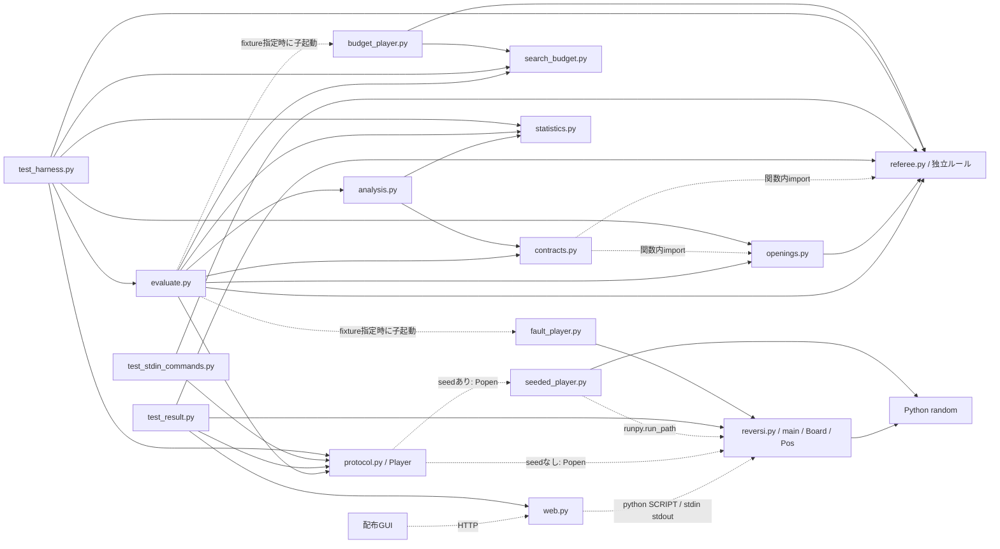
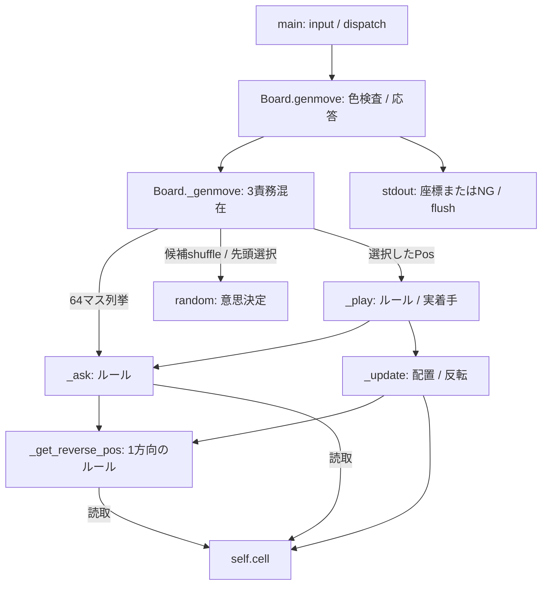
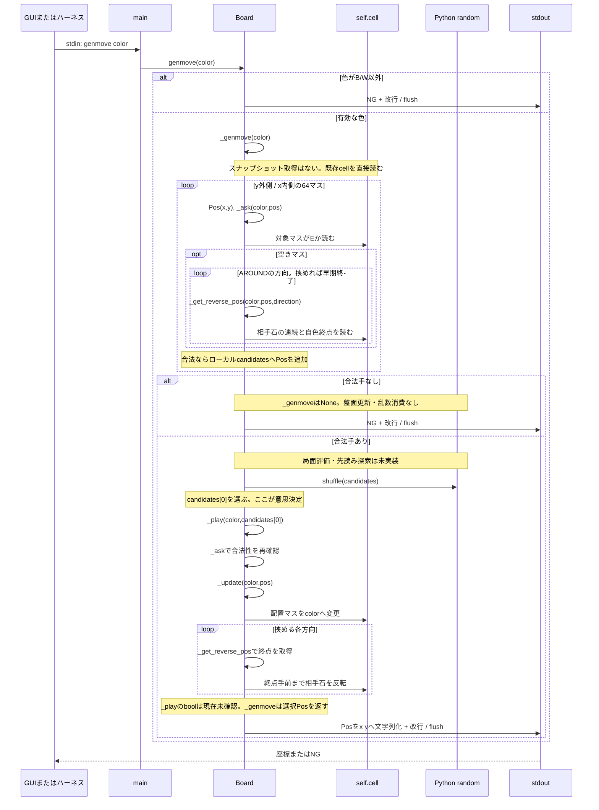
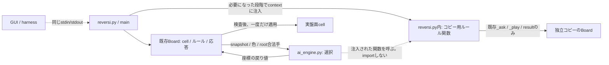
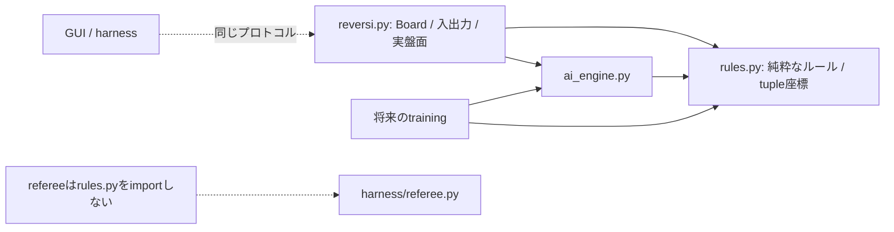
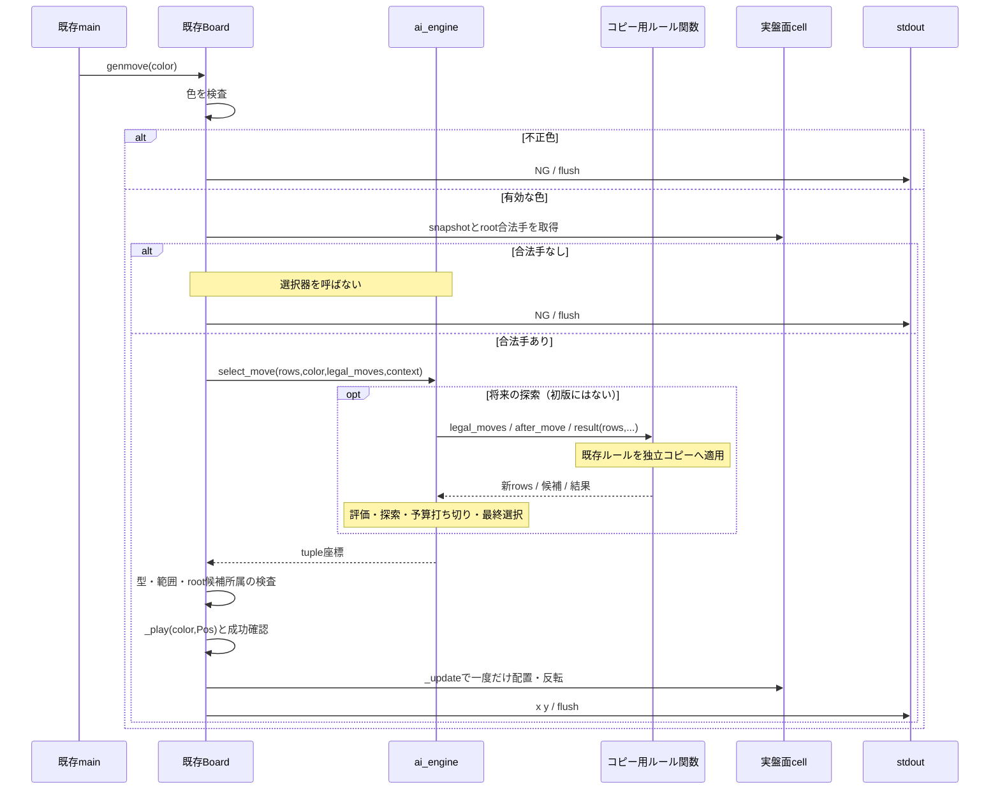

# 着手選択の分離設計案と整合性の確認

> 履歴資料（2026-10-13整理）。本文の「現行」「未実装」、節番号・行番号、実行結果は記録当時のものです。今の作業指示には使わず、[操作手順](../ハーネス.md)、[現行契約](../harness_contracts.md)、[現行構造](../harness_architecture.md)、[AI分離の設計案](../リバーシAI分離設計.md)を優先してください。

検討日: 2026-10-09。対象は HEAD `1b934293ec66f1174f7f6dfbc47de5bbf66f34d1` と未コミット変更を含む現在の作業ツリー。

この資料は未実装の設計案である。今回変更するのはこの文書だけで、本体・GUI・ハーネス・テストのコードを変更しない。

## 1. 結論と設計の境界

第一推奨は、まず `Board._genmove()` の「合法手から一手を選ぶ処理」だけを `reversi_player/ai/random_policy.py` へ移し、後から探索型・学習型の選択器に差し替える構成である。実盤面を更新する処理は本体側に残す。

授業資料の2〜3機能群という方針に合わせ、最終的な責務は「コマンド入出力」「盤面とルール」「着手選択」の3つにする。機能群の数とファイル数は同じである必要はない。最初の分離時点では、入出力とルールは現在の `reversi.py` に同居してよい。

外部の入口は従来の `python reversi_player/reversi.py` を維持する。ハーネスとGUIは今後も同じ標準入出力を使い、内部の選択器のクラスや関数を知らなくてよい。

関連資料:

- [プログラム開発方法.md](../プログラム開発方法.md): 外部仕様と機能分割の正本。
- [開発計画.md](../開発計画.md) / [強化方針.md](../強化方針.md): ランダム版から探索・自己対戦学習へ進む方針。
- [ハーネス.md](../ハーネス.md): 実行方法と評価条件。
- [harness_contracts.md](../harness_contracts.md) / [harness_architecture.md](../harness_architecture.md): 現在の契約と既知の不整合。本案では既知の問題を解決済みと扱わない。

## 2. 現在の処理と分離箇所

現在の `reversi.py` の責務は次のとおり。

| 場所 | 現在の責務 | 最初の分離での扱い |
| --- | --- | --- |
| `main()` | コマンドの解析と呼び出し、name/resultの出力 | 維持する |
| `Board.genmove()` | 色の確認、`_genmove()` 呼び出し、座標またはNGの出力 | 出力とflushを維持する |
| `Board._genmove()` | 合法手の列挙、shuffle、一手の選択、着手、座標の返却 | shuffleと選択を外へ委譲する |
| `_ask()` / `_get_reverse_pos()` | 合法性と反転範囲の判定 | 本体側に残す |
| `_play()` / `_update()` | 実盤面への配置と反転 | 本体側に残す |
| `result()` / `_has_legal_move()` | 両色の合法手と終局・勝敗の判定 | 判定と戻り値を維持する |

`_genmove()` 全体をAIへ移す案は採用しない。現在の `_genmove()` は手の選択だけでなく実盤面の更新も含むので、そのまま移すと「AIが選ぶ」「本体が置く」という契約と矛盾する。

## 3. ファイル構成の案

最初の分離で必要になる構成。以下の新規Pythonファイルは今回作成していない。

```text
reversi_player/
  reversi.py            # 既存入口、Board/Pos、ルール、応答、一手の確定
  ai/
    __init__.py        # パッケージ宣言。重い処理や再exportは置かない
    random_policy.py   # ランダムな合法手の選択だけ
  web.py               # 従来のGUI接続
```

探索・学習を進める段階の構成例:

```text
reversi_player/
  reversi.py            # 既存入口と互換用Board、選択器の組み立て
  board.py              # Posと入出力を持たない盤面・ルール
  ai/
    __init__.py
    random_policy.py
    search.py            # 一手評価・αβ探索
    heuristic.py         # 手作業の局面評価
    ntuple.py            # 学習済み価値モデルの推論
  models/                # 対戦時に使う固定モデルとmanifest
training/                # 自己対戦・重み更新・学習ログ
baselines/
  random_v1/             # 分離前のランダム版を独立保存
  search_v1/             # 検証した探索版を依存資産ごと独立保存
harness/                 # 外部プロセスの検証・評価
```

`強化方針.md` の `ai/search.py` 等は役割の提案であり、本案では対戦プログラムの配布・独立起動を容易にするため `reversi_player/ai/` に具体化する。実装へ進めるときに同資料のパス表記を合わせる。学習コードは対戦時にimportせず、学習済み重みの更新も対戦プロセスでは行わない。

## 4. 最初の着手選択インターフェース

選択器の呼び出しを `select_move(rows, color, legal_moves) -> (x, y)` とする。これは署名の設計案であり、実装コードではない。

| 要素 | 契約 |
| --- | --- |
| `rows` | 現在の盤面の独立したスナップショット。8文字の文字列8個からなるtuple。参照共有する二次元リストを渡さない |
| `color` | 今回のコマンドが指定した `B` または `W`。選択対象の色であり、固定の担当色ではない |
| `legal_moves` | `(x, y)` のtupleを格納した空でないtuple。列挙順は現在と同じy外側・x内側 |
| 戻り値 | 要素が整数2個のtupleで、必ず `legal_moves` の要素。boolを座標の整数として受理しない |
| 副作用 | 渡された盤面と候補を変更せず、標準入出力を操作せず、実盤面へ着手しない |

戻り値は `Pos` にしない。既存の `Pos` は可変であり、AIが `reversi.py` からimportすると `reversi -> ai -> reversi` の循環や、スクリプト起動時とpackage import時の二重ロードを誘発する。tuple座標を本体で `Pos` へ変換する。

合法手がない場合は本体で処理し、選択器を呼ばない。`None` を「選択失敗」「パス」「時間切れ」の共通値にしない。非空の合法手に対して `None` が返ったら内部契約違反である。既存の `_genmove()` が `None` を返す意味は「合法手がない」に限定する。

`Board()` は従来どおり無引数で作れ、既定ではランダム選択器を使う。検証や将来のAI差し替えのため、任意の選択器を渡せる構築方法を追加する案とする。通常コマンドで色を確認した後に、同じ選択器へ局面と指定色を渡す。

初版はtuple座標だけの戻り値で足りる。探索予算や計測値を追加する段階では、要求contextと選択結果の契約を明示的に拡張し、全呼び出し側とテストを同時に更新する。「署名を永久に変更しない」ことは約束しない。公開stdin/stdoutの互換性は維持する。

## 5. genmoveの責任と処理順

本体は次の順で処理する。

1. 指定色を検査する。
2. 現在の盤面から合法手を列挙する。
3. 合法手がなければ盤面と乱数状態を変えず、既存どおりNGを返す。
4. 盤面スナップショットと合法手を選択器へ渡す。
5. 戻り値の型、範囲、候補への所属を確認する。
6. `_play()` で合法性を再確認し、実盤面へ一度だけ配置・反転する。成功したことを確認する。
7. 確定した座標を既存の出力経路へ返し、1行の応答をflushする。

選択器は探索用のコピーへ何手進めてもよいが、実盤面へは書き込めない。選択器の戻り値が不正なら確定処理の前に停止する。初版の契約違反はstderrへ理由を出して非ゼロ終了させる案とし、合法手があるのにNGを返したり、黙ってランダム手へ変更したりしない。ハーネスは異常終了を対局失敗として記録できる。

将来の正常な探索打ち切りは例外的な選択失敗と区別する。探索開始時に合法な代替手を確保し、予算で打ち切ったときも最後に完了した探索結果か代替手を返す。これは要求したモデルが読み込めず別AIに切り替わるフォールバックとは別の事象である。

## 6. 盤面・ルールを再利用する次段階

ランダム分離後、探索と学習が同じルールを使うために `board.py` へ入出力のない盤面クラスを切り出す。名前の案は `BoardState` とする。

| 盤面API案 | 入出力と意味 |
| --- | --- |
| `from_rows(rows)` | 盤面を検証し、独立した内部配列を持つ状態を生成する |
| `to_rows()` | immutableな8行スナップショットを返す |
| `legal_moves(color)` | 共通の合法手判定から候補を返す |
| `apply_move(color, position)` | この状態だけを更新し、成功可否を返す。不正手では変更しない |
| `after_move(color, position)` | 独立コピーへ着手した新状態を返す。不正手は明示的なエラー |
| `result()` | 既存の終局・勝敗の意味を保ち、文字列を返す |

`ask`・`play`・`genmove`・`showboard` の応答出力は `reversi.py` の互換用 `Board` に残す。`Board` は盤面クラスを保持して委譲する構成を第一案とする。`Board.cell` の読み書き、`Board.result()`、`_has_legal_move()` 等の既存テストの入口を維持し、盤面を二重に保持しない。`cell` の置き換えも保持している同一盤面へ反映する。

依存方向は `reversi -> board`、`reversi -> ai`、`ai -> board`、`training -> board/ai` とする。`board -> ai/reversi/training` と、対戦本体からの `harness` importは作らない。

`harness/referee.py` は独立した正解判定として維持する。本体・探索・学習でルールを共有しても、ハーネスの正解判定とは実装を共有しない。比較用fixtureがrefereeを利用していることは、実AIも同じ依存にしてよい根拠にならない。

盤面クラスには自動交代する手番を持たせない。現在の外部APIは指定された色を受け入れ、同じプロセスへ両色のコマンドや固定序盤のplayが来る。探索・学習では別途「盤面＋次の手番」を状態として扱う。パスでは盤面を変えず手番のみ交代し、両色に合法手がなければ終局にする。

## 7. 起こりうる矛盾と対策

| 矛盾・破綻条件 | 起こる問題 | 分離時の対策と確認 |
| --- | --- | --- |
| AIも本体も着手する | 二重着手、余分な反転、相手との盤面不一致 | 選択器は座標だけを返し、確定は本体だけ。選択前後の実盤面不変と一回の更新を試験 |
| AIへ実盤面の浅いコピーを渡す | 探索中に行配列を共有し、実盤面を書き換える | 入力はtupleの文字列、探索状態は独立コピー。コピー間の干渉を試験 |
| AIが独自の合法手判定を実装する | play/askでは合法、AIでは不合法等の食い違い | 本体内は共通ルールを使用。新しい高速表現は共通盤面と独立refereeの両方と照合 |
| 内部手番を自動交代する | 固定序盤、GUIのパス再生、両色の問い合わせが不整合 | コマンド指定色を基準にし、探索・学習の手番は別の状態にする |
| パスと選択失敗が同じNoneになる | 合法手があるのにNG。ハーネスはillegal_moveとして失敗 | 候補なしだけがパス。非空候補での不正戻り値は契約違反 |
| 無効なモデルを黙ってランダムへ戻す | 対局は完走しても、別AIの強さを学習モデルの成果と誤認 | 評価時は失敗を隠さない。運用用フォールバックは将来別方針で記録し、採用評価では0回を要求 |
| shuffleをchoiceへ変更する | 分布が似ていても同seedの乱数消費と棋譜が変わる | 分離だけの段階では候補順とshuffle・先頭選択をそのまま維持 |
| 新しいrandom.Random()やimport時seedを使う | seeded_playerの固定seedが選択器に効かない | 初版は既存のmodule-level randomを使用。独立乱数源はseed契約を拡張する段階で導入 |
| 追加モジュールがimport時に乱数を消費する | 初手前に乱数列がずれる | import・構築・モデルloadは乱数を消費しない。初版の非着手コマンドでも消費しない |
| pythonスクリプトとpackage importの方式が混ざる | ハーネスでは起動、pytestではImportError等 | `__package__` に応じて相対import/スクリプト隣接importを明示的に使い分ける。広いImportError捕捉で隠さない |
| モデルパスがcwd基準 | GUI・ハーネス・別ディレクトリ起動で参照先が変わる | 同梱資産は `__file__` 基準。外部指定は入口で絶対パスへ解決し実ファイルを記録 |
| 本体だけをbaselineへコピーする | 候補の最新ai/boardを相手も読み、固定相手が変わる | baselineは自身のディレクトリ内のコード・設定・資産で独立起動 |
| 追加ファイルをassetとして登録しない | 同じ入口hashのまま選択器や重みが変化する | A/Bそれぞれ、実行に影響する追加コード・設定・重みをすべて明示登録 |
| AIがstdoutへログを出す | 応答行ずれ、showboard8行の破壊 | stdoutは既存応答だけ。正常な初版はstderrも空の既存テストを維持 |
| モデルを毎コマンド読み直す | 通常コマンドの1秒や初回genmoveの10秒を超える | プロセス内で一度load。初回loadをどこへ計上するか明示し、コールド起動も測定 |
| GUIのdepth/temperatureがAIへ届くと仮定する | 画面設定と実際の探索条件が食い違う | 現web.pyは両値を使わない。分離時に受理済みと報告せず、設定接続は別変更にする |
| 黒視点の価値を白も最大化する | 白の選択と学習・探索の符号が逆になる | 強化方針の価値・手番定義を維持し、白の最小化やNegamaxへの変換を試験 |

ハーネスは `genmove` 側が盤面更新済みである前提で、相手だけに `play` を送る。この前提を変えないことが二重更新防止の中心である。

## 8. ブラックボックス検証と予算証跡の区別

### 8.1 分離だけで維持するもの

7コマンドの応答形式、改行、flush、盤面更新、パス、終局と既存の入口パスを維持する。課題上限は仕様の正本に従う。ハーネスは通常1秒、genmove10秒、初回nameは別の起動上限で測る。初回nameの5秒待機は、課題仕様の通常コマンド1秒を緩和する許可ではない。

初版で追加するAIファイルは標準ライブラリだけで起動し、モデルloadを導入しない。ハーネスはscript.parentをcwdにして起動し、seed指定時はseeded_playerがscript.parentをsys.pathの先頭へ置く。GUIは直接スクリプト起動する。これらに加えて、pytestによる `from reversi_player.reversi import Board, Pos` も確認する。

既存のstdinテストはgenmoveを合法手集合への所属で確認し、一つのランダム座標を唯一の正解にしていない。固定終局の試験は独立生成した棋譜をplayで再生するため、AIの選択方式が変わっても使える。

分離の回帰試験では、保存した旧ランダム版と新ランダム版を同じPython、seed、相手、コマンド列で比較する。応答と棋譜は一致を要求するが、処理時間の完全一致は要求しない。AIを賢くする次段階では棋譜の変化は正常なので、その一致条件を仕様合否へ混ぜない。

### 8.2 追加ファイルの資産登録

現ハーネスは追加importや重みを自動列挙しない。初版は最低でも `ai/__init__.py` と `ai/random_policy.py` を `--a-asset` / `--b-asset` へ登録する。後でboard・探索・評価・設定・モデルを追加したら同様に追加し、登録順も固定する。ディレクトリ名だけでは現 `_file_info()` のファイルhash取得を満たさないため、個々のファイルを指定する。

候補Aのコード・資産変更は改良として許容されるが、固定相手Bのコード・資産変更は比較条件の変更になる。候補とbaselineの共通モジュールをまとめて更新しない。資産登録方法やハーネスを変更した場合は、新しい条件で変更前後を取り直し、旧記録を同条件とみなさない。

### 8.3 探索・学習導入後のtrace

分離だけでは現在の予算trace未対応を解消しない。通信・盤面検証の成功と、confirmatory/deploymentの予算検証成功は別である。実AIは現状、予算状態unknownであり、模擬fixtureの成功で代用しない。

将来の探索選択器には、要求予算、実効設定、モデル識別、ノード・深さ、終了理由を渡して返す契約を追加する。環境変数の読取とtrace出力は入口側のアダプターに置き、ルールクラスと学習用の推論APIを評価プロセスのI/Oへ依存させない。

現trace v2との対応で特に注意する点:

- `REVERSI_EVAL_CONFIG`、`REVERSI_EVAL_TRACE`、`REVERSI_EVAL_TRACE_CONTEXT` の役割を区別し、要求と実効設定を照合する。明示的な正規化済みv2設定を使う。
- `board_sha256` はgenmove要求前の盤面。8行を改行で連結したASCIIのSHA-256で、末尾改行やJSON化を付けない。
- sequenceは0始まりで各genmoveごとに増やし、通常着手・パス・終局後の問い合わせすべてにイベントを出す。パス判定は「指定色の候補なし」、終局判定は「両色の候補なし」で分ける。
- 現ハーネスの決定性probeはgenmove前のshowboardを送らず、trace存在/hashと応答を確認する。通常対局のtrace照合は事前showboardを使う。AIはshowboardが呼ばれた場合だけ内部snapshotを更新する実装にしない。
- headerと各イベントのmodel_idとfallbackを一致させる。現検査はfallbackを拒否するため、遅延loadや途中のモデル切り替えを入れるならheader契約との整合を先に設計する。
- 内部探索時間と外部応答時間を分ける。load、候補列挙、推論、trace書込、盤面確定のどこを計測するか決める。内部上限だけを守っても外部10秒以内の保証にはならない。
- nodes/depthの計数定義と同点処理を固定し、実AIで試験する。自己申告traceだけで内部計数の真実性を保証しない。

## 9. 現ハーネス側の既知の不整合との関係

既存監査資料のA01〜A16を本案へ照合した。以下はコード確認とも整合するが、今回は修正していない。

| 問題 | 本案への影響と扱い |
| --- | --- |
| A01: 保存母集合と報告側Nの照合不足 | 正式な強さの区間推定へ進む前に対処。ランダム選択器の分離だけで統計の健全性を保証しない |
| A02: raw trace再読込の内容再検証不足 | 保存報告のverifiedを無条件に再利用しない。正式評価の前提として対処 |
| A03/A04: none予算の許可判定、時計・scope・モデルの意味照合不足 | 不十分なtraceがverifiedになり得る。分離後のAIが予算遵守したという根拠に使わない |
| A05: 正式統計不可でも終了コード0になり得る | CLIの0だけで合格としない。protocol・budget・statisticsの状態と理由を読む |
| A06: 初期盤面4局以上の取得と報告検査の不整合 | 初版回帰は2局スモークと別の直接棋譜照合を使う。正式評価は修正後の契約か固定序盤方式で確認する |
| A07: config省略時のv1/v2とhash不整合 | 現ランダム版はtraceを出さない。trace対応を試験するときは明示的なv2設定を使い、default経路は別途修正する |
| A10: seeded_playerが評価fingerprintに未登録 | seedアダプターを分離作業中に変更しない。正式な再現性・比較の証跡整備では登録を検討 |
| A16: GUI設定の未接続 | AIの選択器を置いただけではGUI設定は有効にならない |

既存テストがすべて成功することと、これらの問題が解消していることは同義ではない。分離作業では既存ハーネスの期待値を緩めず、正式な性能採用判断へ進む前に関連する監査項目を閉じる。

## 10. 将来の実装順と受け入れ条件

### 段階A: ランダム選択だけの分離

1. 現ランダム版を独立起動できるbaselineとして保存し、変更前の仕様検証・棋譜を取得する。
2. 選択器を追加し、既存のshuffleと乱数源・消費順を維持して委譲する。
3. 非空候補での戻り値検証、合法手なしでの非呼出、実盤面不変を内部契約試験で確認する。
4. CLI、seed付きハーネス、GUI、package import、別cwd起動の全経路を確認する。
5. 資産を登録して旧版と同条件の応答・棋譜を照合し、先後交換2局のスモーク対局で盤面同期と終局を確認する。

受け入れ条件は全既存テスト成功、同条件でのランダム棋譜一致、余計なstdoutなし、制限時間遵守、追加資産の登録である。新規選択器への不正戻り値注入は内部契約テスト、最終の盤面・応答の検証は外部プロセスのブラックボックステストに分ける。

### 段階B: 盤面の入出力分離と探索

`board.py` の共通盤面へ移し、互換Boardの入口と既存テストを維持する。合法手・反転・終局・コピーを固定局面と独立refereeで確認する。Boardの印字メソッドを探索から呼ばない。探索のパス、深さ、符号、予算打ち切りを検証し、計測とtraceは別の受け入れ条件として加える。

### 段階C: 学習済み価値モデルへの差し替え

探索の局面評価を固定重みの推論へ差し替える。合法手と実盤面の確定経路は段階A/Bの契約を使う。重み・設定・推論コードを資産登録し、固定モデル・固定相手・先後交換で評価する。黒視点、白の選択、パスを含む手番、モデル欠落・破損、初回loadの時間、フォールバックの検出を確認する。

## 11. 今回行った確認と限界

- 既存本体、GUI、seed付き起動、外部通信、対局同期、資産hash、trace v2、既存テストと監査資料を読み、上記の責務・入力・出力・副作用・依存方向を照合した。
- サンドボックス内のpytestはPython実体のパス解決警告と一時ディレクトリ権限に関するエラーを含み失敗した。通常環境で同じ現行コードを再実行した結果、`python -B -m pytest -p no:cacheprovider -q --tb=short` は **86 passed / 62.71秒** だった。
- 分離後のコード、選択器契約テスト、旧新版の棋譜一致試験、実AIの予算対応・強さの評価は未実装・未実行である。
- 今回のテスト成功は現行の開始基準であり、提案構成の動作保証や既知の監査問題の解消を意味しない。

---

## 2026-10-13整理前の全文保存

以下は混在資料を整理する直前の全文を保存した履歴です。参照パスと見出しの階層だけを移動先に合わせ、当時の提案・失敗・成功・版・行番号は履歴として保持しています。現行の作業指示ではありません。

<a id="snapshot-ai-separation"></a>

### 整理前の `リバーシAI分離設計.md`

### リバーシAI分離設計

調査・設計日: 2026-10-10。状態: **設計案。AI分離は未実装**。

#### 1. 結論、調査範囲、判断の根拠

第一推奨は **`reversi_player/ai_engine.py` を1ファイルだけ追加し、着手の意思決定を委譲する案A** である。盤面、合法手判定、反転、終局判定、標準入出力は `reversi.py` に残す。AIへ渡すのは変更できない盤面と合法手であり、AIが返した座標を本体が検査して一度だけ適用する。

現在のAIは、合法手リストを `random.shuffle()` して先頭を選ぶ処理だけである。局面評価、探索アルゴリズム、学習モデル、置換表、内部探索予算は存在しない。それらを現状図に実装済みとして描かない。

探索が必要になっても、既存ルールを呼ぶ「スナップショット入力・スナップショット出力の関数」を本体からAIへ渡せば、AIから本体をimportせずに再利用できる。ルールや盤面を別ファイルへ移す案Bは、その接続が複雑になった場合の次の選択肢とする。

##### 1.1 調査対象

| 対象 | 確認した内容 |
| --- | --- |
| [AGENTS.md](../../AGENTS.md) | 資料の役割、独立ハーネス、未コミット変更の保護、契約と図の整合 |
| [reversi.py](../../reversi_player/reversi.py) / [web.py](../../reversi_player/web.py) | 全クラス・関数、盤面・乱数の副作用、起動とコマンド経路 |
| `harness/` の10モジュール | 通信、seed、独立判定、固定序盤、予算trace、報告検証、比較・統計の関連経路 |
| `tests/` の3テストモジュールと2fixture | stdin、盤面・反転・終局、GUI接続、異常、再現性、予算・保存・比較の試験 |
| [プログラム開発方法.md](../プログラム開発方法.md) | コマンド、盤面更新、色・座標、処理期限、機能群の分割 |
| [開発計画.md](../開発計画.md) / [強化方針.md](../強化方針.md) | ランダム→探索→自己対戦学習、黒視点価値、予算・固定相手 |
| [ハーネス.md](../ハーネス.md) / [ハーネス拡張計画.md](ハーネス拡張計画.md) | 現行CLIと契約、正式評価と時間評価の区別、未実装の修正計画 |
| [現状アーキテクチャ](../harness_architecture.md) / [契約定義](../harness_contracts.md) | 現行図・監査A01〜A16とコードの照合 |
| [前回の分離案](move_selection_design.md) | AIパッケージ・盤面切り出し案との差分 |

対象HEADは `1b934293ec66f1174f7f6dfbc47de5bbf66f34d1`。未コミットのハーネス拡張があるため、HEADだけではなく実際の作業ツリーを調査した。「コード確認」「今回の実行確認」「将来の提案」を区別する。既存資料の診断結果は今回再実行した診断とは扱わない。

今回はこの文書だけを作成する。Python本体、GUI、ハーネス、テスト、既存設計資料は変更しない。

#### 2. As-Is: 構造と責務一覧

##### 2.1 指定された9分類

| 分類 | 実装箇所・現状 |
| --- | --- |
| 1. 標準入出力・コマンド | `main()` がinput/解析/dispatch、Boardのask/play/genmove/showboardが出力。resultは値を返しmainが出力 |
| 2. 盤面の状態管理 | `Board.__init__()`、可変二次元配列 `cell[y][x]`。手番・棋譜・担当色を保持しない |
| 3. 合法手判定・反転 | `_ask()`、`_get_reverse_pos()`、`_play()`、`_update()`、方向定数AROUND |
| 4. 終局・勝敗 | `result()` と `_has_legal_move()`。両色に合法手がなければ石数比較 |
| 5. AIによる着手評価 | **未実装**。盤面や候補に点数を付けない |
| 6. 探索アルゴリズム | **未実装**。合法手の64マス走査はルール上の列挙でありMinimax等の探索ではない |
| 7. 着手選択 | `_genmove()` のshuffleと `candidates[0]` |
| 8. AI固有のキャッシュ・乱数・時間 | module-level randomの状態を消費する。キャッシュ・内部時間制御なし。seedは外部seeded_player、期限は外部Player |
| 9. その他 | Posの座標演算・文字列化、GUIのHTTP/JSON変換、評価用の保存・統計。これらはAI思考ではない |

**責務が混在する箇所**: `_genmove()` は「合法手列挙」「乱数による意思決定」「実盤面更新」を一つに含む。`genmove()` は入力検査・意思決定への接続・出力を含む。`ask()` と `play()` はルール呼び出しと応答出力を含む。`Board` 全体は盤面/ルール/応答/AIを保持する。この混在を理由に全クラスを一度に分割せず、まず意思決定の境界だけを設ける。

##### 2.2 reversi.pyの全関数・主要クラス

以下はすべて `reversi_player/reversi.py`。戻り値と標準出力を別記する。「変更なし」はオブジェクトの状態が変わらない意味で、ローカル変数の変更は含めない。

| 関数・クラス | 責務 / 入力→出力 | 参照する状態 | 変更する状態・副作用 | 呼び出し先 | AI固有か |
| --- | --- | --- | --- | --- | --- |
| `Pos` | 座標/方向の可変値オブジェクト | x、y | 作成時のみ設定。外部から属性変更可能 | 下記メソッド | いいえ |
| `Pos.__init__(x,y)` | 座標設定→戻り値None | 引数 | self.x/self.y | なし | いいえ |
| `Pos.is_valid()` | 0〜7の範囲判定→bool | self.x/self.y | なし | なし | いいえ |
| `Pos.add(p)` | 座標加算→新Pos | selfとpのx/y | 既存座標は不変 | Pos | いいえ |
| `Pos.__add__(p)` | 演算子による加算→新Pos | selfとpのx/y | 既存座標は不変 | Pos | いいえ |
| `Pos.__eq__(p)` | 座標の同値→bool | selfとpのx/y | なし | なし | いいえ |
| `Pos.__str__()` | 座標→`x y`文字列 | self.x/self.y | なし | format | いいえ |
| `Board` | 盤面・ルール・応答・ランダム選択の集合 | self.cell、AROUND、random | 着手でcell、選択で乱数状態 | 下記メソッド | 混在 |
| `Board.__init__()` | 初期盤面生成→None | 初期配置定数 | self.cellを新規作成 | なし | いいえ |
| `Board.ask(color,pos)` | 色/座標検査と合法性問い合わせ→None、stdout OK/NG | cell、pos | stdoutのみ | pos.is_valid、_ask、print | いいえ |
| `Board.play(color,pos)` | 検査と着手→None、stdout OK/NG | cell、pos | 成功時cell、stdout | pos.is_valid、_play、print | いいえ |
| `Board.genmove(color)` | 色検査・自動着手・応答→None、stdout座標/NG | cell、random | cell、乱数状態、stdout | _genmove、Pos.__str__、print | 混在した接続処理 |
| `Board.showboard()` | 現盤面出力→None、stdout8行 | cell | stdoutのみ | Board.__str__、print | いいえ |
| `Board.result()` | 継続/終局勝敗→NG/B/W/D | cell | なし、出力もしない | _has_legal_move、row.count、sum | いいえ |
| `Board._get_reverse_pos(color,pos,direction)` | 一方向の挟める終点→Pos/None | cell、座標、方向 | なし | Pos.__add__、is_valid | いいえ |
| `Board._play(color,pos)` | 再確認して配置・反転→bool | cell | 合法時cell | _ask、_update | いいえ |
| `Board._ask(color,pos)` | 空きと8方向の挟み判定→bool | cell、AROUND | なし | _get_reverse_pos | いいえ |
| `Board._has_legal_move(color)` | 64マス走査、最初の合法手で終了→bool | cell | なし | Pos、_ask | いいえ |
| `Board._update(color,pos)` | 置ける前提で石配置と反転→None | cell、AROUND | cellを直接更新 | _get_reverse_pos、Pos.__add__、__eq__ | いいえ |
| `Board._genmove(color)` | 候補列挙→shuffle→着手→Pos/None | cell、AROUND、random | 候補配列、randomの状態、cell | Pos、_ask、random.shuffle、_play | 選択のみAI固有。他は混在 |
| `Board.__str__()` | cell→改行連結8行文字列 | cell | なし | join | いいえ |
| `main()` | 1行入力/解析/dispatch、quitでreturn | ローカルboard、stdin | board.cell、stdout、選択時乱数 | input/split/int、Board/Pos、公開Boardメソッド、print | いいえ |

内部 `_ask()` / `_play()` は有効な色・盤面内座標を前提とする。公開ask/playの検査を省いてAIの不正座標を渡すと、負のindexによる別マス参照や例外になり得る。

`_genmove()` は `_play()` のboolを現在確認していない。現状は直前に生成した合法手で単一スレッドの盤面を更新するため通常成功するが、外部選択器を導入した後は同じ暗黙前提を使わない。

##### 2.3 web.pyの主要関数

以下はすべて `reversi_player/web.py`。GUI側の出力はサーバのログであり、子プレイヤーのプロトコルstdoutとは別である。

| 関数 | 責務 / 入力→出力 | 参照する状態 | 変更する状態・副作用 | 呼び出し先 | AI固有か |
| --- | --- | --- | --- | --- | --- |
| `Process.__init__()` | python SCRIPT起動→Process | SCRIPT | self.proc、OS子プロセス/pipe | subprocess.Popen | いいえ |
| `Process.command(command,lines=1)` | 送信し指定行数取得→文字列 | self.proc | stdin/flush、stdout読取、サーバログ | write/flush/readline/print | いいえ |
| `Process.__enter__()` | with入口→self | self | なし | なし | いいえ |
| `Process.__exit__(...)` | quit送信、5秒wait、失敗時kill→None | self.proc | 子プロセス終了 | write/flush/wait/kill | いいえ |
| `RequestHandler.__init__(...)` | 静的ファイルhandler初期化 | STATIC_DIR | HTTP handler | super().__init__ | いいえ |
| `do_POST()` | pathとJSONを解釈→HTTP JSON/500 | HTTP入力、self.path | HTTP応答、サーバログ | _play/_genmove、json、send_response | いいえ |
| `_play(req)` | 要求履歴を再生し応答作成→dict | req.positions | 一時子プロセス盤面 | Process、_make_board、_make_response | いいえ |
| `_genmove(req)` | 履歴再生、自動着手、履歴追加→dict | req.positions | req.positionsと子盤面 | Process、_make_board、_next_color、command、_make_response | AIの通信接続。思考ではない |
| `_next_color(index)` | 手数index→B/W | index | なし | なし | いいえ |
| `_make_board(proc,req)` | 非パス履歴をplayで再生→None | req.positions | 子盤面 | _next_color、Process.command | いいえ |
| `_make_response(proc,req)` | 盤面/合法手/結果→GUI dict | 子盤面、req.positions | 読取通信、ログ | command(showboard/ask/result)、_next_color | いいえ |
| `main()` | localhost:8888のHTTPサーバ開始 | RequestHandler | サーバ常駐、ログ | HTTPServer、serve_forever | いいえ |

GUIはHTTP要求ごとに子プレイヤーを新規起動する。パスはGUI履歴の `[-1,-1]` で表し、再生時はplayを送らないが、履歴indexには含める。depth/temperatureはPython側で利用されていない。通信には通常応答の明示的timeoutがなく、既存テストの `BoundedWebProcess` が試験用に付けている。

##### 2.4 ハーネス・テストの境界に関係する主要関数

| 関数 / 所属 | 責務 / 入力→出力 | 参照する状態 | 変更する状態・副作用 | 呼び出し先 | AI固有か |
| --- | --- | --- | --- | --- | --- |
| `Player.__init__` / protocol.py | script/seed/期限/config→子プロセス | 環境、script path | process/queues/readers、初回name記録 | Popen、seeded_player、_exchange | いいえ |
| `Player.command/_exchange/_validate` / protocol.py | command→応答行list、違反はHarnessError | process、期限、queue | commands、pipe、失敗時停止 | write/flush、queue、regex、abort | いいえ |
| `Player.finish/abort` / protocol.py | quit正常性/停止→None | process/readers | process終了、pipe閉鎖、ログ | wait、taskkill/killpg/kill | いいえ |
| `main` / seeded_player.py | script/seed→対象main実行 | argv、script parent | random、PYTHONHASHSEEDは親設定、sys.path/argv | random.seed、runpy.run_path | AIの乱数を外から制御 |
| `_check_state` / evaluate.py | players/独立rows→一致確認 | 各子盤面、referee | command記録。違反は例外 | showboard/result、referee.result | いいえ |
| `play_game` / evaluate.py | A/B/序盤/seed/config→Game dict | 独立盤面、両process | 着手履歴、盤面同期、trace検査、終了 | Player、referee、validate_trace | いいえ |
| `_verify_determinism` / evaluate.py | 同局面/seed/configの2回起動→probe記録 | 序盤、trace path | 子process、trace artifact | Player、genmove、hash | いいえ |
| `evaluate` / evaluate.py | 全評価条件→v3報告 | sources、設定、母集合、runtime | evidence/checkpoint、対局記録 | openings、contracts、play_game、analysis/statistics | いいえ |
| `compare_reports` / evaluate.py | before/after→比較dict | conditions、B資産、runtime、報告 | 元報告を書換えず比較生成 | validate_report、analysis.paired/comparison_report | いいえ |
| `flipped_cells/legal_moves/apply_move/result` / referee.py | rows/色/座標→反転/候補/新rows/勝敗 | 入力rows | 入力不変。新盤面生成 | 同モジュール関数 | 独立ルール判定 |
| `generate_population/validate_population/select_entries` / openings.py | 条件/母集合→序盤/検証/抽出manifest | 生成・抽出seed、履歴 | 独立Random、ローカル集合。CLIで保存 | referee、validate_entry、hash | いいえ |
| `normalize_config/compatible_budgets` / search_budget.py | config/policy→v2設定/適合bool | 要求設定 | 正規化した新dict | canonical化、exemption関連 | いいえ |
| `validate_trace` / search_budget.py | JSONL/config/commands/ID→予算検証dict | raw trace、事前showboard、設定 | ファイル読取、ローカル検査結果 | _validate_trace、board_sha256 | AI自己申告の検査 |
| `validate_report` / contracts.py | 保存評価dict→エラーlist | 証跡、母集合、game/status | 読取/再生。元報告は変更しない | openings/referee、hash | いいえ |
| `statistical_eligibility/estimate/paired` / analysis.py | 評価dict→資格/推定/前後差 | 保存status、N、profile | 新結果dict | contracts、statistics | いいえ |
| `pair_scores/confidence_interval/paired_difference` / statistics.py | games/N/信頼水準→ペア得点/区間/差 | case/seed/先後/status | ローカル集計 | 同モジュール関数 | いいえ |
| stdin・GUI・harness関連テスト / tests/*.py | fixture/対象process→assert | 固定期待盤面、独立referee | 試験process、一時証跡 | Board、web、Player、evaluate等 | 試験。思考ではない |

budget_playerはルールにrefereeを使う模擬対象、fault_playerは本体Boardを使い故障を注入する対象である。模擬対象での成功は実AIの予算制御の成功を意味しない。

#### 3. As-Is: 現在の依存関係図

##### 3.1 モジュール・プロセスの依存

実線はimport/呼び出し、点線はプロセス・HTTP・runpy・関数内import。標準ライブラリはrandomとrunpy以外省略。これは現在の構成であり、AI専用ファイルはまだない。



WEBはprotocol.Playerを利用しない。本体はharnessをimportしない。refereeは本体をimportしない。seeded_playerと本体は同じ子プロセス内なので、Python randomの固定状態が本体へ引き継がれる。

##### 3.2 reversi.py内部のgenmove関連呼び出し



#### 4. As-Is: genmoveのシーケンス図

呼出元はGUIのProcessまたはharnessのPlayer。Boardは既にそのプロセス内で初期化され、必要なplay履歴も反映されている。



ハーネス側は座標を独立refereeで検査し、相手プロセスだけへplayを送る。その後、双方のshowboard/resultを照合する。着手側へplayをもう一度送る設計に変更すると既存の同期前提を壊す。

#### 5. AIとルールの境界

| 操作 | 担当 | 理由 |
| --- | --- | --- |
| 現盤面の保持、snapshot作成 | 本体Board | 実対局の唯一の盤面 |
| 合法手判定・反転・終局 | 既存ルール | ランダム/探索/学習で意味が変わらない |
| 候補の順序付け、評価、先読み、最終選択 | AIエンジン | 改良・交換の対象 |
| 仮想着手のルール計算 | 本体が提供するコピー用ルール関数 | 探索方式はAI、遷移の正しさはルール |
| 実盤面への最終適用 | 本体 `_play()` | AIの二重更新と仮想着手の漏出を防ぐ |
| 応答・phase判定・評価ログ接続 | 本体の呼出境界 | AIの推論と通信を分離 |
| プロトコル期限、独立盤面照合 | harness.Player/referee | 本体と独立に実測・検査 |

盤面スキャンそのものをAI評価として切り出さない。AIはroot候補を受け取り、その候補を順位付けする。探索中の候補生成も同じルール定義を利用する。

#### 6. To-Be: 最小構成と案の比較

##### 6.1 案A: AI専用モジュール1つを追加（第一推奨）

```text
reversi_player/
  reversi.py      # 既存Board/Pos/ルール/入出力、選択器の呼出と適用
  ai_engine.py    # 新規1ファイル。初版はランダム選択だけ
  web.py         # 既存GUI
```

初版は `ai_engine.select_move()` の関数1つで足りる。ABC、engine factory、plugin registry、新しいAIパッケージは導入しない。将来、モデルやキャッシュの状態が必要になったら同じファイル内の小さなエンジンオブジェクトにする。Boardには任意の選択callableを渡せ、無引数Boardは従来のランダム選択を使う構築案とする。



AIからコピー用関数への点線は実行時の呼び出しで、`ai_engine -> reversi` のimportではない。関数は実盤面に束縛しない。仮想BoardはAIを呼ばず、モデルもロードしない。呼び出しの再帰を作らない。

直接スクリプト起動では隣接 `ai_engine`、package importでは相対 `.ai_engine` を明示的に選ぶ。`__package__` を判定し、広いImportErrorを捕捉してモデル依存の欠落まで隠す方法は使わない。初版AIはPosをimportせずtuple座標を返す。

##### 6.2 案B: 必要になったルール・データの共通化

新規は `ai_engine.py` と `rules.py` の2つを基本とする。rules.pyへ純粋なrows入力の合法手/盤面遷移/終局関数を一度だけ移し、既存Boardは実盤面と出力を持つラッパーとして残す。Posは既存ファイルに残せる。型定義専用ファイルや抽象基底クラスは必須ではない。



この案ではルールの所属ファイルが変わるため、今回の「原則既存の場所へ残す」という条件からは第二候補である。同じ関数を本体と共通ファイルに複製する案にしない。移した内部メソッドは必要な互換委譲で既存テストの入口を維持する。

##### 6.3 比較

| 観点 | 案A: AI単一モジュール | 案B: AI＋共通rules |
| --- | --- | --- |
| 変更範囲 | reversiの選択呼出と検査、AIファイル1つ。探索時にコピー用接続を追加 | 合法手・反転・終局の移動とBoardの委譲も必要 |
| 責務の明確さ | 意思決定は明確。Boardの入出力/ルール混在は残る | AI・純粋ルール・応答の境界が明確 |
| 循環依存 | snapshot＋注入関数ならimport循環なし。AIの逆importは禁止 | 双方がrulesへ依存し循環なし |
| ハーネス互換 | 外部契約を維持しやすい。新資産hash登録は必要 | 外部互換は可能。ルール移動の回帰範囲が広い |
| テスト容易性 | 選択関数とコピー用接続を単独検査可能 | 純粋ルールの直接検査が容易 |
| 学習モデル対応 | 同じ入力で推論を差し替え可能。学習は注入接続でルール再利用 | 学習・複数AIからルールを直接再利用できる |
| 実装の複雑さ | 現状に最小。将来callback境界の説明が必要 | 初期作業は大きいが大規模再利用時は単純 |
| 現在の選択 | **第一推奨** | 接続の重複、速度、複数利用者の問題を確認後に検討 |

tupleの盤面・座標で現在のデータ共有は足りる。複数モジュールに不整合なrequest型が増えたり、同じ検証が重複する段階で、小さな契約データ型の集約を検討する。最初から共通インターフェース専用モジュールを作る根拠はない。

##### 6.4 To-Beのgenmoveシーケンス



不正戻り値では実盤面を更新せず、内部契約違反をstderrに報告して異常終了させる案とする。合法手があるのにNGを返すと、ハーネスではillegal_moveとなる。正常な時間打ち切りは合法な代替手を返す通常動作にする。

#### 7. インターフェース契約

##### 7.1 初版の選択器

概念的な署名: **`select_move(rows, color, legal_moves, *, context=None) -> tuple[int, int] | None`**。この署名は設計を表す記法であり、今回Pythonコードを追加したものではない。

| 項目 | 契約 |
| --- | --- |
| rows | 8文字のB/W/E文字列を8個持つtuple。実cellから新しく生成。行リストを共有しない |
| color | コマンドで指定されたB/W。プロセスに固定の担当色とはしない |
| legal_moves | tuple座標のtuple。根の盤面とcolorに対して完全な合法手集合。順序はy外側/x内側 |
| context | 初版None。将来の予算、決定性、コピー用ルール関数等の要求データ。HTTP handlerやPlayerを渡さない |
| 戻り値 | 非空候補では必ず候補中の整数座標。要素の型は厳密なintでboolを除く |
| None | 空候補でしか許さない。通常本体は空候補で選択器を呼ばず、_genmoveがNoneを返す |
| 禁止副作用 | 実盤面・入力snapshot・候補の変更、stdin読取、stdout応答、実盤面へのplay |
| 例外 | 非空候補でNone、不正座標、モデル故障はパスと区別して契約違反/故障として伝える |

root候補が空であるだけでは終局とは限らない。相手に合法手があればパス、両色に無ければ終局である。外部genmoveのNGには両方が含まれるが、resultとtrace.phaseでは区別する。GUIの `[-1,-1]` はこの関数の戻り値に使わない。

初版random選択は候補をローカルlistへコピーし、**同じ順序でshuffleして先頭を返す**。choiceへの置換、候補のsort/set化、import時の乱数消費、seedし直しを同時に行わない。盤面と色は初版randomでは評価に使わないが、将来の選択器にも同じ入口を提供する。

##### 7.2 仮想着手とコピー用ルール契約（探索導入時）

案Aでは次の接続関数を **reversi.py内** に置き、contextに渡す。AI側からBoard/Posをimportしない。

| 接続関数案 | 入力→出力 | 実装上の制約 |
| --- | --- | --- |
| `_legal_moves_from_rows(rows,color)` | snapshot→tuple合法手 | 独立Boardで既存_askを呼ぶ。stdoutなし |
| `_after_move_from_rows(rows,color,move)` | snapshot/合法座標→新snapshot | 色/範囲確認、全行をコピー、既存_playのbool確認。不合法なら明示エラー |
| `_result_from_rows(rows)` | snapshot→NG/B/W/D | 独立Board.result。実盤面・AI状態を変更しない |

共通のsnapshot→Board生成補助を本体内に1つ置く。全行を `list(row)` として新規作成し、元cellへの浅い参照を使わない。生成するBoardの初期化は盤面と軽い選択callableだけであり、モデルロード・探索・randomの消費を行わない。仮想Boardでgenmoveや公開playを呼ばない。これにより再帰的AI呼出とstdoutの混入を避ける。

関数はmodule内の純粋な接続として定義し、live Boardのbound methodやselfを捕捉したclosureをAIへ渡さない。これは同一プロセス内の設計契約であり、悪意あるPythonコードを隔離するsandboxではない。

探索状態は **rows＋次の手番**。パスはrows不変で手番のみ交代、深さは配置回数としてパスで減らさない案を既存強化方針から引き継ぐ。終局は両色の合法手で判定する。黒視点の価値を使うときは黒が最大化、白が最小化し、Negamaxへの符号変換は探索側で明示する。

##### 7.3 状態、seed、キャッシュ

| 状態 | 所有者 / 扱い |
| --- | --- |
| 実cell | Boardのみ。外部playまたは採用したgenmoveの確定で変更 |
| 仮想rows・探索木 | AI要求内。ルール接続は新snapshotを返す |
| 乱数 | 初版はPython module-level randomを継続利用。seeded_playerによる初期化を継承 |
| モデルと読込済み重み | 将来のAIオブジェクトが1プロセス内で保持。対戦中は不変 |
| ノード計数・深さ・deadline | 各genmove開始時にリセット。履歴の手数やtrace sequenceと混同しない |
| 置換表・推論cache | 初版なし。追加時は寿命、容量、キー、warm/cold条件を明示 |
| trace sequence/要求ID | 本体の評価I/O接続が保持。AIの探索ノード番号ではない |

`PYTHONHASHSEED`だけではPython randomをseedできない。現ハーネスは両方を設定するが、seed数値を専用AI環境変数やargvとして渡す契約は現在ない。新しい `random.Random()` を引数なしで作ると固定seedを失う。独立乱数源を導入するときは初期状態の受渡しまたはseed伝達の契約変更を別途設計し、numpy/GPUも同様に扱う。

同seed再現性は「同じ盤面・設定・コマンド履歴・乱数消費・cache条件・環境」の下で確認する。異なるseedでも必ず別手になるとは要求しない。同点は決定的モードなら候補順を固定して選ぶ。対戦中の追加学習や時刻seedは使用しない。

GUIは要求ごとにcold起動、評価は1局の間processが生きる。この差から、跨ぎcacheの内容で制限時間内の到達深さや着手が変わり得る。最初は要求内cacheを基本にし、processを跨ぐ共有cacheは使わない。永続cacheを採用するときは、rows・手番・モデル/評価版・深さ・境界種別等を正しくキーに含め、cache方針と初期化を比較条件に追加する。

##### 7.4 探索予算と計測の拡張（未実装）

初版randomはbudget未対応のまま。架空のnodes/depthを付けてverifiedにしない。

探索を実装する段階でcontextに、正規化budgetのkindと上限、deterministic宣言、counting_definition_id、コピー用ルール接続を入れる。node/depthは整数、時間はv2の整数ns。deadlineはmonotonicなperf_counter_nsで扱う。configを渡すだけではAIへ上限を強制できない。

拡張contextの項目案を次のように固定する。初版ではこの型を実装しない。拡張時はai_engine.py内の小さなデータ型1つに定義し、同じ値を複数の設定箇所へ複製しない。

| 項目 | 表現と意味 |
| --- | --- |
| `budget` | 正規化v2のbudget。kindと対応するlimit_nodes / limit_depth / limit_nsを持つ |
| `deterministic` | 固定work・同点順・追加乱数源を含む決定性の宣言。timeでは固定着手の保証として使用しない |
| `counting_definition_id` | node計数定義のID。nodeモードで必須、異なる定義間をequal-workとしない |
| `selection_deadline_ns` | 選択計測scopeと同じmonotonic時計の期限。固定work時の安全打ち切りで到達したら正式な完了と偽らない |
| `rules` | 7.2の3関数の組。snapshot入力のstatelessなcallableで、実BoardやPlayerを持たない |

要求contextは選択中に変更しない。観測metricsは別の結果へ返す。アルゴリズム・モデル・cache方針はエンジンの構築設定に置き、要求と実効設定を本体の評価接続で照合する。対応しない必須budgetや矛盾する設定は黙って無視せず、評価を失敗として扱う。

計数定義の初期案は「探索再帰に入る局面をroot・葉・パス局面も含めて1回ごとに計数、root候補の事前生成は含めない」。反復深化では再訪も再計数し、上限に達したら次の局面へ入らない。cache命中を含めるかもこの定義に固定する。深さは石の配置数で、開始した最大深さと完了した深さを別記録する。これは未実装の定義候補であり、採用時にIDと契約試験で確定する。

内部選択時間のscopeは比較相手とも統一する。推奨はroot合法手生成から選択完了までを測り、コピー用ルール処理・推論・同点処理を含める。盤面確定・JSONL書込・stdout送信は外部応答時間側に含まれる。モデルロードは別のload時間を記録し、初回要求内に発生した場合は外部時間から除外しない。fixtureのscopeは `search_only` という宣言で、計測コードには盤面適用も含まれるため、そのまま実AIの定義に転用しない。

期限は外部10秒より十分短く設け、完了した探索の手を保持する。ただしOS・推論ライブラリの停止不能区間があるので、単にdeadlineを見れば全応答を保証できるとはしない。安全余裕は実測で決める。固定node/depthモードでも外部期限は残り、超過は失敗にする。

時間モードは同seedでもOS負荷等で完了深さ・手が変わり得る。固定workの決定的モードと別の実験として扱い、時間モードに有限固定得点の正式区間を適用しない。

traceを加える段階では、戻り値をmoveだけから `SelectionResult(move, metrics)` 相当へ拡張する案とする。metricsはnodes、開始/完了深さ、stop_reason、内部時間、モデルID等を持つ。小さなデータ型はai_engine.py内に置ける。全callable/呼出側/テストを同時に更新し、標準入出力は維持する。複数実装が共有する段階まで新しい契約専用ファイルは作らない。

##### 7.5 モデルload・推論・エンジン交換

将来は同じ呼出契約のエンジンオブジェクトをmainで一度生成し、Boardへ注入する。初版関数と同じく、エンジンはrows/色/合法手からmoveを返す。本体のask/play/resultはモデルが不要であり、Boardのコピー生成やモジュールimportで重いモデルをロードしない。

モデルは `__file__` 基準の同梱パス、または入口で解決した絶対パスから読む。保存形式、入力符号、座標順、出力価値視点、モデル版/hashを確認し、合法手だけに推論を適用する。オンライン学習・重み更新はtraining側へ置く。

モデルloadの初期案は初回の有効genmoveで1回のみ行う。ただし現trace v2はheaderと全イベントのmodel_idを一致させる必要がある。trace有効時は最初のgenmoveのload完了後、全体headerを先に確定してからそのイベントを書く案とする。最初のgenmoveがパスの場合も、headerのモデルIDを確定する方法とload費用を決める。起動時loadへ変更する場合は初回name応答時間も改めて測る。どちらも実測・契約試験前には確定動作と扱わない。

評価時のモデル欠落・破損は黙ってrandomへ戻さず失敗として記録する。将来の提出運用で探索版へ戻す場合はモデルID・fallback・理由を残し、学習モデルの採用試験ではfallback0回を要求する。探索予算打ち切り時の合法な代替手と、別モデルへのfallbackは区別する。

交換方法はmainで選択callableを指定する方式から始める。後で環境変数等の設定を追加する場合は、ハーネスがargvをリセットする点、未知設定の拒否、設定のasset登録を含めて決める。AI moduleの交換のためにstdinコマンドやweb.pyを変更する必要はない。

#### 8. ハーネスとの整合性

##### 8.1 維持する契約と検査経路

| 確認対象 | 現行コードの根拠 | 分離で維持する条件 |
| --- | --- | --- |
| 標準入出力 | protocol._validate、stdinテスト | 7コマンド、必要な応答行数/改行/flush、余計なstdoutなし。nameは初版sampleのまま |
| genmove後の盤面 | evaluate.play_game/_check_state | 着手側が更新済み、相手だけplay。両盤面とreferee一致 |
| 不正手・パス・終局 | play_game、固定終局テスト | 非空候補でNG不可。パス/終局NGでは盤面不変 |
| 全応答時間 | Player._exchangeのperf_counter | 送信直前から全応答と形式検査まで。内部計数と別の実測 |
| 固定seed | seeded_player、seed_for、再現性テスト | A/Bの役割seedを先後交換しても維持。shuffle/消費順/履歴固定 |
| 時間予算 | compatible_budgets、deploymentテスト | equal-timeの上限とscopeを揃える。時間制御による着手の揺れを許容して記述評価 |
| trace | search_budget.validate_trace | 要求/実効設定、sequence/phase/盤面/応答/モデル/上限を整合 |
| 保存再検証 | contracts.validate_report | 現在は一部証跡の存在/hashと棋譜再生。意味の完全再検証は未達 |
| 公平比較 | evaluate.compare_reports | Bコード/資産/設定、seed/序盤/予算/runtime/fingerprint一致。A改良は許容 |
| 基準AI固定 | assetオプション、seeded_playerのpath | baselineディレクトリに依存資産を閉じる。候補の最新moduleを読まない |
| 既存白箱テスト | Board/Posを直接import、cell置換、_has_legal_move | 既存のimport位置・無引数Board・内部試験入口を保つ |

rootの `_play()` はbool成功を確認する。候補生成後に選択器が実盤面を変えない契約と合わせ、二重更新や選択前後の局面不一致を検出する。

##### 8.2 trace対応で落としやすい条件

- config/trace/contextは `REVERSI_EVAL_CONFIG`、`REVERSI_EVAL_TRACE`、`REVERSI_EVAL_TRACE_CONTEXT` の3経路。初版本体はどれも使わない。将来のI/O接続は本体側に置き、AIは要求contextとmetricsだけを扱う。
- board_sha256は **要求前** の8行を改行連結したASCIIのSHA-256。末尾改行やJSONのhashと同一視しない。
- 全genmoveにイベントが必要。normal_move、pass_probe、terminal_probeを区別し、0始まりsequenceはパス・終局probeでも増やす。空候補でAIを呼ばなくても、本体側がtraceを作る。
- 決定性probeはgenmove前のshowboardを送らない。AIはshowboard呼出時だけsnapshotを保存する実装にしない。通常対局のtrace検査は直前showboardの盤面と照合する。
- headerは正規化設定・要求hash・target hash・run/pair/leg/player、時計、scope、モデル、load、fallbackを持つ。各要求のID・モデル・fallbackと一致させる。
- 正常な標準プロトコル応答にtraceを混ぜない。traceは指定JSONLへ書き、quit/終了で保存を完了する。書込/closeも外部期限を侵食する。
- 応答前に盤面を確定し、traceイベントのresponseと実stdoutを一致させる。trace保存失敗時に要求を失敗にする方針を決め、別手を黙って返さない。

##### 8.3 コード確認できる既存の不整合

以下のA番号は既存監査に対応する。**今回はコードで該当経路を照合したが、過去の故障注入診断を再実行していない**。分離の新規不具合と既存問題を混同しない。

| 問題 / 根拠 | 影響 | 解決案と実施時期 |
| --- | --- | --- |
| A01: contractsのarchive検証とanalysis.estimateのreport.population.sizeが直接照合されない | Nを取り違えた正式区間 | 検証した母集合Nを唯一の値にしてaliases照合。正式採用前 |
| A02: contractsはraw traceの存在/hashを確認するがvalidate_traceを再実行しない | 保存verifiedとraw内容の矛盾を再解析で見落とす | 取得/保存読込で同じ内容検査、両playerと全要求のcoverageを再検査。正式採用前 |
| A03: none未承認の理由が通常trace経路へ流れる | 未承認noneがverifiedとなり得る | noneの許可分岐を閉じる。予算対応の採用前 |
| A04: clock/scopeは非空文字列、モデルはheader/event間一致に留まる | 同じtimeでも計測範囲・モデル資産が違う | 要求測定定義とモデルhashを照合。内部計数の実装試験を追加 |
| A05: CLI成功条件に正式統計availableを含めない | 終了コード0が正式統計成功を意味しない | status.statisticsと資格も検査。自動採用前 |
| A06: 初期盤面反復の生成と予定pair再構成の不一致 | 4局以上正常完走しても比較validatorで拒否 | 反復seed/予定pairの統一。分離時は2局スモーク＋別棋譜照合、正式評価は固定序盤 |
| A07: _config_info(None)はv1、子へwrite_configはv2 | 要求hashと実効hash不一致 | 全設定経路で同じ正規化。trace検証は明示v2設定から始める |
| A09: analysis.pairedは相手/環境の相互比較をしない | 直接呼ぶと不公平比較 | compare_reportsの入口を使い、将来比較契約を統一 |
| A10: _harness_infoにseeded_playerが含まれない | seed実行依存の変更がfingerprintに出ない | 分離時はadapter不変。証跡整備で実行依存へ登録 |

A08の解析ID/保存confidence、A11の定義重複、A12の空players状態、A13の証跡可搬性、A14/A15の資格と試験範囲も未解消である。今回のAI境界設計でそれらを自動的に解決したとはしない。

##### 8.4 資産・比較・統計の扱い

AIを別ファイルにすると、reversi.pyが同じでもAIの中身を変更できる。**`ai_engine.py` を必ず `--a-asset` / `--b-asset` に登録する**。案Bではrules.pyも登録する。モデル/manifest/設定/その他importも実行へ影響するものを登録し、順序を固定する。現ハーネスはディレクトリではなく個々のファイルをhashする。

初版の変更前Aにも、分離後に増えるasset欄を同条件として擬装しない。Aのasset差は候補変更として扱えるが、固定Bのasset/本体は前後で同一にする。baselineは自分の配置に閉じ、両者が候補側の最新moduleを共有しない。

ランダム基準相手は同seed・同履歴で再現できるが、現在trace未対応である。baseline-asymmetricのnone適用除外は理由と対象入口hashを指定し、固定資産も別途確認する。除外を双方同じ探索量と解釈しない。候補側は有効なnode/depth traceを必要とする。

正式推定は固定有限序盤母集合、非復元抽出、先後交換ペア、決定的work予算、全予定局の資格を前提とする。時間予算評価の非決定的結果や異常局を同じ固定得点区間へ入れない。初版分離の完走・棋譜一致は強さ向上の証拠ではない。

#### 9. 既存資料・図との照合と解決方針

| 資料の記載 | コードに即した判断 | 解決方針 |
| --- | --- | --- |
| 現状アーキテクチャ図はwebとharnessを別通信経路として描く | 正しい。webはPlayerをimportしない | As-Is図で維持し、To-Beでもこの境界を残す |
| 同図・契約は本体をランダム選択、予算trace未対応とする | 正しい。reversi.pyに評価/探索/予算処理なし | 新しいAs-Isにも未実装と明記 |
| 前回分離案はai/__init__.py＋random_policy.py、後にboard.py | 未実装の提案。現在の構造の説明ではない。今回の単一AI module・ルール保持という条件より大きい | 今回はai_engine.py1つを第一案に更新。旧資料は履歴として残し、この依頼範囲では本書の案Aを優先 |
| 強化方針のai/search.py、heuristic.py、ntuple.py | 未実装の将来構想。現在の関数分類に加えない | 単一AI moduleで始め、責務・サイズ・複数利用者の必要性が出たら分割する |
| 強化方針は探索時に既存Boardの再利用を求める | 既存Board公開メソッドは印字する。直接AIからimportすると循環し得る | 案Aのコピー用ルール接続で再利用。refereeをAIへ流用しない |
| 強化方針に時間中心の評価・bootstrap案が残る | 現statisticsは有限母集合区間、analysisはconfirmatory条件。拡張計画も置き換えを明示 | 正式評価は最新の契約と実装を優先。時間モードは別の記述評価 |
| ハーネス.mdの前半にformat v1の例がある | 入力v1は対応するが現正規化/traceはv2、報告はv3 | 原入力・正規化・trace・報告の版を区別。将来本体adapterは明示v2で試験 |
| GUIでdepth/temperatureが指定できるように見える | webは受け取ってAIへ渡していない | AI分離だけで設定が有効になると報告しない。接続は別設計 |
| 評価JSONのverified、CLI成功、86テスト成功 | それぞれ保証範囲が異なり、raw再検証やモデル・scope照合を完全に保証しない | 本書8節の既存不整合を閉じるまで正式採用の断定をしない |

既存の現状図を未来の構成へ描き替えるのは実装した後に行う。今回は現状と未来を本書に並記し、既存資料を上書きしない。

#### 10. 将来変更するファイルと移行手順

##### 10.1 対象ファイル

| ファイル | 将来の変更内容 | 今回の扱い |
| --- | --- | --- |
| reversi_player/reversi.py | 選択callableの受渡し、snapshot/候補、結果検査、成功確認。探索時にコピー用接続 | 変更しない |
| reversi_player/ai_engine.py | 初版はshuffle/先頭選択。後で探索/推論と要求内状態 | 作成しない |
| tests/test_ai_engine.py（案） | 選択器契約と不正戻り値注入 | 作成しない |
| tests/test_stdin_commands.py / test_result.py | 既存の意味を維持し、必要なら新境界・起動経路の検査を追加 | 変更しない |
| baselines/random_v1/ | 分離前の実体を依存資産ごと保存 | 作成しない |
| ハーネス.md / 開発計画.md / 現状図・契約資料 | 実装後にAI依存/資産登録/現在地を更新 | 変更しない |
| harness/ と test_harness.py | 初版分離では実装変更不要。既存監査問題は別の契約修正として扱う | 変更しない |
| reversi_player/web.py | 初版分離では変更不要 | 変更しない |
| reversi_player/rules.py（案B） | ルールの共通化が必要になった時だけ作成 | 作成しない |

##### 10.2 段階的な実装計画

1. **基準固定**: Git状態、現行仕様テストを記録。独立baselineを保存し、同Python/複数seed/固定相手/コマンド履歴の応答・棋譜を取得する。未コミット変更を含めた実体hashも保存する。
2. **ランダム選択の抽出だけ**: ai_engine.pyの関数を追加。既存の候補順/shuffle/乱数消費を維持。snapshot/候補を渡し、tupleからPosへの変換・合法性検査・_play成功確認を本体に置く。ルールの所属、外部応答、nameを変えない。
3. **初版の受け入れ**: 白箱の選択器契約、全既存ブラックボックス、両色/パス/終局、GUI接続、seed付き/無し/package import/別cwdを確認。baselineとの応答・棋譜一致を検査。時間の完全一致は要求しないが期限を守る。追加assetを指定し、先後2局スモークを実行する。
4. **探索の準備を別変更にする**: コピー用ルール関数を本体に追加して固定局面と独立refereeで遷移・終局・コピー不変を検査。ここでAIへ実盤面を渡さない。接続が複雑/重複/遅い場合にだけ案Bへの移行を判断する。
5. **探索/予算/traceの実装段階**: 要求contextとmetrics、計数定義、scope、モデルなしのtraceを先に試験する。明示v2設定、両色、全phase、時間/ノード/深さを確認する。探索の改良は分離の棋譜一致試験とは分ける。
6. **モデル推論の段階**: 固定モデルload、符号/座標/合法手、初回時間、モデル資産hash、破損検出とfallback方針を試験する。trainingは別経路でモデルを生成し、対戦中に更新しない。
7. **強さの評価**: 関連するハーネス監査問題を別作業で修正・再検証した後、固定序盤・固定B・同予算の評価を前後とも取得。全局の異常/期限/予算と統計資格を確認し、時間モードは別報告にする。

段階2〜3が今回の最小分離の実装範囲となる。段階4以降を同時に実施して、分離の影響とAI性能変更を混ぜない。採用できない場合は保存baselineを使い、ユーザーの無関係な作業ツリー変更を巻き戻さない。

#### 11. 移行後の回帰テスト計画

以下は実装後に追加/実施すべき試験で、今回作成したテストではない。

| 試験 | 方法・入力 | 合格条件 |
| --- | --- | --- |
| 既存全体 | pytest、stdin/GUI/harness全試験 | 既存の期待値を緩めず成功 |
| 選択器の純粋境界 | 固定rows、両色、複数候補、候補1つ | 入力不変、非空なら合法座標、stdoutなし |
| 空候補 | 選択器をspyに差替え、片色パス/両色終局 | 本体は選択器非呼出、NG、盤面・乱数不変 |
| 不正戻り値 | None/範囲外/占有/候補外/list/bool/例外の選択器 | 非空で正常NGへ擬装しない。確定前盤面不変、故障が検出可能 |
| 一回だけの実適用 | 決めた合法手を返す選択器、別processのgenmove→showboard | 独立refereeの一回適用と一致、応答1行 |
| 分離前後の乱数再現 | 同Python/複数seed/同履歴と相手、先後交換 | random版の応答/棋譜/最終盤面/結果が一致。測定秒数の一致は不要 |
| root候補の不一致 | snapshot/色/候補を意図的に不一致にした単体境界 | 不正な実適用を拒否。候補列挙は本体ルールと一致 |
| 起動・import | 直接script、seeded_player、package import、別cwd、独立baseline | import失敗/二重main実行/余分stdoutなし |
| 既存Board入口 | Board()、Pos、cell置換、_has_legal_move、result | 既存白箱テスト互換と不変条件維持 |
| GUI | Process/RequestHandler、パス履歴、最後までの操作 | board/valid/end/scoreが一致。実ブラウザ確認は別に明記 |
| コピー用ルール | 8方向、同時反転、不合法、終局、仮想着手を複数回 | 元rows/実cell不変、Board/refereeとの遷移一致 |
| 探索意味 | パス、同点、白の価値、固定深さ、完全な小局面 | 手番/符号/深さ/終局が契約どおり |
| 予算 | 境界ノード数、開始/完了深さ、固定時間、初回推論 | 計数が定義どおり、上限超過を検出、外部期限も遵守 |
| trace | normal/pass/terminal、0始まり、before盤面hash、model/fallback | 全要求対応。欠落/重複/改変/設定不一致を検出 |
| trace保存再検証 | 保存後rawを変更してhashも更新、別run/相手/資産に差替え | 修正後validatorは意味不一致を拒否。hash一致だけで通さない |
| 公平比較 | BのAI資産/設定、Aの予算/計測scope、runtimeを変更 | 意図しない条件変更は比較拒否。AのAI改良のみ許容 |
| cacheとload | cold/warm、モデル更新後、GUI再起動 | 正しいモデル/キー、条件の記録、初回も期限内 |

不正戻り値を渡す単体試験は、AI境界の契約を確かめる白箱試験である。最終の正常性は独立processからの応答・盤面・期限をブラックボックスで確かめる。両者は補完関係にあり、一方で他方を置き換えない。

#### 12. 未解決事項と判断が必要になる条件

| 問題 | 現在の扱い / 確定する段階 |
| --- | --- |
| ルール共通化の必要性 | 案Aで開始。コピー速度・接続重複・複数学習利用者が実測で問題なら案B |
| node/depth計数とscopeのID | 7.4の案を探索実装前に固定し、比較相手と照合 |
| モデル形式とloadタイミング | 推論速度・初回時間・trace header整合を測ってモデル導入時に決める |
| GUI cold起動と対局processのcache差 | 初版なし。cache採用時に寿命・計測・再現性条件を固定 |
| 独立乱数源へのseed伝達 | 初版module randomを継承。別源を使う時に契約を拡張 |
| trace未対応のbaselineの正式比較 | 除外宣言と資産固定の証拠を用意。equal-workとは区別 |
| A01〜A15のハーネス整合 | 分離自体では修正しない。正式採用前に関連問題を閉じる |
| GUIのdepth/temperature | 現在無効。設定接続の別変更が必要 |
| 未規定入力 | 空行/EOF/不明command/非整数等は現実装に異常経路がある。分離と同時に独自応答仕様を追加しない |
| ブラウザ操作と未知局面の速度 | 現テストの成功範囲から全GUI操作・全将来局面への保証を導かない |

#### 13. 今回の検証とソースsnapshot

現行コードを通常環境で実行した。コマンドは `python -B -m pytest -p no:cacheprovider -q --tb=short`、結果は **86 passed / 67.43秒**。この実行には既存のstdin・盤面・GUI接続・ハーネス試験が含まれる。新AI、分離後の棋譜一致、コピー接続、実AIの予算対応、モデルの強さは未実装・未検証である。

作業開始時と文書作成後で、AGENTS.md、本体・GUI、全harness Python、全tests Pythonの計18ファイルのSHA-256を照合し、変更がないことを確認した。文書はUTF-8で読み取れ、ローカル参照11件に欠落がない。Mermaidはflowchart4個、sequenceDiagram2個で、コードフェンスとシーケンスの分岐・ループ終端を静的確認した。Mermaidレンダラーによる表示確認は行っていない。

主要な確認対象の実ファイルSHA-256:

| ファイル | SHA-256 |
| --- | --- |
| reversi_player/reversi.py | 944865f7a8a4b52d8d72d482390a6d069ec347a12fc09d1376fff29849735443 |
| reversi_player/web.py | f563bfd39bdf612e0081d20b79c2d41f9aa8fccd99a360d0085f1d220df3f6e5 |
| harness/evaluate.py | b70218296f306986be25f5611badf273bd66f3bc236e6f9c7305675e0d9347e0 |
| harness/protocol.py | adc7890c12230a97e344ffa89cd9483392aa469977390025ff7859bcdd43a4e0 |
| harness/search_budget.py | fcaa3ddb629318c4207d34d0d0d343722ec3cb2affd47bcb75065e83ac617cb2 |
| harness/contracts.py | bd701e1510c5fd6ffa2e7b909de12bc3a9a1299170a10d5d2e41f5885899dc69 |
| harness/analysis.py | f7b627ed77dace1f7d6ff81b454d78fbe3fe2138087dbbe30d23796ad23ae79e |
| harness/seeded_player.py | e6d8a6ad756ff58c02ecc1e49931d2e75e8f475ae6c3fc5b09e3b8977e03bc91 |

資料の図と未実装案を実装済みと扱わず、将来コードを変更した時点で、責務一覧・依存・契約・テスト・資産hashを更新する。
