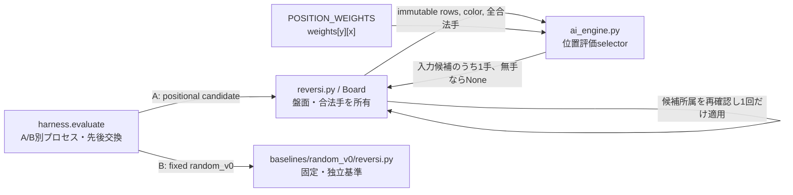

> **Archived record:** This is a historical Phase 1 record. Use [Phase 1 handoff](../../phase1_handoff.md) for the current consolidated status. Machine-readable execution evidence remains under evaluation_results/.

# Phase 1B 位置評価AI 設計・比較実験事前登録

状態: **設計確定・実装済み、固定比較実験完了**（2026-10-20追記）<br>
確定日: 2026-10-20<br>
適用段階: Phase 1Bのみ。本書は事前登録条件の正本であり、実装結果は[実装報告](20261020_phase1b_implementation.md)、最終品質・100局結果・採用判断は[Phase 1完了報告](20261020_phase1_summary.md)を参照する。今回の追記は実施状態のみであり、以下の事前条件・閾値・重みは変更していない。

## 1. Phase 1Aからの境界

Phase 1Aで分離した`reversi_player/ai_engine.py`に版名`positional_v1`の位置評価selector `select_positional_move(rows, color, legal_moves)`を追加する。Phase 1Aの既存`select_move`（ランダムshuffle）は名前と動作を維持し、互換回帰で明示注入する。`reversi.py`の`Board()`既定selectorのみ`select_positional_move`へ切り替える。`reversi.py`は盤面、完全なroot合法手の生成、選択結果の合法手照合、実盤面への着手適用、コマンド出力を引き続き所有する。新しい評価schema、探索予算、trace producer、harness正式統計は作らない。



図のengine→Boardの選択結果は、呼出し側でroot合法手集合に含まれることを検査してから適用する。baselineは現行selectorや設定をimportせず、凍結された独立プロセスのまま維持する。

## 2. 位置評価selector契約

### 2.1 重み表とスコア

```python
POSITION_WEIGHTS = (
    (120, -20, 20, 5, 5, 20, -20, 120),
    (-20, -40, -5, -5, -5, -5, -40, -20),
    (20, -5, 15, 3, 3, 15, -5, 20),
    (5, -5, 3, 3, 3, 3, -5, 5),
    (5, -5, 3, 3, 3, 3, -5, 5),
    (20, -5, 15, 3, 3, 15, -5, 20),
    (-20, -40, -5, -5, -5, -5, -40, -20),
    (120, -20, 20, 5, 5, 20, -20, 120),
)
```

これは8行×8列の不変な整数表で、**暫定的な人手設定**である。学習済み重み、最適値、強さの保証として扱わない。座標は`move == (x, y)`、表参照は`POSITION_WEIGHTS[y][x]`とする。

候補手のscoreは、着手先の静的な表値`POSITION_WEIGHTS[y][x]`そのものとする。着手後の盤面総和、石の反転数、角の所有、相手応答、手番、追加探索は評価しない。黒白で同じ絶対座標表を使い、`color`は既存の3引数selector契約との互換のため受け取るが、選択値には影響させない。この限定により評価の意味を実装者が結果を見て変更できないようにする。

### 2.2 選択規則と失敗境界

1. `legal_moves`以外の座標を返さない。engineは合法手を生成・再実装せず、`Board`が渡す完全なroot合法手を信頼する。`Board`側の既存厳密検査と着手前検証は維持する。
2. 非空なら最大scoreの候補を選ぶ。同点は`y`昇順、次に`x`昇順、すなわち`(y, x)`の辞書順最小で決定する。入力候補の順序や過去の乱数状態に依存しない。
3. 合法手0件では`None`。selectorを呼ぶ側は既存pass/終局規則に従い、非空候補の`None`は正常passへ置換しない。
4. 候補1件ならその手を返す。乱数APIを呼ばず、全局面で乱数状態を消費しない。
5. 同一`rows`・`color`・`legal_moves`で常に同じ手を返す。新たな乱数、時刻、可変学習状態、キャッシュは持たない。

Production CLIの既定selectorを位置評価へ切り替える。Phase 1Aのランダムselector実装・回帰はランダム基準動作の検査用に残すが、比較相手としては必ず凍結済み`baselines/random_v0/reversi.py`を使う。Phase 1Bではランダム基準のファイル、manifest、hashを変更しない。

## 3. 実装時のテスト・互換条件

- 重み表のshapeが8×8、すべて整数で、上記値と完全一致する。
- 表値参照が`[y][x]`であることを、row/columnを取り違えると異なる結果になる独立局面で検証する。
- 最大値選択、同点の`(y,x)`順、初期盤面の既知期待手`(3,2)`、白黒で同じ選択、空候補、単独候補を検証する。
- 結果が常に入力合法手集合の要素であり、呼出し前後で盤面snapshot・合法手入力を変更せず、乱数stateを消費しないことを検証する。
- Board統合で合法手列挙・選択戻り値検査・実着手1回・標準出力とNG/pass/終局応答を検証する。
- Phase 1Aのrandom完全棋譜回帰は`select_random_move`を明示注入する基準テストとして維持し、位置selectorの導入を理由に期待値を位置AIの結果へ書き換えない。production既定の棋譜が変わることは意図した差として別テストで固定する。
- 直接起動、package import、GUI接続、課題標準入出力、既存盤面ルール・不変条件、strict mypy/Lint/format/品質ゲートを実行する。GUI画面の手動操作は自動回帰と別に報告する。

## 4. 比較実験の固定条件

### 4.1 対象・データ・seed

| 条件 | 固定値 |
|---|---|
| A | 実装候補`reversi_player/reversi.py`＋明示asset`reversi_player/ai_engine.py`。実験前に両方のSHA-256を報告JSONで固定 |
| B | `baselines/random_v0/reversi.py`、SHA-256 `a485400c335a8731a0cafd1d77d98fbbcda1289194c4e13147cbaf3135b12b41`。`baselines/random_v0/manifest.json`もassetとして記録 |
| opening母集団 | `benchmark_sets/phase0/development.json`。Population v1、purpose=`development`、N=1000、placements=8、population hash=`e191fbfed938edca93431ce9efd897a6bfd78dbbc5d68077bcf7f77e7a802d78`、file SHA-256=`59dcc82a4365dfbad5403a834558fe66d8522c3e9d8d3a4cfaee7f388db34c13` |
| 母集団検証 | 2026-10-20に`python -B -m harness.openings validate benchmark_sets/phase0/development.json`を再実行。size=1000、purpose=development、hash一致 |
| 対局数 | 100 games＝50 distinct opening cases × 2 role-swapped legs。50ケースは母集団から非復元抽出 |
| opening selection seed | `20261020`。selection algorithmはPopulation v1の`python_random_sample_without_replacement_v1` |
| master seed | `20261021`。既存`contracts.seed_for`がcase ID・player role・master seedからseedを導出。先後交換の両legで同じplayer-role seedを使う既存pair規則に従う |
| runtime | Windows 11 / AMD64 / 直接実行CPython 3.13.5。baseline manifestと一致 |
| profile / budget | `evaluation_profile=descriptive`, `budget_policy=descriptive`。`confirmatory`、`deployment`、探索予算検証を要求しない |
| timeout | startup 5秒、通常command 1秒、`genmove` 10秒。既存CLIの明示条件として渡す |
| held-out | `benchmark_sets/phase0/held_out.json`を読込・抽出・対局・閾値調整のいずれにも使わない |

実行時はPopulation validatorを通し、reportに母集団hash、50選択case ID、selection manifest/hash、master/role seed、script/asset/harness/runtime hashを保存する。失敗や条件不一致のrunを上書きせず、別run IDに残す。

実装後の予定CLI（実験前に候補SHA・実出力先を追加記録し、既存ファイルを上書きしない）:

```powershell
python -B -m harness.evaluate `
  --a reversi_player/reversi.py `
  --b baselines/random_v0/reversi.py `
  --a-asset reversi_player/ai_engine.py `
  --b-asset baselines/random_v0/manifest.json `
  --games 100 --seed 20261021 --selection-seed 20261020 `
  --openings benchmark_sets/phase0/development.json `
  --evaluation-profile descriptive --budget-policy descriptive `
  --startup-timeout 5 --command-timeout 1 --genmove-timeout 10 `
  --output evaluation_results/phase1b/position-vs-random-v0-20261020.json
```

### 4.2 指標・失敗時の扱い

- 主指標は候補Aについて、`game_status=complete`かつ`protocol_status=verified`のgameに限るraw point rate `(wins + 0.5 × draws) / completed_verified_games`。全100局完走時は分母100。ハーネスの`summary.point_rate`と原game recordを照合する。
- 補助指標は黒番・白番それぞれのW/L/Dとpoint rate（各50局）、正常完了率、失敗理由別件数、A/B双方の外部genmove応答時間の平均・最大。内部探索時間/探索予算は未対応のためunknownとして保持する。
- `statistics`/paired formal estimateはbudget traceが未対応ならunavailable/unknownのままにする。summaryのraw point rateを正式信頼区間・正式な優越性へ読み替えない。
- 必須品質ゲートは100/100完了、protocol/referee検証済み、50/50のcase・pair・role swap整合、違法着手・timeout・異常終了・通信失敗0。いずれかを満たさないrunは成績による昇格判断を保留し、失敗局を除外・補充して100局扱いにしない。

### 4.3 事前判断基準

下記は小規模な**探索的参考評価用のプロジェクト判断ヒューリスティック**であり、統計検定や強さの証明ではない。

| 判定 | 事前固定ルール |
|---|---|
| 暫定採用（次の開発段階で候補として維持） | 必須品質ゲートを全て満たし、100局raw point rateが0.55以上、かつ黒番・白番どちらのpoint rateも0.45未満でない |
| 保留 | 必須品質ゲート未達、データ/条件のunknown・不一致、または品質合格後の全体point rateが0.45以上0.55未満。role別が0.45未満でも保留。失敗理由を直して再試験する場合は、元runを保持して別runとして全条件を再実行 |
| 今回の候補版を昇格しない | 必須品質を満たしたうえでraw point rateが0.45未満。これはこの100局sampleでの参考基準未達であり、random_v0への一般的劣位の証明ではない。改善版は別version/hash・新runとして比較 |

0.55/0.45は見てから決めないための対称な目安。CI、p値、confirmatory判定は用いず、勝率が閾値を僅かに越えたことを有意差と呼ばない。暫定採用は次の開発工程へ進む判断に限り、正式な性能優越性・授業最終AIへの採用を意味しない。

## 5. 依存順序と完了条件

1. 本書の契約と図を確認してから回帰テストを先に追加し、重み・同点・legal-subset・色・空/単独・乱数非消費・既定selector切替を実装前に固定する。
2. 既存random_v0資産を保護したまま`ai_engine.py`へselectorを追加し、本体の既定selectorだけを位置評価へ切り替える。GUI・プロトコル・盤面規則を変更しない。
3. 回帰、strict mypy、Lint/format、全品質ゲートを完了し、候補script/asset hashを凍結してから100局を一度に実行する。
4. 完了条件は図・契約・本体・テストの一致、全回帰/品質PASS、100局の条件manifest保存、失敗理由と判断基準に沿った報告。AIの勝率が閾値未達でも設計・実装・計測を成功と偽らない。

Phase 1Bの完了は探索を意味しない。Minimax/Alpha-Beta、学習、評価関数の拡張は次工程の別設計とする。
