# ハーネス整合性修正モデル

> 履歴資料（2026-10-13整理）。本文の「現行」「未実装」、節番号・行番号、実行結果は記録当時のものです。今の作業指示には使わず、[操作手順](../../ハーネス.md)、[現行契約](../harness_contracts.md)、[現行構造](../harness_architecture.md)、[AI分離の設計案](../../リバーシAI分離設計.md)を優先してください。

**更新:** 実装指示に基づく現行対応は末尾「実装段階の対応」を参照。冒頭の未実装表記は承認時点の履歴。

**2026-10-12 / T1追補（未実装）:** 第5節のsequence、第6節のpredicate/入口図、第7節の状態図を[時系列整合性修正計画](ハーネス時系列整合性修正計画.md)へ合わせて更新した。他のrevision3部分は履歴である。現行schema4が起動・連続要求・終了まで検証するという意味ではない。T1のコード修正は別途指示まで開始しない。

**2026-10-13 / Goal 1（履歴）:** 別途指示によるschema5接続の中間版を末尾に記録した。

**Goal 2完了:** 第5節のsequence、第6節の公開境界、第7節の時間状態をschema5 / trace4の接続実装へ合わせた。全pytest291件・独立smoke・正常/不正/unknownのAPI/CLI実行を確認した。計測の真正性・全ケース決定性・実AItrace対応・設計表の全組合せを実装済み/検証済みとする意味ではない。末尾のGoal 2節と検証記録が現在の範囲である。

作成日: 2026-10-11。状態: **第2段階の提案モデル、未実装**。第1段階の[修正計画](ハーネス整合性修正計画.md) revision 1の保存・完了点検後にモデル化した。第2段階で計画をrevision 2・3へ補正し、本モデルもrevision 3へ合わせた。既存の [アーキテクチャ図](../harness_architecture.md) と [契約表](../harness_contracts.md) を参照したが、図の存在を整合性の証明にしていない。第3段階のコード修正は行わない。

## 1. 現状モデルと不足する接続

以下は今回hashを確認した現行コードの経路である。原状態が矛盾した報告を入力すると、原playerのstatus・原game/reportのstatus・新しいraw検証結果が異なる判定へ流れる。

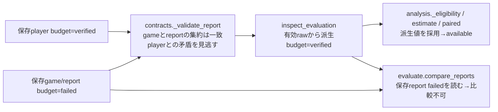

これは「個々の検証が全部ない」という問題ではなく、必要な接続と共通判定が欠けている問題である。時間はhost float RTTとchild search nsが別経路、集計はfresh rawと保存game.budgetが別経路、保存例外はphaseに関係なく一般OSError→2となる。現行の詳細位置は計画第2節を参照する。

## 2. 修正後の依存モデル

以下は**提案**。新規モジュールは作らず、既存責務を整理する。矢印はimport/主要呼出の依存方向で、プロセス依存を破線に分けた。

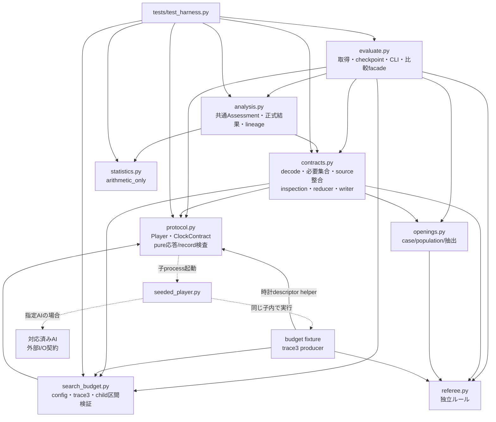

B→Pは純粋なClockContract/record helperだけ、fixture→Pは時計descriptor取得helperだけで、processを起動しない。fixtureのreferee/search_budget importも図示し、任意AIの内部importは未知なので外部契約として区別する。process依存の破線をimport循環と混同しない。P/B→C、C→A/E、A→E、S→C/P/Bは禁止する。writerをCに置くためanalysis→evaluateの循環は作らない。C→Sの現行得点化はAへ移し、Cは検証済みgame/coverageを返す。数式は資格・I/Oの所有者ではない。

## 3. データ契約モデル

### 3.1 四つの領域

| 領域 | 内容と権威 | 可変性 / 禁止 |
|---|---|---|
| SourceArchive | 原評価JSON、原raw、母集合、原commands、元取得状態、元hash/ID | 読取snapshot。上書き・時刻補完・原failed修復禁止 |
| Observations | 原bytesからの盤面/通信/clock/trace測定、必要role/必要series | 一呼出内で再生成。未検証cacheを混ぜない |
| Inspection | source内整合、現在の各検証軸、canonical summary、原状態hold、lineage | 保存したpositive Inspectionは再入力資格として使わない |
| Assessment/Analysis | 共通資格、要求成功、計算値、現在のspec/版、参考値/過去CI | 正式結果は共通入口が生成。caller resultの予約field上書き不可 |

root入力がinvalid/unsupportedならnormalized viewを保証しない。全consumerがこの分岐を先に処理し、不正なconditionsや欠けたsnapshotへ.getを呼ばない。元reportのcanonical hash、原JSON fileのbytes hash、artifact bytes hashは異なる欄に保持する。

rootの非有限JSON/非JSON値はinput invalidで、canonical hashを作れない場合はnull+理由にする。rawの非有限値/不正JSONはartifact検証failedとして分ける。失敗JSONへNaN/Infそのものを埋めず、type/code/pathの安全な表現で診断を残す。

### 3.2 識別子の対応

```text
population_hash + 全archive case集合
    -> selection_manifest + planned_n
case_id + master_seed + role + repeat_index
    -> role_seed -> pair_id -> leg0/1
run_id + pair_id + leg + role + command_index
    -> command_id -> genmove_sequence / phase / before_board
clock_domain_id + clock_contract
    -> 同一取得内のparent/child時刻対応
source_report_sha256 + artifact_hashes + 現在のverifier/spec
    -> 新しいanalysis lineage / analysis_id
```

case/pair/seedの意味・版は維持する。runやclock domainをケース識別へ混ぜない。role seedは色ではなくA/Bに固定し、先後で同じ役割に同じseedを使う。trace3のcommand_indexはname/forced play/showboard等も数える全要求index、genmove_sequenceはgenmoveだけのindexで混同しない。

clock_domain_idは取得内の共通時計を結ぶ値であって、別run間の端点一致を要求するIDではない。比較条件には時計の意味/実装/版を含め、nonceや観測された具体的timestampは含めない。原runのtraceを別runへ付け替えることはidentity違反である。

### 3.3 状態の型

| 軸 | 状態 | 意味 |
|---|---|---|
| input | valid / invalid / unsupported | 安全に解釈できる入力か。unsupportedは未知schemaをprofile未要求へ変換しない |
| source_consistency | verified / failed / unknown | sourceの保存role→game→report、alias/summaryを確認。矛盾failed、証拠不足unknown |
| execution/protocol/gameplay | complete/failed等の原状態 + 現在verified/failed/unknown | 起動・合法終局・通信終了は別。completeはquit成功と同義でない |
| role budget | verified / exempt / unknown / failed | exemptは許可済みBだけ。空/未起動roleはunknown |
| game/report budget | verified / unknown / failed | 全必要集合から集約。現行policyの集約exemptは認めない |
| timing | verified / unknown / failed / not_required | 必須の実測区間、非対応時計、既知違反、明示未要求を区別 |
| metric series | verified / unknown / failed / not_required | 正常部分だけから全シリーズverifiedを作らない。not_requiredは検証済み0秒でない |
| formal eligibility | eligible / ineligible / not_requested | 品質とprofile・固定得点条件を共通Assessmentで判定 |
| calculation | computed / unavailable | 数式の結果。単独では正式資格を意味しない |
| operation/publication | preparing/collecting/checkpoint/analysing/saving/saved/failed | 処理・保存の進行。品質やCIとは別 |

aggregateのseverity順は既知failedを先、必要unknown/欠損を次、必要全件成功のみverified。not_required/exemptは要求行列に適合した場合だけ取り除ける。「全部の要素が免除」という空のall判定は使わない。

## 4. source整合・観測・集計のフロー

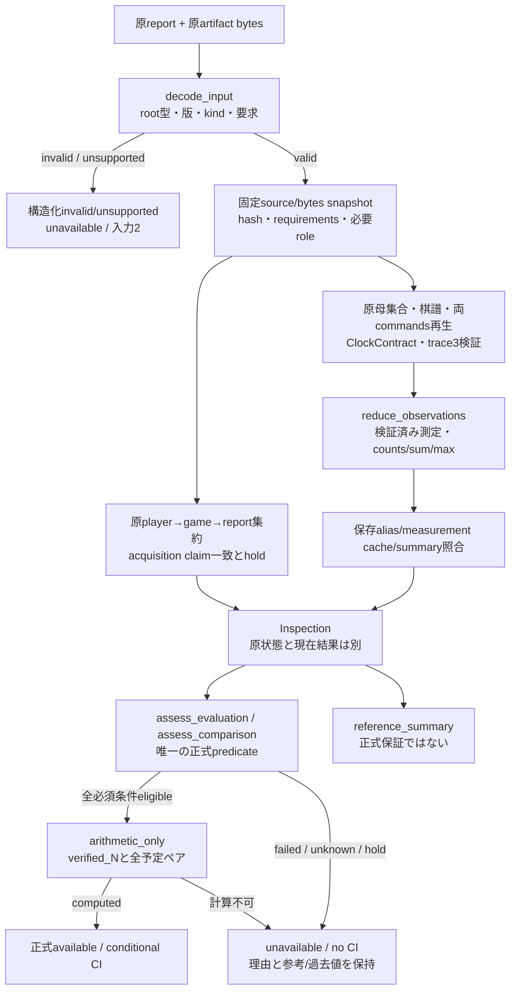

取得中の内部coreはsummaryに依存せずobservationsを生成する。collectorがcacheを組み立ててから、最終reportを同じpublic inspectionで再確認する。checkpointの暫定reference summary→正式資格の直結を禁止する。cacheの誤りをreducerの正しい値で黙って置き換える矢印はない。

参考勝敗は合法終局・通信成功を分母にして予算軸とは分離する。正式対象の失敗leg/測定を除外してnやseries対象を縮めない。rawに必要な測定がないのに保存cacheだけで埋めない。

## 5. 時間区間モデル

### 5.1 計測点の時系列（schema5/trace4、Goal 2接続実装）

schema4/trace3時点は要求内のHE0〜HE1とspawn〜name終了だけを検査していた。Goal 2では既存sequenceを起動・全要求・終了へ接続した。以下はtrace4対応producerの計測契約であり、実AIのtrace対応を意味しない。PR/CE/IR、全要求の子envelope、CSとsessionを照合する。並行ブロックの二枝間に順序はない。

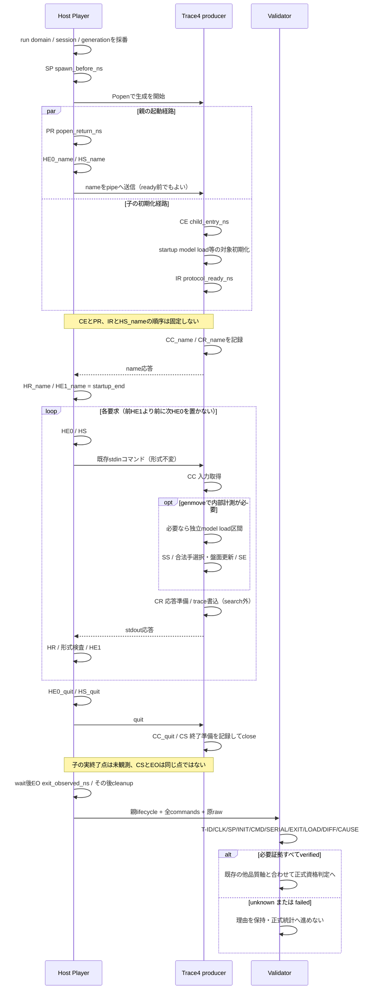

stdoutに時計情報を追加しない。環境contextと別JSONLで結ぶ。親は書込直前と最終応答読取後、形式検査後を測り、子は入力取得後と結果準備前の範囲を測る。traceの書込遅延はparent RTTへ入りsearchからは除外される。終了待ち・回収の時間をsearchへ足さない。

この要求内の区間モデルは通常genmoveとprobeで共用するが、通信列の完了モデルは別。games枝は合法終局を要求、determinism枝はcaseからの単発genmoveとquitを要求し、非終局でも正当なprobeとなる。purposeはsource内の格納位置と期待contextから内部で選ぶ。通常gameがrawにprobeと書いて終局確認を省略できる遷移はない。

### 5.2 要求内の既存不変条件とT1の接続

計画第5節の対応domainを確認した場合に限る。以下の数字は単一共通counter上の値で、UTC epochではない。

```text
HE0 <= HS <= CC <= SS <= SE <= CR <= HR <= HE1
search_ns = SE-SS
wire_ns = HR-HS
external_ns = HE1-HE0
0 <= search_ns <= wire_ns <= external_ns <= limit_ns
```

対応: HE0=exchange_start、HS=send_start、CC=command_received、SS/SE=search start/end、CR=response_ready、HR=response_read_end、HE1=validation_end。同一local CPython 3.13のperf_counter_nsという確認済み契約が必要。別host/runtime/未対応clockではこの比較式へ進まずunknownとする。

正常例は計画R05のHE0=100、HS=120、CC=150、SS=180、SE=240、CR=260、HR=300、HE1=400。search=60、wire=180、external=300で通る。これは合成整数による単体テストの手計算例で、実時計の精度試験そのものではない。

長さだけでなく、要求前のsearchや応答後のsearchも拒否する。9秒という自己申告が240300nsの外部応答へ包含される経路はない。端点差の不一致、型bool/float、時計逆行、domain/context不一致は失敗または証拠不足の所定理由へ落とす。未知時計には共通counter比較の前提がなく、猶予を大きくして通さない。

既知の同一domainのID/context不一致や対応descriptorの矛盾はfailed、必要domain証拠欠損やclock/runtime契約の未対応はunknown。この分類は計画revision 2で明文化した。

同一domainでの量子化された観測値を比較するため、一律の余裕を付けない。resolutionは診断情報で、nsという単位を真の1ns精度と主張しない。この時計選択は [Python 3.13の公式time資料](https://docs.python.org/3.13/library/time.html#time.perf_counter_ns) の同一process間時計・整数nsの説明を参照した設計であり、全producerの実際の計測正しさをlibraryが保証するという意味ではない。

**T1の精度補正:** 上段の一律ゼロ猶予比較は現行/revision3の説明。QPCは異threadの±1tick近傍に順序曖昧性があるため、T1は同一計測threadの厳密`<=`と親子の3値比較を分離する。QPC周波数と計測threadを記録し、異threadの後点−前点がU超ならverified、−U未満ならfailed、それ以外はunknown。`U=ceil(1e9/frequency)+1`nsの根拠・登録条件は時系列計画第4節。未知domainや曖昧値を大きな猶予でverifiedにする規則ではなく、同threadの起動前要求も救済しない。正常な微小差を物理的矛盾と誤判定しないための補正である。

model loadがstartupならspawn→name終了の区間へ、lazy loadならCC→CRの非search区間へ包含する。modelなしは明示not_required。初期loadやtrace書込みをCPU探索時間と混同しない。GPU非同期や別clockは契約拡張と検証が必要で、今の式へ無条件に押し込まない。

上段はrevision3の包含モデルである。現行実装はモデルありで初期load証拠が未確認ならunknownなので、lazy初期load一般を正式対応済みと読まない。またperf_counter_nsはCPU時間ではなく経過時間である。

**Goal 2接続:** SP≤PR≤HE0_name、SP≤CE≤IR≤CC_name、全要求の前HE1≤次HE0、正常quitのHS≤CC≤CS≤EO、および全子イベント≤CSを共通inspectionで検査する。PR≤CEやIR≤HS_nameは要求しない。startup loadはCE〜IR、当該探索で使うcommand loadは完了≤SS。未知のlazy初期化/background/GPU scopeを不可能と決めつけずunknownとする。詳細な不変条件・失敗診断の例外は時系列計画第5・6節を正本とする。

trace4では全commandに子CC/CRを保存する（quitはCCのみ）。B通常予算exemptでもlifecycleは免除しない。全時刻を同じだけ起動前へずらしても要求内の式は成立するが、T-SP/INIT/SERIALが拒否する。T01〜T20は予定テストであり未実行である。

### 5.3 旧時間記録

schema3のfloat秒とtrace2のelapsedだけでは端点/domainの全証拠にならない。新しい端点を再実行や秒×1e9から作る遷移は禁止する。旧系列はlegacy referenceで保持し、強化time status=unknownから正式へ進めない。raw/盤面の既知違反は従来どおりfailedにする。

新しい再解析報告がschema4でも、sourceが旧3で端点欠損なら資格が新4へ昇格するわけではない。**出力schemaの版とsource取得能力の版は別**。正しい旧CIを過去の主張として残すことと、現在の強化正式CIを発行することは別。

T1では同じ原則を旧schema4にも適用する。既存のSP/連続要求/quitから分かる矛盾はfailed、欠けるPR/CE/IR/CSはunknown。旧4正常を壊れたデータとは呼ばず参考・過去の主張を保持するが、新5の強化正式資格は付与しない。出力版5への再保存や新hashだけでは昇格しない。

## 6. formal gateと公開入口の同値性

### 6.1 predicate

以下はT1の提案predicateに更新した。現行コードはsource.schema=4と要求内検証までであり、追加lifecycle軸と公開assess wrapperは未実装である。

```text
SingleFormal(I, R) =
  I.input.valid AND I.source.kind=evaluation AND I.source.schema=5
  AND I.source_consistency.verified AND no_required_origin_hold
  AND population/selection/full_planned_coverage.verified
  AND required_gameplay/protocol/host_intervals.verified
  AND all_required_role_budgets_satisfied
  AND all_required_trace/timing/metric_series.verified
  AND all_A_B_and_required_probe_lifecycle.verified
  AND all_required_command_and_causal_order.verified
  AND fixed_work_profile_allowed
  AND declared_fixed_score_assumption_accepted_with_required_probe
  AND R.analysis_spec.valid

PairFormal(B, A, R) =
  SingleFormal(B,R) AND SingleFormal(A,R)
  AND comparison_match(B,A).verified
  AND exact_planned_pair_alignment
```

roleごとの必要集合は計画7.3の行列に従う。baseline-asymmetricのB内部normal seriesは未要求ならnot_requiredだが、両host通信とBのprobeは免除しない。sourceの任意宣言でA/必要roleを消せない。Deploymentはtime役割を双方要求し、SingleFormalを満たすprofileではないのでCIを出さない。

T1では両hostに加えB通常の子起動/全CC・CR/終了証拠も必要とする。予算の適用除外をlifecycleの適用除外へ拡大しない。time/deploymentで品質verifiedでも固定得点CIはnot_requestedのまま。

固定得点仮定の受理は全ケースの決定性を実証した状態ではない。数学的に条件付きの推定対象を明示し、known非決定性・time・probe失敗を許可する例外にしない。実AI採用や未知相手への一般化は別の判断である。

### 6.2 真理値・失敗例

| source整合 | 母集合/coverage | 必須time/trace/metrics | 原必須hold | profile | 正式CI |
|---|---|---|---|---|---|
| verified | verified | verified | なし | confirmatory fixed work | 計算成功時のみあり |
| failed（Q1/alias矛盾） | verified | verified | 任意 | confirmatory | なし |
| verified | unknown/欠損 | verified | 任意 | confirmatory | なし |
| verified | verified | unknown（旧3等） | 任意 | confirmatory | なし |
| verified | verified | failed（Q2/Q3） | 任意 | confirmatory | なし |
| verified | verified | verified | 原failed/unknown hold | confirmatory | なし |
| verified | 完全 | 両time品質verified | なし | deployment | not_requested、正式CIなし |
| invalid/unsupported input | 未評価 | 未評価 | 未評価 | 不明 | unavailable。未要求と推測しない |
| 起動失敗・role欠損 | 未完了 | budget unknown | 原失敗 | 任意 | なし。exemptにしない |

入力不足を「not_requested」、欠損roleを「exempt」、形式検査不能を「verified」にする遷移はない。full coverageだけでcensus幅0へ移ることもできない。

### 6.3 全入口の閉包

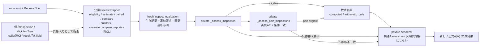

全正式public入口がfresh source→Inspection→共通Assessmentを通る。compare_reportsは保存statusで独自の正式判定をしない。analysis.comparison_reportのresult引数は共通再計算との一致確認のみで、任意resultの**展開による予約field上書きはない。単独数学APIは正式availableを発行せず、数式結果だけをsourceとしてbuilderに渡せない。

この図はGoal 2接続実装の公開境界。assess_evaluation/assess_comparisonは原reportをfresh検査し、核はprivateへ移した。詳細と互換上の引数変更は時系列計画第7節。保存Inspectionを資格証明として受ける経路は置かない。各入口の実行確認結果は検証記録と対応テストで確認する。

同値性の対象は同じimmutable source/artifact bytes、同じverifier/spec/requestである。artifactが実際に変わった別呼出や、confidence/profile/必要軸が違う要求を同じ条件と呼ばない。単独資格と条件不一致による対応差不可は異なるpredicateなので、それらの違いを入口不一致と誤認しない。

CLIのreference successと正式CIは別。reference可否のcomparableがtrueでもpair predicateはfalseになり得るが、直接pairedとcompareのformal_pair_availableは同じPairFormalを参照する。数値基準未達と品質失敗も別である。

## 7. 保存とエラー処理のモデル

既存の保存モデルにT1の時間判定状態を追加した提案図。時間以外の品質・profile・数値計算の可否もSaving前のAssessmentに含めるので、TimingVerifiedだけで正式発行できる図ではない。

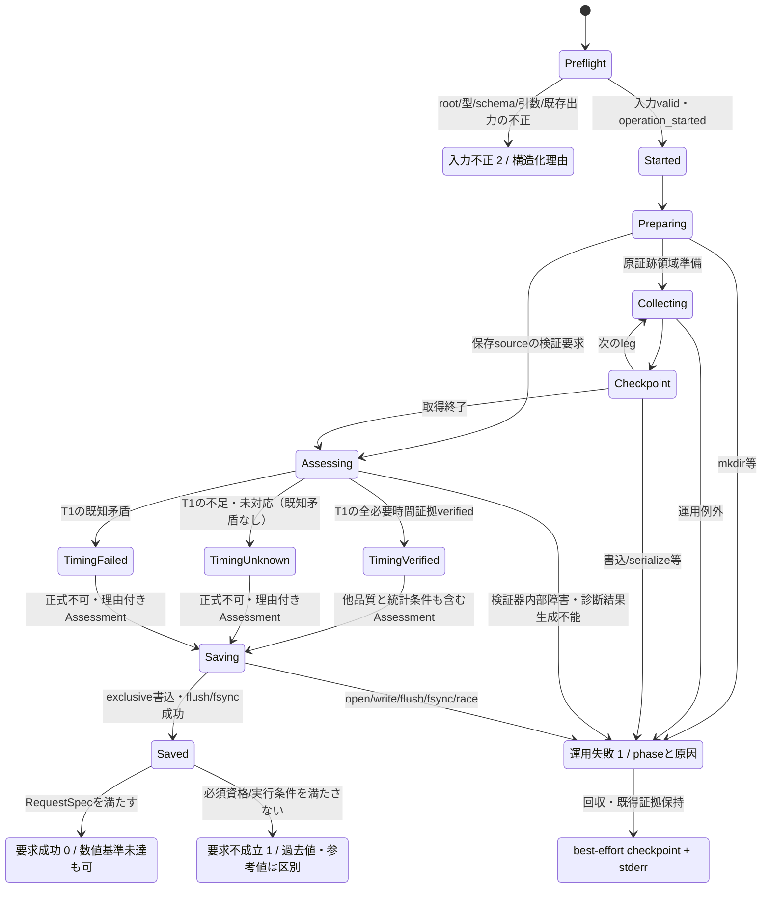

通常の個別対局失敗はgameに記録して後続legを試す現行挙動を維持し、collectingを必ず全体例外で止めるわけではない。終了時のRequestSpecが正常完走を満たさなければ1。

この図のoperation_startedはPopen成功時ではなくpreflight終了後。初期mkdir等のI/O失敗を2にしない。一方、unsupported root schemaはpreflightで2となり、trace/clock証拠の未対応は検証中unknown・必須なら1。発生場所だけで入力不正と運用失敗を入れ替えない。

通常の必須証拠欠損/意味違反はAssessmentを生成してSaving→Saved→Unavailableへ進み、結果を保存できれば診断JSON付き1とする。検証器例外やwriter障害はOperationFailed→Diagnostic。結果判定と、結果そのものを作れない失敗を別経路にした点を計画へ反映した。

writerはcontractsに置き、evaluate/analysisが同じArtifactWriteErrorを扱う。最初の保存エラーに二次checkpoint失敗を追記しても主原因を消さない。最終x作成のraceは上書きせず1。既存checkpointのatomic replaceはrun所有領域限定で、finalの無条件replaceはしない。

report_state=complete（取得/解析完了）とpublication=saved/failedを別軸にする。CIの数値が正しくても保存依頼が失敗したらCLI成功ではない。完全な原証拠の後日の再解析は別operationであり、元の保存失敗履歴の更正ではない。partial JSONや原artifact欠損はそのまま正式へ採用しない。

## 8. 相互作用・互換性の照合

| 相互作用 | 計画との整合性・禁止事項 |
|---|---|
| Q1×Q4 | 同じ必要role集約。空集合unknownをsourceとfreshの両方で使い、参照入口だけexemptへ落とさない |
| Q1×Q3 | acquisition claim/source cacheとfresh測定を分離。正しい新summaryで矛盾sourceを修復してeligibleにしない |
| Q2×Q3 | 区間検証した測定だけcertified seriesへ。RTTを内部時間へ置換しない。部分seriesで全体verifiedを作らない |
| Q1×Q5 | invalid viewを派生資格へ変換しない。型/版で不可なら全正式入口に同じ理由 |
| Q2×Q5 | trace/clockの未対応はunknown、root schema未対応はunsupported。前提欠損を猶予付き計測へ変換しない |
| Q3×Q6 | reducerのserialize不正・writer障害を捕捉。集計成功と保存成功は別で、失敗時に負数/NaNを0へ直さない |
| Q4×Q6 | 起動途中・保存失敗時も実際に起動したprocessを回収。未起動slotはunknown、記録なしを除外扱いにしない |
| 全6×互換性 | 新4正常を維持し、旧1/2/3の原資料・参考値・過去CIを保全。新しい保証だけの資格移行を明示 |
| 全6×推定対象 | N/case/seed/全予定ペアと条件付き固定得点という既存対象を維持。失敗を削って標本を作り直さない |
| 全6×最終採用 | Availableや基準metから自動採用へ遷移しない。decision=undeterminedを維持 |

schema4の新測定を含むsourceとschema3 sourceを同じ時計能力だと比較しない。旧データを読み込めることと新しい正式条件を満たすことを区別する。GUI/標準出力のコマンド・応答形式は変わらず、trace3は別channelの拡張である。

実AI未対応・全ケース決定性・未登録依存を黙ってverifiedへ変えるモデルではない。fingerprintにはseed adapterと新measurement契約を登録し、検証/比較版は元取得版と分ける。対象AIの全importやcounter真正性は別の残存リスクである。

## 9. 設計上の「迂回なし」の確認範囲

次の確認は**設計上の論証**であり、未実装コードの成功試験ではない。

1. 正式報告を発行するsupported public入口を計画7.2/モデル6.3で全列挙し、すべてfresh inspectionを必要とした。
2. 保存状態の別読み、保存Inspection、eligible bool、caller result、数式直接呼出の各経路を資格入力から除外した。
3. cache/summaryは必ずderived値と照合し、正しい値への黙示修復矢印を置かなかった。
4. 必須不明・既知矛盾・旧clock欠損の全行でSingleFormalがfalseとなり、数式が正式出力へ進む唯一の矢印を通れない。
5. paired/compareは同じPairFormalを使い、単独資格に加える相互条件が一箇所にある。
6. 資格と保存phaseを分離し、運用失敗がinput2や成功0へ変換される経路を除いた。
7. 上記をR18/R19と全6回帰群で実装後に反証可能な条件にした。

保証範囲は、定義したpublic APIと正しく計測するtrusted producer/実行環境に限る。外部コードがprivate helperやmoduleを書き換える、全ログを整合した嘘へ偽造する、勝手なJSONを正式と名付ける行為への認証ではない。hashは一致確認であって実行者署名ではない。この限界と、通常の未検証データがpublic入口を通過できる不具合を混同しない。

## 10. 計画との対応・受入確認

| 問題 | 計画の主節 | モデルの主節 | 回帰群 |
|---|---|---|---|
| Q1 | 3・4・7 | 1・3・4・6 | R01-R03,R18-R19 |
| Q2 | 5 | 3・5・6 | R05-R09,R20-R21 |
| Q3 | 6 | 3・4・8 | R10-R12,R18 |
| Q4 | 4 | 3・6・7 | R03-R04,R24 |
| Q5 | 7 | 3・6・7 | R13-R15,R18,R23 |
| Q6 | 8 | 7・8 | R16-R17,R24 |
| 残存制約/互換 | 9・13 | 5.3・8・9 | R20-R24 |

設計照合の問いは、同じsource/requestでpredicateが一意か、unknown/failedが数式へ進まないか、measured intervalの証拠を保存できるか、reducerとsource検証の循環がないか、module循環がないか、旧sourceの強度を勝手に上げないか、入力2と運用1の区別がすべてのwriterで同じか、である。

新規取得と再解析は同じ観測core/判定核へ合流し、collectionと数学の相互依存はない。原結果と現在の結果は異なる名前空間。数字の解釈・role・scope・versionをAPI名やcaller booleanで変えない。以上を本モデルの整合条件とする。

モデル化による補正は、(a) root/raw非有限値の失敗層、(b) 既知domain矛盾と未知domainの区別、(c) 構造化不可判定の保存と検証器例外の分岐、(d) 旧schemaの一律拒否で各回帰がたまたま通らない正常schema4 baselineとreason assert、(e) gameと非終局probeの通信完了テンプレートの区別、の5点。先に計画revision 2・3をそれぞれ保存してから本モデルを同版へ合わせた。R01-R24の根拠と受入条件は変更後計画を正本とする。

**完了は2資料の計画・モデル照合まで**。実コードのR01-R24、Mermaid実レンダリング、他OS/未知clock、実AItrace3の動作は未検証。実装開始やハーネス全体の完成を報告する資料ではない。

## 実装段階の対応（2026-10-11）

上記revision3は承認時点の設計記録である。別途の実装指示によりD0〜D5を実装した。現在の正本はコード、[現行アーキテクチャ第9節](../harness_architecture.md)、[現行契約第9節](../harness_contracts.md)。設計の実装開始禁止は今回の明示指示で解除されたが、commit/push・AI本体変更は行わない。

- 共通型は軽い辞書とdecode_inputの実行時検査。公開入口はfresh検証、Assessmentを認証として保存再利用しない。
- 観測coreはprivate _inspect_evaluation、collector専用_acquisition_summaryがsummary前のcoreを利用し、public inspect_evaluationは全cache照合を固定する。公開skip flagはない。
- protocolに時計記述/対応判定/command ID/実測区間検査を置き、search_budgetがそのhelperを利用する。contracts→statisticsは廃止。evaluate→statisticsは取得時の予備pair_status計算のみ残り、正式資格はanalysisだけが判定する。
- source内部の一貫した原failed/unknownと、source_consistency failedの矛盾は別。どちらも自動更正せず正式保留だが、理由を同一にしない。
- model loadのnot_required/startup/commandと実測包含を確認する。モデルありで初期load証拠が未確認ならunknown。実AI/学習モデルの計測実装を完成扱いしない。
- 同条件の旧資料再解析・保存場所移動を維持するが、旧3にない端点を補わず、新しい正式時間保証は付けない。analysis/comparison出力版4は旧sourceの能力を昇格させない。
- 共通writerはserialize/open/write/flush/fsyncを運用障害として扱う。writer成功の返却とCLI終了がpublication確認であり、checkpoint取得completeだけを保存成功と呼ばない。

D6の実行コマンド・結果・残る制約は[ハーネス検証記録](../reports/ハーネス検証記録.md)へ記録済み。最終全体220成功/0失敗、独立smoke1成功。時間状態は必須probeを含めて共通投影し、未確認/既知矛盾を時計一致だけでverifiedにしない。未照合contextsの要求数をraw違反の証明にせず、起動失敗の予算unknownと通信failedを分離した。未知method/不正estimandの黙示置換も拒否する。数学的固定得点の仮定と有限probeの限界、実AItrace未対応、明示登録外のAI依存、部分書込/停電は残存制約である。

## T1追補: ライフサイクル接続の未実装範囲（2026-10-12）

上記D6は要求内包含の実装記録であって、起動・全要求間・終了の接続完了ではない。現行の起動前showboard、要求間逆転、起動前quitの正式受理を読み取り再検証で確認した。根本原因と実行記録は[時系列計画第1・2節](ハーネス時系列整合性修正計画.md)。

T1更新対象は第5〜7節の既存図と関連説明。第1〜4・8〜10節の旧revision3モデルを現行の完全保証として扱わない。T1では未知と矛盾、通常対局とprobe、予算exemptと時間必須、同一clockと同一sessionを分離する。新旧条件・母集合/traceとのAND・原証拠不変・依存DAGの照合結果は時系列計画第11節を参照する。コード/テスト実装、回帰成功、Mermaid実レンダリングは今回の成果に含めない。

## Goal 1対応: schema5の参考評価と正式保留

schema5→decode→目的別通信identity/盤面/trace再検証→Observations→canonical_summary→Inspection→Assessment→analysis/comparison5→exclusive保存を接続した。原cacheとfresh結果を分離し、原summaryを修復して成功へ変換しない。入力不正/unsupportedを集計のKeyErrorへ変換せず理由付き失敗とする。

第6節のSingleFormal/PairFormalに必要な全lifecycle検証は未完で、Goal 1は時間unknownと正式gate閉鎖を明示する。参考評価の保存成功と正式要求不成立を分離する。完全なT1モデルのAS→正式数式は現在到達不可。現行図は[アーキテクチャ第9・11節](../harness_architecture.md)、契約は[契約第11節](../harness_contracts.md)、実行は[検証記録](../reports/ハーネス検証記録.md)を参照する。

親子・終了・全要求因果検査と公開assessのraw wrapper化はGoal 2へ残す。Goal 1でそれらを検証済みと報告しない。

## Goal 2対応: 時間coreと公開境界の接続

上記Goal 1段階は履歴。明示承認後にcontracts._inspect_timelinesから親子helper・session一意性・予定因果辺を実行し、各時間軸と既存品質/統計条件をANDで判定するよう接続した。公開assessも原reportを再検証し、保存Inspectionを認可しない。時間検証は取得時と再解析時に共用し、元の証拠や集計を修復しない。

現在の契約と図はdocs第12節。先行38回帰は成功したが、全体・CLIの最終結果は検証記録を参照する。未知時計、実AItraceなし、counter真正性・全ケース決定性の限界は引き続き残る。Goal 3の全体正常化は今回開始しない。

---

## 2026-10-13整理前の全文保存

以下は混在資料を整理する直前の全文を保存した履歴です。参照パスと見出しの階層だけを移動先に合わせ、当時の提案・失敗・成功・版・行番号は履歴として保持しています。現行の作業指示ではありません。

<a id="snapshot-harness-architecture"></a>

### 整理前の `docs/harness_architecture.md`

### リバーシ評価ハーネスの現状アーキテクチャと整合性監査

**現行版の参照先:** 第1〜8節はv3時点の履歴。6件修正後の現行schema4は第9節を参照する。

**2026-10-12設計監査:** 第9節の図に現行の時間検査の限界とT1未実装の接続点を明示した。第10節は[時系列整合性修正計画](ハーネス時系列整合性修正計画.md)の提案であり、実装済みの構造ではない。

**2026-10-13 / Goal 1（履歴）:** schema5のdecode・通信identity・集計・analysis・保存を接続した中間版を第11節に記録した。当時の正式gateは閉じていた。

**Goal 2接続実装・検証完了:** 利用者の明示承認後、親子lifecycle・要求間・A/B因果辺を共通inspectionへ接続した。現在の構造は第9・12節。全291件・smoke・正常/不正/unknownの実CLIが成功した根拠は検証記録に置く。実AIのtrace対応や全ログ真正性まで保証する図ではない。

監査日: 2026-10-09。対象は HEAD `1b934293ec66f1174f7f6dfbc47de5bbf66f34d1` に未コミット変更を含む作業ツリー。`harness/` 全10モジュール、`reversi_player/` のPythonコード、`tests/` 全Pythonコードを調査した。

第1～4節は2026-10-11の実装に更新した。第5～7節は2026-10-09の修正前監査記録で、現在との差分は第8節を参照する。課題の正本は [プログラム開発方法.md](../../プログラム開発方法.md)、合意した拡張案は [ハーネス拡張計画.md](ハーネス拡張計画.md)、実行手順は [ハーネス.md](../../ハーネス.md)。データ型・識別子・不変条件の詳細は [harness_contracts.md](../harness_contracts.md) に置く。図は整合性の証明ではなく、問題を探すための地図である。

「コード確認」は呼び出しや条件式から直接確認した事実、「診断確認」は一時データを用いて実行した結果、「推奨」は未実装の変更案を指す。2026-10-09の監査はコード変更なし。2026-10-11は計画第10節の実装・テストを拡張した。本体AI・GUI・既存評価結果は変更していない。

#### 1. モジュールの責務と境界

| モジュール | 現在の責務・主な関数 | 受け渡すもの / 注意点 |
|---|---|---|
| `harness/__init__.py` | パッケージの説明のみ | 公開APIや契約型の定義はない |
| [evaluate.py](../../harness/evaluate.py) | CLI、入力条件、対象・環境hash、序盤選択、決定性probe、先後交換対局、同期、予算判定の接続、保存、集計、比較、数値基準、終了コード | 多数の可変`dict`を組み立てる中心。`evaluate`、`play_game`、`summarize`、`compare_reports`、`main` |
| [protocol.py](../../harness/protocol.py) | `Player`による子プロセス、環境変数、stdout/stderr読取、応答形式、応答期限、quit・停止 | `command(str) -> list[str]`。`commands`は応答・秒数・エラーのメモリ上の配列。違反は`HarnessError` |
| [seeded_player.py](../../harness/seeded_player.py) | Pythonの`random.seed`を設定し、指定スクリプトを`runpy.run_path`で実行 | `protocol`から別プロセスとして起動される。通常のPython import依存には現れない |
| [referee.py](../../harness/referee.py) | 本体をimportしない独立ルール判定 | `tuple[str, ...]`の盤面、`(x,y)`、色を入力し合法手・反転・更新・終局を返す |
| [openings.py](../../harness/openings.py) | 序盤生成、履歴再生、D4対称重複排除、母集合hash、非復元抽出、生成/検証CLI | `OpeningPopulation`、`OpeningEntry`、`SelectionManifest`相当の辞書を返す。実際の型クラスはない |
| [search_budget.py](../../harness/search_budget.py) | 設定v1→v2正規化、予算policy照合、none適用除外、JSONL trace検証 | `BudgetConfig`、`TraceValidationResult`相当の辞書。外部応答時間を計測するモジュールではない |
| [contracts.py](../../harness/contracts.py) | 共通inspect_evaluationによる母集合/抽出/coverage・棋譜/通信・raw/probe再検証 | InspectionResult相当dictと派生値を生成。validate_reportは互換wrapper |
| [analysis.py](../../harness/analysis.py) | 正式資格、検証済みN/ペアでの推定、条件一致付きpaired、再解析CLI | 公開入口は再検証。保存verifiedだけを信用しない |
| [statistics.py](../../harness/statistics.py) | ペアの検査と得点化、有限母集合区間、前後差 | `pair_scores`は状態・seed・役割も検査するため、数式計算だけのモジュールではない |
| [reversi.py](../../reversi_player/reversi.py) | `Board`、`Pos`、ランダム合法手選択、課題のstdin/stdout CLI | 外部から操作する対象。`genmove`は自分の盤面も更新。予算環境変数・traceを利用しない |
| [web.py](../../reversi_player/web.py) | HTTP入力、棋譜再生、GUIの盤面/合法手/勝敗JSON | `Process`は独自の同期通信。`harness.protocol.Player`を使用しない。HTTP要求ごとに本体を起動する |
| [web/index.html](../../reversi_player/web/index.html) / [main-es2015.js](../../reversi_player/web/main-es2015.js) | 配布済みブラウザbundle、表示とplay/genmoveのHTTP要求 | positions・depth・temperatureを送信する。Python側は後ろ2項目を使わない。ブラウザ動作の実行確認は今回していない |
| [test_harness.py](../../tests/test_harness.py) | 評価・比較・異常系・序盤・trace・CLI・checkpointのpytest | 正常な正式統計の試験は予算fixtureを使う。契約境界の全組合せ試験ではない |
| [test_stdin_commands.py](../../tests/test_stdin_commands.py) | 本体の別プロセスによるコマンド・盤面・期限・固定終局 | `Player`と一部`subprocess.run`を使用する |
| [test_result.py](../../tests/test_result.py) | 本体とrefereeの固定ルール局面、GUIのプロセス・応答 | `Board`を直接importする試験もある。GUI通信の期限はテスト用`BoundedWebProcess`で付加する |
| [budget_player.py](../../tests/fixtures/budget_player.py) / [fault_player.py](../../tests/fixtures/fault_player.py) | trace対応模擬AI / 故障注入プロセス | 前者はrefereeと同じルール実装を使うため、成功しても本体AIの予算やルールの独立証明にはならない |

実データは通常の辞書・配列であり、`TypedDict`、dataclass、schemaオブジェクトによる境界の固定はない。盤面はメモリでtuple、JSONでlistになり、応答はプロセス間では文字列である。`Board`や`Pos`のオブジェクトはハーネスとAIの間では渡さない。

#### 2. A: 現在のモジュール依存関係

実線はプロジェクト内importと主要な呼び出し。点線は関数内の遅延import、またはプロセス起動/実行を示す。標準ライブラリは省略した。

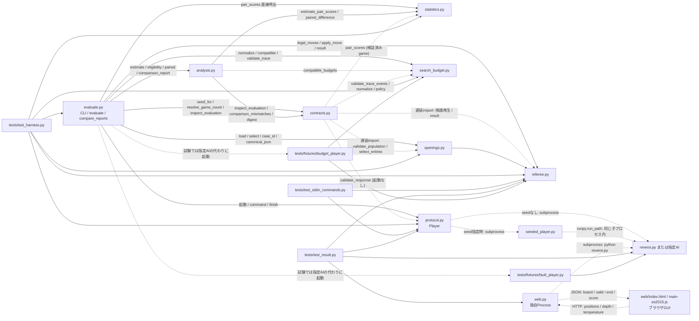

ASTで関数内importも含めて調べた結果、`harness/`内のimport循環はなかった。`contracts -> openings -> referee`は一方向である。`seeded_player`へのプロセス依存はimportグラフには出ないので、fingerprintや再現性監査では別に確認する必要がある。

GUIとハーネスの通信処理は独立している。GUI側のパス表現は`[-1,-1]`、ハーネスの棋譜では`position=None`であり、異なる境界の表現である。この違い自体は誤りではない。変換を経ずに共通棋譜として扱う拡張は未実装。

GUI bundleは`depth`・`temperature`をHTTP送信するが、`web.py`はそれをAIへ渡さない。GUIの設定をハーネスの内部探索予算と同一だと扱う根拠はない。bundleのコンソール表示`win-chance`も、サーバが返す黒勝ち1/白勝ち-1/継続・引分0を表示しており、確率推定ではない（A16）。

#### 3. B: 現在のデータフロー

##### 3.1 対局取得と単独推定

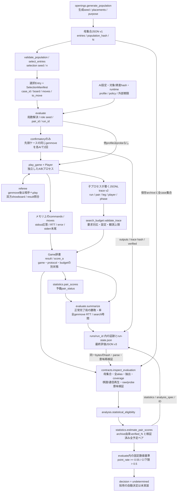

この図の`STORE`は論理上の保管先で、最終評価JSONはCLIの最後に書かれる。`commands`は対局中はメモリ上にあり、局開始前・終了後のcheckpointへ逐次保存される。進行中の局の全コマンドを一要求ごとに永続保存する経路はない。

Nは検証済みarchiveのentries件数だけから導出する。全alias・manifest・予定case/legを照合し、検証済み派生gameと共に統計へ渡す。取得時の予備pair_statusは正式資格と同義ではない。

##### 3.2 保存済み結果の比較

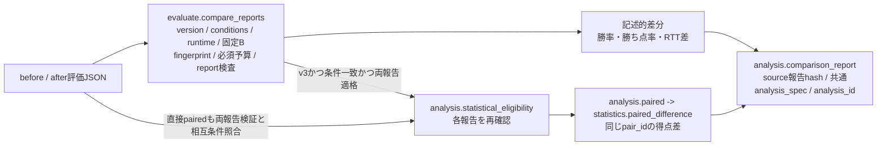

旧v1/v2は記述的結果として保持し、正式ペア区間を付けない。`python -m harness.analysis --report SOURCE --output NEW`はAIを起動せず再検証し、analysis JSONに来歴を保存する。`--evidence-root`は同一証跡の移動先指定である。比較/解析JSON自体の汎用schema検査は未実装。

#### 4. C: 現在の状態と遷移

実装は状態機械クラスではなく、辞書の複数フィールドを更新する。以下は観測できる遷移の整理であり、`report_state`、対局、通信、予算、統計を一つの成功/失敗に潰さない。

##### 4.1 取得checkpointの状態

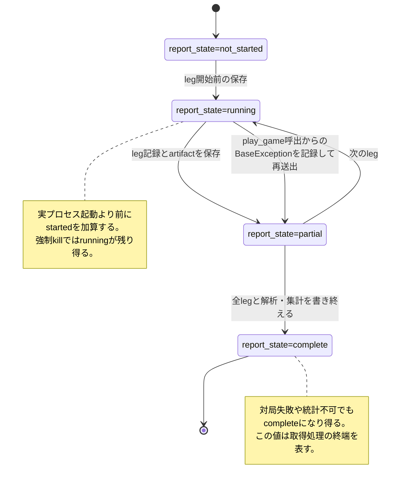

##### 4.2 対局・通信と予算の別状態

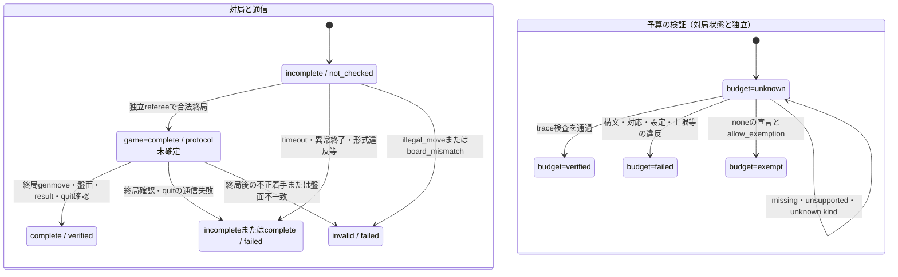

取得時は予算検証と参考勝敗を別軸に保つ。再解析では両playerと完全なcommandsを要求する。noneは許可済みBだけexempt、その他unknown。取得時の空players集約など中断経路は正式統計で拒否するが、取得側の改善課題は残る。

##### 4.3 統計と採用保留

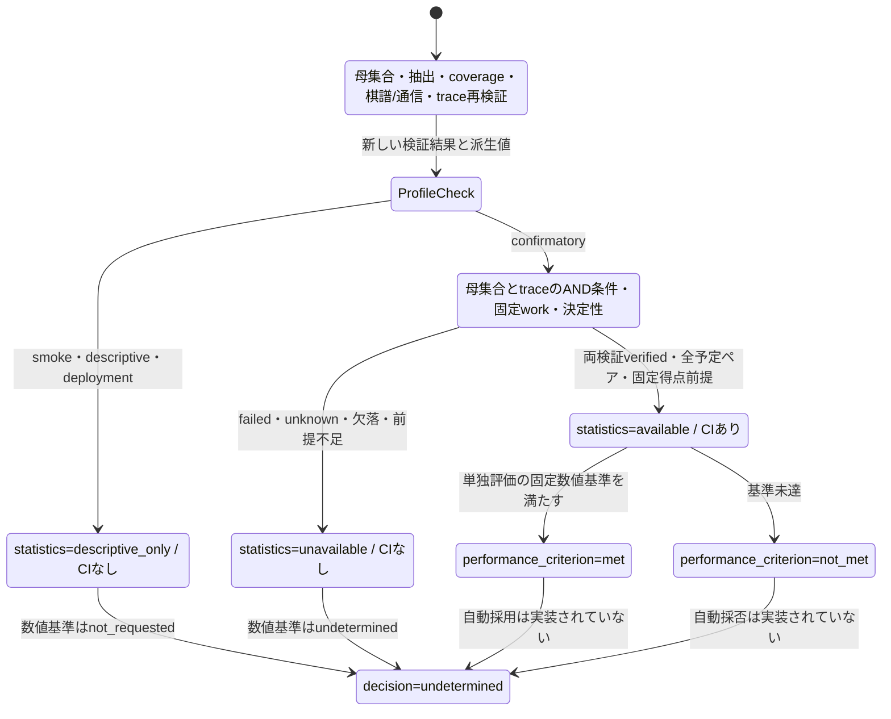

比較の`improvement_criterion`はCI下限が0を超えるかで判定する別項目。最終採用の品質・held-out利用履歴・事前凍結基準を統合する処理は未実装であり、次の図は**将来案のみ**である。

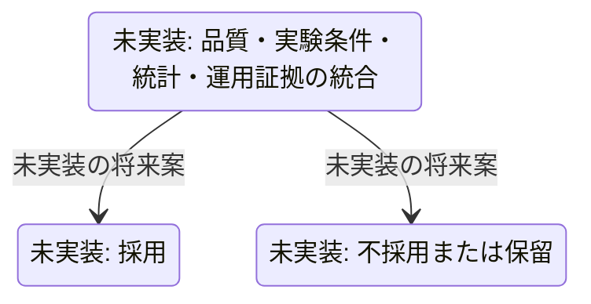

#### 5. 2026-10-09の監査と再現入力（修正前）

実装・テストは読み取りのみ。AST解析のimport循環は0件。`python -B -m pytest -p no:cacheprovider --collect-only -q` は86件収集（0.11秒、テスト本体は未実行）。以前の全86件成功という履歴を今回のテスト実行結果として扱わない。

新規2文書はUTF-8で再読込し、相対リンクと参照行、表の列数、code fence、7つのMermaidブロック構造を確認した。Mermaid描画CLIはこの環境では利用できず、実レンダリングは未確認。既存Python17ファイルの作成前後のSHA-256はすべて一致した。

一時ディレクトリ内で計10局を取得した。共通の基準報告は`budget_player.py`同士、序盤N=4・8 placements・生成seed=913、games=2、master seed=73、selection seed=9、nodes=100・`fixture-node-v1`、confirmatory、confidence=0.90。基準の報告検査は`[]`、統計はavailableだった。加えて初期盤面4局、既定設定fixture2局、決定性probe失敗をメモリ上で注入したCLI2局を使用した。診断スクリプトは正常終了した（約4.25秒）。一時ファイルは終了時に削除した。

| 診断 | 入力の操作と実行関数 | 確認した結果 |
|---|---|---|
| D01 / A01 | 基準のdeepcopyで`population.size=1`だけ変更し`validate_report`、`analysis.estimate` | 検査`[]`、available、`finite_population_census`、CI `[0.5,0.5]`。保存母集合はN=4のまま |
| D02 / A02 | 1つのraw traceを`null`行に置換し、artifact hashのみ更新。旧verifiedは維持 | `validate_trace`はfailed、報告検査は`[]`、統計はavailable。改変者の認証を要求する試験ではなく、再読込時に内容検査を再実行するかの試験 |
| D03 / A03 | 有効traceの実効設定と要求hashを`kind=none`・適用除外なしに変更 | `validate_trace(..., allow_exemption=False)`がverified |
| D04 / A04 | 有効traceのclock・scopeを未定義文字列、headerと全要求のmodel IDを未登録値へ変更 | `validate_trace`がverified。外部計時/モデル資産との意味照合は行われない |
| D05 / A05 | `_verify_determinism`の戻り値へfailedを注入しconfirmatoryの`main()`を実行 | 合法対局・予算確認は完了、statistics=unavailable、determinism=falseだが終了コード0 |
| D06 / A06 | 本体同士、固定序盤なし、games=4で取得し自分と比較 | 4局正常完了。`expected_cases_unavailable`、`unexpected_pair`、coverage不一致で比較不可 |
| D07 / A07 | fixture同士、config省略で取得 | 報告の要求設定v1、子の実効設定v2、budget=failed、`trace_identity_mismatch` |
| D08 / A08 | 公表experiment IDからanalysis IDを再計算。`analysis.estimate(report)`も実行 | analysis ID不一致。元のconfidence=0.90だが引数省略の再推定は0.95 |
| D09 / A09 | deepcopyのruntime.machineのみ変更しexperiment ID再計算 | 報告検査`[]`。`analysis.paired`はavailable、`compare_reports`は比較不可 |
| D10 / A05 | 旧v1のsynthetic報告にconfirmatory profile、予算フラグなしで自己比較 | comparable=true、budget_comparable=false。主比較経路のstrict要求と差がある |

D01・D02・D04・D09は保存データの故障/不整合を注入した試験、D05は関数境界の故障注入、D10は旧形式の最小構造を与えた試験。自然に発生する頻度までは測定していない。

#### 6. 2026-10-09の問題分類と優先順位（現状差分は第8節）

P0は正式統計へ不適格データを通す問題、P1は契約・比較・終了判定の修正、P2は構造・記録・試験の改善。以下の推奨修正はすべて未実装である。

| ID / 優先度 | 分類 | 根拠・発生条件・影響ファイル | 推奨修正 |
|---|---|---|---|
| A01 / **P0** | 契約の不一致・データフロー・統計前提 | `contracts.py:190`がarchiveを検証するが`report.population.size`と結ばない。`analysis.py:54`がこの未照合Nを数式へ渡す。D01で偽の全数区間 | archiveから検証済みNを一度だけ得て全aliasを照合し、数式へその値を渡す。N/n/manifest/population metadataの故障注入試験 |
| A02 / **P0** | データフロー・状態管理・契約の不一致 | `contracts.py:295`はtraceの存在/hashのみ検査し、`search_budget.validate_trace`を呼ばない。A/Bの`players`完全性や各player予算からgame予算を再計算しない。`analysis.py:23`はgameの保存statusを信頼。D02 | 取得と再読込で同じ内容検証を使い、現在の検証結果を新規に算出する。hashは破損検出、意味検証は別。両プレイヤー・全要求のcoverageを必須化 |
| A03 / **P1** | 契約の不一致 | `search_budget.py:120`がnone未承認のunknown理由を無視して通常trace処理へ進み、末尾verifiedへ落ちる。D03。必須予算検証を誤って満たせる | noneは許可済みB適用除外のexempt、それ以外はunknownとして閉じる。trace有無×宣言×role×policyの境界試験 |
| A04 / **P1** | 契約の不一致・再現性/比較条件 | `search_budget.py:143`はclock/scopeの非空文字列だけを検査。モデルはheaderとイベント同士のみ照合、要求モデル・資産hashとの照合なし。none除外も本体hashと理由のみ。D04 | 計測定義ID・モデル資産・除外証拠を要求条件と照合。wall/CPU等の非互換を同じtimeとして扱わない。自己申告の限界も明記 |
| A05 / **P1** | 状態管理・契約の不一致 | `evaluate.py:908`のCLI成功条件に正式統計のavailableがない（D05）。v1分岐`753`はstrict profileを要求へ含めない（D10）。最終出力OSErrorは`924`で2、checkpointだけ1 | 実験品質・統計要求・入力不正・開始後I/O失敗を共通判定表へ接続。基準未達の0と正式統計不可の1を分ける |
| A06 / **P1** | 契約の不一致・再現性/比較条件 | 初期盤面games>=4を`evaluate`が許可、repeat seedを生成するが、`contracts.py:224`は2局しか予定を扱えない。D06 | 初期盤面の全repeat indexから予定pairを再構成。正式序盤統計なしという条件を維持し、4局以上の記述比較を検証 |
| A07 / **P1** | 契約の不一致・データフロー | `_config_info(None)`（`evaluate.py:54`）だけ正規化せずv1、`write_config`はv2。要求hashと実効hashの定義が分岐。D07 | default/path/dict入力を同じ正規化関数へ通す。原設定と正規化設定のhashを区別して保存 |
| A08 / **P1** | 契約の不一致・責務の重複 | `evaluate.py:588`で公表experiment IDを更新した後、`680`で古い局所変数をanalysis IDへ使用。`analysis.py:51`はreport.analysis_specを使わず0.95へ戻る。指標・閾値はevaluate内に残る。D08 | 正規化analysis_specとID算出をanalysisの唯一の入口にする。公表ID・source報告hashを参照し、引数省略時は保存specを使う |
| A09 / **P1** | 再現性/比較条件・契約の不一致 | `analysis.paired`は各報告適格性だけ確認し、相手・環境・予算・fingerprint相互比較なし。`compare_reports`を通さず直接利用するとD09 | 共通比較契約をanalysisのpublic入口でも必須化、または内部専用関数に限定。entrypoint別の保証差をなくす |
| A10 / **P1** | 責務の重複・再現性/比較条件 | `_harness_info`（`evaluate.py:83`）は解析/基準コードもあるevaluate全体を対戦hashへ入れ、実行する`seeded_player.py`を含めない | 実行依存としてseed adapterを含める。解析/採用処理を既存analysisへ寄せ、解析だけの差で再対局を要求しない。対象AIのimport資産は引き続き明示登録 |
| A11 / **P2** | 責務の重複 | canonical_json/digestがcontracts/openings/search_budgetに重複し、openings.digestだけbytesも受ける。pair IDはcontractsに定義があるがevaluateは式を複写。状態集計とsummaryがevaluate/contract、ペア検査がstatistics/contractに分散 | 純粋なID・正規化・状態投影をcontractsに集約し、生成と検証は同じ定義を呼ぶ。独立refereeとAI本体のルール実装は意図した独立性として残す |
| A12 / **P2** | 状態管理 | `play_game`の空playersの`all([])`（`evaluate.py:357`）はexempt。startedはPopen前に増える（`617`）、完了はreport/game/protocol/summaryごとに意味が違う。testの中断は関数故障であり実起動証拠ではない | 空集合をnot_checked/unknownへ、予定leg/起動試行/進行中/合法終局/通信完了を区別。状態値を閉じた集合にして変換表を共有 |
| A13 / **P2** | データフロー | config原本は保存せずnormalized config一時ファイルは削除。evidence.rootは絶対パス。checkpointはleg単位で進行中コマンドは未保存。probe、mkdir、artifact読取、最終JSON保存の例外を単一の中断経路では覆わない | 原/正規化設定と定義版をarchive、読込基準ディレクトリを引数化し持運び可能にする。必要な監査水準に応じ要求単位journalか局単位限界を明示。保存失敗試験 |
| A14 / **P2** | 統計的な前提 | 決定性は先頭ケースの1要求×2回と宣言。全ケース得点が固定という前提の証明ではない。held_outの利用履歴・基準事前固定・品質統合は未実装、decisionは常にundetermined | 決定性宣言・コード/資産/設定に結び付く試験のscopeを記録。有限母集団の主張範囲を維持し、採用の証拠不足は保留する |
| A15 / **P2** | テストの不足・契約の不一致 | v1/v2の`validate_report=[]`は検証済みを意味しない。comparison/analysis kindの検査はない。descriptive estimateはreport検査を省略。既存試験はD01～D10の大半を覆わない。計画のsample_set_id・独立execution_order・number normalization versionはフィールド未実装 | validated/legacy_unverified/invalidを区別し、schema dispatchの最小契約を固定。下表の境界試験と文書差分を先に受け入れ条件へ追加 |
| A16 / **P2** | 契約の不一致・データフロー | GUI bundleはdepth/temperatureを送るがweb.pyは無視。表示名win-chanceに対しscoreは確率ではなく黒視点の結果符号 | GUIと評価の設定・scoreの別契約を明記する。将来接続するときに、値を受理する側の責務と試験を定める。今回GUI修正は行わない |

`complete`と`verified`などを独立に保持すること自体を矛盾とは判定しない。問題は定義が利用先へ伝わらず、未検証値から次段の保証を導いたり、異なる集合を同じ名前の数として使う点である。

#### 7. 推奨する依存方向と拡張手順（未実装）

大きな作り直しより、既存モジュールの入口と定義元を揃えることを推奨する。新規の管理層・plugin機構・多数の設定ファイルは不要。

1. **P0の境界を閉じる**: N/manifest/予定coverage/両playerをarchiveと実値から検証し、同じtrace内容検査を取得・再読込へ適用する。保存statusを資格の証拠にしない。noneの判定もここで統一する。
2. **既存contractsへ唯一の定義を置く**: schema版・enum・ID・局数・状態投影・比較条件projectionを定義する。必要なら少数の`TypedDict`を同じファイルに置く。盤面生成/合法性はopenings/referee、予算の専門検査はsearch_budgetのままにする。
3. **analysisを解析入口にする**: 検証済みcollectionを受け、単独/比較双方の資格と同一性を検査し、analysis_spec・区間・数値基準を返す。statisticsは検証済みペア得点配列とN、range、confidenceに対する数式を担当する。evaluateは取得とCLI・保存を担当する。
4. **方法追加は明示的に行う**: 新しいmethodをanalysis_specとCLIに追加し、analysisから対応するstatistics関数へ接続する。初期段階は明示的な分岐で足りる。推定対象・前提・range・必要データ・census処理を必ず併記する。
5. **設計とテストを同じ変更で更新する**: 新フィールド/状態/方法/モジュールを追加する変更は、下記確認表、対応テスト、2資料の現状図と契約表を一緒に更新する。計画や理想図は現状図に混ぜない。未実行試験を成功扱いしない。

推奨依存は`evaluate -> analysis -> statistics`、`evaluate/analysis -> contracts`、`contracts -> openings/referee/search_budget`を基本にする。共通record・比較条件・seed/pair IDはcontracts、専門的な序盤/予算の定義は各専門モジュールを唯一の定義元とする。専門モジュールからcontractsへの戻りimportを追加すると循環するため、canonical化をcontractsへ移して逆importする案は採用しない。共通のJSON/hash基本関数まで集約する場合は、既存`harness/__init__.py`へ小さな純粋関数だけを置き、そこから他モジュールをimportしない方向にする。状態や資格ロジックをpackage初期化へ置く案ではない。これにより新規ファイルを増やさず、IDの呼び出しと専門検査の依存方向を維持できる。変更後はASTで循環がないことを再確認する。

共通関数への集約は、同じ関数の出力をそのまま期待値にする理由にはならない。課題仕様に基づく固定盤面、手計算得点、独立数値例のテストは維持する。

| 拡張対象 | 変更前に確認する契約・経路 | 必要になる境界試験（今回未追加） |
|---|---|---|
| 序盤・sampling | case/orbit/population/selection/pair、N/n、履歴、pass、予定coverage | serialized報告の各alias不一致、重複/欠落/順序だけの変更、初期盤面repeat |
| AI・seed adapter | A/B役割seed、コード/資産hash、determinism scope、両盤面同期 | 同seed再現/異seed、固定B変更禁止、adapter変更のfingerprint、異なる乱数源 |
| 予算/モデル | 原/正規化/実効/観測、clock/scope、モデル資産、none権限、全phase | 誤設定・超過・missing・未知版・非object・未承認none・モデル差・raw再検証 |
| 統計method | estimand、N/n、固定得点前提、range、spec、解析ID、全予定ペア | 独立数値例、全数、定数標本、境界水準、再解析spec、比較APIの条件違反 |
| 状態/保存 | game/protocol/budget/quality/statistics/decision、started、evidence path | 起動前失敗・局中断・quit失敗・保存失敗・移動・改変・終了コード |
| GUI/プロトコル | 課題stdout形式、genmoveの自己更新、GUIのpass変換 | 本体stdinの既存固定期待値とGUI接続の回帰、stdout混入、期限・停止 |

新モジュール追加時は、まずこの表で「誰が生成し、どの検査を通り、誰が消費するか」を決める。辞書のフィールドを複写して独自に条件式を作る前に、契約表の定義元と既存public入口を確認する。

#### 8. 2026-10-11: 計画第10節の実装差分

- A01/A02: inspect_evaluationに母集合・manifest全照合、同一bytesのhash/parse、棋譜と双方commandsの厳密再生、raw/probe意味検証を集約。正式入口は保存statusではなく派生値を使う。
- A03/A04: 宣言なしnoneはunknown。適用除外はB/policy/理由/元本体hashに限定。対応時計はperf_counter_ns、scopeはsearch_only。モデル指定は要求model_idと登録asset hashを要求し、内部計測の真正性とは区別する。
- A05/A06/A07/A08/A09の関連経路: 正式統計不可はCLI 1、初期盤面の複数repeatを再構成、default configもv2正規化、単独analysis IDは公表experiment IDを使用、保存confidenceを再利用、direct pairedも共通相互条件照合。
- 再解析結果の検証器版/fingerprintは元の取得fingerprintとは別。新しい検証器で旧v3を検証できるが、before/afterの取得fingerprint一致は維持する。
- time/deploymentは同じ保存局のcommands・棋譜・rawを照合し、別runとの棋譜一致や正式固定得点CIを要求しない。品質unknown/failedとCI not_requestedを混同しない。
- 全case・全leg・両通信・要求trace・許可済み予算・固定work・決定性条件をANDで要求。どちらか未検証ならCIなし。failedを優先し、次にunknown。decisionは従来どおりundetermined。
- 残る限界: 自己申告counterの真実性、有限probeでの全ケース決定性証明、traceを出さないBの決定性証拠、seeded adapterの取得fingerprint、実Popenに基づくprogress、全保存区間の障害対応。第6節の未解決項目を修正済み扱いしない。

#### 9. 現行schema5の構造（6件の整合性修正＋Goal 2接続）

第1〜8節のv3監査snapshotとは区別する。現行の責務・呼出経路は次のとおり。

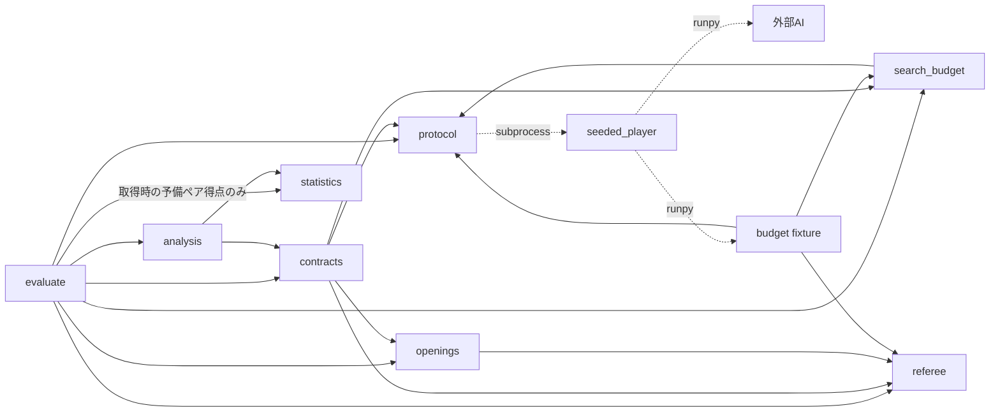

- protocolは整数nsの実測端点・全command index・clock domainを所有し、純粋なhost形式/区間検査も提供する。
- search_budgetはtrace4とhost記録をjoinして子初期化・全CC/CR・終了準備、内部探索・model loadの包含、要求予算、phase/盤面hash/応答を確認する。clock descriptorの適用可否はprotocol.clock_statusへ集約する。
- contractsはdecode_input、必要A/B集約、source階層、game/probe通信再生、fresh測定とcache/summary照合、共通writerを所有する。statisticsへのimportはない。
- analysisの公開assess_evaluation/assess_comparisonも原reportをfresh検証する。判定核はprivate _assess_inspection/_assess_pair_inspections。estimate/paired/reanalysis/comparison builder、evaluate.compare_reportsも同じ核を使う。
- statisticsは算術だけを返し、成功もcomputed/arithmetic_only/not_assessedであって正式availableではない。evaluateのpair_statusは取得時の予備記録であり正式資格ではない。
- _inspect_evaluationのcache照合なし経路は、collectorのsummary生成前のprivate coreだけに使う。公開inspect_evaluationは必ず全cacheを照合する。

**Goal 2の時間境界:** contracts._inspect_timelinesはgameと必須probeの全sessionを検査する。親SP/PR/全要求/quit、子CE/IR/全CC/CR/CS、要求内探索、A/B予定因果辺を接続する。比較不能・欠損・QPC曖昧境界はunknown、確認済み矛盾はfailed。原証拠全体の整合した偽造を認証する仕組みではない。

上の依存図は現在も同じ方向。protocolの親lifecycle検査とsearch_budgetの子lifecycle検査をcontractsが使用し、session/因果辺を集約する。新モジュール・逆importは不要。公開assessへ保存Inspectionを渡す互換経路は置かず、入力不正として扱う。

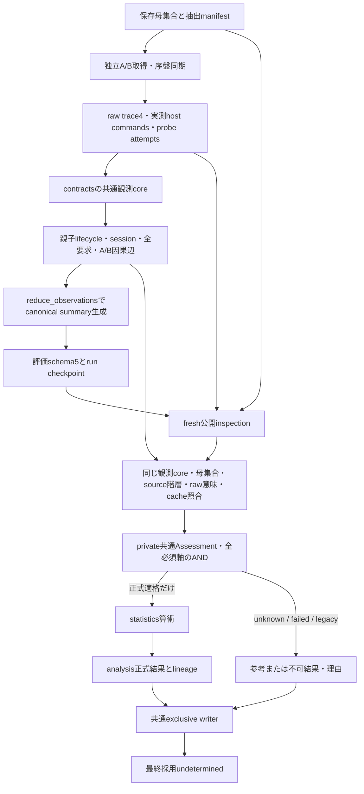

LIFEは共通core内の実行経路であり、取得時summary生成と保存後の公開inspectionで同じ原証拠を検査する。summary生成前だけ保存summary照合の対象がないが、時間検査は省略しない。新取得はraw trace4・親lifecycle・評価schema5。正式資格は時間だけでなく母集合・抽出・全予定leg・盤面・予算・測定・固定work/決定性条件も要求する。

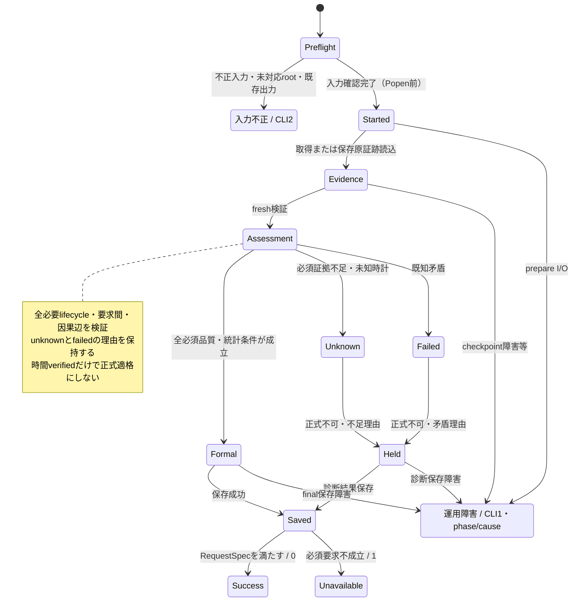

role予算はverified/exempt/unknown/failed、game/report予算はverified/unknown/failed。B通常内部予算除外は両host・通常Bの子lifecycle・B決定性probeを免除しない。原failed/unknownは更正なしに昇格しない。取得completeとpublication savedは別で、exclusive writerが成功を返す前に保存完了を報告しない。

現在の時計対応は同一local CPython3.13/Windows/QueryPerformanceCounter契約に限定する。他OS/runtime/clockは未知として正式保留にする。旧schema3の秒から端点を補造せず、過去CIは歴史的主張として保持する。

新規moduleでは、(1)必要role/識別子、(2)host-child計測scope、(3)source/cache/rawの生成元、(4)共通Assessmentへの合流、(5)入力2/運用1、(6)新旧schema、(7)公開入口閉包の回帰を確認する。実行記録は[ハーネス検証記録](../reports/ハーネス検証記録.md)、詳細設計は[修正モデル](ハーネス整合性修正モデル.md)を参照する。図の存在は契約成立の証明ではない。

#### 10. T1: 起動・通信・終了を接続する提案（未実装）

正本は[時系列整合性修正計画](ハーネス時系列整合性修正計画.md)。プロセスsequenceは既存の[修正モデル第5節](ハーネス整合性修正モデル.md#5-時間区間モデル)を実際に更新した。既存モジュール内の関数拡張だけを使う。

| 流れ | 追加するデータ/検証 | 消費先・境界 |
|---|---|---|
| evaluate → Player | run共通domain、slot、Popen試行ごとのsession/generation | 親lifecycleと子contextへ結合。case/seedの同一性定義は変えない |
| Popen → name → commands → quit/abort | SP/PR、全command、最初の終了観測・終了理由 | protocol.validate_process_timeline（提案）。起動/終了と要求列を結ぶ |
| 子 → raw trace4 | CE/IR、全CC/CR、genmove内部計測、quit/CS | search_budgetの型別dispatchと子lifecycle検査（提案） |
| 原報告/原raw → contracts | 親/子/ID/clock/因果辺を同じbytesから検証 | 新規最終検査と保存再解析が同じcoreへ合流。保存状態を信用しない |
| Inspection → analysis | timingの各substatusと理由、既存品質軸 | public wrapper→fresh→private判定核。unknown/failedなら正式へ進まない |
| 正式/参考/失敗結果 → writer | source取得版と新検証版のlineage | 原資料不変。取得completeとsavedを区別。採用はundetermined |

T1の時計前提は同一local対応counter。親のSP≤PR、子のSP≤CEは検査するがPRとCEは全順序化しない。子readyより先にnameを送信してpipe待ちになる正常系を許す。CSは終了準備、EOは終了後の観測であって同一イベントではない。未知clockを大きな誤差で認可しない。

T1の異thread時刻比較ではQPCの1tick近傍の順序曖昧性を考慮する。protocolが実測周波数/計測thread所属と3値の順序helperを所有し、search_budget/contractsが共用する。曖昧値はunknown→Heldであり、猶予付きverifiedではない。同一親threadの連続要求や起動前通信は厳密に検査する。根拠とUの登録条件は時系列計画第4節。

状態図のUnknown/Failedは既存の判定分類の可視化であり、新しい実行状態enumがコードに追加済みという意味ではない。T1では両role/必須probeのlifecycle欠損→Unknown、既知矛盾→Failedを接続する。母集合だけverified、予算だけverified/exempt、n=N、hash一致、取得completeのいずれもこのHeld経路を迂回できない。

旧4正常は新証拠不足のunknownとして参考保持、旧4の検出できる逆転はfailed。未対応scope/実AItrace/OSは対応済みにしない。全端点を起動前へ移す反例、起動前quit、公開入口閉包、B予算除外とのANDは時系列計画T03〜T18へ対応する。設計の照合であり、修正の動作確認ではない。

#### 11. Goal 1: schema5接続を回復した中間版（2026-10-13）

本節はGoal 1時点の履歴。現在の接続は第12節に記載する。

取得側だけschema5へ移っていたため、decode_inputがunsupportedを返し、_acquisition_summaryが未生成のcanonical_summaryへアクセスして停止していた。schema1〜5を明示受理し、新5のgame/probeで期待run/slot/purpose/case/role seed/domainとsession/generation/all-command IDを照合する。欠損はunknown、提供された矛盾はfailed。旧command ID規則は旧schemaに維持し、新5を旧4として解析しない。

原rawの設定・盤面・応答・探索区間・予算と保存cacheを検証し、reduce_observationsから実データのcanonical_summaryを生成する。取得時private coreと公開再解析が同じidentity・集計規則を使う。集計不能なら仮値を返さずacquisition_inspection_unavailableのValueErrorとする。

analysis/comparison出力5、inspection validation3。通常descriptiveは参考評価・保存が正常なら終了0。confirmatory/strict要求は未完時間品質の診断を保存して終了1。取得completeと正式適格・採用は分離する。

**Goal 2との境界:** validate_process_timeline/validate_child_lifecycleの全面接続、親子初期化・全要求間・A/B因果辺の検証は今回開始していない。timing.command_intervalsとtiming.lifecycleを分け、後者はlifecycle_verification_not_integrated/unknown。analysisのprivate readiness guardもFalseで、保存positiveや偽Inspectionから正式availableを発行しない。入力JSON/CLIに解除スイッチはない。解除にはGoal 2の実装と回帰が必要。

_schema5_identityと欠損例外はcontracts内に置き、既存import方向を維持。新module・逆import・循環は追加していない。実行証拠は[検証記録](../reports/ハーネス検証記録.md)のGoal 1節。

#### 12. Goal 2: 共通時系列検証と公開境界

contracts._inspect_timelinesが同一inspectionのartifact bytes cacheから全game・必須probeを読み、protocol.validate_process_timeline、search_budget.validate_child_lifecycleと探索区間検査を呼ぶ。sessionのrun全体一意性、run/purpose/case/role seed/domainの対応、予定通信列によるA/B因果辺も照合する。予算の適用除外でlifecycleを免除しない。

公開assess_evaluationは原reportを、assess_comparisonはbefore/afterの二つの原reportを受ける。内部だけがfresh Inspectionをprivate核へ渡す。保存Inspectionやcaller製資格を認可する経路はない。最終全291件（時系列55件を含む）・独立smoke・12件の実CLIと保存データの公開API再監査は成功した。条件・旧4のunknown/failed・未保証事項は検証記録を参照し、図の存在だけで保証しない。

<a id="snapshot-harness-contracts"></a>

### 整理前の `docs/harness_contracts.md`

### ハーネスのデータ契約と不変条件

**現行版の参照先:** 第1〜8節はv3時点の履歴。6件修正後の現行schema4は第9節を参照する。

**2026-10-12設計追補:** 第9節は現行の保証範囲を補正。第10節はT1の未実装提案。新計画の存在を既存評価の正式資格へ反映してはいけない。

**2026-10-13 / Goal 1中間版（履歴）:** 第11節は当時の接続契約。第9節はschema4時点の履歴である。

**Goal 2接続実装・検証完了:** 現在の時間・公開入口契約は第12節。第9・11節の未接続/readiness guardは履歴として扱う。全291件・時系列55件・正常/不正/unknownのAPI/CLI照合の根拠はコードと実行記録で確認する。第10節の全条件・全運用を検証済みとはみなさない。

監査日: 2026-10-09。契約更新: 2026-10-11（計画第10節）。対象は [harness_architecture.md](../harness_architecture.md) と同じ未コミット変更を含む作業ツリー。この資料では、**現在の定義**、**保証すべき条件**、**実際の検査/既存テストの範囲**を区別する。不一致の詳細・優先度・診断結果は同資料のA01～A16に対応する。

課題のコマンド・ルール・時間制限の正本は [プログラム開発方法.md](../../プログラム開発方法.md)。ここでは仕様を変更せず、モジュールの間でその仕様をどう表現しているかを記録する。将来必要な試験の一覧は受け入れ条件の提案であり、修正前の不足欄も保持し、今回の対応と新しい回帰テストは第8節に示す。

#### 1. 形式・型と境界

以下の`OpeningEntry`、`Game`などの名前は説明用で、実装に同名の型クラスはない。現在は`dict`、`list`、`tuple`を受け渡す。型・必須項目・enumを網羅した単一schemaは未実装。

| データ / 実型 | 生成元 → 利用先 | 現在の主要フィールド | 検査・変換の境界 |
|---|---|---|---|
| `Rows`: メモリ`tuple[str,...]`、JSON`list[str]` | referee / openings / AI応答 → evaluate / contracts | 8行、各行8文字の`B/W/E` | `Player._validate`はshowboard形式を検査。refereeは基本的に妥当な盤面を前提。contractsは一部でlist/tuple同値を扱う |
| `Position`: tuple/listの整数2個、wireでは`"x y"` | referee / AI → play_game / openings / contracts | x列、y行、左上0,0、0～7 | GUI passは`[-1,-1]`、harness passは`None`。`web._make_board`がGUI表現を処理する |
| `OpeningEntry`: dict | `openings._entry` → 選択/対局/再生 | case_id、orbit_id、moves、board、to_move | `validate_entry`が初期盤面から履歴を再生してID・盤面・手番を検査 |
| `OpeningPopulation`: dict / JSON v1 | `generate_population` → `load_population` / contracts | rules/identity版、purpose、placements、generator、N、entries、hash | 合法履歴、case/orbit重複、件数、全体hashを検査。生成時の乱数分布と標本抽出分布は別 |
| `SelectionManifest`: dict v1 | select_entries → contracts / analysis | hash/N/algorithm/seed/selected IDs/n | 整数型・全manifestを再現照合。同じPython major/minorで対応し、未対応runtimeはunknown |
| `BudgetConfig`: dict v1入力/v2正規化 | normalize_config → live / 再解析 | budget.kind/limit、search、none exemption | defaultを含む全経路でv2正規化・同一hash。モデル指定時はmodel_idと登録model_sha256を要求 |
| `TraceHeader`: JSONL dict v2 | AI → validate_trace_events | run/pair/leg/player/config/target、clock/scope/model/load/fallback | 要求との対応、perf_counter_ns/search_only、モデル宣言を照合。未知版/計測定義はunknown |
| `TraceGenmove`: JSONL dict | AI → `search_budget` | sequence、phase、command、color、board hash、response、search ns、nodes/depth、stop_reason、model/load/fallback | コマンド全件との対応、非負整数、kindの上限などを検査。AI内部の計数の真実性までは検証しない |
| `CommandRecord`: list内dict | `Player._exchange` / `finish` → evaluate / contracts / trace検証 | command、startup_probe、seconds、responseまたはerror。成功genmoveにphaseを後付け | メモリ上の記録。完全なraw stdout/stderrのバイト列ではない |
| `Game`: dict | live → inspect_evaluation → 派生game | case/pair/leg/seeds、棋譜、双方commands、原status | 両player・全通信順・盤面・合法手/pass/終局・勝敗・RTT・quit/exitを再検証し、rawと同じ対局内で照合 |
| `EvaluationReport`: dict / JSON v3 | evaluate/CLI → contracts / analysis / compare | kind、run/experiment/analysis ID、runtime、conditions、request、targets、population、evidence、games、summary、status、statistics | `contracts.validate_report`はevaluation専用。旧v1/v2は実質検査なし。完全なschema検査ではない |
| `Checkpoint`: run-state.json | `_write_progress` → 中断調査 | report_state、games、summary、planned/started/completed/not_started、in_progress、interrupted_legs | fsync後のos.replaceで更新。進行中の局のコマンド一件ごとの永続化ではない |
| `StatisticsResult`: dict | inspection → analysis → statistics | status/CI、verification、coverage_kind | 正式入口は検証済みarchive Nと派生gameのみ使用。数式APIの直接呼出は母集合/traceを保証しない |
| `ComparisonReport`: dict / JSON v3 | `analysis.comparison_report` → JSON保存 / 利用者 | source報告hash/ID、analysis_spec/ID/fingerprint、比較条件、差分、CI、基準 | 生成は実装済み。contractsによるcomparison schemaの検査は未実装 |
| GUI JSON: dict | `web.RequestHandler` → ブラウザ | positions、数値board、valid、end、score | boardは黒1/白-1/空0、scoreは黒視点。harnessのA視点得点とは別の契約 |

ブラウザbundleのHTTP要求には`depth`・`temperature`も含まれるが、サーバはpositions以外の両設定を読み取らない。bundleの`win-chance`というコンソール表示は上記scoreの符号であり、勝率や勝ち点率ではない（A16）。

#### 2. 識別子・hashの契約

すべての意味上のhashを同じIDと解釈しない。JSON canonical化は`ensure_ascii=False`、`sort_keys=True`、空白なし、`allow_nan=False`という定義が3モジュールに複写されている。`openings.digest`のみbytesをそのままhashする経路も持つ。

| 識別子 | 定義元 / 生成方法 | 利用先・保証すべき不変条件 | 既存テストと不足 |
|---|---|---|---|
| `opening_id` | **現在はフィールドも関数も存在しない** | case_idまたはorbit_idの別名として勝手に追加しない。必要なら意味と移行を決める | 該当テストなし |
| `case_id` | [openings.py](../../harness/openings.py#L40)のcanonical JSON SHA-256。identity_version=1、rules_version、初期盤面、色/座標/passの全履歴、到達盤面、手番 | 履歴込みの実験ケース。盤面だけが同じでも履歴が異なればIDは変わり得る。保存先・AI・runに依存しない | `test_opening_population_is_reproducible_validated_and_sampled_without_replacement`、forced opening試験で間接確認。同一盤面・異履歴IDの直接例はなし |
| `orbit_id` | `openings.orbit_id`。D4の8変換における盤面+手番の最小文字列をJSONとしてhash | 対称重複の排除用。履歴・AIを含まない。case_idの代わりにペアを対応付けない | 母集合のorbit数・重複検査はあり。全8変換を個別照合する試験はなし |
| `population_hash` | 母集合の自己hash以外の全内容をhash | 検証済みarchiveのhash・N・case集合と報告全aliasを照合 | N/hash/purpose/placements/selected/manifest改変の回帰試験を追加 |
| `selection_hash` | manifestの自己hash付加前のhash | 対応runtimeで全manifestを再現。同一N・整数n・algorithm・seed・ID順が必要 | algorithm/n/Nの改変、未知runtime停止を回帰試験 |
| `sample_set_id` / `execution_order` | **専用フィールドは未実装**。manifestの配列順とgames.indexが現状の順序情報 | 拡張計画上の概念。現状図では実装済みIDとして描かない。games配列の順序変更だけは集合照合で対応可能 | 順序だけの変更をbefore/afterで直接比較する試験なし |
| `pair_id` | [contracts.py](../../harness/contracts.py#L82)は`pair_version=1, case_id, seeds, role_swap_version=1`をhash。evaluateには同じ式を複写 | caseとA/B役割seedを結ぶ先後2局の意味上の単位。run_id・leg・予算・AI版・pathを含めないためAI改良前後でも対応付ける。同IDなら両legの実値も再検査 | 正常先後・seed改変・欠落ペアを試験。両定義の直接一致、初期盤面複数repeatの検査不足（A06、A11） |
| `run_id` | evaluateでUUID hex | 1回の取得と証跡保存領域。比較条件の同一性を意味しない | trace4ファイルの一意性試験あり。別runのディレクトリ移動試験なし |
| `experiment_id` | `_experiment_id`。conditions、runtime、A/B本体と明示asset hash、evaluation_fingerprintをhash | confidenceやpathは直接含めない。ただしruntime.executableは絶対パス、conditionsに抽出順序と観測済みdeterminism boolを含む。confirmatoryのprobe後に再計算される | confidenceだけの差で同IDを試験。観測結果によるID変化・予定条件との分離は未検証 |
| `evaluation_fingerprint` | evaluate/protocol/referee/openings/search_budget/contracts各ファイルhash配列のhash | 取得・ルール・seed・計測の定義を固定する意図。実際はseeded_playerを省略し、解析基準を持つevaluate全体を含む（A10） | confidence引数差の同一性のみ。ファイル責務別の差分試験なし |
| `analysis_fingerprint` | 単独評価と比較報告に別の構築式。analysis.py/statistics.pyのhashとspec（confidence等） | 数式/解析条件の版を固定。方法・estimand・基準すべてを同じ正規化specから生成することが必要 | confidence差で変化する試験あり。意味上のspec全部の照合はなし |
| `analysis_id` | 新規評価は公表experiment_id+解析版/spec。再解析はsource hash+現在の検証器/解析版/spec | 取得条件と解析条件を分離。旧IDは出典として保存 | 保存confidence再利用・新旧検証器分離・再解析ID差分を試験 |
| `board_sha256` | `search_budget.board_sha256`: 行を改行で連結したASCIIバイト列のSHA-256 | genmove要求**前**の盤面とtraceを対応付ける。case/orbit IDやJSON hashとは違う | 有効fixture traceで間接照合。個別の前後盤面取り違え試験なし |

hashは内容同一性を照合する道具で、実行者・モデル・内部計数の真正性を証明しない。rawファイルの新hashを正しく記録した場合にも内容検証が必要である（診断D02）。

#### 3. 条件・再現性・計測の契約

| 概念 | 定義元 → 利用先 | 保証すべき不変条件 | 現在の検査 / 既存テスト |
|---|---|---|---|
| 生成seed | `generate_population`の独立`random.Random(seed)` | 母集合生成の再現用。評価seedや抽出seedへ暗黙に同一の意味を与えない | integer検査、generatorに保存。同一生成のテストあり |
| selection seed | `select_entries`の独立`random.Random(seed).sample` | 保存済み母集合から一様な非復元抽出。n<=N。生成時のランダム合法手歩行分布を、全可能序盤への一様抽出とは主張しない | 正式評価で明示必須、reportから再抽出。同一seed・非復元のテストあり |
| master/role seed | `contracts.seed_for`。seed_version=1、master_seed、case_id、A/B role、repeat_indexをJSON SHA、先頭16hexを整数化 | 先後2局でも同じ**役割**に同seedを使う。固定序盤はrepeat=0、初期盤面反復はpair index | seed改変を試験。公開`play_game`の既定seed式は別の足し算で、evaluateから明示する経路と違う |
| プロセスseed | `Player`が`PYTHONHASHSEED=seed mod 2^32`、seeded_playerがPython randomを初期化 | subprocess/プロトコルは独立。numpy・GPU・別乱数源・時刻に依存する処理までは再現しない | 本体の同条件棋譜を試験。adapterはfingerprintに未登録（A10） |
| 決定性確認 | config.search.deterministicと先頭caseの2回probe | 全ケースの固定得点前提は有限probeでは証明できない | 元case/role seed・出力合法性・raw意味を再検証。traceなしBは決定性証拠不足として正式解析不可 |
| 対戦条件 | contracts.comparison_conditions / comparison_mismatches | 固定B・asset・ケース/seed・予算・計測・runtime・取得fingerprint一致 | compare_reportsと直接analysis.pairedで同じ相互照合。A.searchはdeterministic/counting IDを残して分離 |
| 解析条件 | analysis_spec / 再解析CLI | 取得条件と分離し、原資料は上書きしない | 保存confidenceを既定として再利用。再解析IDは原資料hashと現在の検証器/解析版/specに依存 |
| 要求/実効/観測予算 | normalize_config → config JSON → trace → 共通validator | 要求と実効一致、観測上限遵守。内部真正性とは別 | default含めv2正規化。同じvalidatorをliveと保存rawで使用 |
| equal-work | `compatible_budgets` | 同じnodes/depth kind・上限。nodesは同じ非空counting_definition_id | 生のconfig相互検査はあり。counting IDの実コード意味を検証する処理はなし |
| equal-time | compatible_budgetsとvalidate_trace_events | 同じ整数ns上限と対応時計/scope。固定得点CIを計算しない | perf_counter_ns/search_only以外はunknown。合法な異なる棋譜の比較を許可する回帰試験あり |
| baseline-asymmetric / none | policy、exemption_status、allow_exemption | Bのみ、理由と元本体hash一致時にexempt。Atrace/両通信/決定性証拠は別要求 | 宣言なしnoneはunknown。B対局traceなしは許可、Bprobeの壊れたrawは正式不可。資産に基づく除外の追加設計は未実装 |
| 外部応答時間 | `Player._exchange`のperf_counter | 送信直前から全応答・形式検査までのwall秒。genmove以外既定1秒、genmove10秒。終了処理やAI内部CPU時間と混同しない | 送受信・flush・OS schedulingを含む。期限後にprocessを停止する。遅延・検査時間・quit/起動失敗試験あり |
| 起動時間 / quit | Popen前から最初name完了まで / quit送信から正常終了まで | 起動は別既定5秒。最初nameを通常command期限と混同しない。quitは応答0行 | quit.secondsはreader join・abort全体時間ではない。超過停止の後処理時間とも別 |
| 内部探索時間 | AIのsearch_elapsed_ns、load ns | perf_counter_ns/search_only契約として検査。trace書込/通信RTTと別 | 未対応clock/scopeはunknown。内部コードの計測真正性は未保証 |
| 思考時間集計 | summarize | 全genmove RTTとsearch時間、通常着手search時間を別に見る。pass/terminal probeの混入を明示 | 全RTT/全search/normal-searchを保存。通常着手だけのRTTは未保存。contractsはsearch時間summaryを再計算しない |

`conditions.timeout_policy`の文字列は1秒/10秒を固定表示するが、CLIでは期限を変更できる。数値フィールドが実際の条件であり、この説明文字列だけを条件の正本にしない。

#### 4. 結果・検証・統計・採用の契約

| 項目 | 現在の定義 | 不変条件と実際の保証 | テスト状況 |
|---|---|---|---|
| `result` | 盤面の黒/白勝ち`B/W`、引分`D`、継続`NG` | 両色合法手なしで終局、石数で勝敗。色と候補roleを区別 | 固定期待盤面、8方向、不正手不変、pass、黒白引分、ライブプロトコル試験あり |
| `winner` / `score_a` | colorsで`B/W -> A/B`へ変換。A勝1、引分0.5、A負0 | 誤通信や不正手をA/Bの敗北に変換しない。正常終局の参考得点はbudget失敗でも残せる | 複数対局・異常試験あり。contractsは最終盤面/result/winner/scoreを照合 |
| `game_status` | incomplete / invalid / complete | completeは独立refereeの終局を得た時点。後続quit失敗時にcompleteが残る場合がある | 異常系間接試験あり。閉じたenumとして網羅検証はしていない |
| `protocol_status` | 取得時判定と現在のgameplay判定は別 | 元判定だけを信用せず両commandsを再生する | player欠落・command欠落/順序/phase/board/期限/exit矛盾を回帰試験 |
| `budget_status` | 新しいplayer trace結果から派生gameへ集約 | 両player必須。許可済みBのみexempt、Aは通常のtrace要求 | raw新hashでも意味違反は不可。保存failedは自動で成功へ戻さない。欠損はunknown |
| `pair_status` | statistics.pair_scoresが得点化できればqualified | leg0/1、先後、case、seed、正常局、protocol、budgetを確認。ただしqualifiedは正式profileの資格を意味しない | 正常・欠落ペア、seed改変試験あり。profile違いで同じ語を用いる点は文書化が必要 |
| summaryの分母 | game=completeかつprotocol=verifiedの正常完了局 | attemptedは返却Gameレコード数、failed=attempted-completed。予算失敗は別軸。勝率=wins/completed、勝ち点率=(wins+draws/2)/completed、0完了はnull | counts・wins/率/RTT/色数の再計算あり。全経路・search集計の検査はない |
| 予定coverage | planned_games=2nと全(pair_id,leg)集合照合 | 欠落/重複/失敗を除外してnを縮めない | 初期盤面repeatも再構成。固定母集合の全数・欠落と初期4局を試験 |
| 取得progress | started=返却Game数+中断leg数+進行中leg、completed=合法終局/通信verified | 予定=started+not_started。startedは実際のPopen試行に基づくべきだが、現在はplay_game前に加算。report_state=completeは勝敗や検証成功を保証しない | monkeypatchした関数の2leg目中断試験あり。実子プロセス中断・全保存区間の障害は未検証 |
| 正式資格 | analysis公開入口 → inspect_evaluation → _eligibility | 母集合/抽出/coverage/棋譜通信/要求trace/予算、固定work/決定性のAND | 一方が未検証でもCIなし。非confirmatoryは検証状態を示しつつdescriptive_only |
| 推定対象 | 固定序盤有限母集合でのA先後平均得点または対応差 | Nはhash/内容照合済みarchive entries件数。全case/legと全適格性を満たす時だけcensus | N改変・全alias・欠損/重複・正しい全数と標本の回帰試験 |
| 区間計算 | confidence_interval: 単独range[0,1]、差range[-1,1]、1<=n<=N、0<c<1 | n=Nならcensusで幅0。それ以外は実装のrhoを使う有限母集団bound。全同点の標本だけで幅0にしない | constants/census、正常推定、欠落拒否あり。独立数値例の網羅・別methodは未実装 |
| `estimate_pair_scores(eligible=...)` | statisticsのpublic関数はeligible=Trueが既定 | unvalidatedなgamesを直接正式推定へ渡さないことが必要。boolは検証済み証拠型ではない | テストが直接eligible=Trueで呼ぶ。安全なpublic入口制約はない |
| 前後差 | 両reportの共通検証 + comparison_mismatches + paired_difference | 個別適格性だけでは不可。取得条件の相互一致が必要 | runtimeだけ変更した直接pairedも拒否 |
| 数値基準 / 採用 | evaluate内のpoint0.55かつCI下限>0.5、比較は差CI下限>0。decisionは常にundetermined | 品質合格・予算証跡・事前固定基準・held-out運用が不足なら採用保留。区間と採用判定を同義にしない | 数値met/not_metの境界や事前基準の履歴は未検証。自動採用処理は未実装 |
| 終了コード | 評価CLIと再解析CLI | 正式unavailableは1、基準未達でも検証/統計成功なら0。入力不正2 | 再解析の正常0・N不一致1・上書き拒否2を試験。保存障害の全経路は未検証 |

非confirmatoryでも共通検証を実施し、verification.statusとreasonsを返す。CIはnot_requestedとして計算しない。記述的統計の存在を品質verifiedと同義にしない。

#### 5. ログと証跡の完全性

取得時に保持するものは、選択した母集合全体、probe trace、各pair/leg/playerのraw JSONL、終了したlegのcommands/moves、応答時間、終了コード、stderr末尾、要求設定の辞書である。raw traceの相対path・存在・SHA-256はGameのplayer.budget_trace.artifactに付加される。

| 保証すべき条件 | 現状 | 追加確認が必要な条件 |
|---|---|---|
| 全予定ケース/legを識別できる | manifest、case/pair/role seedとrepeatから再構成 | 初期盤面4局、全数/欠落・改変の試験あり。順序だけ変更する専用試験は未追加 |
| 起動した両playerを識別できる | 正式再解析でA/Bと完全commands、quit/exitを必須化 | 起動前/途中の実プロセスprogress網羅は未検証 |
| 全genmoveにtraceが対応する | live/reloadで共通意味validator。棋譜/通信を再生してpre-board/phaseを保証 | rawの欠落/余分/phase/board/response/予算違反を回帰試験 |
| 内部上限と外部期限が独立に守られる | 検査場所と単位は別。自己申告traceと親プロセスRTT | clock/scopeと実コードの計測テスト、要求内モデルロードと探索の帰属 |
| 判定根拠を持ち運べる | rawと母集合は永続保存、rootは絶対path。config原本はarchiveされない | 相対bundleの基準dir、原設定/変換版/正規化設定、asset登録漏れ、移動後再読込 |
| 中断しても最後の有効記録が残る | leg単位run-stateを原子的更新。play_game例外に中断情報 | 局中のメモリログ、probe中断、mkdir/read/write/最終JSON失敗、強制kill時のrunning判定 |
| 保存判定を現在の根拠で再計算できる | inspectionがsource snapshotとraw bytesを検査し、新しい状態・理由を生成 | rawを新hashへ更新した意味違反も拒否。結果は別analysis JSON、元status不変 |

棋譜の保存は、AI内部の探索木や学習状態を記録しているという意味ではない。stderrは最大100行の末尾で、全診断ログではない。`quit.seconds`とprocess回収にかかった総時間も別である。

#### 6. 既存テストの保証範囲と今後の確認規則

既存テスト名は [test_harness.py](../../tests/test_harness.py)、[test_stdin_commands.py](../../tests/test_stdin_commands.py)、[test_result.py](../../tests/test_result.py) を参照する。今回のcollect-onlyでは86ケースを確認した。新しいテストは作成せず、既存テスト本体も実行していない。別途、一時ディレクトリでD01～D10の診断を実行した。

| 既存の試験群 | 直接確認していること | その試験からは保証できないこと |
|---|---|---|
| 母集合生成/選択・forced opening | 同seedの生成、非復元抽出、履歴不正拒否、双方へのplay同期 | reported N alias、全D4変換、ID定義の全境界、実行順だけの変更 |
| 正常confirmatory/欠落/seed改変 | trace対応fixtureのCI、同報告ペア差0、欠落/seed改変の拒否 | raw再読込内容、別環境direct paired、analysis lineage、変更前後の違うAIの実対戦 |
| deployment | 同じtime設定、合法完走、正式CIなし | 任意clock/scopeの拒否、非決定性の統計手法、厳密な内部時間の実AI測定 |
| trace/config異常 | limit0、無効hash長、100/100.0同値、fractional depth、sub-ns、先頭null、completed_depth>started、宣言付き未承認除外 | 宣言なしnoneの有効trace、各種上限超過、fallback/model変更、未知版/全phaseの個別境界 |
| artifact/CLI/checkpoint | 4つのtraceファイルの存在/一意性、v3 CLI保存、予算必須比較の1、関数中断のcheckpoint | bundle移動・trace改変再検証、全保存区間、実プロセス起動数、旧strict profile、正式統計不可の終了コード |
| 本体ルール/stdin/GUI | 固定期待盤面と応答、期限、stdout、process停止、GUIの盤面・pass・終局応答 | ハーネス全schema、ブラウザの描画・クリック、実AIの内部予算、統計前提の証明 |

拡張前に、変更するデータの**生成元・正規化・保存・再読込検査・消費者・ID・状態・テスト**をこの順に確認する。同一情報を別の辞書へ写す場合はaliasの不一致を拒否する試験、同じ入口を追加する場合は入口ごとの保証一致を確認する試験を受け入れ条件にする。

schema/field/enum/method/measurement definitionを変更したら、両資料の現状図と契約表、対応する既存テストまたは必要な境界試験、形式版・互換方針を同じ変更で更新する。推奨設計を実装へ移した時点で初めて現状図へ反映する。版変更だけ、図の存在だけ、テスト成功数だけで契約成立を判断しない。

#### 7. 監査snapshot

主要モジュールのSHA-256（作業ツリーの実ファイル）。このsnapshot以後のコード変更では、行番号・定義・試験対応を再確認する。

| ファイル | SHA-256 |
|---|---|
| harness/evaluate.py | b70218296f306986be25f5611badf273bd66f3bc236e6f9c7305675e0d9347e0 |
| harness/contracts.py | bd701e1510c5fd6ffa2e7b909de12bc3a9a1299170a10d5d2e41f5885899dc69 |
| harness/analysis.py | f7b627ed77dace1f7d6ff81b454d78fbe3fe2138087dbbe30d23796ad23ae79e |
| harness/search_budget.py | fcaa3ddb629318c4207d34d0d0d343722ec3cb2affd47bcb75065e83ac617cb2 |
| harness/seeded_player.py | e6d8a6ad756ff58c02ecc1e49931d2e75e8f475ae6c3fc5b09e3b8977e03bc91 |
| harness/statistics.py | aace042209bdd39957ceb7139df074af37e1cce10d986553de6fb1a844696e9c |
| tests/test_harness.py | 29d23b53a490cef2a856d63f4a9888a1332cab4556747a91cd0348f68e5a5f98 |

ハーネス、対戦本体、GUI、既存テスト/fixtureの計17個のPythonファイルを今回の文書作成前後でhash照合し、すべて一致した。Git commit・branch・既存の未コミット差分は監査snapshotとして保全した。

#### 8. 第10節実装後の共通検証契約（2026-10-11）

旧監査の不足欄・snapshot hash・診断結果は2026-10-09の記録であり、変更後ソースのhashや現在の失敗ではない。今回のテスト名はtests/test_harness.pyに追加したものを参照する。

| 派生値・状態 | 定義・保証 | 対応テスト |
|---|---|---|
| InspectionResult相当dict | contracts.inspect_evaluation。validation_contract_version=1、validator_fingerprint、source_report_sha256、reasons、population/selection/coverage/gameplay/budget、derived。毎回deepcopyして検証。保存済み結果は資格入力にしない | test_inspection_uses_archive_size_and_revalidates_saved_report |
| verified_N | archive bytesのSHAと人口内容を照合したentries件数のみ。全N/hash/purpose/placements/selected alias・manifestを照合 | test_population_aliases_cannot_create_false_census、test_population_size_requires_present_strict_positive_int |
| population/selection | population hashと全case集合で同一性判定。抽出は記録algorithm/seed/n/全manifest再現。未対応Python major/minorはunknown | test_sampling_runtime_unknown_blocks_interval_without_claiming_corruption |
| coverage | 全予定(pair_id,leg)、role seed、先後を照合。欠落を除外してnを縮めない。初期盤面反復はrepeat_indexから再構成し記述的に維持 | test_census_requires_all_archived_cases_and_both_legs、test_initial_position_multiple_pairs_remain_descriptive_and_comparable |
| commands/gameplay | 現行v3取得順序に従い各playerのname・forced play・showboard/result・通常genmove/相手play・pass・terminal probe・quit/exitを再生。phaseは独立盤面から導出 | test_saved_game_and_protocol_are_validated_together |
| raw意味 | 同一bytesでhashとparse。validate_trace_eventsをlive/reloadで共用し、genmove全件・盤面hash・phase/response・設定・元run/pair/leg/role/本体hash・予算を照合 | test_saved_trace_semantics_block_formal_statistics_even_with_new_hash |
| case/seed対応 | raw v2に直接case/seedフィールドはない。再計算pair/role seedとheader対応により間接に結ぶ。内部乱数利用の証明ではない | seed改変の既存試験、test_saved_probe_is_revalidated_not_just_hash_checked |
| failed / unknown | 矛盾・意味違反はfailed。欠損・未知版・未対応契約はunknown。全要求確認時だけverified。Bローカルexemptは両player免除でない | test_missing_population_and_trace_never_pass_joint_gate、test_baseline_exemption_is_local_and_does_not_skip_candidate_trace |
| census / sample | 全原母集合caseを各2leg、n_valid=n_planned=N、全要求検証と固定得点条件でcensus_verified。n<Nは標本bound。time/deploymentはfull coverageでも正式CIなし | 全数回帰試験、既存deployment試験 |
| 保存済み再解析 | sourceの取得fingerprintと現在のvalidator fingerprintを分離。対応v3は原証跡で再利用、v1/v2はlegacy descriptive。evidence_rootはhashが同じ資料の移動先のみ | test_evidence_root_override_preserves_source_identity、test_reanalysis_does_not_launch_ai_or_require_original_validator |
| CLI再解析 | python -m harness.analysis。新規analysis JSONのみ作成、上書き不可。正式availableは0、正式unavailableは1、入力不正は2 | test_reanalysis_cli_writes_separate_result_and_exits_nonzero_when_unavailable |

一回のinspection内ではartifact bytesのcacheを共有し、存在/hashだけの結果を他の解析呼出へ持ち越さない。対応通信順序が違う旧v3や未登録モデル/計測scopeは自動で緩和しない。source取得失敗の修正登録、全ケース決定性、内部counter真正性の保証は未実装。

#### 9. 現行schema4 / trace3 / validation2の契約

第1〜8節はv3取得時点の監査記録であり、現行の追加・変更契約は本節を正本とする。

| 契約 | 定義元・利用先 | 不変条件 / 主な回帰 |
|---|---|---|
| root decode | contracts.decode_input → 全解析入口 | object・対応版・既知profile・有限JSON・条件/役割containerを確認。invalid/unsupportedはnot_requestedでない。test_consistency_malformed_sources_fail_all_public_entries / cli_invalid_root_is_exit_two |
| 必要roleと集約 | verification_requirements / aggregate_role_budget / aggregate_game_budget | A/Bを先に固定。0件/未起動はunknown。exemptは元本体hash一致・理由付きbaseline-asymmetricのBのみ。game/reportにexemptを発行しない |
| 原状態と現在検証 | contractsのsource_consistencyとbudget各軸 → Assessment | role→game→report、およびgame.budget alias一致。原failed/unknownは更正hold。一貫した取得失敗と階層矛盾は別。test_consistency_q1 / original_hold |
| command_id | protocol.command_id → host commands / child event | run/pair/leg/role/all-command-indexを含む。genmove sequenceと区別。case/pair/seed規則は従来のversion1のまま |
| 時計契約 | protocol.clock_descriptor / clock_status | 同一local CPython3.13・Windows・perf_counter_ns/QueryPerformanceCounter・monotonic/非adjustable。domainは取得context内の識別であり実験同一性IDではない。既知矛盾failed、未対応/欠損unknown |
| host区間 | Player → validate_command_record / 通信再生 | 要求内のexchange≤send≤read≤validation、external=validation-exchange、wire=read-send。表示秒はns/1e9。startupはspawn→name検査終了、quitはexchange開始→exit観測でcleanupを除く。全要求のspawn下限/隣接順序/終了上限は未接続 |
| search区間 | trace3 → validate_search_interval | send≤child received≤search start≤search end≤response ready≤read。search差=elapsed、search≤wire≤external≤設定期限。bool/float端点・差不一致・要求外区間を拒否。加算猶予0 |
| model load | search_budget._model_load_contract | status not_requiredなら端点null/elapsed整数0。startupまたはcommand内の実測差を確認し、command loadとsearch_onlyを重ねない。初期model load未確認や未知scopeは保留 |
| probe | evaluate._verify_determinism → contracts._observe_probe | 各attemptの実commands/startup/exitを保存。ケース再生後の合法単発genmove・更新盤面・quitを確認し、通常gameの終局条件と混同しない。purposeは保存位置から検証側が決める |
| rawと測定cache | search_budget共通validator → contracts | 同一bytesでhashとparse、全genmove対応。fresh測定とplayer.budget_trace/game.budget.measurementsを照合。検査対象の意味違反は新hashでも不可。ただし未検査の生存期間矛盾まで拒否する保証ではない |
| 集計 | contracts.reduce_observations → collector / inspector | count/sum_ns/max_nsを正本にmean/max秒を派生。全phaseとnormalを分離、空mean/max=null。summaryと全aliasを照合。checkpoint cacheはreference_only |
| 参考勝敗 | reducer / Assessment | 合法終局かつ通信verifiedが分母。予算失敗を負けへ変換せず、欠損を落として予定nを縮めない。参考比較と正式対応差資格は別 |
| 正式単独/対応差 | analysis.assess_evaluation / assess_comparison | 型・版・source一致・母集合/抽出/coverage・通信・time/trace/metrics・固定work仮定/probeのAND。対応差には両側資格と取得条件/予定pair同一性も必要 |
| 公開入口閉包 | inspection/eligibility/estimate/paired/compare/builders/CLI | これらはfresh検証。comparison_reportもcaller結果の不一致を拒否。assess_evaluation/assess_comparison自身はInspectionを信用する判定核であり、この保証の対象外。test_consistency_formal_entry_closure_and_arithmetic_boundary |
| 数式結果 | statistics → analysis | 単独はcomputed/arithmetic_only/formal not_assessed。正式結果はfresh Assessment付きのanalysisが発行する。区間内の算術scopeは数式部分に対する表示で、外側報告の正式資格と区別 |
| 保存 | ArtifactWriteError / write_report_exclusive → 両CLI | preflight既存指定2、開始後prepare/checkpoint/final/compare/reanalysis障害1。xでrace保護、serialize/write/flush/fsyncを捕捉。元原因とphase/path/operation IDを保持 |
| 版移行 | evaluation/analysis/comparison=4、trace=3、validation=2 | 設定v2と母集合/case/pair/seed版は維持。旧1/2/3は参考/過去結果を保全し、現在CIに必要な端点/domainを捏造しない |
| fingerprint | evaluate._harness_info / analysis lineage | seeded_playerを取得依存へ登録。元取得版と現在検証/比較版を分離。不可結果にも現在版/source hash/specを残す |

supported public入口では同一immutable source/artifact bytes・同一要求/spec・同一検証器について判定を共通化する。別要求や別取得条件、正式単独と対応差の追加条件の違いを入口不一致と呼ばない。全selected casesの決定性、counter真正性、署名認証、全対象AI依存固定、未知clock/GPU、停電耐久性は保証しない。

時間状態は対局と必須probeを共通の_trace_timing_status/_protocol_timing_statusで投影する。既知の時間矛盾はfailed、別検査で早期停止して未確認の区間はunknown。時計descriptor一致だけで全時間verifiedにしない。domainは文字列を要求する。未知解析methodはunsupported、不正estimandはinvalidで、既定の正式分析へ黙って置換しない。設定ファイルの準備完了までoperation phaseはprepareを維持する。

現行の「既知」は検査済み項目に限る。要求内包含を保つ起動前showboard/quit・隣接要求逆転を現在のvalidatorは見逃す。詳細と読み取り再現は[時系列整合性修正計画第1・2節](ハーネス時系列整合性修正計画.md)。Popen戻り/子entry/ready/終了準備の証拠は未取得である。

#### 10. T1提案: ライフサイクル契約（未実装）

定義の正本は[時系列整合性修正計画第4〜9節](ハーネス時系列整合性修正計画.md)。以下は所有者・利用先と予定試験の索引であり、既存テストの成功を意味しない。

| 契約 | 定義元 → 利用先 | 不変条件 / 予定テスト |
|---|---|---|
| 取得能力・版 | protocol/search_budget/contracts → evaluate/analysis | measurement lifecycle_v2、evaluation5/trace4/validation3。設定v2・case/pair/seed規則は維持。出力5で旧取得4を昇格しない。T18 |
| slot / session / generation | evaluate + Player → 原player/probe/header/command | Popen試行ごとに新session、slot内世代0から、同一runでsession重複なし。途中restartで成功legを継ぎ合わせない。T-ID / T07,T12 |
| command identity | protocol.command_id → host/child | run/purpose/pair/leg/role/session/generation/index、indexは全要求0から連続。genmove sequenceは別。T-ID/SERIAL / T07 |
| domain / clock | protocol → search_budget/contracts | run共通scope UUID、descriptor/実測QPC周波数/起動経路/対応契約を確認。計測thread所属も記録。同threadは厳密、異threadの±1tick近傍はunknown（計画第4節のU）。別runの絶対時刻は比較しない。T-CLK / T08,T09 |
| 親lifecycle | Player → validate_process_timeline → contracts | SP≤PR≤初回HE0、全要求下限・連続性・quit終了、異常観測とcleanup分離。PR≤CEは要求しない。T-SP/SERIAL/EXIT / T01,T03,T05,T11 |
| 子init/全通信/終了準備 | trace4 producer → validate_child_lifecycle | SP≤CE≤IR≤CC_name、全CC/CR対応、quit CC≤CS≤EO。IR≤HS_nameは要求しない。CE/CSはOS生成/死亡点でない。T-INIT/CMD/EXIT / T01,T02,T04,T06 |
| 予算とlifecycle必要集合 | contracts.verification_requirements → 両検査/analysis | B通常内部探索の除外は可能でも、全A/Bと必須probeのlifecycleは必須。exemptからtiming verifiedへ直接投影しない。T14 |
| load / search scope | search_budget → timing/budget | startupはCE〜IR、当該search利用loadは完了≤SS。未知lazy初期化/background/GPUはunknown、既知依存矛盾はfailed。T-LOAD/DIFF / T02,T10 |
| A/B因果辺 | contracts._command_contexts → 時間core | collectorが同期するspawn/name・forced play・genmove/peer play・check_state・terminal/quitの辺を元の予定順から再構築。保存時計で並べ替えない。T-CAUSE / T13 |
| timingと理由 | contracts._inspect_evaluation → 全analysis入口 | host_lifecycle/child_lifecycle/command_intervals/causal_orderをfailed優先で集約。欠損/精度上の順序曖昧unknown、確認済み矛盾failedを分離。空集合をverifiedにしない。T08,T09,T11,T16 |
| 原状態・cache | contracts観測core → reducer/再解析 | 新規最終検査・保存再解析は同じ時間規則。原証拠を補造/修復せず、新hashでも意味検査。T17,T20 |
| 公開判定境界 | analysis公開wrapper → fresh inspection → private核 | 公開assessも原reportを受けるようにし、保存Inspectionを認可しない。caller CI/bool、直接算術から正式発行不可。T-GATE / T15 |
| 統計・採用 | analysis/statistics | 時間がverifiedでも母集合等の不足なら正式不可。n=Nの例外なし。time/deploymentは固定得点CI未要求、採用undetermined。T16,T19 |

従来のB内部予算除外・通常対局実行は保つが、強化正式資格にはBの最小子traceも必要になる。未対応producerを壊れたAIと呼ばず、証拠不足として扱う。旧4に対して検査可能な起動前/要求間矛盾は検査し、足りないPR/CE/IR/CSはunknownで残す。具体的な移行費用・適用範囲は計画第9・12節を参照する。

図は[アーキテクチャ第9・10節](../harness_architecture.md)、親子sequenceは[修正モデル第5節](ハーネス整合性修正モデル.md#5-時間区間モデル)へ対応する。新moduleや逆importを要求せず、未知時計を許容誤差でverifiedへ変えるルールも置かない。

#### 11. Goal 1の実装契約（2026-10-13）

本節は中間版の履歴。Goal 2承認後の現行契約は第12節。

| 契約 | 定義元 / 現在の保証 |
|---|---|
| schema | contractsのdecode/validationはevaluation1〜5を受理。新規evaluation/analysis/comparisonは5。旧sourceは原版のまま。未対応版unsupported、不正構造invalid |
| schema5 identity | _schema5_identityが原report由来run/pair/leg/role/purpose/case/role seed/domainを照合。session文字列・generation整数0を要求し、command_idを再計算。game/probeで共用 |
| 欠損と矛盾 | 必要identity/要求端点欠損はunknown。提供されたID/型/alias矛盾はfailed。既知のraw/盤面違反はfailedを維持 |
| canonical summary | 同じinspection内で原rawを読み、測定列・正常終局・通信の実データからreduce_observations。publicはcache/summaryと照合。未生成なら理由付きValueErrorで仮値は補わない |
| 時間品質 | 要求内はtiming.command_intervals。未接続の生存期間はtiming.lifecycle=unknown、reason=lifecycle_verification_not_integrated。既知failedをunknownへ下げない |
| 正式資格 | analysisのprivate readiness guard=False。正常5でも正式available/CI不可。保存verified/eligible、偽Inspectionから解除不可。単独算術はarithmetic_only |
| 参考と要求 | descriptiveの合法完走はreference_available。confirmatory/strictは未完時間品質で診断保存後1。失敗を勝敗へ変換しない |
| 再解析 | 新規と同じidentity/予算/集計core。出力5/validation3/source hash/fingerprintを保存し、元資料不変 |

summaryのsearch_metric_status=verifiedは原traceと要求内区間から得た内部測定列の状態であり、全lifecycleの時間品質・正式資格ではない。全体はstatistics.verification/assessmentとtiming.lifecycleも確認する。実AItraceなしはbudget/internal metrics unknown、平均内部時間nullを維持する。

T1の全生存期間・要求間・A/B因果辺の全面検証はGoal 2へ残す。このunknownを検証成功と読まない。予算設定v2・case/pair/seed v1・標準入出力・ルール・AI本体は変更しない。

#### 12. Goal 2の時間・公開入口契約

| 契約 | 定義元・保証する条件 |
|---|---|
| 親lifecycle | protocol.validate_process_timeline。SP≤PR≤全HE0、連続要求、正常quit/EO/cleanup、ID・thread・時計・alias。失敗取得を正常quitへ合成しない |
| 子lifecycle | search_budget.validate_child_lifecycle。SP≤CE≤IR≤初回CC、全CC/CR、探索、CS≤EO。PRとCE、IRとHSの相対順は固定しない |
| 時計比較 | 登録された元時計・domain・session・計測threadを照合してから比較。同threadは厳密、親子はU内unknown。別runの絶対時計を比較しない |
| 初期化 | trace4 startup loadは子CE〜IR。モデルなしはnot_required。欠損unknown、不正値/確認済み逆転failed。search_elapsedへ混ぜない |
| 必要集合 | contracts._inspect_timelines。全A/Bと必須probe。B予算exemptは内部counterだけで、子の起動/通信/終了を免除しない。sessionは同一run全体で一意 |
| 因果順 | _command_contextsの予定列でactor genmove→peer play、A/B同期検査、name→spawn、quitを照合。保存時刻をソートしない |
| 時間状態 | host_lifecycle/child_lifecycle/command_intervals/causal_orderのfailed優先集約。unknown理由も保持。lifecycleは親子軸のaliasで資格証明ではない |
| 正式資格 | inspection全体と必須時間各軸、母集合/抽出/coverage/盤面/予算/測定/source/固定work/決定性のAND。時間verifiedだけ・n=Nだけで正式発行しない |
| 公開境界 | assess_evaluation(report)、assess_comparison(before,after)がfresh検証。保存Inspectionをdecodeで拒否。核はprivateで、全推定・再解析・比較・CLIが共用 |
| 取得・再利用 | 取得summary前と公開再解析が同じ時間coreを実行。元raw/hash/cache/summaryを補造・修復しない。同一bytes cacheは一回のinspection限定 |
| 互換 | schema5/trace4/validation3を維持。旧4は可能なSP/要求間検査を行い、新証拠不足はunknown。出力schema5や保存eligibleで旧sourceを昇格しない |

現状の実行確認範囲は検証記録を参照する。実AIはtrace未対応で参考評価に限る。全counterの真正性、全ケース決定性、全ログの認証、未知OS/時計/GPUは保証しない。
