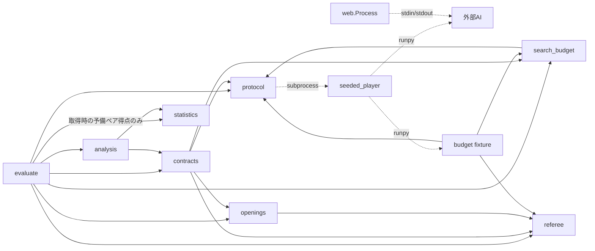
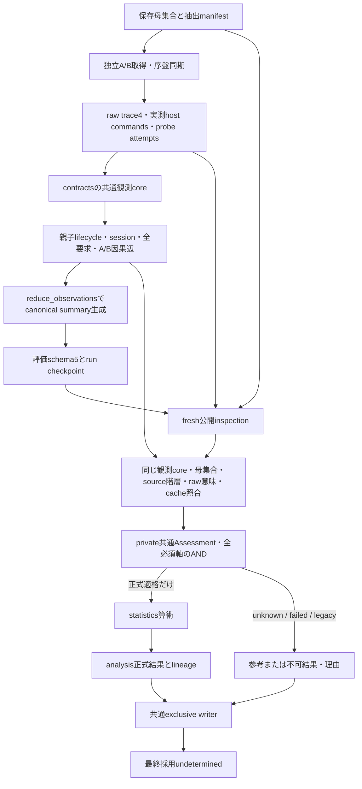
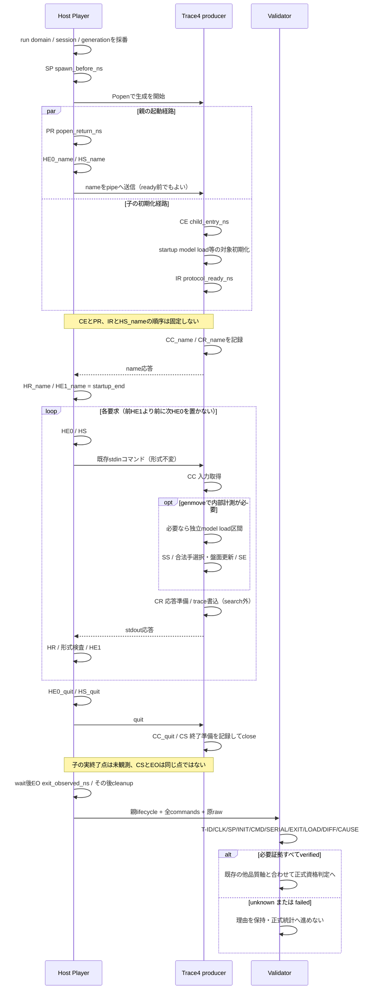
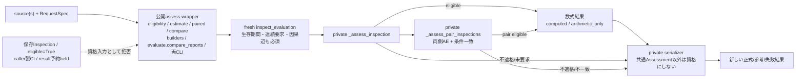
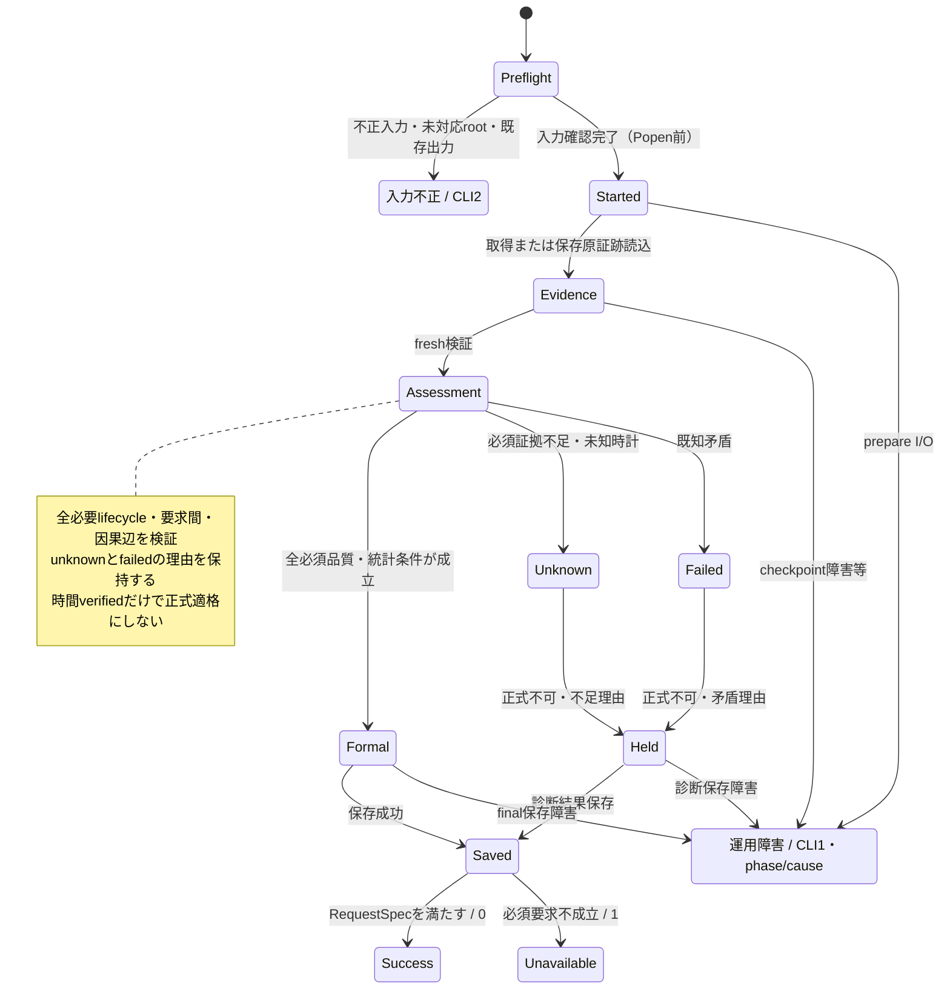

# リバーシ評価ハーネスの現行アーキテクチャ

更新日: 2026-10-13。schema5 / trace4 / validation3、Goal 1～3後の作業ツリーを対象とする。図は現行実装の説明で、理想設計や新しいPython型・状態enumを追加したものではない。文書整理ではコード・AI・GUI・評価データを変更しない。

[操作手順](../ハーネス.md)、[データ契約](harness_contracts.md)、[最新実行報告](reports/ハーネス正常化完了報告.md)を参照する。整理前の図・監査・旧版説明は[修正モデルの履歴](archive/ハーネス整合性修正モデル.md)に保管し、現行の指示には使わない。AI分離は別の[未実装設計案](../リバーシAI分離設計.md)である。

## 1. 責務と境界

| モジュール | 現行責務・主な呼出 |
|---|---|
| evaluate | preflight、独立A/B取得、序盤再生/双方盤面同期、probe、checkpoint、報告保存。compare_reportsはanalysisへ委譲 |
| protocol | PlayerのPopen/通信/回収と親証拠、command_id、clock descriptor/登録判定、純粋host形式/時間検査 |
| seeded_player | 環境seed/contextを対象scriptへ引き継いでrunpy実行。取得fingerprintにも含まれる |
| referee | 本体をimportしない独立ルール・合法手・盤面更新・終局/勝敗判定 |
| openings | 合法な固定序盤母集合、D4重複排除、case/orbit/hash、非復元抽出manifest |
| search_budget | 設定正規化/予算互換、raw trace4の型別dispatch、子lifecycle/全CC・CR、探索/load/要求対応検査 |
| contracts | decode、必要role/検証軸、母集合/全予定coverage/棋譜/両通信、原rawとcache/summaryのfresh照合、共通writer |
| analysis | 公開原report wrapper、private共通Assessment、正式AND、単独/対応推定、再解析/比較serializer |
| statistics | 得点・ペア・有限母集合区間の算術。computed/arithmetic_onlyであり正式資格の発行元ではない |
| reversi_player | 対戦プログラムとGUI。実AIは現状random選択でtrace未対応。web.Processはharness.Playerとは別経路 |
| tests/fixtures | budget_playerは計測契約の模擬producer、fault_playerは異常注入。実AIの強さ・counter真正性を証明しない |

protocolからcontracts/analysis/evaluateへ逆importしない。contractsからstatisticsへ直接依存せず、検証と算術を分離する。現在のimport DAGに循環はない。canonical JSON等の小さな表現処理は複数箇所に残るが、正式判定・比較条件・集計を別々に再定義しない。

## 2. モジュール依存と主要呼出

実線はimport/主要内部呼出、点線はプロセス間通信・対象script実行。webはPlayerをimportせず、HTTP入力とGUI JSONを別に扱う。

## 3. 取得・保存・再解析・統計のデータフロー

LIFEはcontractsの共通core内の検査であり、取得summary前のprivate _acquisition_summaryと公開再解析の両方から呼ぶ。前者には未生成summaryの照合対象がないだけで、時間検証は省略しない。reduce_observationsはraw/通信/正常局からcanonical summaryを生成し、公開inspectionは保存値と比較して矛盾を拒否する。

probeもgameも同じ原contextと必要集合で検査する。予算exemptからtiming verifiedへ直接投影しない。原証拠不足・意味矛盾なら正式数式へ渡さず、参考可否と要求不成立理由を別に残す。最終採用はdecision=undeterminedであり、数値区間が出たことと同義ではない。

## 4. プロセス起動・初期化・通信・探索・終了

以下はtrace4対応producerの計測経路で、実AIが既にこのtraceを出すという図ではない。親子時刻は対応clock/domain/session/threadを照合してから比較する。

SP/PRは親Popenの前/戻り、CE/IRは子の計測hook/対象初期化完了。子はPopen戻り前に動いてよく、親はready前にnameを送ってpipe待ちになってよい。startup loadはCE～IR、command loadは使用する探索前に完了する。load・trace書込・stdout通信をsearch_onlyへ合算しない。

CSは終了準備、EOは親の最初の終了観測。異常終了後の親によるpipe回収を子の終了後実行と混同せず、正常quit証拠は補造しない。QPCの異thread近傍はunknownで保留し、時刻を丸め直す/大きなepsilonで認可する/並べ替える救済はしない。正確な不変条件と計測点は[契約第5節](harness_contracts.md#temporal-invariants)。

## 5. 正式公開入口と信頼境界

assess_evaluation/assess_comparison、statistical_eligibility、estimate、paired、compare、reanalysis_report、comparison_report、evaluate.compare_reportsと両CLIは原evaluation reportをfresh検証する。保存Inspection・Assessment・eligible bool・caller CIを資格証明として受ける互換経路はない。

内部だけがfresh Inspectionをprivate _assess_inspection/_assess_pair_inspectionsへ渡す。comparison_reportのresult引数はfresh値との一致確認だけで、予約fieldを上書きしない。単独の数式APIは算術結果のみで正式availableを発行しない。

同値性の対象は同じimmutable source/artifact bytes・検証器・要求/spec。単独資格と対応比較の相互条件の違い、別confidence、変更された原証拠を同じ要求と呼ばない。非決定time/deploymentの別run棋譜完全一致は要求しない。

## 6. 正常完了・検証不能・失敗・保存の状態

図のphaseは処理経路の説明であり、全てが保存enumとして存在するわけではない。execution/game complete、protocol、budget、timing、source consistency、formal eligibility、publicationを分離する。failedを優先集約し、unknown理由も残す。未起動slotをexempt、証拠の空集合をverifiedとしない。

- 正常descriptiveは参考対局・保存が正常ならCLI0、正式区間は要求なし。
- 正式/strictの必須品質不足・既知矛盾、比較条件不一致は診断保存してCLI1。
- input/root不正・未対応root・開始前既存出力はCLI2。開始後のprepare/checkpoint/final保存障害はCLI1でphase/path/causeを記録する。
- 旧schemaのoptional予算設定もdecode_inputで存在値を検査する。不正型はInputRejectedへ進み、正常な設定欠落とraw証拠不足は参考利用/unknownとして区別する。新しい検証入口や依存は追加しない。詳細は[旧形式の入力契約](harness_contracts.md#legacy-optional-budget)。
- exclusive final保存とrun checkpointを分け、取得completeだけでpublication savedとしない。partial JSONや過去failedを派生値で修復しない。

## 7. モジュール間データの受け渡し

| 生成元 | データ・加工 | 利用先・不変条件 |
|---|---|---|
| openings | Population v1 / OpeningEntry / SelectionManifest | evaluateは両AIへ同じ序盤を再生。contractsは実archiveからNと全ケース/抽出を再照合 |
| Player / producer | 親ProcessEvidenceと全CommandRecord / raw trace4 | contracts/search_budgetはrun/slot/session/command/clockと同じ要求へjoin |
| contracts共通core | 観測・派生game・canonical summary | sourceの状態/集計と照合。role→game→report階層を黙って更正しない |
| contracts公開inspection | 品質各軸、4時間軸、reasons、verified N、coverage | analysisの共通AND。Nだけ、時間だけ、n=Nだけ、保存verifiedだけでは正式不可 |
| analysis private核 | Assessment / formal資格 / source lineage | 正式適格な派生gameだけをstatisticsへ。pairは両単独と相互条件を要求 |
| analysis / evaluate | 新reportと独立した解析spec | 共通writerで別出力へ保存。元報告/証拠は不変 |

メモリのtupleとJSON配列は保存時に表現が変わる。全値のJSON照合と、入力に対する厳密なint/bool・container検査を混同しない。GUI座標/score、色B/Wと役割A/B、caseとorbit、取得条件と解析条件は別の概念である。

## 8. 現在の保証と残る課題

- 母集合N/manifest/coverage・盤面/両通信・予算/raw意味・起動/要求間/終了・cache/summary・公開入口の回帰はある。実行範囲は[検証記録](reports/ハーネス検証記録.md)と[正常化報告](reports/ハーネス正常化完了報告.md)で確認する。
- 実AIはtrace未対応で参考対局に限る。fixtureの正式成功を実AIの正式予算対応や強さとしない。
- clock対応は登録local CPython3.13/Windows/QPCに限定。未知clock、lazy/background/GPU scope、全case決定性、counter/ログ真正性、全AI依存自動固定は未保証。
- GUIのdepth/temperature接続、通常応答timeout、ブラウザ描画/操作はharnessの機能で補完済みとしない。
- 旧schemaの予算設定に関する監査F02は共通decode_inputと専用回帰で対応。旧rawの完全検証を保証したわけではない。scopeの実AI/fixture差、独立baseline、学習/評価集合リーク、多重主張等は必要段階で再確認する。

## 9. 新しいモジュール・評価方式を追加する際の確認

1. 関係する課題仕様、[契約](harness_contracts.md)、対象実装を読む。
2. 必要role/phase、case/pair/seed、session/command、時計と計測scope、予算/counter定義を確定する。
3. source/cache/rawの生成元と消費先を表で確認し、共通inspection/Assessmentへ合流させる。
4. 正常schema5、欠損unknown、既知矛盾failed、旧schema、保存障害、全公開入口/CLIの回帰を確認する。
5. 実装した時点で図・契約・操作資料を更新する。予定設計を現行図へ混ぜず、過去の指示やテスト成功を新保証へ流用しない。

履歴はarchive、実行証拠はreports、日常の操作はハーネス.md、現行データ契約はharness_contracts.mdに分ける。追加ファイルや大規模な責務分割は必要性を測ってから行う。
