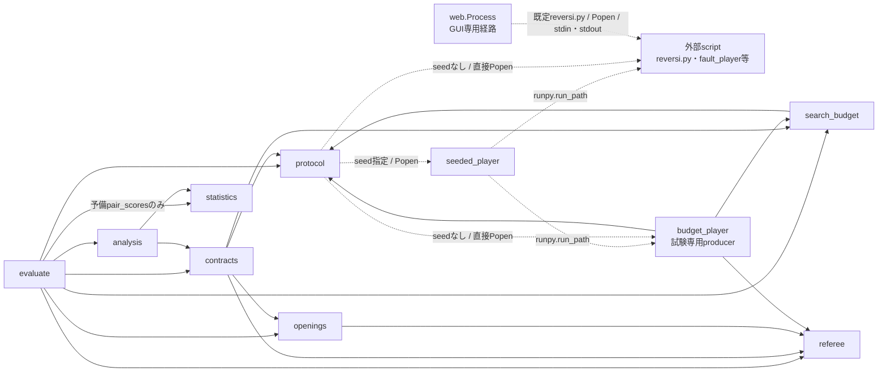
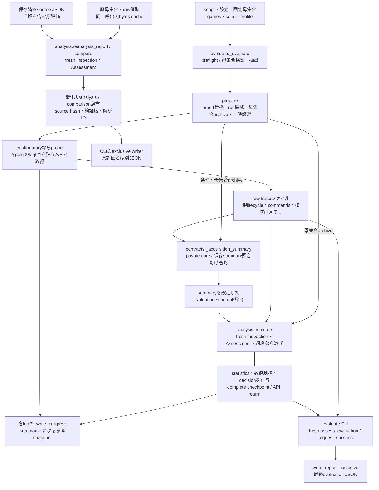
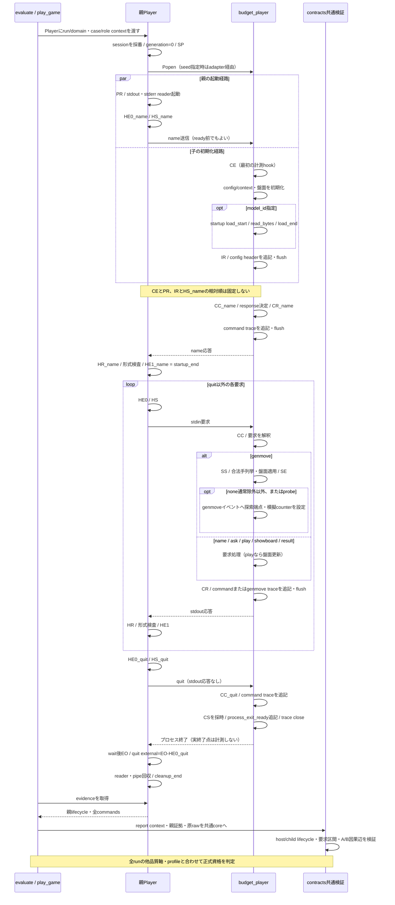
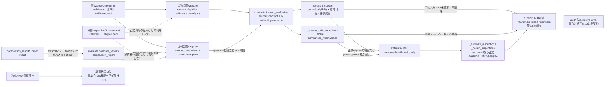
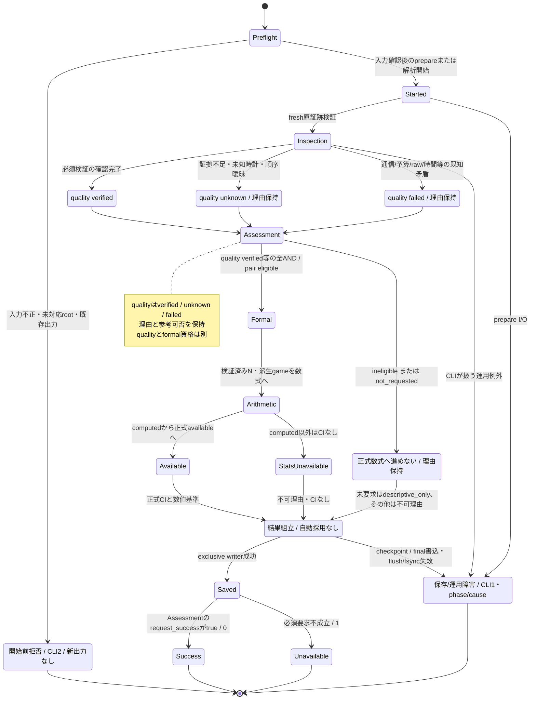

# リバーシ評価ハーネスの現行アーキテクチャ

更新日: 2026-10-13。schema5 / trace4 / validation3、コード基準はae4a8cb（旧schemaのoptional予算設定修正を含む）。図は現行実装の説明で、理想設計や新しいPython型・状態enumを追加したものではない。今回の照合では文書2件だけを変更し、コード・AI・GUI・評価データは変更しない。

[操作手順](../ハーネス.md)、[データ契約](harness_contracts.md)、[最新実行報告](reports/ハーネス正常化完了報告.md)を参照する。整理前の図・監査・旧版説明は[修正モデルの履歴](archive/ハーネス整合性修正モデル.md)に保管し、現行の指示には使わない。AI分離は別の[未実装設計案](../リバーシAI分離設計.md)である。

## 1. 責務と境界

| モジュール | 現行責務・主な呼出 |
|---|---|
| evaluate | preflight、独立A/B取得、序盤再生/双方盤面同期、probe、checkpoint、報告保存。compare_reportsはanalysisへ委譲 |
| protocol | PlayerのPopen/通信/回収と親証拠、command_id、clock descriptor/登録判定、純粋host形式/時間検査 |
| seeded_player | 環境seed/contextを対象scriptへ引き継いでrunpy実行。取得fingerprintにも含まれる |
| referee | 本体をimportしない独立ルール・合法手・盤面更新・終局/勝敗判定 |
| openings | 合法な固定序盤母集合、D4重複排除、case/orbit/hash、非復元抽出manifest |
| search_budget | 設定正規化/予算互換、raw trace4の型別dispatch、子lifecycle/全CC・CR、探索/load/要求対応検査 |
| contracts | decode、必要role/検証軸、母集合/全予定coverage/棋譜/両通信、原rawとcache/summaryのfresh照合、共通writer |
| analysis | 公開原report wrapper、private共通Assessment、正式AND、単独/対応推定、再解析/比較serializer |
| statistics | 得点・ペア・有限母集合区間の算術。computed/arithmetic_onlyであり正式資格の発行元ではない |
| reversi_player | 対戦プログラムとGUI。実AIは現状random選択でtrace未対応。web.Processはharness.Playerとは別経路 |
| tests/fixtures | budget_playerは計測契約の模擬producer、fault_playerは異常注入。実AIの強さ・counter真正性を証明しない |

protocolからcontracts/analysis/evaluateへ逆importしない。contractsからstatisticsへ直接依存せず、検証と算術を分離する。現在のimport DAGに循環はない。canonical JSON等の小さな表現処理は複数箇所に残るが、正式判定・比較条件・集計を別々に再定義しない。

## 2. モジュール依存と主要呼出

実線はharness内のimport、点線はPopen・runpy・標準入出力という別プロセスの経路。contractsの関数内importも含む。図の外部scriptは引数で選択する対象であり、新しいPythonモジュールではない。webはPlayerをimportしない。

evaluateのstatistics呼出は取得記録の予備ペア分類であり、正式資格の発行ではない。通常のevaluateはseedを渡すが、Player自体はseedなしの直接起動も持つ。fixture内のimportは試験用で、実AIがrefereeを利用するという図ではない。主要な関数呼出とデータの契約は以下の各図に分ける。

## 3. 取得・保存・再解析・統計のデータフロー

評価APIが返す辞書、run checkpoint、CLIが保存する最終JSONは別物である。新規評価は**最終JSONを保存する前**にsummary生成と正式判定を行う。保存済み評価の再解析だけが最終source JSONを入口にする。

- ACQと公開inspectionは同じ_private coreで、母集合/coverage・棋譜/通信・raw予算・4時間軸・派生集計を検査する。ACQはsummary未生成のため照合を省くが、時間検証を省略しない。
- 公開inspectionは保存された状態・measurements・summaryとfresh派生値を照合する。別API呼出へ保存Inspectionを資格として渡さず、各呼出でsnapshot/原bytesを読み直す。
- 進行中checkpointのsummarizeは参考cacheで、ACQのcanonical summaryや最終publicationと同じではない。complete checkpointの書込、API return、final JSONの保存成功も別の段階。
- 判定・数値基準・decisionはwriterより前に組み立てる。writerは採用を決めない。evaluationのstatus.decisionとcomparisonのdecisionはundeterminedで、analysis JSONには同じdecisionフィールドを追加していない。
- 新規評価のformal gateも保存後再解析と同じinspection/Assessmentへ合流する。ただし原reportがメモリ辞書か保存JSONか、source/解析IDの作り方は区別する。

## 4. プロセス起動・初期化・通信・探索・終了

これは**現行budget_playerの正常系**に着目した図。reversi.pyがtrace4を出すという図ではない。親子時刻は対応clock/domain/session/threadを照合してから比較し、正常fixtureの計測範囲と将来の実AI選択器の範囲を同一視しない。

通常要求の外部応答はHE1−HE0、wireはHR−HS。quitにはHR/HE1/wireを補造せず、外部経過はEO−HE0。SP/PRはPopen前/戻り、CEはOS最初の命令ではなくfixtureの計測hook、IRはheader出力前のready採時である。

fixtureのSS〜SEは合法手列挙・盤面適用も含む。startup load・trace書込・stdoutはこの探索区間の外である。現行fixtureはcommand loadを行わない。検証器にはcommand loadの区間検査があるが、headerの初期loadも別に満たす必要があり、lazy loadをそのまま正式対応済みとしない。

起動失敗/timeout/異常終了ではこの正常列を完遂せず、abortや診断へ進む。正常quit/子CSを補造しない。CSは終了準備、EOは親の最初の終了観測で、cleanup全体とも異なる。正確な時計条件・不変条件は[契約第5節](harness_contracts.md#temporal-invariants)、要求と保存の分岐は第6節を参照する。

## 5. 正式公開入口と信頼境界

次は正式資格を発行する経路の図で、すべての関数がCLIの保存まで行うという意味ではない。図のInspection/Assessmentは辞書の説明名であり、追加クラスではない。

単独と比較は同じfresh検証を利用するが、比較は両側の単独条件に加え相互条件を要求する。比較呼出内では同じInspection対をprivate核で再利用できるが、別呼出の保存Inspection/Assessmentを認可しない。

comparison_reportのresultは、fresh結果と一致するsubsetなら確認用として受け入れ、不一致ならValueErrorとなる。caller値を使って資格や予約フィールドを上書きする機能ではない。単独の数式APIのeligible引数は算術条件にすぎず、正式availableの証明にならない。

同値性は同じsource/artifact bytes・検証器・要求/specについて確認する。単独資格とpair資格、別confidence、改変された原証拠を同一要求と呼ばない。time/deploymentの別runに棋譜完全一致を要求しない。

## 6. 正常完了・検証不能・失敗・保存の状態

これはCLI経路の説明で、Pythonの保存enumではない。純粋な解析APIはdictを返し、終了コードや最終ファイル保存を行わない。qualityのverified/unknown/failed、formal_eligibility、statistics.status、request_successを別に扱う。

- 正常descriptiveや互換旧参考評価は、正式資格なしでも要求を満たせば0。任意の内部証拠unknownを、一律に実行失敗へ変換しない。
- 正式/strict要求の証拠不足・矛盾や、比較条件不一致は要求不成立として1。参考可否は別に保存する。descriptive_onlyという統計ラベルだけでは参考集計や要求成功を保証しない。
- 数値基準met/not_metと最終採用は別。基準未達だけで終了1にせず、decisionは自動採用しない。
- input/root不正・未対応root・開始前既存出力は2。旧schemaのoptional予算設定も[共通入力契約](harness_contracts.md#legacy-optional-budget)で存在値を検査する。正常な欠落と不正型を区別する。
- 取得のrun prepareはPopen前でも開始後の運用段階。独立checkpointのcomplete、API return、final保存成功は別で、書込途中のファイルが存在してもpublication成功にはしない。
- 元の失敗・原traceを派生値で修復しない。異常取得の診断は正常quit/全数/verifiedの証拠として利用しない。

## 7. モジュール間データの受け渡し

| 生成元 | データ・加工 | 利用先・不変条件 |
|---|---|---|
| openings | Population v1 / OpeningEntry / SelectionManifest | evaluateは両AIへ同じ序盤を再生。contractsは実archiveからNと全ケース/抽出を再照合 |
| Player / producer | 親ProcessEvidenceと全CommandRecord / raw trace4 | contracts/search_budgetはrun/slot/session/command/clockと同じ要求へjoin |
| contracts共通core | 観測・派生game・canonical summary | sourceの状態/集計と照合。role→game→report階層を黙って更正しない |
| contracts公開inspection | 品質各軸、4時間軸、reasons、verified N、coverage | analysisの共通AND。Nだけ、時間だけ、n=Nだけ、保存verifiedだけでは正式不可 |
| analysis private核 | Assessment / formal資格 / source lineage | 正式適格な派生gameだけをstatisticsへ。pairは両単独と相互条件を要求 |
| analysis / evaluate | 新reportと独立した解析spec | 共通writerで別出力へ保存。元報告/証拠は不変 |

メモリのtupleとJSON配列は保存時に表現が変わる。全値のJSON照合と、入力に対する厳密なint/bool・container検査を混同しない。GUI座標/score、色B/Wと役割A/B、caseとorbit、取得条件と解析条件は別の概念である。

## 8. 現在の保証と残る課題

- 母集合N/manifest/coverage・盤面/両通信・予算/raw意味・起動/要求間/終了・cache/summary・公開入口の回帰はある。実行範囲は[検証記録](reports/ハーネス検証記録.md)と[正常化報告](reports/ハーネス正常化完了報告.md)で確認する。
- 実AIはtrace未対応で参考対局に限る。fixtureの正式成功を実AIの正式予算対応や強さとしない。
- 新規clock descriptorのlifecycle_v2登録はlocal CPython3.13.5/Windows/QPCと有効周波数を要求する。低水準clock_statusには旧enclosed_v1の互換判定もある。実際の識別条件は契約第5節で確認し、未知clock・lazy/background/GPU scope・全case決定性・counter/ログ真正性・全AI依存自動固定を保証しない。
- GUIのdepth/temperature接続、通常応答timeout、ブラウザ描画/操作はharnessの機能で補完済みとしない。
- 旧schemaの予算設定に関する監査F02は共通decode_inputと専用回帰で対応。旧rawの完全検証を保証したわけではない。scopeの実AI/fixture差、独立baseline、学習/評価集合リーク、多重主張等は必要段階で再確認する。

## 9. 新しいモジュール・評価方式を追加する際の確認

1. 関係する課題仕様、[契約](harness_contracts.md)、対象実装を読む。
2. 必要role/phase、case/pair/seed、session/command、時計と計測scope、予算/counter定義を確定する。
3. source/cache/rawの生成元と消費先を表で確認し、共通inspection/Assessmentへ合流させる。
4. 正常schema5、欠損unknown、既知矛盾failed、旧schema、保存障害、全公開入口/CLIの回帰を確認する。
5. 実装した時点で図・契約・操作資料を更新する。予定設計を現行図へ混ぜず、過去の指示やテスト成功を新保証へ流用しない。

履歴はarchive、実行証拠はreports、日常の操作はハーネス.md、現行データ契約はharness_contracts.mdに分ける。追加ファイルや大規模な責務分割は必要性を測ってから行う。

## 10. 今回の照合で修正したずれと根拠

| 修正点 | コード/契約の根拠 |
|---|---|
| seedなしPlayerの直接Popen、実線importと点線プロセスの区別 | protocol.Player.__init__、seeded_player.main。harnessのimport辺はASTで照合 |
| final保存をinspectionの前提にしていた取得図、checkpointとfinalの混同 | evaluate._evaluateの_acquisition_summary→analysis.estimate→complete checkpoint→return、evaluate.mainのassess→writer |
| fixtureの探索・header/load・quitの端点 | budget_player.main、Player._exchange/finish、validate_command_record。quitはEO−HE0、通常要求だけHE1−HE0 |
| 数式computedから正式availableへの昇格と公開builderの実責務 | analysis._estimate_inspection/_paired_inspections、compare/reanalysis_report/comparison_report。serializerを架空のprivateモジュールとしない |
| 正常参考評価・未要求・unknownと終了成功の分岐 | analysis._assess_inspection/_assess_pair_inspections、両CLI。quality/formal/statistics/requestを分離 |
| kind=unknown、pair_id_for、解析IDの取得/再解析差、時計patch条件、数値基準 | search_budget.KINDS、contracts.pair_id_for、evaluate._evaluate、analysis._analysis_lineage、protocol.clock_status。契約表も更新 |

コードの不変条件と回帰テストを根拠とし、図だけで整合性を保証しない。今回の更新範囲は本書とharness_contracts.mdのみ。AI本体の分離やハーネスの新機能を実装したものではない。

今回実行した関連回帰は62成功・0失敗・226除外（31.73秒）。コマンドは `python -B -m pytest -q tests/test_harness.py -k 'legacy_optional_budget or schema5_reference_generation_roundtrip or schema5_cli_saves_reloads_and_reanalyses or temporal_public_apis_and_saved_clis_agree or consistency_formal_entry_closure_and_arithmetic_boundary or temporal_real_startup_model_load_is_separate_from_search or consistency_prepare_failure_is_after_preflight' -p no:cacheprovider`。全341件の再実行ではなく、上記の入口・時間・保存・互換性に関係する既存テストを選択した。Mermaidの実レンダリングは今回未確認で、図の構造・リンク・コード対応を照合する。
