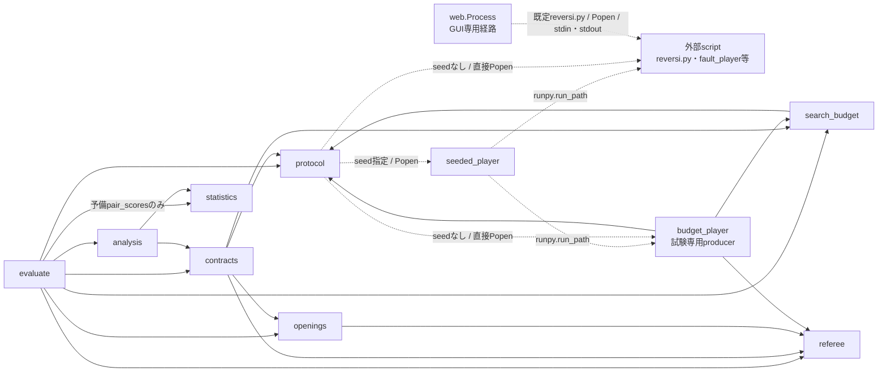
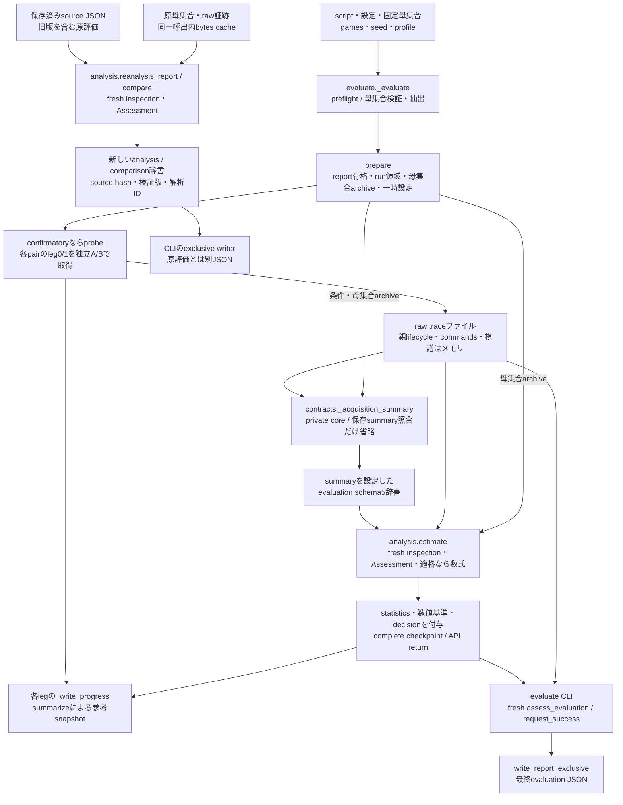
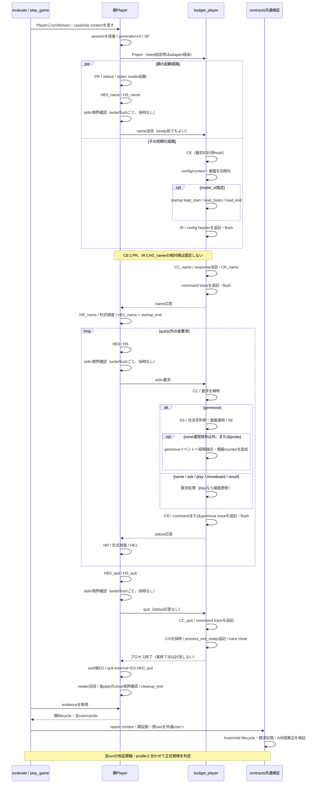
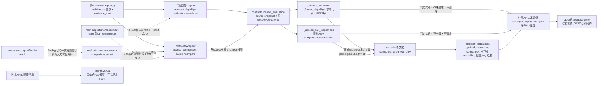
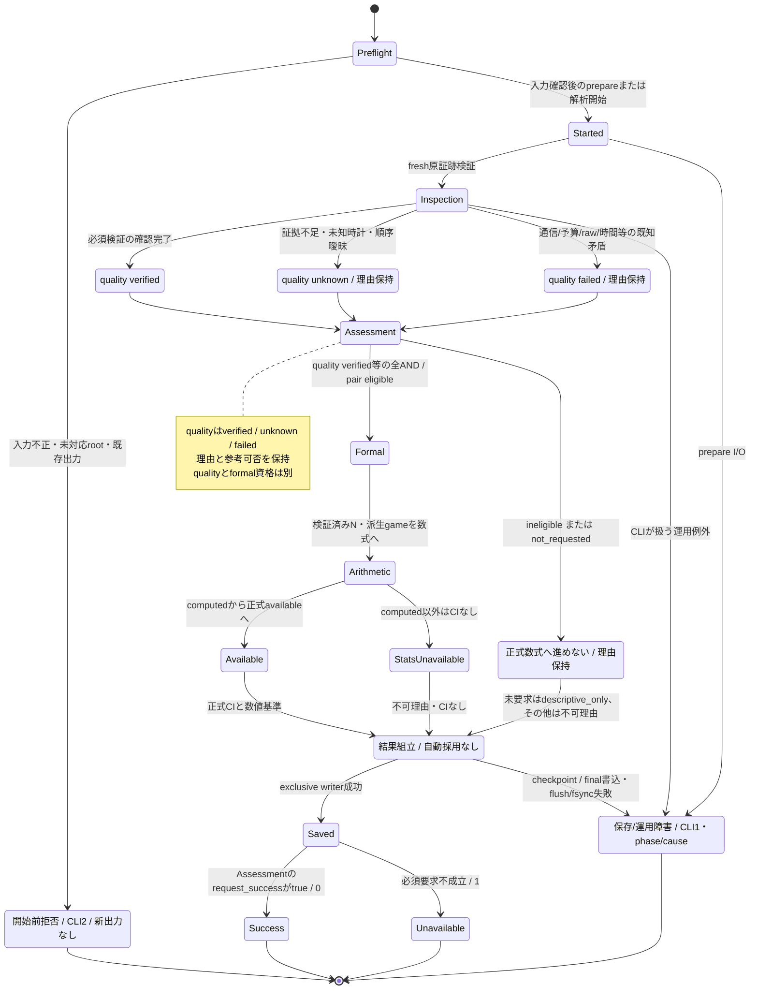
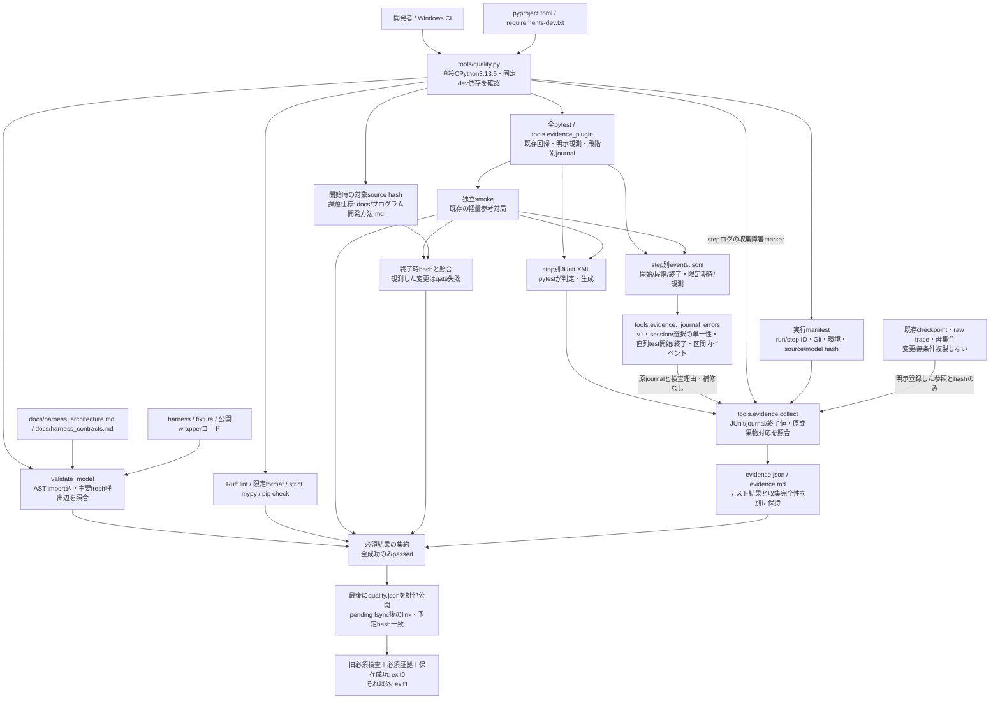
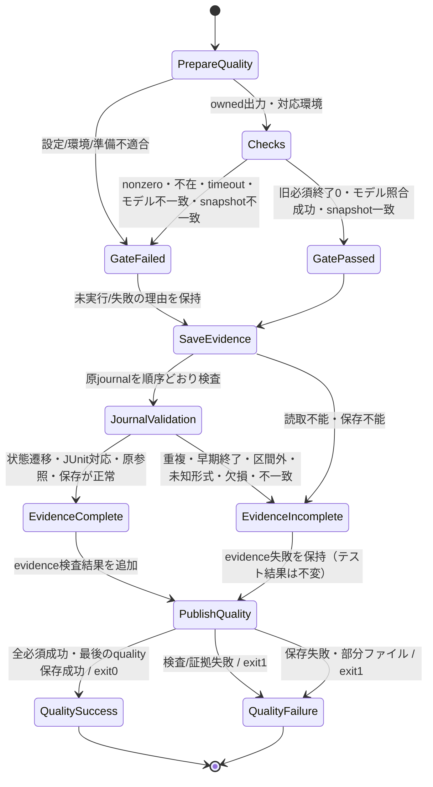
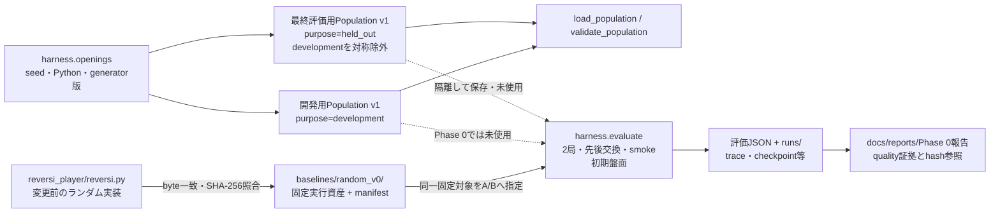

# リバーシ評価ハーネスの現行アーキテクチャ

更新日: 2026-10-14。schema5 / trace4 / validation3、評価経路のコード基準は8712843＋品質導入時の非意味的なlint整理・型注釈。第2〜6節は現行評価モデルで、状態はPython enumの追加を意味しない。第11節は品質ゲートの実装前に確定した設計で、実装状況はQUALITY_PROGRESS.mdで区別する。AI・GUI・評価契約は変更しない。

[操作手順](ハーネス.md)、[データ契約](harness_contracts.md)、[最新実行報告](reports/ハーネス正常化完了報告.md)を参照する。整理前の図・監査・旧版説明は[修正モデルの履歴](archive/ハーネス整合性修正モデル.md)に保管し、現行の指示には使わない。AI分離は別の[未実装設計案](リバーシAI分離設計.md)である。

## 1. 責務と境界

| モジュール | 現行責務・主な呼出 |
|---|---|
| evaluate | preflight、独立A/B取得、序盤再生/双方盤面同期、probe、checkpoint、報告保存。compare_reportsはanalysisへ委譲 |
| protocol | PlayerのPopen/通信/回収と親証拠、command_id、clock descriptor/登録判定、純粋host形式/時間検査 |
| seeded_player | 環境seed/contextを対象scriptへ引き継いでrunpy実行。取得fingerprintにも含まれる |
| referee | 本体をimportしない独立ルール・合法手・盤面更新・終局/勝敗判定 |
| openings | 合法な固定序盤母集合、D4重複排除、case/orbit/hash、非復元抽出manifest |
| search_budget | 設定正規化/予算互換、raw trace4の型別dispatch、子lifecycle/全CC・CR、探索/load/要求対応検査 |
| contracts | decode、必要role/検証軸、母集合/全予定coverage/棋譜/両通信、原rawとcache/summaryのfresh照合、共通writer |
| analysis | 公開原report wrapper、private共通Assessment、正式AND、単独/対応推定、再解析/比較serializer |
| statistics | 得点・ペア・有限母集合区間の算術。computed/arithmetic_onlyであり正式資格の発行元ではない |
| reversi_player | 対戦プログラムとGUI。実AIは現状random選択でtrace未対応。web.Processはharness.Playerとは別経路 |
| tests/fixtures | budget_playerは計測契約の模擬producer、fault_playerは異常注入。実AIの強さ・counter真正性を証明しない |

protocolからcontracts/analysis/evaluateへ逆importしない。contractsからstatisticsへ直接依存せず、検証と算術を分離する。現在のimport DAGに循環はない。canonical JSON等の小さな表現処理は複数箇所に残るが、正式判定・比較条件・集計を別々に再定義しない。

Phase 6の型境界（先行設計を実装反映済み）: search_budgetの型付けでは既存の数値/端点検査を型ガードへ接続し、検査済みの局所値を再束縛する。原traceやsearch metadataを正常値へ再構築せず、未知値はobjectとして残す。型だけでrawを検証済みにしない。既存述語の値域・短絡順序・例外・unknown/failed/exempt、別々の探索/load/外部応答の区間と正式入口への伝播は維持する。依存図・データフロー図・sequence・状態図の新しい経路は不要であり、変更するのは同じ検査内部の型境界だけである。検証の到達状態はQUALITY_PROGRESS.mdのPhase 6を参照する。

## 2. モジュール依存と主要呼出

実線はharness内のimport、点線はPopen・runpy・標準入出力という別プロセスの経路。contractsの関数内importも含む。図の外部scriptは引数で選択する対象であり、新しいPythonモジュールではない。webはPlayerをimportしない。

evaluateのstatistics呼出は取得記録の予備ペア分類であり、正式資格の発行ではない。通常のevaluateはseedを渡すが、Player自体はseedなしの直接起動も持つ。fixture内のimportは試験用で、実AIがrefereeを利用するという図ではない。主要な関数呼出とデータの契約は以下の各図に分ける。

## 3. 取得・保存・再解析・統計のデータフロー

Phase 9の型境界（個別承認・先行設計を実装反映済み）: evaluateの取得途中辞書・正常な親証拠・失敗診断・保存用報告を区別し、既存のACQ→fresh Inspection→Assessmentの向きを維持する。通常形状を検証済み証明とせず、序盤positionと統計fieldの未知値は局所の反復/添字/既存比較演算だけへ接続する。部分gameのscore/pairのNone、trace不在artifact、probe失敗時の部分親証拠を型でも保持する。直接依存の共有型はこの実際の生成形状と読取専用境界だけ精緻化し、正常値へ補修しない。

_callは位置引数列と返却型を保つ汎用ラッパーとし、起動closureは必要なら同じ既定値捕捉を持つ注釈可能な局所関数へ表現する。_evaluateのoperation=Noneは元のupdate属性例外を維持する局所境界で扱う。Pathの局所束縛・親commandへの既存phase追記を静的に表し、採時・通信・回収・checkpointの順序を変えない。新しいimport辺・取得経路・資格入口・状態遷移は不要なので既存Mermaidの辺/状態を追加しない。型成功、API return、complete checkpoint、final保存、正式資格を混同しない。実装・検証の到達状態はQUALITY_PROGRESS.mdのPhase 9を参照する。

評価APIが返す辞書、run checkpoint、CLIが保存する最終JSONは別物である。新規評価は**最終JSONを保存する前**にsummary生成と正式判定を行う。保存済み評価の再解析だけが最終source JSONを入口にする。

- ACQと公開inspectionは同じ_private coreで、母集合/coverage・棋譜/通信・raw予算・4時間軸・派生集計を検査する。ACQはsummary未生成のため照合を省くが、時間検証を省略しない。
- 公開inspectionは保存された状態・measurements・summaryとfresh派生値を照合する。別API呼出へ保存Inspectionを資格として渡さず、各呼出でsnapshot/原bytesを読み直す。
- 進行中checkpointのsummarizeは参考cacheで、ACQのcanonical summaryや最終publicationと同じではない。complete checkpointの書込、API return、final JSONの保存成功も別の段階。
- 判定・数値基準・decisionはwriterより前に組み立てる。writerは採用を決めない。evaluationのstatus.decisionとcomparisonのdecisionはundeterminedで、analysis JSONには同じdecisionフィールドを追加していない。
- 新規評価のformal gateも保存後再解析と同じinspection/Assessmentへ合流する。ただし原reportがメモリ辞書か保存JSONか、source/解析IDの作り方は区別する。

## 4. プロセス起動・初期化・通信・探索・終了

これは**現行budget_playerの正常系**に着目した図。reversi.pyがtrace4を出すという図ではない。親子時刻は対応clock/domain/session/threadを照合してから比較し、正常fixtureの計測範囲と将来の実AI選択器の範囲を同一視しない。
以下のpipe境界注記はPhase 5の承認後に設計を先行更新し、現在のprotocol.pyへ反映したものである。検証の到達状態はQUALITY_PROGRESS.mdのPhase 5を参照し、図の存在だけで完了としない。

通常要求の外部応答はHE1−HE0、wireはHR−HS。quitにはHR/HE1/wireを補造せず、外部経過はEO−HE0。SP/PRはPopen前/戻り、CEはOS最初の命令ではなくfixtureの計測hook、IRはheader出力前のready採時である。

fixtureのSS〜SEは合法手列挙・盤面適用も含む。startup load・trace書込・stdoutはこの探索区間の外である。現行fixtureはcommand loadを行わない。検証器にはcommand loadの区間検査があるが、headerの初期loadも別に満たす必要があり、lazy loadをそのまま正式対応済みとしない。

起動失敗/timeout/異常終了ではこの正常列を完遂せず、abortや診断へ進む。正常quit/子CSを補造しない。CSは終了準備、EOは親の最初の終了観測で、cleanup全体とも異なる。正確な時計条件・不変条件は[契約第5節](harness_contracts.md#temporal-invariants)、要求と保存の分岐は第6節を参照する。

Phase 5の境界設計: readerは各readline直前、送信はwrite/flushごと、回収は各close直前にpipeの非Noneを確認する。pipeをcacheせず、公開process属性を読む順序を維持する。Noneなら既存と同じ操作名のAttributeErrorを送出し、skipや正常値への置換、新しい正常終了状態を追加しない。close失敗後に_closedやcleanup_endを補造しない。例外の型・メッセージ・name/obj・伝播は維持するが、helper導入によるtracebackの位置/フレームは同一とはしない。
SP/PR/HE0/HS/HR/HE1/EOと既存のperf_counter呼出位置・回数は維持し、境界helper自身は採時しない。送信側確認の処理コストは既存の外部/wire区間内に含まれる。値の完全一致や無コストを保証せず、期限・単位・区間の定義は変えない。
OS条件は実CPythonのWindowsをsys.platform=='win32'、その他を既存POSIX経路とする。未対応OSの正式資格を増やさず、OSを偽装した不整合なos.name/sys.platformの組合せを互換性の保証対象にしない。
生のlifecycleは自由拡張dict[str, object]のまま保持・複写する。終了観測後にcommandへ転記する時刻だけの局所castは値の検査・修復・正式資格を意味せず、保存値は共通検証が再確認する。時計/整数/期限の型ガードは既存の述語と同じ値域を表し、unknown/failedの条件・データフロー・状態図は維持する。

## 5. 正式公開入口と信頼境界

Phase 7の型境界（先行設計後に実装）: contractsの入力形状・生成途中のInspection・通常の返却形状を静的に区別する。通常形状の注釈は入力の検証成功や正式資格を意味しない。原値は従来どおりdecodeからfresh検証へ渡し、欠損・不正な形状も既存の経路で拒否する。型ガード化/局所束縛は既存述語の意味・拒否順・例外・detailを維持し、raw全体を有効reportへcastしない。母集合N/coverage、保存traceとsummary、4時間軸、旧schema、取得前summaryのprivate経路と公開入口の差を変えない。依存・データフロー・sequence・状態図に新しい到達経路はなく、検証省略入口を追加しない。検証結果はQUALITY_PROGRESS.mdのPhase 7を参照する。

既存のcontracts→search_budget→protocolの向きは維持する。command列は読み取り専用Sequenceとして型を受け渡し、生成reason列は基礎時間型のまま拡張metadataを保持する。構造全体のcastやデータの複製で型差を隠さず、時間結果の既知4軸を元の順で構築する。None get境界にも採時や正常値への修復を追加しない。

Phase 8の型境界（先行設計後に実装）: analysisの型付けは同じfresh Inspectionと正式ANDを使い、型ガード/局所束縛と既存属性・添字・update操作の限定境界で表現する。snapshotを有効reportへcastしない。contractsの比較関数は未知値を持つMappingを受け取り、decode済みgame配列という生成根拠だけをSequence[Mapping[str, object]]として共有する。statisticsはこの読取専用の未検証入力を受け、得点・case/ペアIDの原値を保持する。算術結果の辞書をコピー/全体castせず、同じ辞書への既存updateを行う。これらは相互運用に必要な直接依存の型境界で、探索・通信・資格条件の変更や次フェーズの実装ではない。依存DAG・データフロー・sequence・状態の経路は変わらないため、Mermaidへ新しい状態/辺を追加しない。検証状況はQUALITY_PROGRESS.mdのPhase 8を参照する。

次は正式資格を発行する経路の図で、すべての関数がCLIの保存まで行うという意味ではない。図のInspection/Assessmentは辞書の説明名であり、追加クラスではない。

単独と比較は同じfresh検証を利用するが、比較は両側の単独条件に加え相互条件を要求する。比較呼出内では同じInspection対をprivate核で再利用できるが、別呼出の保存Inspection/Assessmentを認可しない。

comparison_reportのresultは、fresh結果と一致するsubsetなら確認用として受け入れ、不一致ならValueErrorとなる。caller値を使って資格や予約フィールドを上書きする機能ではない。単独の数式APIのeligible引数は算術条件にすぎず、正式availableの証明にならない。

同値性は同じsource/artifact bytes・検証器・要求/specについて確認する。単独資格とpair資格、別confidence、改変された原証拠を同一要求と呼ばない。time/deploymentの別runに棋譜完全一致を要求しない。

## 6. 正常完了・検証不能・失敗・保存の状態

これはCLI経路の説明で、Pythonの保存enumではない。純粋な解析APIはdictを返し、終了コードや最終ファイル保存を行わない。qualityのverified/unknown/failed、formal_eligibility、statistics.status、request_successを別に扱う。

- 正常descriptiveや互換旧参考評価は、正式資格なしでも要求を満たせば0。任意の内部証拠unknownを、一律に実行失敗へ変換しない。
- 正式/strict要求の証拠不足・矛盾や、比較条件不一致は要求不成立として1。参考可否は別に保存する。descriptive_onlyという統計ラベルだけでは参考集計や要求成功を保証しない。
- 数値基準met/not_metと最終採用は別。基準未達だけで終了1にせず、decisionは自動採用しない。
- input/root不正・未対応root・開始前既存出力は2。旧schemaのoptional予算設定も[共通入力契約](harness_contracts.md#legacy-optional-budget)で存在値を検査する。正常な欠落と不正型を区別する。
- 取得のrun prepareはPopen前でも開始後の運用段階。独立checkpointのcomplete、API return、final保存成功は別で、書込途中のファイルが存在してもpublication成功にはしない。
- 元の失敗・原traceを派生値で修復しない。異常取得の診断は正常quit/全数/verifiedの証拠として利用しない。

## 7. モジュール間データの受け渡し

| 生成元 | データ・加工 | 利用先・不変条件 |
|---|---|---|
| openings | Population v1 / OpeningEntry / SelectionManifest | evaluateは両AIへ同じ序盤を再生。contractsは実archiveからNと全ケース/抽出を再照合 |
| Player / producer | 親ProcessEvidenceと全CommandRecord / raw trace4 | contracts/search_budgetはrun/slot/session/command/clockと同じ要求へjoin |
| contracts共通core | 観測・派生game・canonical summary | sourceの状態/集計と照合。role→game→report階層を黙って更正しない |
| contracts公開inspection | 品質各軸、4時間軸、reasons、verified N、coverage | analysisの共通AND。Nだけ、時間だけ、n=Nだけ、保存verifiedだけでは正式不可 |
| analysis private核 | Assessment / formal資格 / source lineage | 正式適格な派生gameだけをstatisticsへ。pairは両単独と相互条件を要求 |
| analysis / evaluate | 新reportと独立した解析spec | 共通writerで別出力へ保存。元報告/証拠は不変 |

メモリのtupleとJSON配列は保存時に表現が変わる。全値のJSON照合と、入力に対する厳密なint/bool・container検査を混同しない。GUI座標/score、色B/Wと役割A/B、caseとorbit、取得条件と解析条件は別の概念である。

## 8. 現在の保証と残る課題

- 母集合N/manifest/coverage・盤面/両通信・予算/raw意味・起動/要求間/終了・cache/summary・公開入口の回帰はある。実行範囲は[検証記録](reports/ハーネス検証記録.md)と[正常化報告](reports/ハーネス正常化完了報告.md)で確認する。
- 実AIはtrace未対応で参考対局に限る。fixtureの正式成功を実AIの正式予算対応や強さとしない。
- 新規clock descriptorのlifecycle_v2登録はlocal CPython3.13.5/Windows/QPCと有効周波数を要求する。低水準clock_statusには旧enclosed_v1の互換判定もある。実際の識別条件は契約第5節で確認し、未知clock・lazy/background/GPU scope・全case決定性・counter/ログ真正性・全AI依存自動固定を保証しない。
- GUIのdepth/temperature接続、通常応答timeout、ブラウザ描画/操作はharnessの機能で補完済みとしない。
- 旧schemaの予算設定に関する監査F02は共通decode_inputと専用回帰で対応。旧rawの完全検証を保証したわけではない。scopeの実AI/fixture差、独立baseline、学習/評価集合リーク、多重主張等は必要段階で再確認する。

## 9. 新しいモジュール・評価方式を追加する際の確認

1. 関係する課題仕様、[契約](harness_contracts.md)、対象実装を読む。
2. 必要role/phase、case/pair/seed、session/command、時計と計測scope、予算/counter定義を確定する。
3. source/cache/rawの生成元と消費先を表で確認し、共通inspection/Assessmentへ合流させる。
4. 正常schema5、欠損unknown、既知矛盾failed、旧schema、保存障害、全公開入口/CLIの回帰を確認する。
5. 意味・構造・依存・契約を変えるときは図・契約を先に更新して照合し、その後実装する。注釈/formatだけならモデル変更不要の理由を記録する。予定設計と実装状況を区別し、過去の成功を新保証へ流用しない。

履歴はarchive、実行証拠はreports、日常の操作はハーネス.md、現行データ契約はharness_contracts.mdに分ける。追加ファイルや大規模な責務分割は必要性を測ってから行う。

## 10. 今回の照合で修正したずれと根拠

| 修正点 | コード/契約の根拠 |
|---|---|
| seedなしPlayerの直接Popen、実線importと点線プロセスの区別 | protocol.Player.__init__、seeded_player.main。harnessのimport辺はASTで照合 |
| final保存をinspectionの前提にしていた取得図、checkpointとfinalの混同 | evaluate._evaluateの_acquisition_summary→analysis.estimate→complete checkpoint→return、evaluate.mainのassess→writer |
| fixtureの探索・header/load・quitの端点 | budget_player.main、Player._exchange/finish、validate_command_record。quitはEO−HE0、通常要求だけHE1−HE0 |
| 数式computedから正式availableへの昇格と公開builderの実責務 | analysis._estimate_inspection/_paired_inspections、compare/reanalysis_report/comparison_report。serializerを架空のprivateモジュールとしない |
| 正常参考評価・未要求・unknownと終了成功の分岐 | analysis._assess_inspection/_assess_pair_inspections、両CLI。quality/formal/statistics/requestを分離 |
| kind=unknown、pair_id_for、解析IDの取得/再解析差、時計patch条件、数値基準 | search_budget.KINDS、contracts.pair_id_for、evaluate._evaluate、analysis._analysis_lineage、protocol.clock_status。契約表も更新 |

コードの不変条件と回帰テストを根拠とし、図だけで整合性を保証しない。今回の更新範囲は本書とharness_contracts.mdのみ。AI本体の分離やハーネスの新機能を実装したものではない。

今回実行した関連回帰は62成功・0失敗・226除外（31.73秒）。コマンドは `python -B -m pytest -q tests/test_harness.py -k 'legacy_optional_budget or schema5_reference_generation_roundtrip or schema5_cli_saves_reloads_and_reanalyses or temporal_public_apis_and_saved_clis_agree or consistency_formal_entry_closure_and_arithmetic_boundary or temporal_real_startup_model_load_is_separate_from_search or consistency_prepare_failure_is_after_preflight' -p no:cacheprovider`。全341件の再実行ではなく、上記の入口・時間・保存・互換性に関係する既存テストを選択した。Mermaidの実レンダリングは今回未確認で、図の構造・リンク・コード対応を照合する。

## 11. 開発用品質ゲート（現行実装）

資料配置の整理（2026-10-16、参照変更に先行して確定）: ルートのAGENTS.mdとREADME.mdを入口とし、現行資料・品質進捗・授業メモをdocs/へ集約する。課題仕様の実ファイルと品質snapshotのキーはdocs/プログラム開発方法.mdへ移す。下図のsnapshotとmanifestはその新パスを使い、検査の順序・必須10検査・正式評価の経路・schemaは変更しない。model_contract_hashesは既存のdocs/接頭辞による抽出を維持するため、移動後は課題仕様も含む。既存のimport図・状態遷移の変更は不要で、過去の証拠のパス/hashを書き換えない。Phase 10のscope検査はこの整理では実装しない。反映状況と新旧の実行結果は[品質進捗](QUALITY_PROGRESS.md)を参照する。

本節の図と契約はGoal 5のコード追加に先行して確定・照合した。対応するtools.qualityと27ゲート回帰は実装済みで、統合ゲートもローカル成功を確認した。最新の実行結果・未確認範囲はQUALITY_PROGRESS.mdに記録する。品質runnerを評価器や正式資格発行元へ組み込まず、第2〜6節の経路・schema・fresh検証を変えない。stdlibだけの`tools/quality.py`を入口とし、harnessからtoolsへのimportは禁止。CIも同じrunnerを呼び、独自の成功基準を持たない。

各コマンドは直列で実行し、失敗を握り潰さない。環境が不適合なら後続を未実行として明記し成功にしない。時間上限による回収ではrunner所有の子プロセスだけを停止し、Windowsではそのtreeをtaskkillする。taskkill不在/失敗でも直接の子は回収し、tree未確認の失敗を報告する（完全回収済みとは扱わない）。既存評価結果を上書きせず、品質JSONは評価schema5入力ではない。

設計照合時に、終了時hashだけでは途中で変更されたsourceを全検査済みとしてしまう穴を見つけた。実装に先行して開始/終了snapshotの一致を必須条件へ追加した。観測間の一時変更・復元まで検出するファイルロックや改ざん認証ではない。実行中は対象コード/設定/モデルを編集しない。

`validate_model`は第2節の全harness importとfixture3辺の過不足・循環、新moduleの図漏れを検査する。第5節の単独wrapper→fresh inspection、比較wrapper→_inspect_pair→fresh inspection、facade委譲をASTで検査する。図のレンダリングや全関数の制御フロー/意味の証明ではない。T-ID〜T-GATEや品質/統計の状態は全pytestと[品質導入対応表](QUALITY_PROGRESS.md)で照合する。

Windows venvのredirectorではPopen PIDとproducer PIDが異なる事象を確認した。正式identity照合を緩めず、このゲートはvenvランチャーではない直接CPythonを使う。別起動機構の正式対応は未実装であり、この制約を時刻の猶予やhash更新で回避しない。

### 11.1 検証証拠拡張（先行設計後に実装、2026-10-14）

上記品質2図を実装に先行して拡張した。導入状態・実行証拠はQUALITY_PROGRESS.mdの「検証証拠自動生成」を参照する。第2〜6節の評価モデル・schema5/trace4/validation3・正式ANDは変更しない。

依存方向はquality→evidence、pytest→evidence_plugin、選定テスト→pluginの明示記録APIである。pluginはpytest既存依存とstdlibを使い、collectorはstdlibだけで成果物を読む。harness→tools、collector→harnessの検証呼出、新しい正式資格入口を追加しない。新しい2moduleもstrict対象へ追加する。

toolsは__init__.pyで明示packageにする。collectorをstrictの直接filesとtools.evidenceのimportから二重のmodule名で検査しないための最小package標識であり、新しい責務・判定・依存辺を持たない。

| 要素 | 実装・責務 | 必須照合 |
|---|---|---|
| MAN | tools.evidence.manifest / quality.run_gate | UUID run/step、Git commit/dirty（読取のみ）、設定/環境/source/model hash、argv/timeout |
| XML | quality.required_steps / run_step | 新規owned stepディレクトリのJUnit。既存XMLを拒否してから起動 |
| JOURNAL | evidence_pluginのpytest hookと明示API | run/step/nodeid/sequence、setup/call/teardown、collection/session終了。flush逐次保存、保存障害はpytestの判定を変更せず収集エラー |
| JL | evidence._journal_errors / collect_step | 順序どおりのsession/selected/active test/phase/終了を検査し、重複・区間外・未対応形式をincompleteへ伝播。正常なfixture内metadataやsetup失敗/skipを許可 |
| EC | evidence.collect | JUnit集計とjournalの段階・nodeid/終了値を照合。call成功・teardown失敗、負例成功、skip、collection失敗、中断を混同しない |
| ORIGINAL | pluginの明示原成果物登録→collector | 実行に関係するcheckpoint/runとraw/population hashだけを関連付ける。登録時hashと終了後bytesの差は不一致、意味検証済みという証明にはしない |
| EV | evidence.render_markdown / quality保存 | JSONとMarkdownは同じ観測辞書から生成。期待値推測、任意local抽出、原証跡修復をしない |
| LOG/EXIT | quality.run_gate / main | quality.json v1のfield構造を維持し必須evidence StepResultを追加。各派生ファイルはowned pendingへfsync/close後に排他hardlinkで公開し、最後のquality bytesが予定hashと一致して完成。保存不能ならstderr/終了1 |

XMLだけでは開始したまま未完のテストや正確なnodeid/段階を保証できないため、軽量journalを併用する。成功した重要テストの明示記録欠落も証拠不足とする。通常のpytestをpluginなしで実行した場合は明示APIをno-opにし、既存合否を維持する。

証拠完全性は取得範囲の完了であり、全local変数・全Hypothesis例・全AI stderr・原証拠真正性を意味しない。未実行と中断には理由を残す。JUnitはsession終了時の出力で、強制停止では欠損し得る。run領域の準備以前や書込不能、OS障害、停電で完全な証拠を保証しない。参照先の後日の消失は再確認失敗として扱い、原traceを無条件にコピーしない。

初回証拠導入時の品質回帰は旧27＋証拠39の66件。重要48ケースは実plugin/JUnitで期待先行・観測・原12参照を確認した。11.2節の後続修正・回帰を含む最新結果はQUALITY_PROGRESS.mdで確認する。正式評価の既存18import/10fresh呼出は不変。追加品質依存はquality→evidence、選定test/pytest→pluginで、collectorのharness逆依存はない。

### 11.2 journal状態遷移の修正モデル（先行確定後に実装）

11節の品質2図を先に更新し、ECの前提にJLを追加した。修正前collectorがphaseだけを抽出しfinishedをboolに潰していたため、終了重複・早期終了・終了後イベント・test間の交差を見落としていた問題への修正モデルである。実装・回帰完了の状態はQUALITY_PROGRESS.mdの追記を正本とし、過去66件の成功を本検査の証拠にしない。

JLは同じevidenceモジュール内のprivate関数_journal_errorsとして実装し、collect_stepが集約前に呼ぶ。元journalを変更せずエラーをECへ返す。開始session→collection→selected→直列test区間→終了sessionを検査する。各testは開始→必要phase報告→終了の順序を守り、期待/観測/原参照は同じtestの開始から終了までに限る。phase報告は段階の実行後なので、fixture内metadataはsetup報告前やteardown報告前にも正常に発生する。setup失敗/skipはcallなしのsetup→teardown→終了を許可する。複数観測や失敗の整合した証拠は拒否しない。

session/selected/testの重複、実行区間の交差、終了後イベント、未知kind/format_versionはincompleteへ伝播し、gateを失敗にする。途中停止は不足を記録し、終了イベントを補造しない。元pytest結果、評価schema5/trace4/validation3、正式資格入口、公開hash確認の責務は変更しない。verify_publicationは保存bytes対応だけを確認し、この状態検査の代用にも記録真正性の証明にもしない。

最終監査で、完成名へ直接書き込むとfsync失敗後にも全bytesが残り得ることを確認し、先に公開モデルを修正した。pendingからos.linkによる排他公開を使い、同名winnerを置換しない。hardlink未対応の保存先は失敗にし、危険なreplaceへfallbackしない。own pendingの回収失敗は警告で保持し、公開済みの保存成功を巻き戻さない。停電/OS障害・directoryの永続性まで保証するものではない。

## 12. AI開発Phase 0の資産・評価フロー

この図は現行ハーネスの新しい正式評価経路ではなく、Phase 0で固定するAI資産と既存CLIの接続を示す。`reversi.py`は変更せず、baselineの独立コピーをA/Bの実行対象にする。序盤母集団は既存`openings`で生成・検証する。Phase 0の2局smokeは初期盤面で行い、最終評価用母集団を対局や調整に使用しない。

baselineの複製・序盤母集団のhashは資産同一性を照合するための値であり、署名や秘密保持を意味しない。母集団の`purpose`と除外hashは用途の記録であり、最終評価用データが人から秘匿されている、または未閲覧であることの保証ではない。図は品質ゲート・対局の正式資格を変更せず、random AIのtrace4/探索予算対応を示さない。
