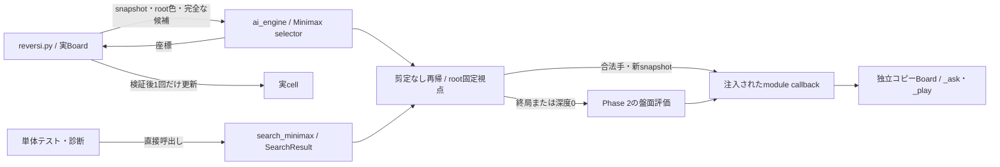

# Phase 3 浅いMinimaxの設計・実装契約

作成日: 2026-11-06。対象は `feat/ai-phase3`。本書は実装前に確定する探索の契約で、実行結果と採否は別の報告に記録する。

## 1. 目的と前提

Phase 2のコピーcallbackと固定評価を使い、相手の最善応手を考慮する剪定なしMinimaxを作る。[段階設計書](リバーシAI段階開発・評価設計書.md)のPhase 3とG0〜G5を完了条件とする。評価関数の重みは変更しない。

Phase 2は実装PASS・参考評価完了だが、固定positionalへの得点率0.39により棋力採用は保留されている。今回の開始時に保存済みrandom/positional各100局をfresh再解析し、両方の参考利用可能性を確認した。開始時の全品質ゲートは今回の証拠で別に確認する。構造的な進行と棋力採用を区別し、固定baselineを変更しない。

変更対象は `reversi_player/ai_engine.py` の探索と診断値、`reversi_player/reversi.py` の既定selector、関連テストと資料に限る。Alpha-Beta、TT、bitboard、反復深化、time/node予算の受領、trace4 producer、学習、search_v1の固定は後続工程とする。

## 2. 責務と依存

本体はsnapshot・完全なroot合法手をselectorへ渡し、戻った座標を検査して実Boardへ一度だけ確定する。engineはstatelessな `legal_moves_for` と `apply_move` を受け取り、仮局面だけを探索する。[コピー境界](phase2_design.md)の値域・失敗条件を維持する。

engineから本体・GUI・harnessへの逆importは追加しない。独立refereeはテストと外部対局だけで使う。ハーネスの責務・依存・状態遷移・正式入口・schemaを変更しないため、ハーネスDAGの辺や正式資格モデルの更新は不要。AI内部の図と契約は実装前に更新する。

## 3. 探索の意味

`depth` はrootから実際に置く石の数で、通常intの0〜4を診断APIの値域とする。selector factoryは通常intの1〜4だけを受け付け、boolを含む範囲違反はValueError。浅い参照実装の対象を明確にし、過大な深度を誤って指定することを防ぐ。通常動作の `DEFAULT_SEARCH_DEPTH` は2に固定する。深度3〜4は小規模な診断で使い、対局結果を見て既定値を選び直さない。

再帰の評価視点はroot着手色で固定する。root色の手番で最大化し、相手の手番で最小化する。手番交代に伴って評価値の符号を反転しない。終局と深度0では既存の `evaluate_position` を使い、非終局の40/40/20、終局の勝敗優先と石差を維持する。

双方に合法手がなければ深度が残っていても終了する。一方だけに合法手がなければ、同じsnapshot・同じ残深度で手番を交代する。深度0ではパスを展開せず盤面を評価する。非終局のパスの次には必ず合法着手があるため、深度を減らさないパスでも無限再帰しない。

全候補を評価し、枝刈り・キャッシュ・候補省略を行わない。正確に同点なら `(y,x)` 昇順の座標を選ぶ。評価値の8対称性と、同点座標の回転同変性は区別する。

## 4. APIと計数

| 名前 | 入出力と責務 |
|---|---|
| `make_minimax_selector(legal_moves_for, apply_move, *, depth=DEFAULT_SEARCH_DEPTH)` | 既存の3引数MoveSelectorを返す。root候補が空ならcallbackなしでNone。候補の完全性はBoardが保証する |
| `search_minimax(rows, color, depth, legal_moves_for, apply_move)` | snapshotと色・深度を検査し、root合法手も列挙して探索する。パスのrootでも後続価値を計算する |
| `SearchResult` | 不変dataclass。move、value、depth、nodes、leaves、passesを返す。depth0またはroot合法手なしのmoveはNone |

計数名は `minimax-call-v1` とする。nodesはroot・通常子・パス後の子を含む再帰呼出し回数で、同じ盤面でも別経路なら別に数える。leavesは深度0または終局で評価を返した呼出し回数。passesは深度が残る非終局ノードから実際にパスの再帰辺をたどった回数で、深度0や双方合法手なしでは加算しない。合法手列挙、評価内のcallback、仮着手自体は別ノードに数えない。

計数状態は1回の探索内だけで保持する。標準出力・標準エラー・ファイルへの自動診断出力は追加しない。これらは参考診断値であり、trace4のverified nodeや正式な同一workを意味しない。Phase 4で正式計数との対応を改めて設計する。

callbackの例外は伝播し、無断fallbackや部分探索の成功値に変えない。コピーsnapshotを使い、実cell、候補tuple、乱数状態を変更しない。時間中断や予算不足時のfallbackはPhase 5で実装する。本Phaseの上限保証は測定した入力・環境の範囲に限る。

## 5. 独立検証

新規テストは `tests/test_ai_phase3.py` にまとめ、終了時の分類レビューまではFull専用とする。既存テストでは既定factoryの切替だけを追従し、Phase 2の1手選択自体の回帰は保持する。本番モジュールの追加はなく、既存engineと本体は既にstrictとlintの対象である。

独立refereeで固定棋譜を再生し、本番関数を使わない有理数の評価とNegamaxによる全列挙をオラクルにする。初期・序盤・中盤・終盤・rootパス・内部パス・空きあり終局で深度0〜4を照合する。白rootと相手の最小化、同点集合、候補順、深度1と旧1手selectorの一致も確認する。

計数は独立した全木の列挙と、初期盤面の深度0/1/2の既知件数で照合する。入力違反、callback故障、繰り返し、盤面・乱数・stdout/stderr不変、実着手一回、直接起動・package・別cwd・GUI接続を確認する。テスト結果から期待値を生成しない。

関連テストの後に `python -B tools/quality.py` のFullを実行し、全pytest・独立smoke・strict・lint・format・モデル・証拠照合を通す。品質ゲートの省略や緩和は行わない。

## 6. 事前登録した参考比較

| 条件 | 固定値 |
|---|---|
| 相手 | 依存ごと固定したrandom_v0とpositional_v1 |
| smoke | 各相手に初期盤面から先後交換2局 |
| 本評価 | 各100局、50ケース×先後2局 |
| 集合 | Phase 0 development.json、1000件、8 placements、非復元抽出 |
| selection seed / master seed | 20261020 / 20261021 |
| profile / policy | descriptive / descriptive |
| startup / command / genmove上限 | 5 / 1 / 10秒 |
| Aの明示資産 | ai_engine.py |
| Bの明示資産 | 各manifest、positionalは独立ai_engine.pyも登録 |
| 通常探索 | 固定depth2、剪定なし、決定的同点順 |

Phase 2の保存済み各100局を変更前の比較対象とし、fresh再解析、現在のハーネス・固定B・序盤・seed・明示資産の一致を確認する。不一致や原証拠不足があれば新たに変更前評価を取得する。外部応答時間は全genmoveを集計し、参考対局の異常0・完走・期限を確認する。内部の同一workや正式CIは主張しない。held-outはbytes hash以外に使わない。

棋力版の暫定昇格は、異常0を前提に、両固定相手への参考得点率がPhase 2を上回り、positionalへの得点率が0.5を超えた場合だけ検討する。この条件は本Phaseで事前に固定した参考判断であり、統計的優越性の認定ではない。満たさなければ棋力昇格を保留する。正しさ・品質・参考比較が成立すれば探索基盤としてPhase 4へ進めるが、実装PASSと強化成功を区別する。

## 7. 証拠と終了条件

開始HEAD、Git状態、変更前ファイル、保護資産hash、事前条件は `evaluation_results/phase3/run-01a13b34aab34ddb844ded6bd9bcdb40/preflight.json` に保存した。以後の診断・評価・再解析は同領域の新しいファイルへ保存し、過去の評価や原traceを上書きしない。品質ゲートは独自の新UUID領域を使う。Git管理外の証拠はパスで記録し、新規checkoutに存在するとは扱わない。

G0〜G5、深度ごとの独立値・最善手集合・計数、パス・終局・不変性、固定深度の応答期限、参考比較を照合して終了する。commit・push・merge・tagは行わない。正式資格・ブラウザの手動操作・未使用局面への一般化は、対応する証拠がない限り未確認と記録する。
