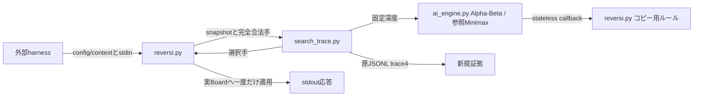

# Phase 4: Alpha-Betaと実AI探索計測

2026-11-06の実装前設計。Phase 3の評価関数・剪定なしMinimaxを参照として保全する。課題の入出力は[プログラム開発方法](プログラム開発方法.md)、正式計測は[現行契約](harness_contracts.md)に従う。

## 前提と対象

開始HEADは`bf8ae76ed6f71e3f2b0bd2bddab76f3b813dce99`、ブランチは`feat/ai-phase4`、未コミット差分なし。Fullの42ソースの一致と原品質の公開検証に成功した。Phase 3は構造・参考評価を完了しているが、正式予算・時計・lifecycle資格は未取得。固定baseline、序盤、GUI、harness実装を変更しない。原証拠は`evaluation_results/phase4/run-327c43552a074fb79d0aaed6314615e1/`へ新規保存する。

Alpha-Beta、単純な内部着手順序、固定深度の実AI trace4のみを対象とする。TT、bitboard、学習、反復深化、中断、search_v1固定は対象外。モデル資産はなく、traceではmodel_id=null、not_requiredとする。

## 責務とAPI

AIからharnessをimportしない。新規`search_trace.py`は設定検証・時計・原traceの生成を担当し、strict mypy・lint・formatへ登録する。`ai_engine.py`は純粋探索、`reversi.py`は盤面の所有と着手確定を担当する。新しい`search_alpha_beta(rows,color,depth,legal_moves_for,apply_move,ordered=True)`は不変な結果を返す。診断深度0〜4、selector深度1〜4、通常intだけを受け付ける。callback例外は伝播し、部分結果を成功にしない。

## 探索・同点・計数

root固定視点で最大化・最小化する。初期窓は無限、パスで深度を減らさず、双方合法手なしで終局。rootは常に(y,x)順、厳密改善でだけ更新する。後続root子のfail-low上限が現最善値と同じでも更新しない。先行する候補の正確な値と後続候補の改善を判定するため、root評価は厳密となり、従来の同点規則も保つ。

まずordered=Falseで全階層(y,x)順とする。ordered=Trueではroot以外を角優先、次に既存の位置重み降順、最後に(y,x)順とする。評価関数は変えない。

`minimax-call-v1`はroot、leaf、パス後を含む実際の再帰呼出しを各1nodeとする。leafは深度0または終局の評価返却数、passは非終局でパス辺をたどった数。callback内部や候補生成はnodeに加算しない。cutoffsは残る兄弟を1個以上省略した内部節点数で、省略した架空nodeを数えない。Minimaxと同じ計数範囲で比較する。

## 設定と測定区間

現行ハーネスの正規化config v2を受ける。対応予算はkind=depth、limit_depth=1〜4のみ。searchはalgorithm（alphabetaまたはminimax）、ordered（bool、alphabetaのみ）、deterministic=true、counting_definition_id=minimax-call-v1に限定する。省略値はalphabeta・ordered=true。未知キー、異なる定義、モデル指定、time/nodes/noneは起動時に拒否する。通常GUI用の環境変数なしと、ハーネス既定のunknown＋空searchだけは非計測経路を維持し、正式適合を申告しない。部分的なtrace環境は拒否する。

固定深度探索を呼ぶ直前から結果返却直後をsearch_onlyとする。root合法手の再列挙と評価・コピーは範囲内、実Board確定・JSON書込・stdoutは範囲外。max_depth_startedは開始した固定深度、completed_depthは完了した固定深度で、早期終局でも要求深度を完了とする。stop_reason=fixed_depth_completed。通常着手でroot・全子を実探索する。Boardがselectorを呼ばないpass/terminal問い合わせは探索なし、nodes=0、開始/完了深度0、stop_reason=no_legal_moveとし、実時計で取得した空区間を保存する。

子entryは本体import前、protocol_readyはBoard構築後。全コマンドの受信、探索の両端、応答準備、quit、終了準備を同一スレッドのperf_counter_nsで測る。時計descriptorは現行契約と独立実装で一致を検査する。親contextのidentityを検査し、子PID・threadも記録する。traceは排他作成・逐次flushし、取得後に修復しない。コマンド既存出力を一時bufferへ受け、イベント保存後にstdoutへ出す。例外・設定違反・書込失敗は異常終了し、正式成功を偽装しない。

## 検証と評価の事前条件

新規テストはPhase 4専用ファイルに置きFullだけで実行する。独立Fraction Negamax、既知局面、参照Minimaxに対して深度0〜4、白黒、パス・終局・同点・逆候補順・入力/RNG不変・例外を検査する。合成木でも境界値と同点を区別する。traceは実プロセスで全コマンド・pass/terminal・不正設定を検査し、既存schema5/trace4/validation3の検査を緩和しない。

固定代表局面で各深度・ordered有無のnodeと実時間を記録し、中央値・分布・悪化例を保存する。中央値20%削減は暫定目標で必須条件にしない。

変更前のPhase 3原証拠をfresh再解析し、実行時にコード・明示資産が一致することを確認して再利用する。変更後は同じrandom_v0/positional_v1、各2局smokeと100局、development序盤、selection_seed=20261020、seed=20261021、外部期限5/1/10秒で参考比較する。固定相手の正式資格不足を優越性へ読み替えない。

正式計測は別に実AI Alpha-Beta対実AI参照Minimaxで4局、developmentの2caseを先後交換する。両者depth2、同じseed・選択seed、confirmatory/equal-work、deterministic=trueとし、engineとproducerを明示資産に登録する。取得・保存後にfresh再解析し、予算・時計・lifecycle・決定性・資産・全応答を個別に判定する。これは少数の計測適合試験であり棋力優越の試験ではない。held_outはhash以外に使用しない。

G0〜G5とPhase 4の固有条件、Full成功、実AI正式計測の必須資格成立を確認して完了判定する。未達項目をPASSに変えず、Phase 5へ進める範囲を報告する。

## 実施結果

2026-11-06に設計範囲の実装・対局取得、2026-11-07にfresh再解析と最終照合を完了した。G0〜G5と固有条件の判定、成立範囲と未実施事項は[実装・評価記録](reports/20261107_phase4_implementation.md)を参照する。Phase 5の実装は含めていない。
