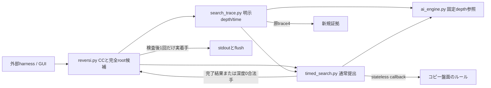
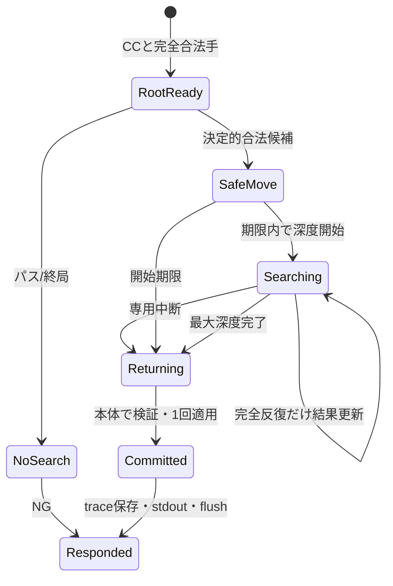

# Phase 5: 時間制御と安全応答の実装設計

2026-11-08の実装前設計と、実測後の改訂履歴。現行の予約分は末尾の二回目の再設計、結果は最終照合を参照する。開始HEADは518cd2aa263fbed869ed17ea9da64e126d78c1a3、feat/ai-phase5。Phase 4はmainへ統合済み。参照Minimax・固定深度Alpha-Beta・評価重み・baseline・序盤・held-out・harness実装は保全する。原証拠はevaluation_results/phase5/run-0f94162b39214839bcff342fe327a2f0へ新規保存する。開始時と実装後のFullは別snapshotで実行する。

## 責務とAPI

新規reversi_player/timed_search.pyをstrict mypy・lint・format・Fullテストへ登録する。ai_engine.pyの参照関数は変更しない。timed_searchはai_engineの型・評価関数・位置表だけに依存し、本体・GUI・harnessをimportしない。search_iterative(rows,color,root_moves,legal_moves_for,apply_move,command_received_ns,policy,limit_ns=None,clock=None)はimmutable TimedResultを返す。callbackは完全な合法手と独立snapshotを返すstateless関数である。実Board・乱数・stdoutは変更しない。

ResponsePolicyはtarget_ns=7000000000、new_depth_margin_ns=1000000000、stop_margin_ns=500000000、max_depth=4を初期値とする。提出設定はscript相対response_config.jsonで保持し、未知キー・bool・不正int・不整合を起動前に拒否する。今後の0.1秒調整は固定search_v1へ波及させない。今回の値は設計候補であり、実測前に安全確認済みとしない。

本体mainは正常な設定なしの場合だけTimedSelectorを選び、各コマンド受付後begin(received_ns)を呼ぶ。Boardの既存コンストラクタ既定は診断・既存import互換の固定深度2として保全する。unknown＋空searchは従来の非計測・固定深度2を維持する。明示depth設定も既存経路を保全する。snapshot・完全root合法手・選択検査・実着手1回はBoardが担当する。

## 時間と停止

時計はtime.perf_counter_nsの通常int・単調実経過。CCはinput行の取得直後でsplitより前、SSはselectorの探索入口直前、SEは探索返却直後。通常経路でも単一CCを全反復で共有する。コマンド新深度開始の限界はCC+target-new_depth_margin、途中停止要求はCC+target-stop_margin。6.0秒、6.5秒、0.5秒は初期候補で、測定に失敗すれば旧証拠を残して設定を改訂する。

明示timeは通常int limit_ns=1000000〜6500000000だけに対応する。初版ではSSからの上限に対しmax(100000,limit_ns//20)nsを停止予約分とし、新しい反復はSS+limit_ns*8//10より前だけ開始する。実際の停止はコマンド期限との早い方を使う。SE-SSが要求上限を越えたら既存validatorは失敗する。時計待ち・callback・serialization・flushが無制限に遅延しないという保証はしない。停止要求検出時刻と実SE、全外部応答を別に測る。

時刻確認は反復・root候補切替・再帰入口・合法手生成前後・仮着手前後・評価前後・順序付け後に置く。途中停止は専用内部例外だけで巻き戻す。callback・不正入力・時計逆行・trace書込み例外は伝播し、正常中断へ変換しない。

## 深度と完了

時間対応側も深度1〜4。既存代表10局面のPhase 4 depth4は最大約0.869秒で、安全応答の実装には上限4で評価可能と判断した。より深い探索は今回追加しない。中断が起きない場合は同じ深度の固定Alpha-Betaと厳密root値・(y,x)同点手が一致する。内部順序は角、位置重み、(y,x)、rootは(y,x)。パスはplacement plyを減らさず双方合法手なしで終局とする。

完全rootの最初の(y,x)合法手を深度0候補として先に確保する。root全候補から再帰が正常に戻ったときだけvalue/move/completed_depthを置き換える。途中の値は公開しない。valueは完了深度0ならNone。max_depth_startedは実際に開始した反復、completed_depthは完了した反復。終了直後に期限検出した反復は未完了とする。root合法手なしは探索しない。パス/終局問い合わせは0node・開始/完了深度0・value=None・no_legal_moveで区別する。

## 計数とtrace4

minimax-call-v1の実再帰呼出しを全反復・途中中断分も合算する。再帰入口でnodeを1加算し、その後の時間確認で中断しても実呼出しを残す。leafは評価を実際に返した数、passはパス辺を実際にたどった数、cutoffは残兄弟を省いた内部節点数。root合法手の事前列挙・候補順序付けはnodeへ加算しない。計数の定義を変えず、固定深度の単一木とは仕事量が違うことを明記する。

対応time設定はalgorithm=iterative、ordered=bool、max_depth=1〜4、deterministic=false、counting_definition_id=minimax-call-v1。省略時もこの実効アルゴリズムを用いるが、要求JSONを勝手に書き換えない。depthは従来algorithm=alphabeta/minimax、deterministic=true、深度1〜4。timeで決定性trueやminimaxを指定したら拒否する。nodes/none/未知設定/モデルは拒否する。

trace4には実SS/SE、全node、leaves/passes/cutoffs、開始深度、完了深度、stop_reason、valueを取得時に記録する。stop_reasonはmax_depth_completed、new_depth_deadline、time_limit、no_legal_move。time_limit/new_depth_deadlineの合法候補はモデル故障ではなくfallback=false。モデルなしはnull/not_required。全commandとlifecycle、CC/CR/quit/CS、identityと時計は既存契約を保全する。着手確定・trace・stdout/flushはSS/SEの外で全応答に含める。CRは応答準備時でflush完了ではないため、flush完了は外部HR/HE1で検証し、元traceを後から修復しない。

## 状態と依存図

## 検証と評価の事前固定

新規tests/test_ai_phase5.pyはFull専用。偽時計の各停止点・深度1未完了・完了直後・深度2以降・root後半・内部pass・終局・1合法手・入力/RNG不変・例外・連続呼出し・確定/応答1回を検査する。固定探索は独立Fractionオラクル・refereeと既存Phase 2〜4回帰で維持する。

実時計は固定10局面の全区分とdevelopment由来の局面を事前に固定し、0.1/0.5/1.0秒を各局面、5/7秒候補を各負荷条件で通常着手100件以上、pass/終局を別枠で測る。通常と単一CPU affinity＋同CPU負荷を区別し、模擬サーバーとは呼ばない。全試行・全genmoveの外部/探索時間、7/8/10秒超過、異常、停止遅れ、開始/完了深度・nodes等を残す。分位点はnearest-rank ceil(p*n)-1、平均・中央値・最大も保存する。7秒超過は目標未達、8秒超過または不正手/異常/10秒超過があれば初期採用不可とし、旧証拠を残して再設計する。

同じ固定random_v0/positional_v1に各2局smoke＋development非復元50pairの100局、selection_seed20261020・seed20261021・外部5/1/10秒。時間対応の探索仕事量はPhase 4固定depth2と違うため、成績は参考で同workの棋力差とはしない。Phase 4の204局をfresh再解析し、資産/条件一致と相違を保存する。

正式depth2は実AI Alpha-Beta対参照Minimaxで4局confirmatory/equal-work。正式timeは実AI同士4局deployment/equal-time、まずlimit_ns=100000000で取得・保存・fresh再解析する。timeでは決定性資格や固定得点CIを要求されたかと成立したかを分ける。schema5/trace4/validation3・既存資格ANDは変更しない。

## 固定資産と提出

検証と評価後だけbaselines/search_v1へ本体・engine・timed_search・trace producer・response設定・depth/time設定・manifestを独立コピーする。候補側への動的importを許さない。後続チューニングから隔離した空ディレクトリで起動・全依存hash・再現性を検査する。

提出ZIPは全実行時依存を含め、harness/pytest/venvに依存せず別cwdの展開物だけで全コマンド・通常/パス/終局/連続対局を検査する。保存ZIPのbytesと全展開hashを記録し、直前正常版を別ZIPとして保持する。サーバーのOS/Python/起動名/ZIP階層の未確認は残す。実機提出・0.1秒増量は今回行わず、ZIP hash・設定・相手・先後・日時・完走・勝敗・異常・原因確度の記録様式と復旧手順を用意する。

## 実装・検証の経過

2026-11-08、上記の設計を新規timed_search.py、mainの受付起点、time trace接続へ反映した。参照ai_engine.py、harness、固定baseline、序盤、held-outは開始hashと一致した。新規201テスト、lint、strict19本が成功した。独立全停止境界は偽時計の証拠であり、実応答保証ではない。

最初の関連実行は監視側が600秒の任意上限を指定して途中で中断し、返却dictをdataclassとして記録する誤りもあった。原ログを残し、PASSには数えていない。既存品質ゲートの上限や内容は変えていない。修正した監視手順で新規テストを完走し、旧回帰の全件は実装後Fullで確認する。

実AI depth2の4局confirmatory/equal-workと、100000000nsの4局deployment/equal-timeは取得・保存・fresh再解析が成功した。deploymentはmetrics_certifiedであり、固定得点の正式CI・決定性・一般的棋力向上を意味しない。Phase 4原証拠5組のfresh再解析も終了コード0。

参考対局の候補はtime-100ms.jsonを用い、固定2相手に各2+100局を実施する設定で事前固定した。Phase 4のdepth2と異なるworkのため、対応する同workの棋力差は主張しない。応答測定は13局面、5/7秒×2負荷×100通常着手の400件、全局面の短予算試験に加え、明示評価設定なしの提出経路を各負荷100件、合計200件測定する。traceなし経路の内部計数は未取得として扱い、設定ありの計数を移植しない。測定前計画と全試行は原証拠に保存する。

実装後Fullの初回は既存上限1800秒でpytestが中断した。1485ケースが成功し、assertion失敗はなかったが、残り107件が未完了であるためFull失敗とする。原journalを比較すると新規テストの独立計算に約274秒かかり、既存のharness・型検査も開始時より遅かった。現在のCPU観測だけから遅延原因を断定しない。

再検証では新規Phase 5テスト内の純粋な独立Fractionオラクルと不変の参照結果だけを入力単位でメモ化する。候補探索は全ケースで実行し、期待値・201 node ID・順序・既存テスト・1800秒上限は変更しない。参照オラクルとAI本体のファイルhashは不変。これは同一の参照値の再計算を避ける検証内の変更で、AIの探索・計数・意味・通信・評価契約は変えないため図・正式契約の追加変更は不要である。最初の収集確認ではcache importが改行形式の違いで追加されずNameErrorとなったが、補正後に201ケースの同一収集とlint成功を確認した。失敗・中断を成功へ読み替えない。

## 100ms予算の再設計

最初のpositional100局は全局完走・94勝6敗だったが、index17/23の探索が102920200nsと101228100nsとなり、要求100000000nsを超えた。停止要求の確認遅れはそれぞれ7851700ns、6175500nsで、巻戻しは42300ns、37800ns。CLI終了1・fresh再解析も終了1のまま保持する。勝率や全応答7秒以内を理由に内部予算の失敗を除外しない。

測定後の変更として、明示timeの予約分をreserve=max(100000,min(25000000,limit_ns//4),limit_ns//20)nsへ改める。25msは負荷試験の最大停止確認遅れ11.276msの2倍22.552msを5ms単位で切り上げた設計値であり、普遍的な停止保証ではない。短予算の予約分を上限の4分の1以内とし、大きい予算の従来5%は維持する。通常提出の7秒目標、6秒開始限界、6.5秒停止要求、0.5秒後処理予約、最大深度4は変更しない。

time_stop=SS基準時刻+limit_ns-reserveとし、新反復開始限界は従来80%とtime_stop-min(1000000,limit_ns//20)の早い方へ制限する。コマンド期限とのminも維持する。100msでは停止要求75ms・新反復開始74ms、0.5秒では停止要求475ms、1秒では950ms、6.5秒では6175ms。1msの受領境界は停止要求0.75msとするが、実時計の正式資格を1msへ一般化しない。

この規則と独立の整数計算期待値を実装前に確定し、旧コードで失敗することを先に検証する。評価値・最善手のオラクル、100ms上限、schema5/trace4/validation3、正式ANDを変更しない。役割・依存・状態図・SS/SEは同じで、停止判定の数値条件だけを更新する。旧証拠は保存し、新しい原証拠はguard25領域で取得し直す。

## 25ms予約分の再取得結果と二回目の再設計

Phase 5の初期time予約分5%では参考100局中2着手、次の25msを含む予約分でも別の100局中6着手が100msを超過した。後者の停止確認遅れは最大59.2659msで、巻戻しは最大28.4µsだった。現行の予約分はmax(100000,min(120000000,limit_ns*4//5),limit_ns//20)nsとする。120msは最大停止確認遅れの2倍118.5318msを10ms単位で切り上げた値。短予算では予約分を要求上限の80%までに制限し、100msでは20msに停止要求、新反復は19msより前だけ開始する。通常提出7秒目標、6秒開始限界、6.5秒停止要求、0.5秒後処理予約は変更しない。要求time上限・SS/SE・正式ANDは緩和せず、未知のOS停止に対する保証もしない。旧失敗は保持し、変更後の全品質・正式計測・参考対局・実応答をguard120へ新規取得する。

これは予算・棋力基準の緩和ではなく、停止遅れの再観測による仕事時間の保守的な配分変更である。最大深度・評価値・最善手の期待値は変えず、境界の整数期待値を実装前に決定して旧コードでredを確認する。正常応答678件と正式4局だけでは100局中の遅延を除外できなかったため、限定的成功を一般化しない。

## 最終照合

2026-11-08 Phase 5のローカル作業完了。反復深化・協調的中断・合法な安全応答を実装し、Full1604件・独立smoke1件、参考408局、678応答の検証を完了した。678件の応答測定は全件7秒以内で、正式計測はWindows直接CPython3.13.5のdepth2と100ms timeに限定する。

search_v1を全依存・設定・hashごと独立固定し、提出用7秒ZIPと開始時Phase 4の復旧ZIPを展開物・別cwdで検証した。

一般的な棋力向上とサーバー実機での安全性は未確認。先行runで固定Bの通常play timeout1件を観測し、原因未確定のまま別記録に保持した。全試行で異常0とは扱わない。Phase 6の別途設計へ進行可能とするが、学習・Phase 6以降・Git統合・外部提出は未実施。[Phase 5実装・評価記録](reports/20261108_phase5_implementation.md)を参照。 最終pytest1604件、strict19本、47品質sourceを照合した。678応答の最大1.0978042秒。5/7秒候補は深度4を早期完了しており、自然に7秒付近まで探索した証拠ではない。固定資産のGit改行保全、G0〜G5・固有12条件・旧失敗・原証拠は実装記録へ集約した。

時刻境界の補足：内部time停止用の起点はsearch_iterative内で入力検査後に読む初回clockで、traceのSSはselector呼出しの直前である。SS/SEの正式実測には入口検査と戻りの費用も含まれ、その費用も予約分が必要とする余裕に含める。要求上限の合否は常に実SS/SE全体で判定し、内部起点へ測定区間を狭めていない。
