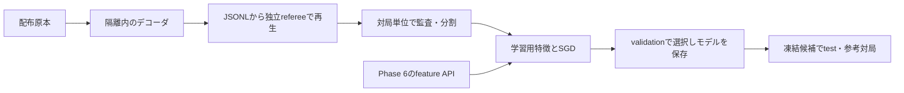

# Phase 6.5の教師あり学習設計

Phase 6を統合したmainの `7147272` を起点にする。学習は `tools` から実行し、既存の推論、対戦プロトコル、Phase 0の評価契約は同じ入口を使う。[Phase 6のモデルと特徴量](phase6_design.md)

## 原本の境界

提供されたZIP内のpickleと展開済みファイルのSHA-256を照合する。来歴、利用条件、棋力の確度は別々に記録する。opcodeを静的に調べたうえで、数値、二要素のtuple、リスト、座標tupleの参照だけを扱う専用デコーダで正規化する。通常のpickle復元は使わない。デコーダはWSL2のマウント・ネットワーク・PID名前空間とread-only chroot内で、専用の非特権UIDを割り当て、capabilityを落として実行する。隔離の検査に成功した場合だけrawを渡す。出力は親プロセスが新規ファイルへ受け取り、正常終了、件数、hashを確認する。

変換形式v1はUTF-8 JSON Lines。1行が `[着手列,黒−白の最終石差]` で、着手は0始まりの `[x,y]`、明示パスは `[-1,-1]`。変換時には値の意味を修正しない。独立refereeで黒から交互に再生し、パスは当該色に合法手がなく相手に合法手がある場合に限る。原本の説明はパスを明示する形式なので、欠落を補わない。双方に合法手がない終局と記録石差の一致を受け入れ条件とする。例外は元の行番号と理由を保存する。

## 漏洩の検査と分割

合法で完全な対局をD4同値な着手列の辞書順最小で識別する。先に現れた対局を1件残し、同一棋譜とD4同値を記録する。途中までしか続かない棋譜は除外し、既知の完全対局のprefixにあるかを確認する。共通序盤の集中は先頭8手のD4同値別に計測する。この共通序盤を分割の群にはしない。サンプル状態のD4同値重複も分割後に数える。

seed 20261118で結果別に80／10／10のtrain／validation／testへ分ける。分割を固定してから、各対局の非終局状態を盤上に置いた石の数で序盤0〜19着手、中盤20〜41着手、終盤42着手以降に分ける。各段階と手番の組から、固定seed 65で最大1局面を抽出する。パスの前後は同じ盤面でも別状態として扱う。重みを更新するときは各対局のサンプル寄与が同じになるよう、1局あたりの採取数で除す。Phase 0のheld-outは学習・候補選定・参考対局に使わない。

## 更新と評価

教師は観測した最終結果を黒勝ち+1、白勝ち−1、引き分け0で表す。白番でも符号を維持する。局面と手番をPhase 6の `features` へ渡し、重みIDと出現回数を得る。教師ラベル、対局ID、石差、着手履歴は特徴に渡さない。

更新は逐次SGDとし、損失を `(V−y)²/2`、重みの勾配を `(V−y)(1−V²)cᵢ` とする。重みは学習側の配列で管理して、推論可能なcheckpointをPhase 6のJSONに保存する。学習側でまとめた出現回数の積と、推論側の反復加算にはbinary64丸め差があり得る。照合は数値許容差を用い、最終推論経路は既存モデルを使う。

比較基準はPhase 6の初期値0と、trainの対局ごとのラベル平均。MSEを対局内と対局間で等重みに集計し、RMSEとMAE、手番・段階・ラベルごとの誤差を記録する。最終testを開く前に選択したcheckpointをhashで固定する。全testを評価した後、実際に学習に使った対局とvalidationの状態に対するD4同値重複を計数し、重複を除いたtestの誤差も補足する。test結果を候補選択に使わない。区間を報告する場合は対局単位の誤差差を使う。Phase 6.5の参考対局は先後交換したdevelopment序盤で、専用の1手選択器を比較する。

事前登録は1,000局で3学習率、5,000局で3学習seed、20,000局へ順に進める。学習率は0.000125、0.0005、0.001、各3 epoch。5,000局からは小規模validationの最良学習率と4 epochを用いる。train局数は固定順のprefixとし、seedはSGD中の対局順を変える。候補の選択はprimary seedのvalidation最低MSE。20,000局の候補が定数を0.005以上、かつ5,000局の候補を0.002以上上回った場合、利用可能なtrain全体まで拡大する。各学習・評価実行は外部上限900秒とし、検証集合で `|V| ≥ 0.99` が95%以上なら過度の飽和として拡大しない。有限の重み、checkpointの再読込、ピーク常駐メモリと実行時間を記録する。

正規化後の再現はリポジトリルートで `python -B -m tools.phase65_data NORMALIZED_JSONL DATASET_DIR` を実行し、`python -B -m tools.phase65_experiment DATASET_DIR ZERO_MODEL OUTPUT_DIR` へ渡す。出力は新規ディレクトリを指定する。正規化時はWSL2の隔離スクリプトで先にプローブを実行し、非特権・書込禁止・通信拒否を確認する。実呼出しと実bytesのhashは原証拠へ保存する。

