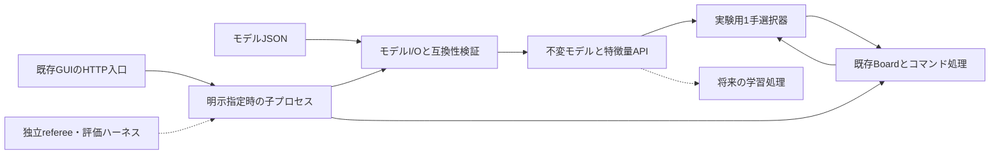

# Phase 6のn-tuple推論設計

起点は最新の `origin/main`、`6773751`。Phase 5のPR #15はmainに統合済み。現行提出ZIPを保管する互換性ブランチは別worktreeに残す。[段階設計書](リバーシAI段階開発・評価設計書.md#phase-6n-tuple価値モデルの推論保存読込)と[移行準備](phase6_preparation.md)で未確定だった規約をここで定める。

## 入力、配置、共有

状態は、不変な8行のASCII文字列のtupleと手番 `B` または `W`。添字は `rows[y][x]`、座標は0始まりの `(x,y)`。セルは `E=0, B=1, W=2`。長さ $n$ の順序付きtupleで、左の座標を最上位桁として $p=\sum_{i=0}^{n-1}d_i3^{n-1-i}$ を計算する。2要素のindexは0〜8、3要素は0〜26。符号化APIは長さ、座標の型・範囲・重複、盤面の形と値を検証する。特徴量APIは盤面の到達可能性を仮定しない。

隣接する直線を、右、下、右下、右上の4方向で長さ2と3について列挙する。D4と列の逆転で同値になる直線のうち、座標列の辞書順最小を代表とする。代表を長さ、座標列の順で並べ、0始まりの位置をtuple IDとする。全210本の2マス直線は32代表に、全168本の3マス直線は24代表に分かれる。各代表の順序付き座標へ次の8変換を適用する。展開時は座標列の順序を保つ。

| ID | `(x,y)` の変換 |
|---|---|
| identity | `(x,y)` |
| rotate90 | `(7-y,x)` |
| rotate180 | `(7-x,7-y)` |
| rotate270 | `(y,7-x)` |
| flip_x | `(7-x,y)` |
| flip_y | `(x,7-y)` |
| diagonal | `(y,x)` |
| antidiagonal | `(7-y,7-x)` |

重みの順は手番（B、W）、tuple ID、パターンindex。各手番に56 LUT、計112 LUTと1,872重みを持つ。binary64の重み本体は14,976 bytes。各盤面・手番で56×8=448参照を加算する。異なるtuple IDまたは手番には別の重みを割り当てる。同一IDの8変換が同じindexを参照した回数をそのまま $c_j(s)$ とする。例えば3回なら寄与は $3w_j$。同じ座標列が空間対称性で複数回出る場合も同じ規則を使う。重複を平均化しない。

## 価値と学習用API

`NtupleModel.features(rows, turn)` は平坦な重みIDと整数の出現回数をID昇順で返す。`logit` は $f(s)=\sum_j c_j(s)w_j$、`value` は黒視点の $V(s)=\tanh(f(s))$ を返す。推論は状態や重み、乱数を変更しない。浮動小数点の加算に標準の `math.fsum` を使う。重みは有限のbinary64で、絶対値上限を $2^{1000}$ とする。448項の絶対値の和が $2^{1009}$ 未満になり、相殺前の部分和もbinary64で有限になる。tanhは丸めによって±1を返し得る。

盤面を $h$ で変換した場合、各代表の $g$ による参照は合成 $h^{-1}g$ へ置換される。D4の閉性から各重みの参照回数が一致し、同じ手番で $f(hs)=f(s)$、$V(hs)=V(s)$ が成立する。色交換に対する反対称性は課さない。パスは合法手のある相手へ手番だけを渡し、パス後は相手のLUTを使う。

学習側が使用する偏微分は $\partial V/\partial w_j=(1-V^2)c_j(s)$。Phase 6.5の観測最終結果ラベルとPhase 7の終局報酬は黒勝ち+1、白勝ち−1、引き分け0。手番が白でもこの規約を使う。観測した対局結果は最善プレイを仮定した評価値と区別する。学習側が損失、TD目標、更新とcheckpointを管理し、推論側は同じ特徴量と不変の重みを提供する。

## 実験用の選択とプロセス

専用の `reversi_player/phase6_player.py` を起動し、環境変数 `REVERSI_NTUPLE_MODEL` にモデルの絶対パスを指定する。対戦プロセスは入力受付前に一度検証・読込する。設定の欠落、読込失敗、別の探索設定との併用はstderrと終了コードで報告する。ハーネスからはversion 2のunknown予算・空のsearch設定を受け入れる。GUIも明示指定時にこのスクリプトを選び、各HTTPリクエストで別プロセスを起動・読込する。選択は既存Boardの合法手・適用callbackを使い、候補ごとに次の手番のLUTを使う。次手番が強制パスなら、着手直後の状態としてその手番を使う。

双方に合法手がなければ石差 `d = 黒−白` を計算する。比較スコアは黒勝ち `2+d/64`、白勝ち `-2+d/64`、引き分け0。確定した勝ち・負けはtanhの飽和域の外になり、同じ勝敗内で石差を比較できる。引き分けは価値0と同点とする。黒は最大化、白は最小化し、同点では `(y,x)` 昇順の最初を選ぶ。着手確定は既存Boardが一度だけ行う。探索へ渡す手番視点への変換はPhase 8の境界で定める。

実験用経路は現行の正式trace producerの資格を申告しない。共通ハーネスを参考対局に使い、startup、初回応答、通常応答を分けて記録する。G3の対局健全性と正式な探索予算資格は別に判定する。

## 形式version 1

UTF-8 JSONファイル1本に `payload` と `payload_sha256`。payloadにはmanifestと平坦な重み配列を保存する。manifestはversion、モデルID、盤面・tuple配置・D4・符号化・視点・加算・数値規約の定義、重み数、binary64容量、provenanceを保持する。JSONの正規化はキー昇順、空白なし、ASCIIエスケープ、非有限値禁止。モデルIDは、定義と重みだけを同じ方法で直列化したbytesのSHA-256。payloadのSHA-256はprovenanceとmanifestも含む。読み込み時に実ファイルbytesのSHA-256も返す。binary64は標準のJSONの十進表現からfloatへ復元し、`-0.0` を含めて往復させる。

読込上限は1 MiB。未知version、定義差、重み数や型・値の不一致、重複キー、hash不一致、部分ファイル・不正UTF-8を拒否する。provenanceは拡張可能な文字列キー・値で管理する。学習方法、データhash、seed、条件を記録できるが、互換性や学習済みの判定根拠はモデル名に置かない。保存は同じディレクトリの一時ファイルをflush・fsyncして閉じ、新規ファイル名へhard linkで公開する。保存先が既にある場合は失敗する。hard linkを提供する同一ファイルシステムが必要。公開前に失敗した場合は既存モデルへ影響せず、ディレクトリの停電時永続性は環境に依存する。

## 検証とPhase 6.5への引き継ぎ

独立テストでは盤面の行列転置と反転から8盤面を作り、候補実装の座標変換・符号化・加算を呼ばずに参照を数える。全36パターンと手計算fixture、固定seedの合法棋譜、到達可能なパス・終局、人工的な数値境界を使う。プロセスとHTTPで盤面・合法手・結果を独立refereeと照合する。参考対局は固定search_v1のdepth2と開発用固定序盤を使い、master seed 20261118、selection seed 20261118、外部期限startup 5秒、通常1秒、genmove 10秒。先後2局のsmokeを確認後、同条件の開発用50ペアを上限候補として追加する。目的は対局健全性と再現性の確認とする。

配布の `102400-games/data.py` は交互着手、パス `(-1,-1)`、黒から見た最終石差という資料上の形式を示す。Phase 6ではファイルの存在と資料を確認する。Phase 6.5に進む前に、原本hash・配布元・使用条件・安全なデコード、実件数、盤面を再生した合法性とパス、終局石差、対局者と生成元、ラベル・序盤の分布を監査する。同一対局由来の局面を対局IDでまとめ、重複・D4同値の棋譜も同じ群に入れてからtrain／validation／testへ分ける。近似序盤や同一生成元の偏りは分割前に調べ、分割手順とseed・群の識別子を保存する。Phase 0のdevelopment・held-out集合とは別に管理し、Phase 0のheld-outは学習と調整に使わない。
