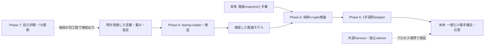

# Phase 6への移行準備

2026-11-09。Phase 5の終了確認と、Phase 6の実装前に決める事項を整理した準備資料である。Phase 6のコード・モデル・テスト・学習処理は作成していない。以下の「正本の方針」と「実装Goalで確定する案」を区別し、未確定の案を現行APIや正式契約として扱わない。

工程・完了条件の正本は[段階設計書のPhase 6・7](リバーシAI段階開発・評価設計書.md#phase-6n-tuple価値モデルの推論保存読込)、現在地は[開発計画](開発計画.md)、Phase 5の根拠は[最終レビュー](reports/20261109_phase5_review.md)と[実装報告](reports/20261108_phase5_implementation.md)を参照する。

## 1. Phase 5の終了状態

開始ブランチは`feat/ai-phase5`、HEADは`fe4d043ef798375e5efcd9a4d0d845cd1bd5826f`、作業ツリーはclean。既存[PR #15](https://github.com/nonnhjleno/reversi-ai/pull/15)は確認時点でopen・非draft・未マージ、remote headも同じだった。main/origin/mainは`518cd2aa263fbed869ed17ea9da64e126d78c1a3`。PRのCI結果確認とマージは利用者が行う。

保存済みFullのquality.json、JUnit、typingログ、開始/終了source hash、原証拠のpublication検証を読み取り照合した。今回のテスト・Full・対局の再実行は0回である。

| 確認項目 | 結果 |
|---|---|
| 最終Full | 必須11工程すべてPASS、保存された実終了コード0の記録あり |
| pytest | 1611成功、failure/error/skip各0 |
| strict・独立smoke | strict19本成功、smoke1件成功 |
| source | 48件の開始・終了・今回の実bytesのSHA-256が一致 |
| 原証拠 | publication errors0。旧バックアップ対象9162ファイルのsize/hash一致 |
| 所要時間 | pytest1750.2884283秒、1800秒上限まで49.7115717秒 |

Full領域は`evaluation_results/quality-b5bab628186d4e089fcb3a086c31003c/`、quality.json SHA-256は`e89b1f747408f6806542f93f42e0a862f65ce0029a1cfb79f71d5828937087e2`。これは今回の文書変更前後で実行sourceが変わらない範囲の確認であり、将来のモデル実装後までPASSを引き継ぐものではない。

固定baseline3種の計14ファイルを確認し、random_v0・positional_v1のfrozen_copy、search_v1のmanifest8資産と実bytesが一致した。依存ごと独立したsearch_v1と、既存提出・復旧ZIPを変更していない。以前の独立起動・ZIP展開試験はhashの一致を確認して参照し、再実行していない。

| 保管物 | SHA-256 |
|---|---|
| ranger-phase5-7s.zip | a9570f18e9b912694e9e1a385e60cc4442ef01d94cf73c1b859303eb1a012f1d |
| ranger-phase4-rollback.zip | ad76a6aae9315f0b9759332c40987dbe18823afba98363c49db90b3d6c199da3 |

ZIPは`evaluation_results/phase5/run-0f94162b39214839bcff342fe327a2f0/guard120/packages/`にある。新規checkoutにはこのGit管理外領域と原証拠が含まれない。前回作成したbackup-manifestとhash照合手順は[最終レビューの保管手順](reports/20261109_phase5_review.md#固定資産zipバックアップ)を参照する。 前回manifestはfe4d043時点のsnapshotとして改変せず保持する。今回の計画文書更新を含む新しい一覧は`evaluation_results/phase6_preparation/run-66e5dccb6f0e48cea1bea20037a557cf/backup-manifest.json`と`backup-manifest.sha256`へ保存する。外部コピー時は新しい一覧を使い、同じ保管手順の検証スクリプトでmanifestのpathを今回のものへ変更する。旧開発計画の開始bytesも今回の証拠領域へ保存した。同一PC内の保管を外部媒体へのバックアップと呼ばない。過去の外部Temp9件欠損は既知の未解決事項として維持し、復元調査は繰り返していない。今回照合した最終Fullはその9件に依存しない。

終了判定は「Phase 5のローカル実装PASS・参考評価完了・限定した計測適合の確認」である。正式depth2はstatistics=availableでもperformance_criterion=not_met、time100msはdescriptive_onlyで、両者ともdecision=undeterminedを保持する。一般的な棋力向上、提出サーバー適合、mainへの統合完了とは区別する。

## 2. 未解決事項と実際の依存

| 未解決事項 | Phase 6の設計・推論実装への依存 | 必要になる時点・扱い |
|---|---|---|
| 提出サーバー実機確認 | ローカルの表現・I/O・独立計算検証は進められる | サーバー適合や提出版採用の前に、OS/Python・ZIP階層・起動名・全コマンド・先後交換対局を確認する |
| 外部媒体へのバックアップ | 読み取り調査や新規領域への準備を一律に停止しない | 原証拠の単一媒体依存は残る。旧ファイル置換を伴う運用やuploadの前に、旧ZIP・モデル・原証拠を別媒体へコピーしhash照合する。学習出力は別名・新規領域へ保存する |
| 固定Bの通常command timeout原因 | モデルの純粋計算・保存読込には依存しない | 比較評価で同様の異常が出たら該当試行を失敗として保持する。既存1秒期限やBを変えて通さず、実際に評価を妨げる場合に限定調査する |
| 未知環境での7秒以内応答 | 現行環境でのモデル検証は可能 | モデル追加後の起動・初回・通常応答を新たに測る。未知環境の保証やサーバー提出を判断するには実機証拠が必要 |
| Fullの余裕約50秒 | 今回はG2成功であり、既存PASSを取り消す理由ではない | 新規コードには新しい関連検査とFullが必要。増分費用・環境負荷を確認し、上限・件数を維持する。新しいFullがtimeoutすればG2未達。必要な品質基盤改善は別作業として扱う |
| 100msの80%予約分と棋力 | n-tuple表現・I/Oの成立条件ではない | 予約分変更の効果は同じ局面・相手・seed・環境で別候補として測る。既存search_v1・設定・rawは凍結し、浅い深度だけで棋力悪化と断定しない |

これらを一律のPhase 5再開条件にしない。新たな正しさ不具合、source不一致、必須品質の失敗、必要証拠の欠損が実際に見つかった場合は、その依存範囲の判定を止める。現時点では、Phase 6の詳細設計へ進む前提は満たしている。

## 3. 正本で決まっている範囲

段階設計書§3.1にはPhase 1〜4時点の未実装説明が残る。現在の反復深化・時間制御はPhase 5最終レビューで実装済みと確認し、Phase 6・7の工程範囲は同設計書の各Phase節を参照する。

- Phase 6は未学習n-tupleの推論・表現・保存読込と1手選択の検証。未学習モデルに強さを要求しない。
- 初期候補は直線状2-tuples/3-tuples、LUTは各3^n要素、8種類の回転・反転で重みを共有する。重複参照の扱いは推論と将来の更新で一致させる。
- 状態は盤面＋手番、黒視点のV(s)=tanh(f(s))、手番別LUTを用いる。黒は最大化、白は最小化。色交換で数値が自動的に反転すると仮定しない。
- 推論は重み・実盤面・乱数状態を変更せず、着手確定は本体が一度だけ行う。AIからharnessへの逆importを作らない。
- 実際の重み更新・ε-greedy自己対戦・TD(0)・checkpoint選択・複数学習seedと漏洩検査はPhase 7。同じ学習済み重みのAlpha-Beta/MCTSへの統合比較はPhase 8。

## 4. Phase 6実装Goalで確定する設計

以下は実装前の検討表であり、ファイルやAPIを実装済みとするものではない。

| 項目 | 第一案・決める内容 | 確認する性質 |
|---|---|---|
| 座標と符号 | 盤面はrows[y][x]、tupleは(x,y)列。E=0/B=1/W=2を第一案とし、桁順を明記する | 桁順・tuple順を変えて同じモデルと扱わない。手計算したindexと一致 |
| 配置と容量 | 直線2/3のどちらを初版にするか、方向・位置・tuple順・共有単位を固定する | tupleごとの9/27要素、手番2系統、総LUT数・全重み数・bytes・参照回数を算出 |
| 対称性と重複 | 8変換すべての参照を扱い、同じindexへの重複回数を記録する。和/平均・正規化を実装前に決める | 手計算した重複回数、8対称性、将来の勾配で同じ係数を使えること |
| 価値と手番 | 黒視点を保ち、仮着手後は次の手番のLUTを参照する | 白の最小化、パスによる手番変更、両合法手なしの終局 |
| 終局の優先 | 終局をモデル推定より先に判定する。確定勝敗と推定値の比較・tanh飽和・同点規則を契約化する | 確定勝ちと大きい推定値の同点化を検出。黒白の視点を混同しない |
| 初期重み | 決定的なゼロ初期化を第一案にし、非ゼロの手計算fixtureを別に用意する | 未学習と学習済みを区別。ゼロ重みだけでindexや対称性の正しさを認定しない |
| 推論の入出力 | 不変の盤面・手番・モデルから黒視点の有限値を返す純粋境界を設計する | 不正盤面/手番/shape/NaN/Infを明示拒否し、重み・入力を変更しない |
| 1手adapter | 全合法手の子状態を純粋評価し、同点は既存(y,x)順を第一案にする | 対象出力から期待値を作らず最善手を独立列挙。Alpha-Betaの葉置換や探索深度増加を混ぜない |

終局用の比較値と、将来TDが学ぶ黒勝ち+1/白勝ち−1/引分0という目標値は、同じ役割とは限らない。符号・尺度の変換場所を決め、既存の手作業評価や固定探索版の数値を無断で変更しない。

### 責務・依存の準備図

図は将来案で、現行の実装依存図を置き換えない。最小の配置候補は`ai/ntuple.py`等だが、直接起動とpackage importの両経路・既存selector境界を調べて確定する。不要な細分化は避け、推論へ学習専用ライブラリを要求しない。Phase 6では`training/`の自己対戦・重み更新を作らない。

## 5. モデル資産と再現性

初期の小型LUTでは標準ライブラリで扱えるUTF-8 JSONを保存形式の第一案とする。実装前に次を固定する。容量・読込費用が不適合なら、別形式を比較し、既存ファイルを同じversionのまま解釈し直さない。

| 資産・metadata | Phase 6で必要な定義 | Phase 7へ引き継ぐもの |
|---|---|---|
| format/schema version | encoding、座標/桁順、tuple順、対称共有、手番/価値視点、正規化、shape、数値表現 | 更新処理が同じ定義を読めるversion規則 |
| 重み | 初期化種別・初期化seedが必要なら実値、有限値と次元の検証 | 学習重み、学習seed、再開時乱数状態 |
| hashとmodel ID | 定義・重み・設定・全依存を明示資産へ登録し、実bytesのSHA-256とIDの対応を固定 | 学習コード/データhash、checkpointとの対応 |
| 保存と互換性 | save/load後の値・index・weightが同じ。破損・欠落・未対応versionを拒否。新規pathへ保存し既存資産を上書きしない | 安全なcheckpoint保存・再開と互換検査 |
| provenance | 未学習と明示し、作成コード・設定・環境を記録。ゼロ初期化をランダム学習と呼ばない | 学習局数・学習率・ε・報酬・選定条件・データ利用記録 |

model IDを自身を含むファイルhashから循環定義しない。外側のmanifestにモデル本体のhashを置く案などを決め、実bytesの識別と意味上の設定一致を区別する。候補と固定search_v1の依存・モデルを共有しない。Phase 7用の学習metadataは拡張点を整理するだけで、今回checkpointや重みを作らない。

## 6. 時間制御・読込・GUI・正式資格

現行の[時計/モデル読込契約](harness_contracts.md#6-探索予算model-loadtrace)と[Phase 5設計](phase5_design.md)を保つ。今回7.0秒目標・6.0秒新深度開始限界・6.5秒停止要求・最大深度4、100msの現行予約分を変更していない。これらは既存探索経路の設定で、新しい1手モデルの実効予算が自動的に同じになるわけではない。

| 区間・経路 | Phase 6実装前に決めて検証する内容 |
|---|---|
| startup load | 実file読込・検証・構築・推論可能状態の端点を区別し、現行CE〜IR窓とmodel/load IDへ結合する。fixtureのread_bytes成功を実モデルの資格へ流用しない |
| 推論と選択 | モデル推論を含む実選択時間を測る。SS/SEやcounter・algorithm・budgetの意味を既存producerと照合し、対応しない設定は拒否する |
| 全応答 | 読込がstartupなら探索時間と別に保持する。初回/通常genmove、盤面更新、trace、flush、親の読取を含む全応答を混同せず記録する |
| GUI | web.pyの要求ごとの起動でload費用が繰り返される。初回name・model load・最初のgenmove・HTTPの区間を区別する |
| 故障 | 欠落/破損/unsupported versionと推論例外を確認する。提出用探索退避は設計候補だが、モデル採用試験はload失敗・fallback0件が条件 |

現行は通常command既定1秒・genmove10秒・startup別既定5秒。提出サーバーの10秒はgenmove受信〜応答という利用者情報であり、サーバーの起動条件まで検証済みではない。モデル読込をstartupで一度行う案から設計し、lazy/background/GPUを未検証のままverifiedにしない。モデルがあるのにnot_requiredやmodelなしを申告しない。

モデル導入で意味・構造・通信・評価契約が変わる箇所は、現行図・契約を実装前に更新・照合する。新規本番moduleをstrict/lint/品質hashへ明示登録する。今回は準備文書だけで現行runtime契約を変えないため、harness_contracts/harness_architectureやschema5/trace4/validation3を編集していない。

## 7. 独立した正しさの検証計画

| 対象 | 独立期待値・検査 |
|---|---|
| 符号化・LUT | 小さいtupleの全9/27パターンを手計算式と照合。順序を反転した非対称重みfixtureで桁順違いを検出 |
| 対称共有・重複 | 別実装の座標変換または手記した8盤面・indexと照合。重複度の違う局面で加算/正規化を確認 |
| 価値・手番・色 | 黒/白手番の異なるLUT、白の最小化、パス、終局を既知値で確認。任意の重みに色反対称性を要求しない |
| 1手選択・不変性 | 独立refereeで合法手と子盤面を列挙。非ゼロ重みから最善手を独立計算し、重み・盤面・RNG不変、実着手1回を確認 |
| I/O・ID | round-trip値、未対応version、不正shape/数値、欠落・途中切れ・hash不一致を検証。新モデルへの切替で旧値を再利用しない |
| 実プロセス | 直接起動とimport、7コマンド・GUI接続・終了・startup load・初回/通常応答を実モデルで検証 |

独立側が候補のindex計算・対称変換・loaderをそのまま期待値計算へ使わない。新規テストは専用ファイルへ置き、現行方針に従いFull専用から始める。未実行の本表をテスト成功と数えない。今回テストコードは追加していない。

## 8. 固定search_v1との比較準備

正本の共通ゲートに従い、実装Goalで比較命題・局数・開発序盤の抽出・seed・先後交換・外部期限を先に登録する。初期費用案は2局smokeの後に開発用50ペア=100局の参考比較とし、十分な検出力や棋力基準の達成を保証しない。未学習モデルの勝率をPhase 6実装PASSの条件へ追加しない。

| 比較 | 目的・制限 |
|---|---|
| 手作業1手 vs 未学習n-tuple1手 | selectorとモデルの正しさ・動作・費用の差を整理。Phase 5の深い探索との差を学習効果と呼ばない |
| 未学習n-tuple vs 固定search_v1 | 同じ固定B、開発序盤、seed、先後、期限、harness/資産hashを記録。search_v1のdepth2とtime100msの用途を分ける |
| Phase 7の学習前後 | 同じ定義の未学習モデルと凍結checkpointを比較し、学習の寄与を分離。学習seed間の分散と対局ケースの統計を合算しない |

1手モデルとdepth2の探索は同一workの証明ではない。新selectorのalgorithm/予算/counter/load資格が既存契約に適合しなければ参考値に留め、正式availableを流用しない。time評価はdeploymentとし、固定得点の正式区間と分ける。100ms予約分の変更、学習、深度増加を同じ候補へ同時に混ぜない。

held-outの内容は今回閲覧せず、hash照合だけに留めた。Phase 0の開発/held-outは学習データ分割ではなく、Phase 7で別途漏洩・対称同値局面・checkpoint選択を管理する。固定random/positionalを参考相手として追加するときも、内部予算unknownと既存timeoutを隠さない。

## 9. 次の実装Goalへ渡す条件

1. 利用者がPR #15のCI確認・main統合を行う。安定mainを起点にする運用では、その統合を確認してから`feat/ai-phase6`を別Goalで作る。今回そのブランチ作成・切替やmergeは行わない。main未統合は実装の起点管理の課題として扱い、設計準備は継続できる。
2. Git・未コミット変更・固定資産の実bytes/hashを再確認し、別worktreeなら改行変換も照合する。旧原証拠を新規checkoutで失わないよう保管先を引き継ぐ。
3. 本文の検討表を使い、配置・符号・重複・終局・API・保存形式・model ID・時間/load・故障・比較条件を実装前に確定する。必要な図・契約・独立テストの根拠を先に記録する。
4. Phase 6だけを実装し、関連回帰・必須Full・実プロセス/GUI・未学習版と固定相手の参考評価を新規証拠へ保存する。現行sourceのPASSを新実装へ読み替えず、上限・件数・schemaを緩めない。
5. 手計算LUT、対称性・手番、I/O、入力/重み不変、合法応答と共通G0〜G5の成立を個別に判定する。load/時計/予算の正式資格と棋力採用は別判定とし、未達は残す。

今回の準備確認はコード変更・テスト追加・対局・外部コピー・サーバーuploadを伴わない。ローカル再確認の証拠は`evaluation_results/phase6_preparation/run-66e5dccb6f0e48cea1bea20037a557cf/`へ新規保存した。PR更新後はCIの終了を待たずに引き渡す。
