# 品質ゲートの実行効率・検証能力監査（2026-10-20）

> 調査・分析・改善計画のみ。品質ゲート、テスト、設定、AI、既存の設計図・契約は変更していない。以下のQuick/Standardは未実装の提案である。

## 1. 判断の要点

**約8〜9分のFullには、実プロセス、保存traceの再検証、正式入口の拒否、型境界の負例という検証上の理由がある。一方、小さな変更ごとにFullを繰り返す運用と、同じ基礎型検査を26回起動する自己試験には改善余地が大きい。第一推奨はFullの合格条件を維持し、明示的に限定したQuickを追加することである。**

- 現行ソース34ファイルのhashと一致し、原証拠も再検証できた最新ローカル記録では、10工程の計測合計552.893秒、pytest工程539.011秒。787件のphase合計534.332秒の99.28%は `test_harness.py` と `test_quality.py` が占める。
- 型境界の26ケースは計198.271秒。うち24ケースは設定の14rootを各回検査し、残る2ケースは明示probeとそのimport依存を検査する。通常のtyping工程4.149秒と比べ、検証器を検証するための反復コストが大きい。ただし負例・正常対照の期待結果は異なり、通常typingで代替できない。
- pytestのsetupは9.964秒、teardownは0.376秒。fixtureのscope拡大だけを第一施策にしない。初期化や対局生成の一部はcall内部で実行されるので、setup時間だけで全初期化費用が小さいとも断定しない。
- 独立smokeはFull内と同じ1 nodeidを別プロセスで再実行する。主記録の外部8.135秒であり、独立性を失ってまで削る優先度は低い。
- 現在のjournalは直列専用。単に並列workerを有効にするとactive test・sequence・nodeidの契約と衝突する。
- 旧2runは各10件の一時領域原証拠が現在欠損し、publication再検証が不能だった。新しい高速化とは分けて、証拠の保管期間・移動可能性を改善する必要がある。

テスト数の削減は推奨しない。完全に同じ条件・期待結果で、独立した検出能力がないと立証できた削除候補は今回確定していない。

## 2. 作業範囲・Git・Goalの確認

### 2.1 Gitの準備

- 開始時: `feat/ai-phase1`、HEAD `d1debe72cd7901b7b8ad6d5ed4c4bee8c6507f7f`、作業ツリーclean。
- `git fetch origin` 後の `origin/main`: `73990eccbb4a10d96013f771e8925759a73e137f`（PR #2統合済み）。
- 同名のローカル/リモート作業ブランチがないことを確認し、`git switch -c refactor/quality-gate-optimization origin/main` で専用ブランチを作成した。
- ローカルmainは移動していない。未コミット変更の破棄・上書き・退避はしていない。監査資料以外の変更は行わない。
- 既存goalはなく、この依頼の/goalを1件作成し、Goal 1〜6を順に成果確認した。以下の「監査完了」は将来の最適化やprofileの実装PASSを意味しない。

| Goal | 判定 | 完了条件を満たした根拠 | 参照 |
|---|---|---|---|
| Goal 1 | 監査完了 | 10工程・順序・scope・262定義/787ケース・証拠契約を照合 | §3–4、quality.py/契約13節 |
| Goal 2 | 監査完了 | 既存3runとCIの時間を集計、上位30件・phase/カテゴリ・未計測を記録 | §5–6、metrics JSON |
| Goal 3 | 監査完了 | 不具合の検出能力で重複・独自性・不足を評価 | §7–8、assert/負例/公開入口の対応 |
| Goal 4 | 監査完了 | Quick/Standard_AI候補とFull維持、選択不能時の拡大規則を設計 | §9、候補190/212ケースの基底ID |
| Goal 5 | 監査完了 | 時間見込み・コスト・再現性・リスクを比較 | §10–11、実測と推定を区別 |
| Goal 6 | 監査完了 | 実装順・比較方法・完了条件・残件を保存 | §12–15、資料検証記録 |

### 2.2 調査資料

実装は [quality.py](../../tools/quality.py)、[evidence.py](../../tools/evidence.py)、[evidence_plugin.py](../../tools/evidence_plugin.py)、[テスト](../../tests/)、[pytest設定](../../pytest.ini)、[型/Lint設定](../../pyproject.toml)、[CI](../../.github/workflows/quality.yml) を確認した。
現行の [アーキテクチャ](../harness_architecture.md) 第11節、[契約](../harness_contracts.md) 第13節、[品質進捗](../QUALITY_PROGRESS.md)、[既知の制約](../QUALITY_BLOCKERS.md)、[ハーネス操作](../ハーネス.md)、AGENTSを照合した。

数値と分類の機械可読な根拠、入力hash、全262基底テストの内訳、候補profileの基底ID、実際に使った読取集計スクリプトは [監査metrics](20261020_quality_gate_audit_metrics.json) に保存した。これは新しい監査派生物で、既存のquality/evidenceや正式AI評価報告ではない。個人profile/一時領域prefixの正規化もこの派生物だけに行い、原証拠は編集していない。

## 3. 現行品質ゲート（Goal 1）

### 3.1 順序と依存

`tools/quality.py:365 run_gate` は、新規UUID出力の作成、開始source hash、Git/実行manifestの準備を行い、以下の10工程を直列に実行する。

```mermaid
flowchart LR
    A["新規owned領域・開始hash・manifest"] --> E["1 environment"]
    E --> M["2 model"]
    M --> D["3 dependencies"]
    D --> L["4 lint"]
    L --> F["5 format"]
    F --> T["6 typing"]
    T --> P["7 pytest全件"]
    P --> S["8 独立smoke"]
    S --> X["9 snapshot"]
    X --> V["10 evidence収集・照合"]
    V --> W["evidence.md/JSONを排他公開"]
    W --> Q["最後にquality.json公開・CLI終了判定"]
```

これは現状の要約図であり、提案profileを既存モデルへ描き込んだものではない。environment不適合は6外部工程を未実行・失敗扱いにする。modelや各コマンドが失敗しても、対応環境なら残りを実行して診断を保存する。quality保存の成功までCLI成功にならない。

| 順 | 工程 | 内容・保証する特性 | 保証の限界・依存 | 外部上限 | 最新ローカル秒 |
|---:|---|---|---|---|---:|
| 1 | environment | Windows・直接CPython 3.13.5・非venv・固定dev依存4種を照合 | 任意OS対応や全実行資産の互換性証明ではない | 内部検査 | 0.033 |
| 2 | model | harness import図の過不足/循環、共通正式入口のAST呼出辺、契約文書の存在 | Mermaid描画・全制御フロー・意味を証明しない。AI内部依存は別テスト | 内部検査 | 0.119 |
| 3 | dependencies | `pip check` で導入済み依存関係の整合性 | 必須toolの版照合はenvironmentとの役割分担 | 120秒 | 0.663 |
| 4 | lint | Ruff E4/E7/E9/F、対象ディレクトリの構文/基本的な不備 | Ruff全ruleではなく、include範囲外の保証なし | 120秒 | 0.134 |
| 5 | format | Ruff format --check、限定導入scope | legacy除外はpyprojectに明記、全Pythonの整形保証なし | 120秒 | 0.126 |
| 6 | typing | mypy strict、明示14 root、--no-incremental、import依存も検査 | tests/web等はrootにない。全コードstrictの証明ではない | 300秒 | 4.149 |
| 7 | pytest | testpaths=tests、全787、strict config/marker、短いtraceback、journal/JUnit | 件数はcoverage率や全失敗の検出率を表さない | 1800秒 | 539.011 |
| 8 | smoke | 別pytestで `-m smoke`、1実行・786除外、新journal/JUnit | 全件の代用にならない。外部性能優越性の証明でもない | 120秒 | 8.135 |
| 9 | snapshot | 開始/終了34 sourceのpath/hash集合一致 | 観測間の変更/復元や、含まれない全文書・baseline資産の同一性は保証しない | 内部検査 | 0.018 |
| 10 | evidence | journal状態、JUnit対応、実行/原参照、hash、完全性を照合 | テストのassertを再判定せず、正式AI資格を発行しない | 内部検査 | 0.505 |

`Step` の既定上限は1800秒。実OS起動は `run_step:217`、回収は `_terminate:195`。timeout時は所有する子treeを回収し、回収不能を成功にしない。

10工程秒の合計はプロセス全体のwall時間そのものではない。開始hash/Git準備、最終Markdown整形・fsync・排他公開などの一部は工程timer外にある。特にevidenceのsecondsはcollect完了直後に記録され、その後の公開費用を全部含まない。

### 3.2 品質scope

常設strict rootは、harnessの9ファイル、AI本体/engineの2ファイル、toolsの3ファイルの計14。mypyのimport経由検査と明示rootへの登録を分ける。`web.py` は教員配布GUIとして意図的なstrict対象外であり、LintとGUI回帰は残る。testsはstrict rootではない。baseline、`102400-games/data.py`、`reversi_01.py` などもこの14件には含まれず、これらを無断で「本番例外」と承認したことにはしない。

Phase 10の新規本番モジュール登録漏れ防止は未実装。9対象の昇格負例だけから、全14 rootや新規moduleの登録漏れが自動検出されるとは言えない。影響選択を追加する際の前提として扱う。

### 3.3 証拠と判定

- `quality.json`: 全必須結果、argv/exit/seconds/error、環境、開始/終了hash。
- `pytest.txt / smoke.txt`: 原コマンド出力。`pytest/pytest.xml / smoke/smoke.xml`: 標準JUnit。
- `*/events.jsonl`: run/step/nodeid/sequence、selected、setup/call/teardown、明示期待/観測、原成果物参照、終了。
- `evidence.json / evidence.md`: manifest、テスト結果、収集完全性、不足情報、原hash参照。pending→fsync→排他hardlinkで公開し、対応するquality.jsonのhashを完成markerにする。
- `evidence.collect_step:284` は原journalとJUnitの状態・件数・結果を照合する。`verify_publication:719` は保存bytesと原参照の対応を再検証する。後者の空エラー配列だけでjournal意味や原記録の真正性を証明しない。
- 最新記録はpytest 787 + 別smoke 1 = **788 execution、787 unique nodeid**。明示checkは49 executionにあり、739 executionは詳細not_collected。これは期待値がないという意味ではなく、通常assertの入力/期待/観測を証拠APIへ自動抽出していないという意味である。

## 4. 787件の構成と保証する層

集計単位はパラメータ展開後のnodeid。ソースのtest関数/methodは262定義。unittest methodも数え、文字列中の模擬testを実定義へ数えていない。Hypothesisの2ケースは各max_examples=40と明示4例を持つが、実際の生成例数は既存ログに残っておらず件数を推定しない。

| テストファイル | test定義数 | 展開後ケース | setup秒 | call秒 | teardown秒 | phase合計秒 |
|---|---:|---:|---:|---:|---:|---:|
| `tests/test_harness.py` | 155 | 511 | 6.526 | 260.882 | 0.126 | 267.534 |
| `tests/test_quality.py` | 58 | 164 | 1.877 | 261.015 | 0.056 | 262.948 |
| `tests/test_stdin_commands.py` | 7 | 13 | 1.528 | 0.430 | 0.170 | 2.128 |
| `tests/test_result.py` | 18 | 61 | 0.026 | 0.591 | 0.018 | 0.635 |
| `tests/test_ai_compatibility.py` | 5 | 9 | 0.003 | 0.609 | 0.002 | 0.614 |
| `tests/test_invariants.py` | 2 | 2 | 0.000 | 0.393 | 0.001 | 0.394 |
| `tests/test_ai_engine.py` | 17 | 27 | 0.004 | 0.073 | 0.003 | 0.079 |

- H=`tests/test_harness.py`: wire形式、取得/CLI、schema/旧版、time/lifecycle、保存trace再検証、母集団/抽出/coverage、予算、統計、失敗/回収、型移行の動作互換。
- Q=`tests/test_quality.py`: gate自身の失敗伝播・モデル・snapshot・実OS回収、証拠/公開とjournal改変、型対象の負例/境界。
- 残り112件はBoard/Pos/ルール、独立referee、不変条件、固定random互換、selector、stdin、GUI接続を検査する。phase計3.850秒であり、AI回帰を削減してもFullの主要時間は短くならない。
- `test_result.py` には実GUI Process/RequestHandler経由の試験がある。実ブラウザ操作・HTTP全体のE2Eを確認したことにはしない。

## 5. 既存記録の時間比較（Goal 2）

### 5.1 入力と今回の再解析

| 記録 | 元のpytest表示秒 | 外部pytest工程秒 | 10工程合計秒 | 現在のsource照合 | 今回の証拠再検証 |
|---|---:|---:|---:|---|---|
| c1e5…（質問の基準） | 492.24 | 493.072 | 502.660 | コード/テスト一致、workflow・AGENTS・2設計資料hashは相違 | publicationは原一時参照10件欠損で不能 |
| 31d2…（先行記録） | 493.90 | 495.216 | 511.162 | 上と同じ4資料相違 | 原一時参照10件欠損で不能 |
| bc3a…（主計測） | 536.65 | 539.011 | 552.893 | 現在の34対象hashすべて一致 | publication=[]、pytest/smokeの再collectもcomplete/errors=[] |
| main CI #16 | 425.11 | quality step内の内訳ログ未取得 | quality step=434秒（10工程個別ではない） | 実run HEADが監査基準73990ec | 既存artifactのJUnit787・失敗0、CI success |

原保存先はローカルの `evaluation_results/quality-<run_id>/`（Git管理外）。完全なrun名・原ファイルhashはmetricsに保存した。bc3a記録のmanifestはcommit `adbd85f` / dirty=trueであり、現在HEADで新規実行したと表現しない。34対象のbytes一致と、main CIの別成功記録を分けて根拠にした。

[main CI #16](https://github.com/nonnhjleno/reversi-ai/actions/runs/39374393425) はすでに終了していたrunを読み取った。新たにCIを起動していない。artifact `pytest-diagnostics-39374393425` のpytest.txt/JUnitから787成功・0失敗を確認した。JUnit testcase秒の和は422.932秒。CI artifactのtext hashは復号後UTF-8再符号化の派生hashと明記し、ZIP/原bytes hashと混同しない。

主記録ではphase計534.332秒に対し外部pytest539.011秒で、差4.679秒には起動・collection・hook・出力等が含まれる。これを単独の「プロセス起動時間」や「journal負荷」として扱わない。

setup計9.964秒はphase総時間の1.86%、teardown計0.376秒。module fixtureのsetupは最初の利用caseへ帰属するため、個別caseの固有費用と誤認しない。

### 5.2 実行時間上位30件

主計測bc3aの **setup + call + teardown** で降順。H/Qのファイルは§4参照。小数3桁は表示丸め。全30件の合計233.893秒（phase総計の43.77%）。

| 順位 | nodeid（ファイル略号） | setup秒 | call秒 | teardown秒 | 計秒 |
|---:|---|---:|---:|---:|---:|
| 1 | `H::test_confirmatory_evaluation_verifies_trace_and_estimates_paired_scores` | 0.006 | 14.632 | 0.000 | 14.639 |
| 2 | `Q::test_promoted_modules_are_checked_by_configured_strict_gate[harness/contracts.py]` | 0.005 | 9.626 | 0.000 | 9.631 |
| 3 | `Q::test_budget_typing_does_not_certify_opaque_metadata[int-measurement]` | 0.009 | 9.603 | 0.000 | 9.612 |
| 4 | `Q::test_contract_typing_does_not_certify_raw_metadata[int-reference_ns]` | 0.009 | 9.252 | 0.000 | 9.261 |
| 5 | `Q::test_protocol_typing_legacy_frequency_is_not_certified[False]` | 0.012 | 9.153 | 0.000 | 9.165 |
| 6 | `Q::test_contract_typing_dependency_accepts_readonly_command_sequence[True]` | 0.006 | 9.094 | 0.001 | 9.101 |
| 7 | `Q::test_promoted_modules_are_checked_by_configured_strict_gate[harness/search_budget.py]` | 0.006 | 8.938 | 0.000 | 8.944 |
| 8 | `Q::test_contract_typing_does_not_certify_raw_metadata[object-decoded]` | 0.010 | 8.918 | 0.001 | 8.928 |
| 9 | `Q::test_contract_typing_does_not_certify_raw_metadata[int-snapshot]` | 0.030 | 8.824 | 0.001 | 8.854 |
| 10 | `Q::test_budget_typing_does_not_certify_opaque_metadata[object-measurement]` | 0.004 | 8.798 | 0.000 | 8.803 |
| 11 | `Q::test_contract_typing_dependency_accepts_readonly_command_sequence[False]` | 0.007 | 8.753 | 0.000 | 8.761 |
| 12 | `Q::test_protocol_typing_legacy_frequency_is_not_certified[True]` | 0.006 | 8.692 | 0.000 | 8.698 |
| 13 | `Q::test_budget_typing_does_not_certify_opaque_metadata[object-search]` | 0.009 | 8.653 | 0.000 | 8.663 |
| 14 | `Q::test_contract_typing_does_not_certify_raw_metadata[int-decoded]` | 0.007 | 8.551 | 0.001 | 8.559 |
| 15 | `Q::test_contract_typing_does_not_certify_raw_metadata[object-snapshot]` | 0.007 | 8.504 | 0.000 | 8.511 |
| 16 | `Q::test_openings_typing_keeps_unchecked_generator_metadata_opaque` | 0.009 | 8.481 | 0.000 | 8.490 |
| 17 | `Q::test_promoted_modules_are_checked_by_configured_strict_gate[reversi_player/ai_engine.py]` | 0.008 | 7.808 | 0.000 | 7.816 |
| 18 | `Q::test_promoted_modules_are_checked_by_configured_strict_gate[harness/evaluate.py]` | 0.005 | 7.466 | 0.000 | 7.471 |
| 19 | `Q::test_promoted_modules_are_checked_by_configured_strict_gate[harness/analysis.py]` | 0.007 | 7.384 | 0.000 | 7.392 |
| 20 | `Q::test_contract_typing_does_not_certify_raw_metadata[object-reference_ns]` | 0.007 | 7.385 | 0.000 | 7.392 |
| 21 | `Q::test_budget_typing_does_not_certify_opaque_metadata[int-search]` | 0.004 | 7.293 | 0.000 | 7.298 |
| 22 | `Q::test_promoted_modules_are_checked_by_configured_strict_gate[harness/protocol.py]` | 0.004 | 6.683 | 0.000 | 6.688 |
| 23 | `H::test_omitted_games_uses_all_fixed_openings_and_confirmatory_requires_explicit` | 0.006 | 6.557 | 0.000 | 6.564 |
| 24 | `Q::test_real_quality_cli_rejects_intentional_lint_type_and_test_failures` | 0.002 | 5.456 | 0.000 | 5.458 |
| 25 | `H::test_census_requires_all_archived_cases_and_both_legs` | 0.003 | 5.393 | 0.000 | 5.397 |
| 26 | `H::test_schema5_incomplete_temporal_cannot_issue_formal` | 2.094 | 3.107 | 0.000 | 5.201 |
| 27 | `Q::test_promoted_modules_are_checked_by_configured_strict_gate[harness/openings.py]` | 0.004 | 5.148 | 0.000 | 5.152 |
| 28 | `H::test_initial_position_multiple_pairs_remain_descriptive_and_comparable` | 0.004 | 4.721 | 0.000 | 4.725 |
| 29 | `H::test_time_budget_comparison_accepts_different_legal_games_without_formal_ci` | 0.004 | 4.397 | 0.001 | 4.402 |
| 30 | `Q::test_promoted_modules_are_checked_by_configured_strict_gate[harness/statistics.py]` | 0.004 | 4.314 | 0.000 | 4.317 |

CIの順位は異なる。上位はconfirmatory正常系12.511秒、omitted-games12.458秒、意図的不備の小規模gate9.289秒、census5.048秒、初期盤面比較4.901秒。CIのQ全体は153.961秒、ローカルは262.948秒、Hは266.878秒対267.534秒だった。機械・負荷・I/O差を同一変更の改善量として扱わない。

### 5.3 カテゴリと共通コスト

分類はテストの主責務/ソース領域による排他的集計であり、同じテストが他の契約も検査することを否定しない。全分類規則・262定義の対応はmetricsに置いた。

| 主カテゴリ | ケース数 | phase秒 | 主な共通処理 |
|---|---:|---:|---|
| 品質側の型境界 | 61 | 199.239 | 26件は実mypy、35件は主にAST/変異文字列検査 |
| lifecycle/時系列 | 55 | 95.528 | 正常報告の複製・raw改変・fresh正式入口の反復 |
| 母集団/trace/再解析 | 47 | 64.802 | 独立原証拠・hash再計算・意味検証・joint gate |
| 証拠の実統合 | 41 | 40.768 | 小さな別pytest、JUnit生成、破損/公開失敗注入 |
| 一貫性/保存 | 87 | 27.146 | report改変、全公開入口、writer・失敗状態 |
| schema5入口 | 16 | 22.199 | module fixture生成、API/CLI保存再読込 |
| 実通信の異常系 | 14 | 20.921 | 故障player、期限超過、OS回収 |
| 予算/正式正常系 | 6 | 20.513 | 全時間証拠付き実対局、複数pairの区間 |
| 品質runner/回収 | 21 | 13.862 | 実子/孫processと小規模gate |
| journal状態 | 30 | 4.816 | 原本pytestはmoduleで共有、各caseは複製改変 |
| 算術/互換の軽量群 | 181 | 0.917 | budget/contract/protocol/statistics/analysis/evaluateの動作互換 |
| AI/ルール/stdin/GUI | 112 | 3.850 | 固定局面・独立referee・実CLI・同seed対局 |

残りカテゴリも含む全25分類はmetricsに保存し、合計787件/534.332秒に一致する。

## 6. ボトルネックの具体的な原因

### 6.1 反復する型checkerの起動

`test_quality.py:1106` 以降の以下8定義が26ケースへ展開される。いずれも `quality.required_steps(ROOT)` のtyping argvを基礎に独自cache-dirを使う。24ケースはshadow-file指定なので設定の14rootを検査する。一方、analysis/evaluateの2ケースはprobeファイルを位置引数に追加するため、rootはそのprobeへ切り替わり、import依存を間接検査する。設定のfilesは位置引数がない場合の対象である（[mypy 2.4設定資料・files](https://mypy.readthedocs.io/en/stable/config_file.html#confval-files)）。両者を14root検査として合算しない。`--no-incremental` のため、cache-dirを分離しても再利用による短縮にはならない。

| test定義（Q） | ケース | phase秒 |
|---|---:|---:|
| `test_promoted_modules_are_checked_by_configured_strict_gate` | 9 | 61.508 |
| `test_openings_typing_keeps_unchecked_generator_metadata_opaque` | 1 | 8.490 |
| `test_contract_typing_does_not_certify_raw_metadata` | 6 | 51.505 |
| `test_contract_typing_dependency_accepts_readonly_command_sequence` | 2 | 17.862 |
| `test_budget_typing_does_not_certify_opaque_metadata` | 4 | 34.376 |
| `test_protocol_typing_legacy_frequency_is_not_certified` | 2 | 17.863 |
| `test_analysis_typing_opaque_values_are_not_numeric_certificates` | 1 | 3.320 |
| `test_evaluate_typing_opaque_fields_and_call_arguments_are_not_certified` | 1 | 3.349 |

26件で198.271秒、pytest phaseの37.11%。内訳は14rootを繰り返す24件191.603秒と、明示probe 2件6.668秒。正常ソースのtyping工程4.149秒との重複は「同じ基礎プログラムを再解析する部分」であり、未注釈漏れ・未知値の誤保証・読取専用性などの期待結果は別である。通常typing1回と24shadowケースで14rootを対象とする起動が計25回あり、これとは別に2probeの起動がある。さらに意図的不備gate自己試験は別の小さなrootを1回検査する。

### 6.2 公開入口をまたぐfresh検証

`test_harness.py:269 _assert_temporal_rejected` は同じ不正reportをinspection、eligibility、estimate、reanalysis、paired、compare、comparison_report、facadeへ通す。11 child-event変異34.158秒、8 raw時間変異25.397秒、13 raw意味変異24.961秒など、同じ原証拠を何度も読んで意味検証する。

この反復は「ある入口だけ旧summaryを信用して正式資格を出す」という過去の種類の不具合を検出する。内部計算1回だけのassertへ集約すると検出能力を失う。Fullの公開入口行列は維持する。

`contracts._artifact_bytes:692` には1 inspection内のbytes cacheがあり、`test_each_artifact_is_read_once_per_inspection:1685` が単一読込を検査する。したがって「同じinspectionが毎回ディスクを読み直している」とは言えない。別inspectionごとのJSON decode・replay・整合性計算の内訳は未計測。呼出をまたぐ永続cacheは、raw改変後の再検証を飛ばす危険がある。

### 6.3 fixture・process・ファイル・待機

- `schema5_reference_reports:76`、`integrity_report:747`、`smoke_reports:1704` はすでにmodule scope。Qの `journal_template:880` も原本生成を共有する。
- `_relocated_report:768` はrawツリーをcase専用に複製する。改変rawを共有して前caseの汚染を持ち越す変更は認めない。`journal_sample:899` のcase別copyも独立性のためにある。
- 対局生成・CLI起動・collectorはcall内部にもあり、fixture setupの9.964秒だけで初期化全費用を数えない。
- 故障fixtureの `sleep(20)` は親の0.1秒程度の期限と回収を試す囮。20秒×ケース数という計算は誤り。slow_genmoveの0.15秒、validation遅延の0.08秒、runner timeout0.2/1秒は意図的な異常系である。
- `Player.finish:656` のjoin上限0.5秒や `abort:735` のwait/join上限は、完了済みなら直ちに戻る上限待機であり、固定sleepではない。
- 不必要な無条件sleepが主要時間を占めるという証拠は得られなかった。実子process・孫process回収はmockだけでは代替できない。
- 全process起動回数、個別Popen/Git起動秒、copytree/fsyncの個別秒、JSON parse対replay費用は既存journalにない。今回これらを推測で実測値にしていない。

## 7. 重複と検出能力の監査（Goal 3）

| 対象 | 共通する処理 | 固有に検出する不具合 | 分類・提案 |
|---|---|---|---|
| typing工程と26probe | root/import解析 | scope漏れ、未知値→intの誤保証、readonly破り | 初期化の重複候補。負例/正常対照と各診断は残す |
| 9 promoted probe | 14 rootを各回検査 | 各対象の未注釈関数が拒否されない | 同時shadowの共有fixtureを検討。9論理caseを削除しない |
| 時系列のunit / API / CLI | 同じclock・command概念 | 単体の境界計算 / wrapper迂回 / 保存再解析・exit・原bytes保全 | 階層別の独自検証。単体だけへ置換しない |
| raw hash / raw意味 / gameplay | 同じtrace | bytes不一致 / hash再計算済みの不可能な値 / 両盤面と得点の矛盾 | 相互代替不可 |
| 母集団N / joint gate / census | case/leg集合 | 未照合N、重複/欠落case、trace未検証で幅0 | 個別軸とANDの交互作用を残す |
| 失敗時Player / evaluate / quality.run_step | kill/exit観測 | 直接通信分類 / 複数局継続と失敗集計 / 孫tree回収 | 責務と回収主体が異なる |
| 手計算ルール / Hypothesis / GUI | Board/合法手 | 期待値が独立な反転 / 多様な到達局面 / web接続 | 低コストで独自性あり、維持 |
| full内smoke / 別smoke | 同nodeid・同seed | 同じセッションでの動作 / 他テストから独立した再現 | 重複実行だが意図あり。削減上限も3.8–8.1秒程度 |
| evidence phase / journal変異 / 公開gate | 同じcollector | 標準pytestとの対応 / 連番を直しても不正状態を検出 / 失敗伝播 | real原本の生成は共有、変異は個別保持 |
| feature push / PR workflow | 同一head由来のFull | branch head / 合成merge treeでの検証 | treeが同じ場合にCI作業の重複候補。baseが変わる場合は異なる検証 |

完全重複のテスト削除は提案しない。重複費用を減らすときも、どの改変を各テストが拒否するか、期待するerror code・例外・unknown/failed・公開入口・原bytes保全を同じ行列で比較する。

## 8. 検証が不足する/別途評価すべき範囲

| 優先 | 確認した不足・不確実性 | 根拠/次の検証 |
|---|---|---|
| P1 | 保存済み2runの原証拠参照10件ずつが現在欠損 | `verify_publication` はFileNotFoundError。一時pytestディレクトリ配下。消失主体は未特定で、過去PASSを改ざん扱いしない。原参照寿命と保管責任を設計する |
| P1 | 任意の新規本番moduleがstrictへ自動登録される保証なし | pyprojectの明示14rootと9promoted負例。Phase 10のscope guardを先行候補にする |
| P1 | profile/workerを表す現行正式証拠契約なし | active test最大1・rerun/worker未対応。選択結果をFull成功へ流用しない新しい境界が必要 |
| P2 | Fullの数学試験だけで区間式の全分岐・一般的妥当性を証明しない | `statistics.confidence_interval:52` はHoeffding–Serflingの有限集合bound。現行は全数/同点/入力境界/ANDを検査するが、非全数のrho両分岐を独立数値期待値で固定する試験は見当たらない。小N全列挙による設計確認を別途検討 |
| P2 | 実AIの内部予算・trace4・正式性能資格 | 正常正式評価はBUDGET_FIXTUREが主。AI本体の参考評価成功から内部workや棋力優越性を保証しない |
| P2 | 行/分岐coverage率・mutation検出率は未測定 | pytest-covやmutation用toolを設定/依存に確認できず。787件から率を算出しない |
| P2 | dirtyなローカル成果物に依存する検査 | 今回のCIリンク不具合は、無視対象evaluation_resultsの存在がローカルで失敗を隠した例。クリーンcheckoutでのFullを維持する |
| P3 | GUI実ブラウザ、POSIX実回収、負荷下の実時計、パラメータ以外の非決定性 | 既存の意図的対象外・未検証を残す。scopeは高速化のために拡大解釈しない |

数学式の追加確認は統計手法の変更や新しい正式資格の導入を意味しない。実施する場合も固定得点・一様非復元抽出・先後ペアの推定対象と条件を維持する。

## 9. 開発フィードバックの階層化案（Goal 4、未実装）

### 9.1 第一推奨: 明示Quick + 対象別Standard + 既存Full

3種類を同じ品質証明へ混ぜない。最初はQuickとFullの2入口を確立し、Standardは影響対応が確認できたAI境界から段階導入する。判定できない変更はFullへ拡大する。

| profile案 | 対象・条件 | 既存phase合計の投影 | 未計測のwall目標 | 見逃し得るもの |
|---|---|---:|---|---|
| Quick | 最初の静的6工程 + 明示69基底/190ケース。AI/ルール等112、wire25、合成時計/予算/区間の軽量試験、文書/モデルと型ASTガード | 4.990秒。別途静的6工程は主記録5.224秒 | 20–40秒を開発目標、未実測 | 実rawの全変異、正式入口の全行列、26mypy境界、長い実異常系、再解析CLI等 |
| Standard_AI | Quick + schema5 roundtrip/3種CLI、独立smoke、正式正常入口、opening replay、通信/回収/期限の関連統合。80基底/212ケース | 42.299秒 | 60–120秒を開発目標、未実測 | 時系列/raw/旧版の全変異組合せと型負例全数。共通契約変更には使用しない |
| Standard_harness/evidence | 初期段階は共通契約・時計・統計・証拠・型scope変更をFullへ拡大。将来、対応表で許可された部分集合だけ狭める | 独立に計測していない | Full相当から開始、短縮を約束しない | 選択の依存漏れが最大リスク |
| Full | 現在の10必須工程 + 全787 + 独立smoke。PR/merge/重要変更/不明な影響範囲 | phase534.332秒 | 現行ローカル工程合計552.893秒、CI品質step434秒。将来値ではない | §8の現在の保証境界は残る |

候補基底IDはmetricsの `inventory_analysis.profiles` に完全列挙した。パラメータは一部を間引かず、基底に属する全ケースを選ぶ案である。これは実行済みQuick/Standardの結果ではない。

**phaseの選択合計は単独profileの実測時間ではない。** 独立したpytest起動/collection/保存が加わり、module fixtureが新たな最初のcaseへ移る。Standard_AIでは主記録の別caseへ課金されたintegrity_report約2.094秒も別途必要になる可能性がある。20–40秒/60–120秒は採用前に実測で検証する開発目標である。

### 9.2 結果・証拠の境界

- Fullの `python -B tools/quality.py` と `report_kind=quality_gate / v1` を維持する。Quick/Standard成功でFullの必須工程を実行済みにしない。
- 新しい補助入口を作る場合は、最小1module程度の `tools/feedback.py` と `report_kind=quality_feedback` の別envelopeを候補にする。未実装でありファイルは今回追加しない。
- 新envelopeにはprofile、selection policy/version/hash、変更paths/base、実行予定nodeids、実際のselected/deselected/skip、各工程・run/step、source開始終了hash、artifact hash、Full未実行を記録する。
- 既存 `evidence.collect` は内部工程を補記し、公開markerは対応quality.jsonを前提にする。feedback.jsonへ名前だけ置換して `verify_publication` が成功したことにしない。既存 `collect_step` のjournal/JUnit検証を利用する場合も、新envelopeの選択計画/公開を検証する別の限定関数と回帰が必要。
- 依存はfeedback→quality/evidence、pytest→evidence_pluginまで。harness→toolsや正式Assessmentへの新経路を作らない。新moduleのstrict/Lint登録とscope guardを必須にする。
- 検査の部分選択、空選択、欠損、実行中source変更、環境不適合、保存失敗の結果を明記する。対象外や未実行を成功件数に足さない。

### 9.3 変更影響による選択

第一段階はレビューできる明示allowlistを用い、test名の部分一致や実行時間しきい値だけで選ばない。

| 変更 | 最低限の初期規則 |
|---|---|
| ai_engineだけの実装 | Quick毎変更、Standard_AI機能完了、Full PR前/merge前 |
| Board・標準入出力・seed adapter・GUI境界 | Quickに加え全stdin/GUI/互換を確実に含める。Phase単位とPRはFull |
| contracts / analysis / search_budget / protocol / statistics / evidence / quality / fixture | 共通前提の影響が広いためFullへ拡大 |
| pyproject / pytest.ini / requirements / CI / strict対象 / package構造 / 削除/rename / 未知の新ファイル | Fullと選択規則自体の確認。新規本番module登録を検証 |
| 純粋な説明・report整理 | 文書リンク・必要なモデル照合を選べる案。ただし仕様/モデル/契約の意味変更はFullへ拡大 |

自動選択は後段とする。tracked差分だけでなくdirty/untracked・削除・rename、基準commit、設定・fixture・動的import/monkeypatchの影響を扱い、分類不能はFull。import逆グラフだけでは意味依存を証明できない。新テストがselection表へ無断で漏れる場合を検出する仕組みが必要である。

## 10. 改善候補の比較（Goal 5）

| 案 | 期待時間短縮の根拠 | 導入/保守 | 検出能力・再現性・危険 | 優先 |
|---|---|---|---|---|
| Quick/Standardの頻度分離 | 190ケースの旧phase和4.990秒、AI統合212で42.299秒。wallは未実測 | 中。分類と証拠・選択の回帰が必要 | Full頻度を必要箇所で維持。未選択の見逃しを明記し、Full成功へ昇格不可 | 第一推奨/P1 |
| 9 strict-scope負例の1回の複数shadow起動 | 旧44.913〜61.508秒。均等な共通解析費用を仮定した8/9部分は約39.9〜54.7秒の理論削減候補。実短縮ではない | 中。診断のpath/位置/codeと全9caseを照合 | 1件のエラーで他8件の欠落を隠さない。9論理caseをfixture共有で残す | P1、profile後の狭い試行 |
| 他の型probeのpositive/negative別batch | 合計26case 198.271秒が対象領域。削減量未計測 | 中〜高。依存shadowと診断干渉の回帰 | object正常とint負例を混ぜて非zeroだけで成功扱いしない。期待code/個別診断が必須 | P2 |
| 共有fixture/初期化 | pytest setup全体9.964秒が単純scope変更の参考上限。call内部生成は未分離 | 低〜中 | module共有は既にある。read-only原本とcase別raw改変領域を維持 | P2、実対象判明後 |
| inspection内decode/replay共通化 | 時間/trace群が約160秒以上だが、読込/parse/replay寄与は未計測 | 高、正式契約へ影響 | 1inspectionの同じ取得bytes内に限定。呼出跨ぎcacheやsaved Inspection信頼は禁止 | P3、profile後に別設計 |
| CI feature push/PR頻度整理 | 同head d1debe7のpush/PRが各quality step420秒。重複が不要な場合は計840秒のCI作業の片側を削減候補 | 低〜中。required check設定に注意 | branch headとmerge treeが異なる場合は同じ検証ではない。PR合成mergeとmain Fullは維持 | P2 |
| lint/format/通常mypyのcache/並列 | 最初6工程計5.224秒、typing4.149秒。Fullに対する上限効果は小さい | 中。stale依存/設定/版の扱いが必要 | fresh Fullの意味を維持。まずmypy自己試験の反復を扱う | P3 |
| 全pytestへworker追加 | 2workerなら半分になるという仮定を置けない。実測なし | 高 | 現journalは直列専用、実期限に負荷影響、共有cache/環境/RNG/原raw競合 | 現時点は非推奨 |
| テスト削除・timeout短縮 | 正当な削除量を確定していない | 短期は低、将来事故コスト高 | 過去不具合の失敗原因や回収・境界を失う | 採用しない |

batch案では、24shadowケースのroot選択と、2明示probeのimport経由検査を混同しない。probeを14rootと単純に同時指定すると検査範囲・診断数が変わるため、同じ検証として扱うには個別の同値確認が必要である。元の各caseが検査していた対象・期待診断・戻り値の意味を別々に保存する。新しいmutantを加えたとき、他caseのエラーだけでbatch全体が成功しないことも回帰で固定する。正常/異常・error伝播・unknown/failedの区別を変えない。

## 11. 並列化の境界とCI準備費用

### 11.1 技術的に分離しやすい候補

純粋なBoard/selector/算術試験や、独立cache・shadow領域を持つmypy probeはprocess間で分ける余地がある。ただし現在のglobal RNG、環境変数のmonkeypatch、QのPYTHONPATH変更、recorderのglobal状態から、同一processのthread並列は避ける。複数processでもjournal/出力を共有しない。

将来workerを使う場合は、worker別の既存直列journal/UUID出力と、予定nodeidsの和集合=実行集合、重複/欠損/worker failure、setup共有と選択、sourcehash一致を検証する集約契約が先に必要。既存v1のactive nodeid規則を大きな許容やエラー無視で通さない。

### 11.2 直列で維持する対象

外部応答期限・QPC/clock契約・startup/quit・kill/tree回収、全応答時間、固定seed対局の再現性、別smokeなど。計測中に重いmypy/対局を重ねるとOS scheduling由来のtimeoutと検証時間が混ざる。これらは標準対応環境の専用laneを候補にする。

### 11.3 CI時間とローカル時間の違い

main CI #16の既存job stepはsetup-python50秒、依存導入14秒、checkout8秒、quality434秒、upload1秒だった。これらはAPIの秒精度であり、品質10工程内の値ではない。run作成〜更新完了515秒にはqueue等も含み、課金時間として算出していない。

依存導入cacheを検討してもこのrunで対象になるのは導入14秒の一部。setup-python50秒を全部pip cacheで消せるとは言えない。P1の開発feedbackとmypy自己試験改善を先にする。

## 12. 段階的実装計画（Goal 6、すべて未実装）

| 次Phase案 | 変更と前提 | 完了ゲート | 失敗時の戻し方 |
|---|---|---|---|
| A1: scope/証拠境界の設計確定 | Phase 10の新規本番module登録漏れ検出、Full/feedbackの別kind、選択計画・artifact寿命を決める。architecture品質図/契約13節/運用を先に更新 | 新規module未登録・任意除外・空/誤選択・Full誤表示・原参照欠損の負例計画がレビュー済み | Full現行だけを使用 |
| A2: Quickの限定実装 | 新補助moduleを必要最小限で導入、既存qualityを既定Fullとして保持。190候補をベースに時間/依存を単独実測 | 同じsourceでQuickの選択・journal/JUnit・scope結果が正しく、Full全必須PASS。未選択/skipが記録される | feedback入口だけ無効化、Full変更を残さない |
| A3: Standard_AI | AI境界の対応表と212候補、fallback Full。実fixture費用を計測 | 独立profileの正常/異常結果、固定seedとGUI互換、Fullと共通caseの結果一致 | 当該変更をFullへ拡大 |
| B1: mypy 9scope probeの起動共有 | source/設定/診断を固定し、9論理caseの共有fixtureへ限定。通常typingはfreshのまま | 元9case全不具合検出、各path/code、対象を1つ外す負例、cold反復で効果確認、Full PASS | 個別起動へ戻す |
| B2: 他のprobe/fixture/inspection計測 | positive/negative群別設計、case別raw保全。parse/replayは別profileしてから判断 | 元の拒否行列・原bytes保持、変異検出維持、source/予算/時計/統計契約が同一 | 各最適化単位を独立撤回 |
| C: CI頻度/選択自動化 | required Fullを維持して重複eventを整理、未知変更はFull。workerは別契約から着手 | PR mergeとmainのFull checkが必須、未知/rename/untracked選択漏れなし、並列ならworker集約回帰 | 全イベント現行Fullへ戻す |

推奨する次の依頼は **A1〜A2（Quickの契約・scope guardを先行して限定実装）**。自動影響推定や並列化を同時導入せず、Fullそのものの短縮はB1のような狭い単位で後から検証する。各Phaseは人間の判断後に開始し、この監査では開始していない。

## 13. 改善前後の測定・検証方法

1. 同じWindows・直接CPython3.13.5・固定4tool版・同じsource/baseline資産を記録。変更before/afterとGit dirty、CPU/負荷/電源モード/同時実行の有無、cold/warm条件を分ける。
2. 元のFullは既存契約のまま比較。導入前に合格/不合格/例外/unknown/failed/原bytes保全の行列を保存し、導入後に同じcaseが同じ結果を示すか照合する。
3. profileは選択計画と実際のnodeid集合、skip/deselected、実行command/期間/版/hashを保存。空の成功・欠損・重複・異なるsourceの寄せ集めをFull成功にしない。
4. 初回は対象を限定。mypy起動共有ならその9caseのcold比較と正負probeだけを先に測る。効果がなければFullを何度も繰り返さない。
5. 実装効果の最終判断は同じ機械で3回程度の対にしたbefore/afterを候補とし、中央値・最小/最大と対象所要時間を保存する。これは将来の検証計画で、今回3回実行したという意味ではない。CI/ローカル差を改善量へ混ぜない。
6. Fullのwall、各step、testのsetup/call/teardown、主要helper/subprocessを分離する。計測hookを付ける場合は試験的instrumentationと明記し、正式時計/期限のPASS証拠と混同しない。
7. assertion行/branch coverageや意図的mutantを追加して検証能力を比較する案は、既存の過去不具合・公開入口・全N照合・rehash済raw・positive/negative双方を最小行列にする。単に件数や時間だけが減ったことを採用条件にしない。
8. 新runはUUID領域、旧証拠は保存。raw参照の長期保管は少なくとも監査/採用に必要な期間を定め、pathだけで保証しない。7日artifactは失敗診断用で、恒久的な履歴証拠の代用にしない。

## 14. 今回実行したこと・実行していないこと

### 実行済み

- `git status -sb / branch -vv / log / remote -v`、`git fetch origin`、専用branch作成、HEAD確認。
- 関連ソース/現行モデル/契約/品質進捗の読取とASTによるtest定義・fixture・param群確認。
- 既存3runのquality/JUnit/journal集計と入力hash算出。`evidence.verify_publication` の再検証。
- 現行sourceと一致するbc3aの `evidence.collect_step` 再照合: pytest787/smoke1、双方complete/errors=[]。`quality.validate_model(ROOT)==[]`。
- 既存GitHub Actions run #14/15/16の状態/step時間と、main #16の許可済みpytest artifactを読取。main/PRの成功を確認。
- Goal 1〜6の根拠表・明示選択候補・改善比較を新規監査資料へ保存。

### 未実施

- **今回の全pytest再実行は0回、全品質ゲート再実行は0回、追加の性能ベンチマークは0回。** 既存3runと最新main CIに必要な内訳があり、再実行で同じ情報を取り直さなかった。
- Quick/Standard実装・実測、mypy batch/caching、fixture変更、並列化、CI trigger変更、モデル/契約変更は未実施。
- syscall/processごとのprofile、機械負荷の再現、実統計coverage/網羅率/実mutation score、原一時証拠の消失原因追跡は未実施。
- fullが保証していない実AI正式予算・trace・強さ、GUI実ブラウザ/POSIX実機を成功扱いしていない。

新規資料のリンク検査・JSON/schema上の内部集計検算・Git差分確認の結果は末尾へ記録する。これらの短い成果物検証は最適化の性能計測ではない。

## 15. 設計モデルとの整合性・残る判断

現在の図はFullの直列10工程、fresh正式入口、直列journalと一致しているため、今回は現在図を書き換えない。提案の意味/データ流/状態を現行に混ぜない。実装時にはarchitecture第11節のFull隣にfeedback別経路、contracts第13節にprofile/選択結果/別kindの公開契約を先行追加する。正式評価の図・schema5/trace4/validation3・AND条件は維持する。

未解決なのは、単独profileの実測wall、mypy batch診断の相互干渉、helper別CPU/I/O寄与、原参照の保持方式・保存期間、scope guardの本番/旧資産分類、worker集約設計である。これらを未確認として残したままでも、Quickを独立した補助feedbackとして検討し、現在のFullを維持する方針は選べる。Fullを短縮した実装として採用するにはB1等の個別完了ゲートが必要である。

## 16. 成果物の最終検証

2026-10-20に新規資料へ実行した検証:

- 既存文書リンク回帰: `python -B -m pytest -q -p no:cacheprovider --tb=short tests/test_quality.py::test_documentation_file_links_resolve` → **1成功・0失敗、1.20秒**。
- JSON読込、ファイル別/カテゴリ別787件、262基底定義、25カテゴリ、phase和、top30の降順・一意性、Quick190/Standard_AI212の選択と時間合計、24+2のmypy scope分離を独立に検算 → エラー0。
- 全34 source hashを再照合し変更なし。`quality.validate_model` → エラー0。
- `git diff --check` → エラー0。変更はこの監査レポートと監査metrics JSONの2ファイルだけ。
- 全pytest/全品質ゲート/CIの新規実行は0回。上の1件は新しい資料の検証であり、性能計測ではない。
- Goal 1〜6は監査成果物の完了条件を満たした。最適化の実装、profile採用、推定した時間目標の達成は今回の完了条件に含めていない。
