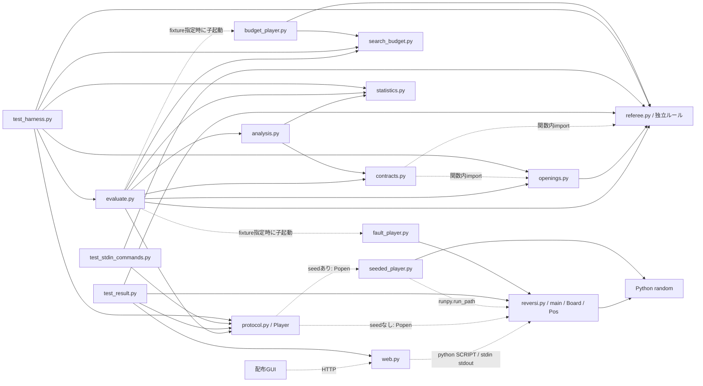
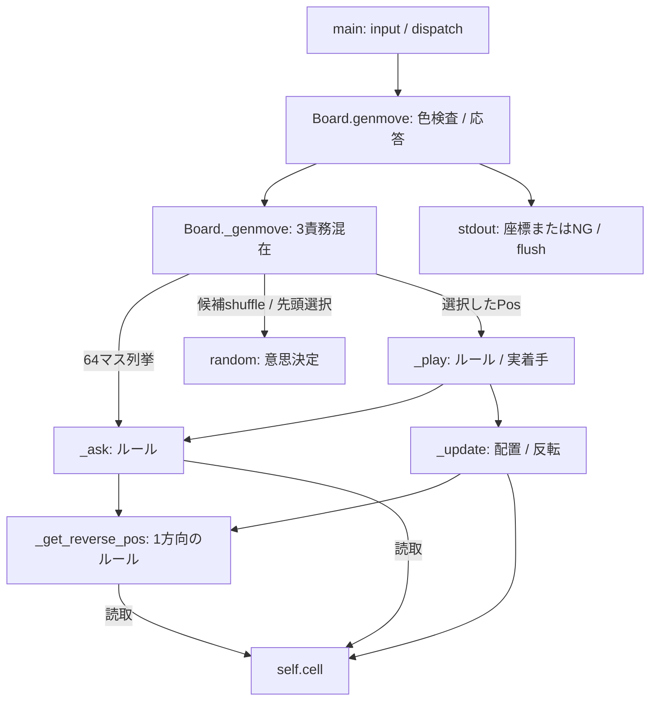
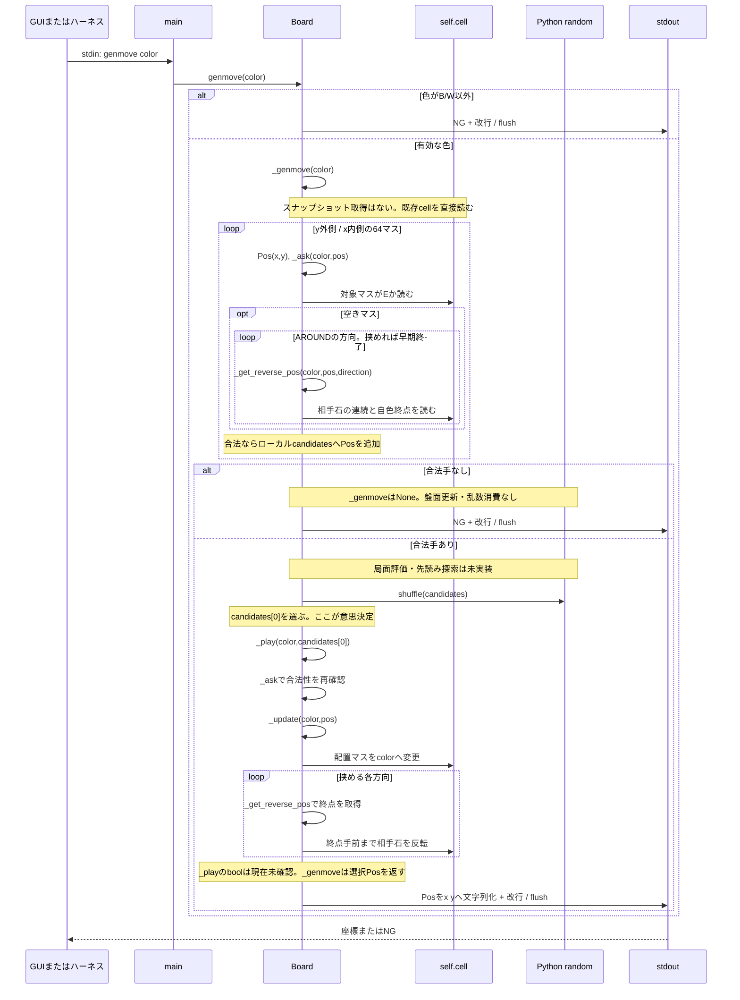
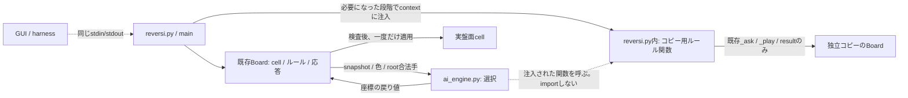
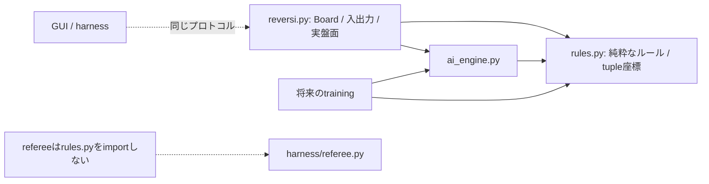
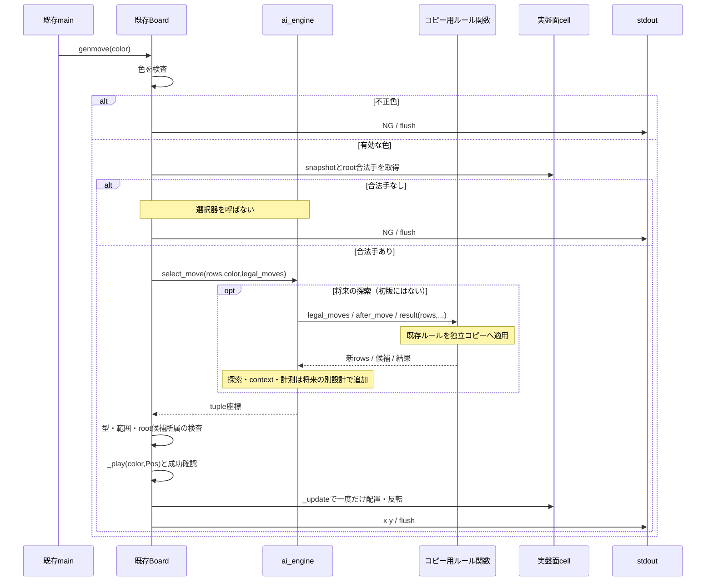

# リバーシAI分離設計

2026-10-20更新: Phase 1A・1Bの実装、品質検証、固定random_v0との参考比較は完了。現行状態・比較版・制約の正本は[Phase 1引き継ぎ資料](phase1_handoff.md)。以下の設計時点における「未実装」表現は、その時点の記録であり、現状を示すものではない。

Phase 1A設計確定日: 2026-10-19、実装・互換回帰完了: 2026-10-19。Phase 1Bの位置評価契約・比較条件は2026-10-20に確定し、selector実装・回帰・参考比較も完了。[第13節](#phase1a-design)はPhase 1Aの確定契約、現行状態と証拠は[Phase 1引き継ぎ資料](phase1_handoff.md)を参照する。第2〜4節は現行実装、第6〜8節の探索・計測部分は将来案であり、実装済み経路と混同しない。

調査・設計日: 2026-10-10。整理・照合日: 2026-10-13。状態: **設計案。AI分離は未実装**。AI境界の設計正本として旧move_selection_designの必要条件を統合した。現行ハーネスの契約は[データ契約](harness_contracts.md)、構造は[アーキテクチャ](harness_architecture.md)、実行確認は[正常化報告](reports/ハーネス正常化完了報告.md)。整理前の本文は[旧分離資料](archive/move_selection_design.md#snapshot-ai-separation)に保管する。

## 1. 結論、調査範囲、判断の根拠

第一推奨は **`reversi_player/ai_engine.py` を1ファイルだけ追加し、着手の意思決定を委譲する案A** である。盤面、合法手判定、反転、終局判定、標準入出力は `reversi.py` に残す。AIへ渡すのは変更できない盤面と合法手であり、AIが返した座標を本体が検査して一度だけ適用する。

現在のAIは、合法手リストを `random.shuffle()` して先頭を選ぶ処理だけである。局面評価、探索アルゴリズム、学習モデル、置換表、内部探索予算は存在しない。それらを現状図に実装済みとして描かない。

探索が必要になっても、既存ルールを呼ぶ「スナップショット入力・スナップショット出力の関数」を本体からAIへ渡せば、AIから本体をimportせずに再利用できる。ルールや盤面を別ファイルへ移す案Bは、その接続が複雑になった場合の次の選択肢とする。

### 1.1 調査対象

| 対象 | 確認した内容 |
| --- | --- |
| [AGENTS.md](../AGENTS.md) | 資料の役割、独立ハーネス、未コミット変更の保護、契約と図の整合 |
| [reversi.py](../reversi_player/reversi.py) / [web.py](../reversi_player/web.py) | 全クラス・関数、盤面・乱数の副作用、起動とコマンド経路 |
| `harness/` の10モジュール | 通信、seed、独立判定、固定序盤、予算trace、報告検証、比較・統計の関連経路 |
| `tests/` の3テストモジュールと2fixture | stdin、盤面・反転・終局、GUI接続、異常、再現性、予算・保存・比較の試験 |
| [プログラム開発方法.md](プログラム開発方法.md) | コマンド、盤面更新、色・座標、処理期限、機能群の分割 |
| [開発計画.md](開発計画.md) / [強化方針.md](強化方針.md) | ランダム→探索→自己対戦学習、黒視点価値、予算・固定相手 |
| [ハーネス.md](ハーネス.md) / [ハーネス拡張計画.md](archive/ハーネス拡張計画.md) | 現行CLIと契約、正式評価と時間評価の区別、未実装の修正計画 |
| [現状アーキテクチャ](harness_architecture.md) / [契約定義](harness_contracts.md) | 現行図・監査A01〜A16とコードの照合 |
| [前回の分離案](archive/move_selection_design.md) | AIパッケージ・盤面切り出し案との差分 |

対象HEADは `1b934293ec66f1174f7f6dfbc47de5bbf66f34d1`。未コミットのハーネス拡張があるため、HEADだけではなく実際の作業ツリーを調査した。「コード確認」「今回の実行確認」「将来の提案」を区別する。既存資料の診断結果は今回再実行した診断とは扱わない。

初回の2026-10-13の整理ではこの文書だけを作成し、Python本体・GUI・ハーネス・テスト・他の設計資料は変更しなかった。2026-10-19のPhase 1Aでは第13節の確定設計に合わせ、図・契約・計画・品質記録も文書だけ更新する。

## 2. As-Is: 構造と責務一覧

### 2.1 指定された9分類

| 分類 | 実装箇所・現状 |
| --- | --- |
| 1. 標準入出力・コマンド | `main()` がinput/解析/dispatch、Boardのask/play/genmove/showboardが出力。resultは値を返しmainが出力 |
| 2. 盤面の状態管理 | `Board.__init__()`、可変二次元配列 `cell[y][x]`。手番・棋譜・担当色を保持しない |
| 3. 合法手判定・反転 | `_ask()`、`_get_reverse_pos()`、`_play()`、`_update()`、方向定数AROUND |
| 4. 終局・勝敗 | `result()` と `_has_legal_move()`。両色に合法手がなければ石数比較 |
| 5. AIによる着手評価 | **未実装**。盤面や候補に点数を付けない |
| 6. 探索アルゴリズム | **未実装**。合法手の64マス走査はルール上の列挙でありMinimax等の探索ではない |
| 7. 着手選択 | `_genmove()` のshuffleと `candidates[0]` |
| 8. AI固有のキャッシュ・乱数・時間 | module-level randomの状態を消費する。キャッシュ・内部時間制御なし。seedは外部seeded_player、期限は外部Player |
| 9. その他 | Posの座標演算・文字列化、GUIのHTTP/JSON変換、評価用の保存・統計。これらはAI思考ではない |

**責務が混在する箇所**: `_genmove()` は「合法手列挙」「乱数による意思決定」「実盤面更新」を一つに含む。`genmove()` は入力検査・意思決定への接続・出力を含む。`ask()` と `play()` はルール呼び出しと応答出力を含む。`Board` 全体は盤面/ルール/応答/AIを保持する。この混在を理由に全クラスを一度に分割せず、まず意思決定の境界だけを設ける。

### 2.2 reversi.pyの全関数・主要クラス

以下はすべて `reversi_player/reversi.py`。戻り値と標準出力を別記する。「変更なし」はオブジェクトの状態が変わらない意味で、ローカル変数の変更は含めない。

| 関数・クラス | 責務 / 入力→出力 | 参照する状態 | 変更する状態・副作用 | 呼び出し先 | AI固有か |
| --- | --- | --- | --- | --- | --- |
| `Pos` | 座標/方向の可変値オブジェクト | x、y | 作成時のみ設定。外部から属性変更可能 | 下記メソッド | いいえ |
| `Pos.__init__(x,y)` | 座標設定→戻り値None | 引数 | self.x/self.y | なし | いいえ |
| `Pos.is_valid()` | 0〜7の範囲判定→bool | self.x/self.y | なし | なし | いいえ |
| `Pos.add(p)` | 座標加算→新Pos | selfとpのx/y | 既存座標は不変 | Pos | いいえ |
| `Pos.__add__(p)` | 演算子による加算→新Pos | selfとpのx/y | 既存座標は不変 | Pos | いいえ |
| `Pos.__eq__(p)` | 座標の同値→bool | selfとpのx/y | なし | なし | いいえ |
| `Pos.__str__()` | 座標→`x y`文字列 | self.x/self.y | なし | format | いいえ |
| `Board` | 盤面・ルール・応答・ランダム選択の集合 | self.cell、AROUND、random | 着手でcell、選択で乱数状態 | 下記メソッド | 混在 |
| `Board.__init__()` | 初期盤面生成→None | 初期配置定数 | self.cellを新規作成 | なし | いいえ |
| `Board.ask(color,pos)` | 色/座標検査と合法性問い合わせ→None、stdout OK/NG | cell、pos | stdoutのみ | pos.is_valid、_ask、print | いいえ |
| `Board.play(color,pos)` | 検査と着手→None、stdout OK/NG | cell、pos | 成功時cell、stdout | pos.is_valid、_play、print | いいえ |
| `Board.genmove(color)` | 色検査・自動着手・応答→None、stdout座標/NG | cell、random | cell、乱数状態、stdout | _genmove、Pos.__str__、print | 混在した接続処理 |
| `Board.showboard()` | 現盤面出力→None、stdout8行 | cell | stdoutのみ | Board.__str__、print | いいえ |
| `Board.result()` | 継続/終局勝敗→NG/B/W/D | cell | なし、出力もしない | _has_legal_move、row.count、sum | いいえ |
| `Board._get_reverse_pos(color,pos,direction)` | 一方向の挟める終点→Pos/None | cell、座標、方向 | なし | Pos.__add__、is_valid | いいえ |
| `Board._play(color,pos)` | 再確認して配置・反転→bool | cell | 合法時cell | _ask、_update | いいえ |
| `Board._ask(color,pos)` | 空きと8方向の挟み判定→bool | cell、AROUND | なし | _get_reverse_pos | いいえ |
| `Board._has_legal_move(color)` | 64マス走査、最初の合法手で終了→bool | cell | なし | Pos、_ask | いいえ |
| `Board._update(color,pos)` | 置ける前提で石配置と反転→None | cell、AROUND | cellを直接更新 | _get_reverse_pos、Pos.__add__、__eq__ | いいえ |
| `Board._genmove(color)` | 候補列挙→shuffle→着手→Pos/None | cell、AROUND、random | 候補配列、randomの状態、cell | Pos、_ask、random.shuffle、_play | 選択のみAI固有。他は混在 |
| `Board.__str__()` | cell→改行連結8行文字列 | cell | なし | join | いいえ |
| `main()` | 1行入力/解析/dispatch、quitでreturn | ローカルboard、stdin | board.cell、stdout、選択時乱数 | input/split/int、Board/Pos、公開Boardメソッド、print | いいえ |

内部 `_ask()` / `_play()` は有効な色・盤面内座標を前提とする。公開ask/playの検査を省いてAIの不正座標を渡すと、負のindexによる別マス参照や例外になり得る。

`_genmove()` は `_play()` のboolを現在確認していない。現状は直前に生成した合法手で単一スレッドの盤面を更新するため通常成功するが、外部選択器を導入した後は同じ暗黙前提を使わない。

### 2.3 web.pyの主要関数

以下はすべて `reversi_player/web.py`。GUI側の出力はサーバのログであり、子プレイヤーのプロトコルstdoutとは別である。

| 関数 | 責務 / 入力→出力 | 参照する状態 | 変更する状態・副作用 | 呼び出し先 | AI固有か |
| --- | --- | --- | --- | --- | --- |
| `Process.__init__()` | python SCRIPT起動→Process | SCRIPT | self.proc、OS子プロセス/pipe | subprocess.Popen | いいえ |
| `Process.command(command,lines=1)` | 送信し指定行数取得→文字列 | self.proc | stdin/flush、stdout読取、サーバログ | write/flush/readline/print | いいえ |
| `Process.__enter__()` | with入口→self | self | なし | なし | いいえ |
| `Process.__exit__(...)` | quit送信、5秒wait、失敗時kill→None | self.proc | 子プロセス終了 | write/flush/wait/kill | いいえ |
| `RequestHandler.__init__(...)` | 静的ファイルhandler初期化 | STATIC_DIR | HTTP handler | super().__init__ | いいえ |
| `do_POST()` | pathとJSONを解釈→HTTP JSON/500 | HTTP入力、self.path | HTTP応答、サーバログ | _play/_genmove、json、send_response | いいえ |
| `_play(req)` | 要求履歴を再生し応答作成→dict | req.positions | 一時子プロセス盤面 | Process、_make_board、_make_response | いいえ |
| `_genmove(req)` | 履歴再生、自動着手、履歴追加→dict | req.positions | req.positionsと子盤面 | Process、_make_board、_next_color、command、_make_response | AIの通信接続。思考ではない |
| `_next_color(index)` | 手数index→B/W | index | なし | なし | いいえ |
| `_make_board(proc,req)` | 非パス履歴をplayで再生→None | req.positions | 子盤面 | _next_color、Process.command | いいえ |
| `_make_response(proc,req)` | 盤面/合法手/結果→GUI dict | 子盤面、req.positions | 読取通信、ログ | command(showboard/ask/result)、_next_color | いいえ |
| `main()` | localhost:8888のHTTPサーバ開始 | RequestHandler | サーバ常駐、ログ | HTTPServer、serve_forever | いいえ |

GUIはHTTP要求ごとに子プレイヤーを新規起動する。パスはGUI履歴の `[-1,-1]` で表し、再生時はplayを送らないが、履歴indexには含める。depth/temperatureはPython側で利用されていない。通信には通常応答の明示的timeoutがなく、既存テストの `BoundedWebProcess` が試験用に付けている。

### 2.4 ハーネス・テストとの境界

本体を変更せず独立refereeと両host通信で検証する方式を維持する。Playerはプロセスと通信、evaluateは対局・序盤同期、contractsは原証拠の共通再検証、analysisは公開原report入口とprivate資格判定、statisticsは算術を担当する。schema5 / trace4 / validation3の現在の関数・型・保証は[現行構造](harness_architecture.md)と[現行契約](harness_contracts.md)を参照し、本書で古いschema3関数表を複写しない。

budget_playerはrefereeを使う模擬producer、fault_playerは故障注入用。実AIからharness/referee.pyをimportして検証器との独立性を失わせない。正式fixtureの成功は実AIの予算制御や強さの証明ではない。

## 3. As-Is: 現在の依存関係図

### 3.1 モジュール・プロセスの依存

実線はimport/呼び出し、点線はプロセス・HTTP・runpy・関数内import。標準ライブラリはrandomとrunpy以外省略。これは現在の構成であり、AI専用ファイルはまだない。



WEBはprotocol.Playerを利用しない。本体はharnessをimportしない。refereeは本体をimportしない。seeded_playerと本体は同じ子プロセス内なので、Python randomの固定状態が本体へ引き継がれる。

### 3.2 reversi.py内部のgenmove関連呼び出し



## 4. As-Is: genmoveのシーケンス図

呼出元はGUIのProcessまたはharnessのPlayer。Boardは既にそのプロセス内で初期化され、必要なplay履歴も反映されている。



ハーネス側は座標を独立refereeで検査し、相手プロセスだけへplayを送る。その後、双方のshowboard/resultを照合する。着手側へplayをもう一度送る設計に変更すると既存の同期前提を壊す。

## 5. AIとルールの境界

| 操作 | 担当 | 理由 |
| --- | --- | --- |
| 現盤面の保持、snapshot作成 | 本体Board | 実対局の唯一の盤面 |
| 合法手判定・反転・終局 | 既存ルール | ランダム/探索/学習で意味が変わらない |
| 候補の順序付け、評価、先読み、最終選択 | AIエンジン | 改良・交換の対象 |
| 仮想着手のルール計算 | 本体が提供するコピー用ルール関数 | 探索方式はAI、遷移の正しさはルール |
| 実盤面への最終適用 | 本体 `_play()` | AIの二重更新と仮想着手の漏出を防ぐ |
| 応答・phase判定・評価ログ接続 | 本体の呼出境界 | AIの推論と通信を分離 |
| プロトコル期限、独立盤面照合 | harness.Player/referee | 本体と独立に実測・検査 |

盤面スキャンそのものをAI評価として切り出さない。AIはroot候補を受け取り、その候補を順位付けする。探索中の候補生成も同じルール定義を利用する。

## 6. To-Be: 最小構成と案の比較

### 6.1 案A: AI専用モジュール1つを追加（第一推奨）

```text
reversi_player/
  reversi.py      # 既存Board/Pos/ルール/入出力、選択器の呼出と適用
  ai_engine.py    # 新規1ファイル。初版はランダム選択だけ
  web.py         # 既存GUI
```

Phase 1Aの分離時点では`ai_engine.select_move()`の関数1つで足りた。ABC、engine factory、plugin registry、新しいAIパッケージは導入しない。Phase 1Aでは第13節の`Board(*, selector=None)`で選択callableを受け、当時の既定はランダム選択だった。Phase 1Bで既定を`select_positional_move`へ変更し、ランダム基準は`selector=ai_engine.select_move`として明示注入する。将来は同じ3引数で呼べる小さなエンジンオブジェクトに拡張できる。



AIからコピー用関数への点線は実行時の呼び出しで、`ai_engine -> reversi` のimportではない。関数は実盤面に束縛しない。仮想BoardはAIを呼ばず、モデルもロードしない。呼び出しの再帰を作らない。

実行時は直接起動で隣接`ai_engine`、package importで相対`.ai_engine`を明示的に選ぶ。型検査時はTYPE_CHECKINGで`reversi_player.ai_engine`へ統一する。両実行時importをそのままmypyへ見せると未解決import・再定義を診断するためである。第13節の分岐を採用し、広いImportError捕捉で依存の欠落を隠さない。AIはPosをimportせずtuple座標を返す。

### 6.2 案B: 必要になったルール・データの共通化

新規は `ai_engine.py` と `rules.py` の2つを基本とする。rules.pyへ純粋なrows入力の合法手/盤面遷移/終局関数を一度だけ移し、既存Boardは実盤面と出力を持つラッパーとして残す。Posは既存ファイルに残せる。型定義専用ファイルや抽象基底クラスは必須ではない。



この案ではルールの所属ファイルが変わるため、今回の「原則既存の場所へ残す」という条件からは第二候補である。同じ関数を本体と共通ファイルに複製する案にしない。移した内部メソッドは必要な互換委譲で既存テストの入口を維持する。

### 6.3 比較

| 観点 | 案A: AI単一モジュール | 案B: AI＋共通rules |
| --- | --- | --- |
| 変更範囲 | reversiの選択呼出と検査、AIファイル1つ。探索時にコピー用接続を追加 | 合法手・反転・終局の移動とBoardの委譲も必要 |
| 責務の明確さ | 意思決定は明確。Boardの入出力/ルール混在は残る | AI・純粋ルール・応答の境界が明確 |
| 循環依存 | snapshot＋注入関数ならimport循環なし。AIの逆importは禁止 | 双方がrulesへ依存し循環なし |
| ハーネス互換 | 外部契約を維持しやすい。新資産hash登録は必要 | 外部互換は可能。ルール移動の回帰範囲が広い |
| テスト容易性 | 選択関数とコピー用接続を単独検査可能 | 純粋ルールの直接検査が容易 |
| 学習モデル対応 | 同じ入力で推論を差し替え可能。学習は注入接続でルール再利用 | 学習・複数AIからルールを直接再利用できる |
| 実装の複雑さ | 現状に最小。将来callback境界の説明が必要 | 初期作業は大きいが大規模再利用時は単純 |
| 現在の選択 | **第一推奨** | 接続の重複、速度、複数利用者の問題を確認後に検討 |

tupleの盤面・座標で現在のデータ共有は足りる。複数モジュールに不整合なrequest型が増えたり、同じ検証が重複する段階で、小さな契約データ型の集約を検討する。最初から共通インターフェース専用モジュールを作る根拠はない。

### 6.4 To-Beのgenmoveシーケンス



不正戻り値では実盤面を更新せず、内部契約違反をstderrに報告して異常終了させる案とする。合法手があるのにNGを返すと、ハーネスではillegal_moveとなる。正常な時間打ち切りは合法な代替手を返す通常動作にする。

## 7. インターフェース契約

### 7.1 初版の選択器

Phase 1Aの確定署名: **`select_move(rows, color, legal_moves) -> tuple[int, int] | None`**。正確な型と構築方法は[第13節](#phase1a-design)。旧案の未使用context=Noneは初版に追加せず、将来の構築設定・要求contextは必要なPhaseで型と寿命を設計する。今回Pythonコードを追加したものではない。

| 項目 | 契約 |
| --- | --- |
| rows | 8文字のB/W/E文字列を8個持つtuple。実cellから新しく生成。行リストを共有しない |
| color | コマンドで指定されたB/W。プロセスに固定の担当色とはしない |
| legal_moves | tuple座標のtuple。根の盤面とcolorに対して完全な合法手集合。順序はy外側/x内側 |
| context | Phase 1Aの引数には含めない。将来の型付き拡張候補であり、HTTP handlerやPlayerを渡さない |
| 戻り値 | 非空候補では必ず候補中の整数座標。要素の型は厳密なintでboolを除く |
| None | 空候補でしか許さない。通常本体は空候補で選択器を呼ばず、_genmoveがNoneを返す |
| 禁止副作用 | 実盤面・入力snapshot・候補の変更、stdin読取、stdout応答、実盤面へのplay |
| 例外 | 非空候補でNone、不正座標、モデル故障はパスと区別して契約違反/故障として伝える |

root候補が空であるだけでは終局とは限らない。相手に合法手があればパス、両色に無ければ終局である。外部genmoveのNGには両方が含まれるが、resultとtrace.phaseでは区別する。GUIの `[-1,-1]` はこの関数の戻り値に使わない。

初版random選択は候補をローカルlistへコピーし、**同じ順序でshuffleして先頭を返す**。choiceへの置換、候補のsort/set化、import時の乱数消費、seedし直しを同時に行わない。盤面と色は初版randomでは評価に使わないが、将来の選択器にも同じ入口を提供する。

### 7.2 仮想着手とコピー用ルール契約（探索導入時）

案Aでは次の接続関数を **reversi.py内** に置き、contextに渡す。AI側からBoard/Posをimportしない。

| 接続関数案 | 入力→出力 | 実装上の制約 |
| --- | --- | --- |
| `_legal_moves_from_rows(rows,color)` | snapshot→tuple合法手 | 独立Boardで既存_askを呼ぶ。stdoutなし |
| `_after_move_from_rows(rows,color,move)` | snapshot/合法座標→新snapshot | 色/範囲確認、全行をコピー、既存_playのbool確認。不合法なら明示エラー |
| `_result_from_rows(rows)` | snapshot→NG/B/W/D | 独立Board.result。実盤面・AI状態を変更しない |

共通のsnapshot→Board生成補助を本体内に1つ置く。全行を `list(row)` として新規作成し、元cellへの浅い参照を使わない。生成するBoardの初期化は盤面と軽い選択callableだけであり、モデルロード・探索・randomの消費を行わない。仮想Boardでgenmoveや公開playを呼ばない。これにより再帰的AI呼出とstdoutの混入を避ける。

関数はmodule内の純粋な接続として定義し、live Boardのbound methodやselfを捕捉したclosureをAIへ渡さない。これは同一プロセス内の設計契約であり、悪意あるPythonコードを隔離するsandboxではない。

探索状態は **rows＋次の手番**。パスはrows不変で手番のみ交代、深さは配置回数としてパスで減らさない案を既存強化方針から引き継ぐ。終局は両色の合法手で判定する。黒視点の価値を使うときは黒が最大化、白が最小化し、Negamaxへの符号変換は探索側で明示する。

### 7.3 状態、seed、キャッシュ

| 状態 | 所有者 / 扱い |
| --- | --- |
| 実cell | Boardのみ。外部playまたは採用したgenmoveの確定で変更 |
| 仮想rows・探索木 | AI要求内。ルール接続は新snapshotを返す |
| 乱数 | 初版はPython module-level randomを継続利用。seeded_playerによる初期化を継承 |
| モデルと読込済み重み | 将来のAIオブジェクトが1プロセス内で保持。対戦中は不変 |
| ノード計数・深さ・deadline | 各genmove開始時にリセット。履歴の手数やtrace sequenceと混同しない |
| 置換表・推論cache | 初版なし。追加時は寿命、容量、キー、warm/cold条件を明示 |
| trace sequence/要求ID | 本体の評価I/O接続が保持。AIの探索ノード番号ではない |

`PYTHONHASHSEED`だけではPython randomをseedできない。現ハーネスは両方を設定するが、seed数値を専用AI環境変数やargvとして渡す契約は現在ない。新しい `random.Random()` を引数なしで作ると固定seedを失う。独立乱数源を導入するときは初期状態の受渡しまたはseed伝達の契約変更を別途設計し、numpy/GPUも同様に扱う。

同seed再現性は「同じ盤面・設定・コマンド履歴・乱数消費・cache条件・環境」の下で確認する。異なるseedでも必ず別手になるとは要求しない。同点は決定的モードなら候補順を固定して選ぶ。対戦中の追加学習や時刻seedは使用しない。

GUIは要求ごとにcold起動、評価は1局の間processが生きる。この差から、跨ぎcacheの内容で制限時間内の到達深さや着手が変わり得る。最初は要求内cacheを基本にし、processを跨ぐ共有cacheは使わない。永続cacheを採用するときは、rows・手番・モデル/評価版・深さ・境界種別等を正しくキーに含め、cache方針と初期化を比較条件に追加する。

### 7.4 実AIの探索予算と計測の拡張（未実装）

初版randomはbudget未対応のまま。架空のnodes/depthを付けてverifiedにしない。

探索時には型付きcontextへ正規化budget、deterministic宣言、counting_definition_id、コピー用ルール接続を入れる案とする。Phase 1Aへ先行実装せず、まず同じ3引数callableを持つengineの構築設定へ収められるか検討する。要求contextやmetricsで署名変更が必要なら全呼出側と図・契約を先に改訂する。node/depthは整数、時間はv2の整数ns。deadlineはmonotonicなperf_counter_nsで扱う。configを渡すだけではAIへ上限を強制できない。

拡張contextの項目案を次のように固定する。初版ではこの型を実装しない。拡張時はai_engine.py内の小さなデータ型1つに定義し、同じ値を複数の設定箇所へ複製しない。

| 項目 | 表現と意味 |
| --- | --- |
| `budget` | 正規化v2のbudget。kindと対応するlimit_nodes / limit_depth / limit_nsを持つ |
| `deterministic` | 固定work・同点順・追加乱数源を含む決定性の宣言。timeでは固定着手の保証として使用しない |
| `counting_definition_id` | node計数定義のID。nodeモードで必須、異なる定義間をequal-workとしない |
| `selection_deadline_ns` | 選択計測scopeと同じmonotonic時計の期限。固定work時の安全打ち切りで到達したら正式な完了と偽らない |
| `rules` | 7.2の3関数の組。snapshot入力のstatelessなcallableで、実BoardやPlayerを持たない |

要求contextは選択中に変更しない。観測metricsは別の結果へ返す。アルゴリズム・モデル・cache方針はエンジンの構築設定に置き、要求と実効設定を本体の評価接続で照合する。対応しない必須budgetや矛盾する設定は黙って無視せず、評価を失敗として扱う。

計数定義の初期案は「探索再帰に入る局面をroot・葉・パス局面も含めて1回ごとに計数、root候補の事前生成は含めない」。反復深化では再訪も再計数し、上限に達したら次の局面へ入らない。cache命中を含めるかもこの定義に固定する。深さは石の配置数で、開始した最大深さと完了した深さを別記録する。これは未実装の定義候補であり、採用時にIDと契約試験で確定する。

内部選択時間のscopeは比較相手とも統一する。推奨はroot合法手生成から選択完了までを測り、コピー用ルール処理・推論・同点処理を含める。盤面確定・JSONL書込・stdout送信は外部応答時間側に含まれる。モデルロードは別のload時間を記録し、初回要求内に発生した場合は外部時間から除外しない。fixtureのscopeは `search_only` という宣言で、計測コードには盤面適用も含まれるため、そのまま実AIの定義に転用しない。

期限は外部10秒より十分短く設け、完了した探索の手を保持する。ただしOS・推論ライブラリの停止不能区間があるので、単にdeadlineを見れば全応答を保証できるとはしない。安全余裕は実測で決める。固定node/depthモードでも外部期限は残り、超過は失敗にする。

時間モードは同seedでもOS負荷等で完了深さ・手が変わり得る。固定workの決定的モードと別の実験として扱い、時間モードに有限固定得点の正式区間を適用しない。

traceを加える段階では、戻り値をmoveだけから `SelectionResult(move, metrics)` 相当へ拡張する案とする。metricsはnodes、開始/完了深さ、stop_reason、内部時間、モデルID等を持つ。小さなデータ型はai_engine.py内に置ける。全callable/呼出側/テストを同時に更新し、標準入出力は維持する。複数実装が共有する段階まで新しい契約専用ファイルは作らない。

### 7.5 モデルload・推論・エンジン交換

将来は同じ呼出契約のエンジンオブジェクトをmainで一度生成し、Boardへ注入する。初版関数と同じく、エンジンはrows/色/合法手からmoveを返す。本体のask/play/resultはモデルが不要であり、Boardのコピー生成やモジュールimportで重いモデルをロードしない。

モデルは `__file__` 基準の同梱パス、または入口で解決した絶対パスから読む。保存形式、入力符号、座標順、出力価値視点、モデル版/hashを確認し、合法手だけに推論を適用する。オンライン学習・重み更新はtraining側へ置く。

モデルloadのタイミングは未確定である。旧案の「初回genmove後にheaderを確定するlazy load」を現行trace4対応として採用しない。対応済みstartup loadは子CE〜IRに含め、初回name期限とgenmoveの探索時間から分離する。command内loadにも使用前完了等の検査があるが、header側も満たす必要があり、未対応lazy/background/GPU scopeはunknownで正式保留となる。起動時loadを使うか、別のdeferred/scope契約と同期証拠を設計するかは、モデル導入前に決めて実測・契約試験を行う。

評価時のモデル欠落・破損は黙ってrandomへ戻さず失敗として記録する。将来の提出運用で探索版へ戻す場合はモデルID・fallback・理由を残し、学習モデルの採用試験ではfallback0回を要求する。探索予算打ち切り時の合法な代替手と、別モデルへのfallbackは区別する。

交換方法はmainで選択callableを指定する方式から始める。後で環境変数等の設定を追加する場合は、ハーネスがargvをリセットする点、未知設定の拒否、設定のasset登録を含めて決める。AI moduleの交換のためにstdinコマンドやweb.pyを変更する必要はない。

## 8. 現行ハーネスとの接続と旧設計の採否

### 8.1 分離だけで維持するもの

標準入出力・GUI入口・Board()無引数構築・Board.cellの既存操作を維持する。合法手なしは選択器を呼ばず、非空候補の不正戻り値をpass/NGへ変換しない。実盤面の確定は本体が一度だけ行う。コピー接続でstdoutを出さず、AIからBoard/Pos/Playerを逆importしない。

ランダム分離では候補順・shuffle・module random・消費順を保持して同条件棋譜を比較する。時間予算AIの改良では別runの完全棋譜一致を採用条件にせず、各保存局内部の合法性/同期と同条件の品質・成績を確認する。

### 8.2 trace・予算・時計の接続は別の実装段階

分離だけではconfig受領・内部予算強制・raw trace4を実装したことにならない。producerは要求/実効設定、case/role seed、run/purpose/pair/leg/role/session/generation/command、clock/thread、CE/IR/全CC・CR/CSを親証拠へ結合する。genmoveのSS/SEとmodel loadを分ける。

B内部予算の許可済みnone除外はB子lifecycle・両host・必須probeを免除しない。現在の実AIをそのまま正式baselineにできるとは保証しない。未知時計/scopeはunknown、確認済み矛盾はfailed。時間品質と母集合/coverage/予算/測定のANDを緩和しない。

fixtureのsearch_onlyは盤面適用も含むため、第7.4節の実AI選択完了までの案と同じscope名だけで比較しない。counter/scopeの意味とID、loadと探索の境界、collectorへのmetrics伝達を探索/モデル導入前に確定する。偽のnodes/depthでverifiedにしない。

### 8.3 資産・baseline・統計

ai_engine.py、必要ならrules.py、設定・モデル・import等の実行依存を--a-asset/--b-assetへ明示登録する。全importや外部設定の自動列挙は現ハーネスの保証外である。

候補Aと固定Bを独立保存し、両者が候補側の最新engineを共有しない。A変更のasset差を共通条件と偽らず、B本体/assetは前後で同一にする。コード・設定・資産そのものも保管し、hashだけで復元可能としない。

正式推定は検証済み固定有限母集合、非復元抽出、全予定先後ペア、固定work等を前提とする。time/deploymentは参考評価、分離の完走や棋譜一致は強さ向上ではない。学習・調整はdevelopment、採用は事前固定した候補と未閲覧の最終集合で行う。

### 8.4 旧資料と現行仕様の区別

旧ai/random_policy.py＋board.py案は将来候補として履歴へ移した。本書の案A（ai_engine.py一つ、ルールは本体）が第一推奨。案Bの共通ルール分離はコピー速度・複数利用者・接続重複等の必要性が出た時に選ぶ。将来のai/search.py等を初版で一括作成しない。

旧A01〜A15の未修正一覧・schema3関数表・当時の86テスト/ソースhashは現在の故障一覧として使わない。母集合/原trace/公開資格/時系列の現在の検査は現行契約を優先する。旧監査F02の予算設定検査は[現行契約](harness_contracts.md#legacy-optional-budget)で対応。実AItrace、全case決定性、全依存固定、GUI設定/通常応答timeout等は残件・再確認事項として保持する。

### 8.5 受け入れ条件

旧資料から、戻り値のstrict int/bool・範囲・候補所属、不正戻り値で実盤面不変、空候補で非呼出、コピー独立性、余計なstdoutなしを保持する。直接script/seed adapter/package import/別cwd/GUIを確認し、現行全pytestと先後2局スモークを再実行する。モデルや探索を変えた時は同条件の性能評価も別に行う。

図を未来の構成に描き替えるのは実装時であり、本書のTo-Beを実装済みと扱わない。


## 9. 将来変更するファイルと移行手順

### 9.1 対象ファイル

以下の第3列は初回整理時点の作業範囲。Phase 1Aの設計更新と、今後実装時に必要な変更は第13節で区別する。

| ファイル | 将来の変更内容 | 今回の扱い |
| --- | --- | --- |
| reversi_player/reversi.py | 選択callableの受渡し、snapshot/候補、結果検査、成功確認。探索時にコピー用接続 | 変更しない |
| reversi_player/ai_engine.py | 初版はshuffle/先頭選択。後で探索/推論と要求内状態 | 作成しない |
| tests/test_ai_engine.py（案） | 選択器契約と不正戻り値注入 | 作成しない |
| tests/test_stdin_commands.py / test_result.py | 既存の意味を維持し、必要なら新境界・起動経路の検査を追加 | 変更しない |
| baselines/random_v0/ | Phase 0で分離前の現行ランダムAI実体を依存資産・由来manifestとともに固定 | Phase 0対象 |
| ハーネス.md / 開発計画.md / 現状図・契約資料 | 実装後にAI依存/資産登録/現在地を更新 | 変更しない |
| harness/ と test_harness.py | 初版分離では実装変更不要。既存監査問題は別の契約修正として扱う | 変更しない |
| reversi_player/web.py | 初版分離では変更不要 | 変更しない |
| reversi_player/rules.py（案B） | ルールの共通化が必要になった時だけ作成 | 作成しない |

### 9.2 段階的な実装計画

1. **基準固定（Phase 0）**: Git状態、現行仕様テストを記録し、変更前のランダムAIを`baselines/random_v0/`に保存する。開発用/最終評価用の序盤母集団を分け、最終評価用を調整に使わない。独立baselineの2局smokeと実行条件・資産hashを記録する。未コミット変更を破棄・ステージしない。
2. **ランダム選択の抽出だけ**: ai_engine.pyの関数を追加。既存の候補順/shuffle/乱数消費を維持。snapshot/候補を渡し、tupleからPosへの変換・合法性検査・_play成功確認を本体に置く。ルールの所属、外部応答、nameを変えない。
3. **初版の受け入れ**: 白箱の選択器契約、全既存ブラックボックス、両色/パス/終局、GUI接続、seed付き/無し/package import/別cwdを確認。baselineとの応答・棋譜一致を検査。時間の完全一致は要求しないが期限を守る。追加assetを指定し、先後2局スモークを実行する。
4. **探索の準備を別変更にする**: コピー用ルール関数を本体に追加して固定局面と独立refereeで遷移・終局・コピー不変を検査。ここでAIへ実盤面を渡さない。接続が複雑/重複/遅い場合にだけ案Bへの移行を判断する。
5. **探索/予算/traceの実装段階**: 要求contextとmetrics、計数定義、scope、モデルなしのtraceを先に試験する。明示v2設定、両色、全phase、時間/ノード/深さを確認する。探索の改良は分離の棋譜一致試験とは分ける。
6. **モデル推論の段階**: 固定モデルload、符号/座標/合法手、初回時間、モデル資産hash、破損検出とfallback方針を試験する。trainingは別経路でモデルを生成し、対戦中に更新しない。
7. **強さの評価**: 関連するハーネス監査問題を別作業で修正・再検証した後、固定序盤・固定B・同予算の評価を前後とも取得。全局の異常/期限/予算と統計資格を確認し、時間モードは別報告にする。

従来の段階2〜3（選択器分離と受入れ）は、段階開発設計書のPhase 1以降で改めて対象を定める。Phase 0の基準固定とは同時に実施せず、段階4以降も一括実装しない。採用できない場合は保存baselineを使い、ユーザーの無関係な作業ツリー変更を巻き戻さない。

## 10. 移行後の回帰テスト計画

以下は実装後に追加/実施すべき試験で、今回作成したテストではない。

| 試験 | 方法・入力 | 合格条件 |
| --- | --- | --- |
| 既存全体 | pytest、stdin/GUI/harness全試験 | 既存の期待値を緩めず成功 |
| 選択器の純粋境界 | 固定rows、両色、複数候補、候補1つ | 入力不変、非空なら合法座標、stdoutなし |
| 空候補 | 選択器をspyに差替え、片色パス/両色終局 | 本体は選択器非呼出、NG、盤面・乱数不変 |
| 不正戻り値 | None/範囲外/占有/候補外/list/bool/例外の選択器 | 非空で正常NGへ擬装しない。確定前盤面不変、故障が検出可能 |
| 一回だけの実適用 | 決めた合法手を返す選択器、別processのgenmove→showboard | 独立refereeの一回適用と一致、応答1行 |
| 分離前後の乱数再現 | 同Python/複数seed/同履歴と相手、先後交換 | random版の応答/棋譜/最終盤面/結果が一致。測定秒数の一致は不要 |
| root候補の不一致 | snapshot/色/候補を意図的に不一致にした単体境界 | 不正な実適用を拒否。候補列挙は本体ルールと一致 |
| 起動・import | 直接script、seeded_player、package import、別cwd、独立baseline | import失敗/二重main実行/余分stdoutなし |
| 既存Board入口 | Board()、Pos、cell置換、_has_legal_move、result | 既存白箱テスト互換と不変条件維持 |
| GUI | Process/RequestHandler、パス履歴、最後までの操作 | board/valid/end/scoreが一致。実ブラウザ確認は別に明記 |
| コピー用ルール | 8方向、同時反転、不合法、終局、仮想着手を複数回 | 元rows/実cell不変、Board/refereeとの遷移一致 |
| 探索意味 | パス、同点、白の価値、固定深さ、完全な小局面 | 手番/符号/深さ/終局が契約どおり |
| 予算 | 境界ノード数、開始/完了深さ、固定時間、初回推論 | 計数が定義どおり、上限超過を検出、外部期限も遵守 |
| trace | normal/pass/terminal、0始まり、before盤面hash、model/fallback | 全要求対応。欠落/重複/改変/設定不一致を検出 |
| trace保存再検証 | 保存後rawを変更してhashも更新、別run/相手/資産に差替え | 修正後validatorは意味不一致を拒否。hash一致だけで通さない |
| 公平比較 | BのAI資産/設定、Aの予算/計測scope、runtimeを変更 | 意図しない条件変更は比較拒否。AのAI改良のみ許容 |
| cacheとload | cold/warm、モデル更新後、GUI再起動 | 正しいモデル/キー、条件の記録、初回も期限内 |

不正戻り値を渡す単体試験は、AI境界の契約を確かめる白箱試験である。最終の正常性は独立processからの応答・盤面・期限をブラックボックスで確かめる。両者は補完関係にあり、一方で他方を置き換えない。

## 11. 未解決事項と判断が必要になる条件

| 問題 | 現在の扱い / 確定する段階 |
| --- | --- |
| ルール共通化の必要性 | 案Aで開始。コピー速度・接続重複・複数学習利用者が実測で問題なら案B |
| node/depth計数とscopeのID | 7.4の案を探索実装前に固定し、比較相手と照合 |
| モデル形式とloadタイミング | 推論速度・初回時間・trace header整合を測ってモデル導入時に決める |
| GUI cold起動と対局processのcache差 | 初版なし。cache採用時に寿命・計測・再現性条件を固定 |
| 独立乱数源へのseed伝達 | 初版module randomを継承。別源を使う時に契約を拡張 |
| trace未対応のbaselineの正式比較 | 除外宣言と資産固定の証拠を用意。equal-workとは区別 |
| 現行契約と残る保証境界 | ハーネス正常化と実AIのtrace/依存/決定性を分離し、第8節と現行契約で確認 |
| GUIのdepth/temperature | 現在無効。設定接続の別変更が必要 |
| 未規定入力 | 空行/EOF/不明command/非整数等は現実装に異常経路がある。分離と同時に独自応答仕様を追加しない |
| ブラウザ操作と未知局面の速度 | 現テストの成功範囲から全GUI操作・全将来局面への保証を導かない |

## 12. 設計資料の更新と実行証拠

本体/GUI/AI分離はこの整理で実装・変更していない。現在の回帰・CLI確認と制約は[正常化完了報告](reports/ハーネス正常化完了報告.md)、過去の調査・hashは[旧分離資料の整理前snapshot](archive/move_selection_design.md)に保管する。

AIを実装した時点で責務一覧・依存/sequence・選択器/計測契約・テスト・資産登録を更新する。ブラウザ描画、全将来局面の速度、モデルの強さを既存pytestの成功から保証しない。

<a id="phase1a-design"></a>

## 13. Phase 1A確定設計：ランダムAI選択器の分離

> 実装状況（2026-10-20更新）: Phase 1Aの選択器分離、Phase 1Bの位置評価selector、100局descriptive比較、対応環境での品質ゲートは完了。結果と現在の制約は[Phase 1引き継ぎ資料](phase1_handoff.md)を参照。

2026-10-19、HEAD `eb2e860`、`feat/ai-phase1`で照合した。以下は**実装前の契約**であり、Phase 1Bの位置評価・探索・trace producerは未実装のままとする。予定の呼出図は[アーキテクチャ第13節](harness_architecture.md)、外部評価との境界は[契約第14節](harness_contracts.md#phase1a-boundary)。

### 13.1 現物から確認した事実と互換性の範囲

- 現`Board._genmove()`は64マスをy外側／x内側で走査し、`_ask()`が真のPosをlistへ格納する。0件ならNone、非空ならmodule randomのshuffleを1回呼び、先頭Posで`_play()`を1回呼んでそのPosを返す。
- 公開`genmove(color: str)`はB/W以外を先にNGとし、正常着手後に座標を出力する。現在の_genmoveは_playのboolを無視するが、正常な単一スレッド・正しいルール・生成済み合法手ではTrueとなる。
- テストは`from reversi_player.reversi import Board, Pos`を使う。GUIは`['python', SCRIPT]`で直接起動し、要求ごとに新プロセスを作る。seeded_playerはseed適用後にscript親をsys.pathへ追加してrunpyする。
- 互換対象は有効盤面・通常履歴での応答、着手、盤面、パス、勝敗、乱数状態、および既存の不正色・不正着手の扱い。nameのsample、Board()、Board.cell操作、Posの動的比較を保つ。空行／EOF／不明command等の未規定経路は同時修正しない。
- 選択器故障は新しい内部境界の契約として定義する。意図的な異常callable・破損Board・差替えルールの全挙動まで「旧版と完全同一」とはしない。計測秒、traceback位置、私有属性の追加、無seedの別起動での同一棋譜も保証対象外。

### 13.2 責務・所有・依存

| 対象 | 責務と状態 | 境界 |
|---|---|---|
| reversi.py／Board | Pos、実cell、既存ルール、完全なroot合法手、snapshot、委譲、結果検査、1回の確定適用、応答 | Phase 1Aでは評価・探索・ルール移動を行わない |
| ai_engine.py | 不変入力から座標を選ぶ。初版はローカル候補listをshuffleして先頭を返す | Board／Pos／web／harnessをimportせず、反転・実盤面更新・標準入出力を行わない |
| stdlib random | 既存プロセスのmodule状態を共有 | 新しいRandom、再seed、独自のstate保存復元は導入しない |
| harness／referee | 外部取得、独立ルール照合、時間・保存・資格判定 | refereeをAIのルールとして共用しない |

依存は`reversi→ai_engine→stdlib`の一方向。AI内部の型名はai_engineだけで定義し本体から参照する。Posや可変cellはengineへ渡さず、harnessとの共有型ファイルも作らない。不変値の受渡しは実cellの直接参照を避けるものであり、任意Pythonコードを隔離するsandboxではない。

### 13.3 型・構築・入力前提

以下は予定する型と署名であり、本番コードではない。

```python
from collections.abc import Callable

type BoardRows = tuple[str, ...]
type Move = tuple[int, int]
type LegalMoves = tuple[Move, ...]
type MoveSelector = Callable[[BoardRows, str, LegalMoves], Move | None]

def select_move(rows: BoardRows, color: str, legal_moves: LegalMoves) -> Move | None:
    """不変の候補から1手を選び、実盤面と入力は変更しない。"""
    ...
```

| 項目 | 確定する意味 |
|---|---|
| rows | `tuple(''.join(row) for row in self.cell)`相当。8行・各8文字のB/W/E。行listを共有しない。型だけで長さ・文字集合を保証しない |
| color | 公開入口で検査済みのB/W。静的型は既存のstrを維持。現行述語だけではmypyがLiteralへ絞らないため、型付け用の実行時判定変更・castは加えない |
| legal_moves | `tuple((pos.x, pos.y) for pos in candidates)`相当。同じ盤面・色の完全な合法手集合を既存y/x順・重複なしで保持 |
| selector | `Board.__init__(self, *, selector: ai_engine.MoveSelector | None = None) -> None`で受ける。Noneのときだけdefaultを選び私有`self._selector`に保持 |
| Phase 1A時点のdefault | `ai_engine.select_move`。`selector or default`ではなく`selector is None`で分岐し、偽と評価される正当なcallableも注入可能。Phase 1BでBoard既定は`select_positional_move`へ変更され、random_v0は明示注入で保持 |
| 戻り値 | 非空候補では候補所属のMove。空候補をengineへ直接渡した場合だけNone。通常Boardは空候補で非呼出 |

入力は内部callableの前提であり、直接の不正入力すべてに新しい例外分類を保証しない。Board.cellの新たな全要素検査・正規化や、engine側での合法手二重生成を加えない。未使用context、request class、ABC、registry、新しいCLI設定は不要とする。

### 13.4 呼出・適用・失敗

1. 公開genmoveの色判定を維持し、`_genmove(color: str)`で従来と同じ順にPos候補を列挙する。
2. 0件なら内部Noneへ戻る。非空だけrows／legal_movesを作り、`self._selector(rows, color, legal_moves)`を1回呼ぶ。
3. 戻り値は厳密なtuple・長さ2、要素がそれぞれ`type(value) is int`、各0〜7、root候補所属をすべて検査する。bool、float、文字列、list、tuple派生、None、範囲外、非候補を拒否する。Pos.__eq__へtupleを渡さない。
4. `legal_moves`上の対応位置から元のcandidatesのPosを取得し、`_play(color, pos)`を1回呼ぶ。Trueの場合だけ同じPosを返し、公開genmoveが座標を出力する。

| 条件 | 結果・副作用 |
|---|---|
| 不正色 | 従来NG、選択器非呼出、盤面・乱数不変 |
| root候補0件 | 内部None→従来NG、選択器非呼出、乱数不変。パス／終局はresultで区別 |
| engineへ空候補を直接渡す | None、shuffleなし。通常Board経路では呼ばない |
| 非空候補で不正結果 | `_play`前に`RuntimeError('selector_result_invalid')`。正常NGや代替手へ変換しない |
| engine自体の例外 | 元例外を伝播し原因を保持。消費済み乱数を巻き戻さない |
| _playがTrue以外 | `RuntimeError('selector_apply_failed')`。成功座標を出さない。現在の_playがFalseなら盤面不変 |

標準RuntimeErrorを使い、例外クラスやプロトコル応答を増やさない。通常CLIはstderr・非0終了となりharnessが異常を記録する。GUIの例外／500経路を正常対局と偽装しない。不正結果での盤面不変は「本体が適用前に拒否し、選択器が外部参照から実Boardを変更しない」前提。外部closure・他thread・悪意あるcallable、途中変更後に失敗する差替え_playまで巻き戻す設計ではない。

### 13.5 importと起動の方針

互換性の実行確認対象は既存品質ゲートに対応するWindows／直接CPython 3.13.5。web.pyのpythonコマンド解決は従来どおりで、GUI回帰時にPATHを確認する。他Python版での動作を今回のプローブから保証しない。

既存future annotationsを維持し、TYPE_CHECKINGブロックと実行時分岐を次のように接続する概念設計とする。

```python
import random as random
from typing import TYPE_CHECKING

if TYPE_CHECKING:
    from typing import Any, Literal
    from reversi_player import ai_engine
elif __package__:
    from . import ai_engine
else:
    import ai_engine
```

`random as random`は既存reversi.randomを明示的に再exportし、分離後も未使用importのLint診断としないため。Anyは既存Posの境界だけであり、選択器へ追加しない。

| 起動 | 実行時解決・確認 |
|---|---|
| `python reversi_player/reversi.py` | script親の隣接ai_engine、既存7コマンドと終了 |
| package import | 相対.ai_engine、Board()・Pos・乱数状態 |
| `python -m reversi_player.reversi` | 相対.ai_engine、直接起動と同じ応答 |
| seeded_player／runpy | adapter既存のscript親設定→隣接ai_engine、seed再適用なし、別cwdも確認 |
| 既存GUI Process | SCRIPT直接起動、web.py無改造でProcess／HTTP接続回帰 |
| 別cwdから絶対script指定 | script親で解決、cwd依存設定や本体側sys.path補修なし |

広いImportError fallback、新しい__init__.py・mypy_path・検査除外は設けない。importlibで任意名のファイル読込だけを行い隣接ディレクトリも検索パスへ置かない経路、同名moduleの意図的な差替えまでは自動対応しない。型検査と実行時が同じ隣接実体を選ぶことを回帰で確認する。

一時領域の2-moduleプローブでは素朴な両分岐importにimport-not-found／no-redef、str→Literalにarg-typeを確認した。採用分岐とstr境界は既存設定のmypy strictで0診断。直接・package import・-m・seeded別cwd・直接別cwdの5経路で隣接__file__、import前後のrandom state、終了0・stderr空を確認した。これは型とimportの小型プローブで、本番選択器・GUI・対局の合格ではない。

### 13.6 ランダム互換性の不変条件

- 候補集合・順序を既存y/x列挙のまま維持し、sort・set・choiceへ置換しない。
- engineは`list(legal_moves)`を作り、非空ならstdlib random.shuffleをちょうど1回呼ぶ。候補1件でも呼出を減らさず、0件では呼ばない。
- Pos listから座標listへ表現が変わっても、標準shuffleへ渡す長さ・初期順・共有RNG stateを一致させる。座標だけでなく終了後のRNG stateも旧baselineへ照合する。
- import、型定義、Board構築、snapshot、ask／play／showboard／result、不正色、空候補で乱数を新たに消費しない。seedは既存adapter／呼出元に残す。
- 入力tupleと選択前の実cellを変更しない。独立Random、時刻seed、thread、cache、学習を増やさない。
- 同runtime・初期状態・seed・履歴の座標／全盤面／パス／勝敗／次の乱数stateを一致させる。計測秒や無seedの別起動、異Python版の内部shuffle実装まで同一とはしない。

### 13.7 品質scopeへの登録（実装時に行う）

| 項目 | 最小変更・確認 |
|---|---|
| strict mypy | pyproject.tomlのtool.mypy.filesへreversi_player/ai_engine.pyを追加。既存13件を維持して14件。通常qualityのtyping argvで全件を検査 |
| Lint | 既存reversi_player/**/*.pyに自動包含。例外追加なし |
| format | 現reversi_player/*.py除外は新engineも除外するため、既存reversi.py／web.pyを名指しする2除外へ置換。既存2件のscopeを維持し新engineはformat対象 |
| scope漏れ回帰 | tests/test_quality.pyのtest_promoted_modules_are_checked_by_configured_strict_gateへengineを列挙。shadow-fileの未注釈関数が通常gateでno-untyped-defとなることを確認 |
| 選択器回帰 | 新設するならtests/test_ai_engine.pyの1ファイル。外部回帰が重複する場合は既存result／stdin／invariantsを拡張 |
| 依存検査 | engineの逆import禁止と本体からの接続をASTで、実際の解決・応答を起動回帰で確認 |

今回は設定・テストを変更しない。Phase 10の全本番module自動scope検査は未実装。web.pyのstrict例外を維持し、他の除外、Any／cast／ignoreでの一括抑制を増やさない。

### 13.8 実装前に定義する回帰と完了ゲート

| ID | 必須確認 | 期待値の根拠 |
|---|---|---|
| A1 | rows／完全な候補／y/x順、空候補で非呼出 | 手計算の初期B候補(3,2),(2,3),(5,4),(4,5)、既知パス・終局、独立referee |
| A2 | 非空で選択器1回、候補1件でもshuffle1回、空0回、入力不変 | 旧baselineと既知の1候補局面 |
| A3 | seed 0,7,31,73,20261016で座標・盤面・RNG state一致 | 固定random_v0を互換オラクルとし、ルール自体は手計算／refereeで別照合 |
| A4 | import／構築／非genmove／不正色／パスで追加乱数なし | 各操作前後のgetstate。テスト終了時にRNG stateを復元して相互汚染を防ぐ |
| A5 | None、bool、float、list、tuple派生、範囲外、非候補を適用前に拒否 | 新内部契約。盤面不変、stdout成功応答なし、RuntimeError |
| A6 | 元例外伝播、_play Falseの成功偽装禁止、正常時に元Posを1回適用 | 呼出スパイと外部参照で盤面を壊さない故障注入 |
| A7 | 直接／package／-m／seeded／別cwd、既存GUI接続、余計なstdoutなし | 固定baselineの応答と隣接module実体。既存Process／handler直接呼出の回帰に加え、HTTP POSTの/genmoveを追加検証。ブラウザ目視とは区別 |
| A8 | default／明示注入／偽と評価されるcallable、Pos既存回帰 | Board()互換と新構築契約。Posの動的比較を保持 |
| A9 | strict14件・Lint・format・モデル・全pytest・独立smoke・証拠 | 実品質ゲート、scope陰性回帰。件数は実装後の実測を保存 |
| A10 | 分離前後の先後2局smoke、棋譜／盤面／結果一致を別名保存 | A=変更前／後、B=独立random_v0、同master seed・case・期限。新Aのengineを明示asset登録 |

baselineは再生成しない。A10は参考互換性であり正式な決定性probeや全局面の強さ保証ではない。Phase 1全体の100局程度の位置評価比較はPhase 1Bの工程とし、純粋分離に勝率改善を要求しない。

順序は「図・契約の照合→A1〜A8とscope回帰の定義→最小分離→strict登録とA9→A10→G0〜G5と制約の報告」。本設計時点のA1〜A10は予定であり、作成済み・成功済みとはしない。

### 13.9 既存案からの決定と将来拡張

Phase 1Bの位置評価契約・実験条件は[Phase 1B事前登録](phase1_handoff.md)で具体化した。ここで触れる将来の位置得点拡張はその重複定義ではなく、位置表を変更・学習する場合は新しい版と別実験条件を設ける。

| 旧案の未確定点 | 確定した方法・理由 |
|---|---|
| contextと返却None | 初版は3引数。未使用contextを実装せず、非空Noneは故障 |
| 注入位置 | keyword-only selectorと私有_selectorで既存Board()を保ち、別戦略・故障を局所テスト可能にする |
| 型と色 | strを保持し、値域は既存公開判定。型のための実行時変更・castを避ける |
| import | TYPE_CHECKINGでcanonical名、実行時はpackage判定。strictと5起動経路を小型プローブで照合 |
| Posと適用 | 座標を元Posへ対応させ1回適用。既存Posの動的比較は改造せず、_play失敗を成功として出力しない |
| format | 広い除外を既存2件へ絞り、新moduleの対象漏れを防ぐ |

Phase 1Bでは同じ3引数callableに`select_positional_move`を実装し、`Board()`の既定selectorへ接続した。固定重み・同点規則・比較条件は[事前登録](phase1_handoff.md)、検証結果は[実装報告](phase1_handoff.md)を正本とする。Phase 2以降は必要時だけ本体内にsnapshot遷移関数を追加し、statelessなコピー用ルール接続を構築時にengineへ注入する。Board／Posへの逆importや実Boardへのbound method参照を作らず、Minimax／Alpha-Betaはコピー遷移を使う。実盤面の確定は本体に残す。

予算／clock／metrics／model／cacheは将来の別設計であり、Phase 1Aの着手を妨げる未決事項ではない。署名拡張が必要なら第7.4節と全呼出側・図・契約を改訂する。名称だけでtrace4適合と認定しない。必須設計判断は確定したが、実装・全対局互換・実ブラウザ操作の成功はまだ保証しない。
