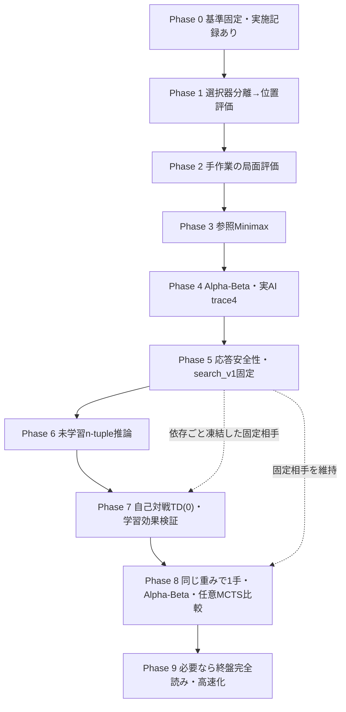

# リバーシAI 段階開発・評価設計書

- **文書ID**：REVERSI-AI-PLAN-2026-10-16
- **状態**：強化方針を統合した改訂設計。Phase 0の実施記録あり、Phase 1以降は未実装
- **作成日**：2026-10-16
- **改訂日**：2026-10-16
- **対象**：`reversi_player/reversi.py` を基点とする対戦AI、既存の検証・評価ハーネス
- **目的**：固定した探索型の比較相手を作り、n-tuple価値モデルを自己対戦TD学習で改善し、学習済みモデルと探索を組み合わせる。各変更の正しさ・実行品質・棋力を分離して検証可能にする。

> **実装担当への最重要指示**：この文書を根拠に全フェーズを一括実装しない。[強化方針](強化方針.md)の第一推奨を本書の詳細工程へ取り込み、採用理由・旧工程との対応を第11節に記録した。着手前に[開発計画](開発計画.md)、[現行契約](harness_contracts.md)、[現行アーキテクチャ](harness_architecture.md)、[品質進捗](QUALITY_PROGRESS.md)、[AI分離案](リバーシAI分離設計.md)と照合する。以後は **モデル図・契約の確認／更新 → 最小実装 → テスト → 対局評価 → 証拠保存 → 判定** の順で1フェーズずつ進める。未実装の設計を実装済みと報告しない。

Phase 0の実施内容は作業ブランチの`docs/reports/20261016_phase0.md`と`benchmark_sets/phase0/manifest.json`に記録している。これらの報告・資産は本設計改訂のコミットには含めず、mainには未収録であるため、参照にはPhase 0の作業ツリーまたは将来の統合が必要となる。本改訂では固定済みの`random_v0`、序盤集合、原評価結果を変更しない。過去の品質PASSは当時のsnapshotの証拠であり、この改訂後の作業ツリーの検証結果ではない。本書の改訂は次フェーズの実装開始を意味しない。

---

## 1. 目的・成功の定義

### 1.1 主要目的

1. `genmove` のランダム選択を、評価関数に基づく着手選択に変更する。
2. 手作業評価とαβ探索を比較基準として固定し、n-tuple推論、自己対戦TD(0)、学習後の探索統合の順に導入する。[R1][R2]
3. 変更ごとに、**プロトコル適合性／ルールの正しさ／戦略の正しさ／棋力／速度・予算／再現性**を区別して評価する。
4. 固定条件・独立レフェリー・保存証拠によって変更前後を比較し、正式資格がない結果を正式な優越性の証明として扱わない。
5. 自己対戦強化学習をプロジェクトの主要工程（Phase 6〜7）とする。探索版の完成だけで最終目標を達成したとは扱わない。これは[開発計画](開発計画.md)の目標に基づく決定であり、授業の必須要件を推測で追加するものではない。[R1]

### 1.2 非目的

- 方策・価値ネットワーク＋学習中MCTSは将来候補とする。まずCPUで試しやすいn-tuple/TD(0)から始め、MCTSは学習後の比較候補とする。CPU/GPU、期限、学習可能時間を確認して実験量を決める。[R2][R4]
- `web.py` の改修・strict化を今回の必須工程にしない。既存LintとGUI関連テストは維持する。
- ハーネスのschema5/trace4/validation3、正式資格や統計の定義をAIに合わせて緩めない。
- 既存の教師配布プロトコルや `Pos.__eq__` の動的比較境界を、性能向上の名目で無断変更しない。
- 外部の探索実装や新しい評価器の自己申告だけで「正解」「強い」「verified」とみなさない。

### 1.3 成功を区別する3つの判定

| 判定 | 意味 | 進行・報告での扱い |
|---|---|---|
| **実装PASS** | 仕様、ルール、品質ゲート、該当する単体・性質・統合テストに合格 | 次の実装フェーズへ進むための必須条件 |
| **参考評価完了** | 条件固定の `smoke` / `descriptive` 評価を保存し、勝敗・応答・異常を説明できる | 強弱の仮説を検討できるが、正式な優越性は主張しない |
| **正式採用PASS** | `confirmatory` または用途に合う `deployment` の契約を満たし、事前固定した採用基準に合格 | 「正式評価で優位」「実運用条件を満たす」など用途を限定して主張できる |

**重要**：実装PASS・参考評価完了は、正式採用PASSを意味しない。強さの改善が不明でも、探索基盤のような構造的な工程は、正しさと実験結果を明示して次へ進める。ただし性能改善を実証したことにはしない。

---

## 2. 前提・変更禁止の契約

### 2.1 既存資産

- `Board.cell[y][x]` は8×8、値は `B` / `W` / `E`。
- 既存の `_ask()`、`_play()`、`_update()`、`_has_legal_move()`、`result()` を当初のルール実装として利用する。
- 標準入力コマンド：`name`、`ask`、`play`、`genmove`、`showboard`、`result`、`quit`。
- `genmove` は合法手があれば**盤面を更新して** `x y` を出力、なければ `NG` を出力して盤面不変。独自の `pass` コマンドを追加しない。
- GUIは `reversi_player/web.py` から起動。AI改修後も既存GUI連携を維持する。
- ハーネスはAIを独立プロセスとして扱い、独立した `harness/referee.py` により盤面を検証する。
- 現行ハーネスは evaluation/analysis/comparison schema5、trace4、validation3。正式時計照合の対応契約はWindows／直接インストールのCPython 3.13.5／QPCに限定される。
- 既存の実AIは探索予算受領・trace4実測に未対応。fixtureの合格は実AIの適合証拠ではない。

### 2.2 保持すべき外部インターフェース

1. stdoutは課題プロトコルの応答だけ。探索ログ、警告、特徴量、ベンチマーク値を混入させない。
2. stderr・内部ファイルへの診断記録も、ハーネスの取得契約と性能に影響するため勝手に増やさない。
3. 全コマンドの成功時・不正入力時の既存仕様、および未定義入力に関する既存の扱いを無断変更しない。
4. `genmove` 以外のコマンドに、探索による新たな副作用を持ち込まない。
5. `web.py` に追加のCLI引数や新しいコマンドを要求しない。
6. 変更前後で合法着手・盤面反転・パス・終局のルールが一致することを独立した検証で確かめる。

### 2.3 品質ゲート・環境

- 既存の `python -m pytest -q`、`python -m pytest -q -m smoke`、`python -B tools/quality.py` を維持する。
- 品質ゲートの実行は、現行契約に合うローカルWindows + 直接インストールCPython 3.13.5で行う。異なる環境の結果を正式なPASSとして代用しない。
- 新規本番Pythonモジュールは、設計時にstrict mypyの適用対象・Lint対象・テスト対象を明示して登録する。Phase 10の新規scope自動検査は**未実装**のため自動検出を前提にしない。
- `web.py` のstrict除外は維持するが、GUIテストやLintを除外しない。
- 失敗テストをskip化、期待値の安易な修正、評価の再分類によって通過させない。

---

## 3. 目標アーキテクチャと移行方針

### 3.1 責務の分離（概念設計）

```text
外部 GUI / ハーネス
       │ stdin / stdout（既存契約を維持）
       ▼
reversi.py：コマンド受付・Board・状態更新
       │ genmove時だけ合法手と現在盤面を渡す
       ▼
着手選択（Strategy / choose_move）
       ├── 評価関数（Evaluation）
       │    ├── 位置評価
       │    ├── 角／合法手数／局面特徴
       │    ├── 学習済みn-tuple価値（Phase 6以降）
       │    └── 終局の厳密評価
       └── 探索（Search）
            ├── Minimax / Negamax
            ├── Alpha-Beta
            ├── Move Ordering / Cache
            ├── 学習後MCTS（Phase 8の比較候補）
            └── 終盤完全読み
       │ 合法手を1つ返す（または合法手なし）
       ▼
Board._play() による確定更新 → プロトコル応答

ハーネス（独立プロセス／独立レフェリー）
       ├── 現行の品質・対局・予算・保存・再解析
       └── 新しい「診断評価」：局面テスト・特徴量・探索効率・学習更新

学習（Phase 7以降、対戦時の推論とは別工程）
       AI側ルールによる自己対戦 → TD更新 → checkpoint＋学習ログ
                                           │ 凍結して明示資産登録
                                           ▼
                               外部ハーネスで固定相手と評価
```

上図は目標構造であり、学習・探索モジュールは未実装である。自己対戦ループに毎手HTTPや外部プロセスを挟まず、AI側ルールを利用し、一部の棋譜を独立レフェリーで監査する。`harness/referee.py`をAIのルールとして共用しない。[R5]

### 3.2 移行の原則

- **Phase 1は選択器の最小分離から開始**：[AI分離案](リバーシAI分離設計.md)の`reversi_player/ai_engine.py`を第一案とし、ランダム版の合法手順序・`random.shuffle()`の呼出しと乱数消費・盤面不変を先に回帰確認する。その後、別の小Goalで位置評価へ切り替える。Board・コマンド処理を全面分離しない。[R5]
- **Phase 2で評価境界を追加**：盤面コピー／純粋な特徴量計算／評価を必要な範囲で分離する。探索は本体をimportせず、必要なら本体から渡すスナップショット遷移関数を使う。AI側からharnessをimportしない。[R5]
- 直接実行 `python reversi_player/reversi.py` と、既存テストでのimportの両方を壊さない。相対import／パッケージ構成を憶測で決めない。
- 探索中は**実盤面を変更しない**。仮局面のコピーまたは適切に戻せる更新を使用し、最初はコピー方式を推奨する。
- 各戦略は、合法手0個、複数手、パス、終局の扱いを持つ。着手確定は原則として現行の `Board._play()` から行う。
- ベースラインを依存も含め凍結する。バージョンのファイル名だけでなく、実体・明示資産・hash・seed・実行条件を保存する。
- **Phase 5で`search_v1`を独立固定してから学習へ進む**。候補側の共有engineや重み変更で固定相手まで変わらないことを確認する。広範な高速化と終盤完全読みはPhase 9へ移す。[R1][R6]



この図は改訂後の予定工程であり、現行harnessの実装依存図・正式資格の状態遷移を変更しない。Phase 4の正式計測に証拠不足が残る場合、参考研究への進行可否と正式採用を分けて記録し、未達をPASSへ置き換えない。

### 3.3 評価のための責務境界

- **ルール正当性**：独立レフェリーおよび既知局面の手計算オラクルで確認。
- **戦略正当性**：同一盤面で選択理由を診断し、想定する関数値・最適性を単体テストで確認。
- **内部探索計測**：AI実装側がノード数・深度・探索時間等を定義して発行。正式値にするには現行trace4契約による取得・照合が必要。
- **対戦性能**：実際の独立対局で評価。特徴量の改善だけでは棋力改善の代わりにならない。

---

## 4. 評価ハーネスの拡張方針：新しい軸をいつ作るか

現行ハーネスの評価・証拠・正式資格は保持する。新しい指標は**最初は独立した診断レイヤー**として追加し、正式評価に使う必要が生じた時点で契約・実証・schema適合を検討する。schema5やtrace4の原データを書き換えて後付けすることは禁止。

| 導入時期 | 新しく導入する評価軸 | 計測方法・オラクル | 位置付け |
|---|---|---|---|
| **Phase 0** | 比較基準・異常率・先後別得点・再現性 | 現行 `evaluate` / 独立レフェリー / 固定序盤 | 既存機能を活用、原則追加実装不要 |
| **Phase 1** | **着手選択の説明可能性・位置選択の正しさ** | 固定局面の合法手と位置スコアを独立計算 | 新規の局面診断テスト（正式勝率ではない） |
| **Phase 2** | **戦略特徴量**（角差・mobility差・位置評価・局面別） | 仮局面で独立再計算し、盤面不変を照合 | 新規の特徴量診断と局面分類 |
| **Phase 3** | **探索の正しさ**（参照Minimaxとの一致、パス、終局） | 小規模・浅い局面で独立オラクル | 新規の探索専用回帰テスト |
| **Phase 3後半〜4** | **探索コスト**（展開ノード、深度、枝刈り率） | 先に計数定義を文書化。内部診断→trace4実装・照合 | 正式予算・公平比較への必須基盤 |
| **Phase 4〜5** | **効率と時間余裕**（同深度ノード、全応答分布、timeout） | 同じ固定局面、同じ環境で複数回測定 | `descriptive`／`deployment`、用途別に扱う |
| **Phase 6** | **n-tuple推論・対称性・モデルI/O** | 手計算LUT、重複参照、手番・色交換、save/load | 未学習モデルの正しさを検証、強さは要求しない |
| **Phase 7** | **TD更新・学習一般化・漏洩・アブレーション** | 手計算更新・有限差分、学習／開発／最終評価分離、複数学習seed | 学習系実験の新規診断 |
| **Phase 8** | **学習と探索の寄与** | 同じcheckpointの1手／αβ／MCTS、固定相手との比較 | 固定workと同時間の評価を分ける |
| **Phase 9** | **終盤正解率・高速化** | 完全列挙オラクル、旧Boardと独立refereeとの一致 | 測定で必要な追加だけ実施 |

### 4.1 診断レイヤーの最低設計

新しい診断機構（実装パスは調査後決定。候補：`tools/ai_diagnostics.py`、`tests/test_ai_strategy.py`）には次の性質を要求する。

1. **入力**：固定局面ID、8行盤面、手番、期待特性、テスト定義版、元となる独立資料／オラクルの識別子。
2. **出力**：ケースID、対象AI hash、局面ID、合法手一覧、選択手、期待と実測、診断結果、実行環境、必要なら計数値。
3. **独立性**：期待値の作成に対象AIの選択結果を使わない。戦略上の一般則（「Xマスは必ず悪い」など）を無条件の正解にしない。
4. **非干渉**：現行ハーネスの正式データ・終了コード・資格を勝手に変更しない。診断結果からschema5のverifiedやCIを偽造しない。
5. **追跡可能性**：局面セット・評価定義・コードhash・出力を保存し、何が変化したかを見られる。
6. **局面の出所**：既知の合法棋譜から導くか、独立したルール検査で入力を検証する。意図的な不正局面は別カテゴリにする。
7. **増設制約**：現段階で利用しない分析や可視化は作らない。各Phaseの判定に必要な最小機能から実装する。

**正式な内部探索計測への昇格条件**：AIが予算設定を正しく受領し、trace4で必要なrun/session/generation/command・時計・子lifecycle・探索範囲・ノード数等の契約を実装し、原記録の再検証を通過した場合のみ。単なる診断JSON・ログ・自己申告値は参考値とする。

### 4.2 比較試験の3段階

- **段階A：機能回帰**――該当単体テスト＋全pytest＋品質ゲート＋2局smoke。毎フェーズ必須。
- **段階B：開発中の参考比較**――日常回帰は20局、調整は固定探索版・旧採用版へ各50ペア＝100局を初期案とし、実時間で規模を決める。事前固定の開発用序盤・独立Bを使用し、全予定局の結果と異常・原証拠の検証状態を保存する。異常を除外して成功扱いにしない。これは仮説検討用であり、有意差や正式優越性の主張ではない。[R7]
- **段階C：正式な採用評価**――実AIの予算・trace4・決定性・資産・親子時計・固定有限母集合など、現行の `confirmatory` 契約に**実際に**適合してから実行。時間予算・実用応答は別途 `deployment` で評価し、固定得点CIと混同しない。

正式評価以前でも研究を止める必要はない。ただし、報告書に「参考」「未検証」「正式利用可能」を必ず明示する。

---

## 5. フェーズ別の設計・実行・移行条件

各フェーズの完了は、共通ゲートG0〜G5と固有条件で決める。

### 共通ゲート（全フェーズ必須）

| ID | 判定内容 | PASS条件 |
|---|---|---|
| **G0 構成・設計** | 対象差分、モデル図、責務、インターフェース、比較相手、テスト計画を確定 | 変更前に記録し、既存仕様との衝突なし／衝突なら解消記録あり |
| **G1 正しさ** | 単体・性質・独立レフェリー・プロトコル・GUI接続の該当テスト | 必須テストすべてPASS。skip/xfail・未実行をPASSに数えない |
| **G2 品質** | 現行の全pytest・smoke・統合品質ゲート | 対応環境で実行し必須検査が成功、証拠保存も成功 |
| **G3 対局健全性** | 最低2局smoke、該当する固定局面・参考対局 | 予定局で不正手、同期失敗、余計なstdout、timeout、異常終了なし。失敗を勝敗へ付け替えない |
| **G4 比較可能性** | 変更前後で固定B・序盤・seed・予算・環境・明示資産を識別 | 不一致は比較不成立とし、差の解釈を停止する |
| **G5 証拠と意思決定** | コマンド、結果、hash、未確認事項、改善／悪化／不明の判定 | 再実行可能な報告を保存し、採用／再設計／保留を明記する |

**進行の原則**：G0〜G5と各Phaseの必須機能を満たした場合に限り、その範囲の実装PASSを記録する。G4は参考比較でも条件の同一性を要求するが、内部予算unknownを同一workの証明として扱わない。実装PASSと正式資格availableは別である。正式計測の未達がある場合は未達を残し、利用範囲を参考研究へ限定したうえで、次工程の前提を満たすか個別に判断する。対局の優越が不明なら「強化成功」とは記録せず、前の安定版を保持する。品質ゲートまたはプロトコルに失敗したまま次Phaseへ進まない。[R7]

### Phase 0：基準の固定・実験条件の確立

**目的**：出発点を不変にし、何を改善したか比較できるようにする。

**手段**
1. 現行 `reversi.py` と依存・実行条件を保存し `random_v0` として固定する。
2. 開発用と最終評価用の固定序盤集合を分離して作成。対称重複・合法性・母集合hashを検証する。最終評価用は開発中の重み調整に使わない。
3. ベースライン同士のsmokeを行い、必要なら参考対局でランダムAIの性質を記録する。
4. 各結果の保存先、ゲームID、実行設定、source hash、明示資産、未検証事項を記録する。
5. ハーネスの現行仕様とAI分離案の整合を確認し、変更予定のモデル図を作成する。

**このPhaseで新たに作る評価軸**：原則なし。既存の正常完了・勝ち点率・先後別集計・応答時間を使用する。

**固有完了条件**：ランダムAIが独立起動し2局smoke成功、固定Bを再現可能に起動でき、開発・最終評価集合のhashと区別が保存されている。全品質ゲートが通っている。

**失敗時**：AI強化に進まず、現在のプロトコル・評価器・固定資産の問題を先に直す。

**実施済み範囲**：2026-10-16のPhase 0報告（`docs/reports/20261016_phase0.md`、本コミットには未収録）では、`random_v0`、開発用／held-out各1000件・8 placementsの集合、2局smokeを2run、当時の品質ゲートを記録した。smokeは初期盤面で実施し、序盤集合を用いた棋力比較は行っていない。内部予算unknown・trace4未対応という制約も保持する。本改訂を理由に資産を`random_v1`へ改名したり、過去の証拠を書き換えたりしない。[R8]

### Phase 1：位置評価だけで手を選ぶ

**目的**：ランダム選択器の互換性を確保して分離し、位置価値に従う決定的な選択へ進む。

**手段**
1. まず選択器だけを最小engineへ委譲し、固定seedでランダム版の棋譜・乱数消費順と盤面更新が変わらないことを確認する。直接起動・import・GUI接続の回帰を通してから、位置評価を別の小Goalで導入する。`_ask()`と`_play()`は維持する。[R5]
2. 8×8の重み表（角、高リスク隣接マス等）を導入。値は最初から最適だと主張しない。
3. 合法手に対して位置得点が最大の候補を選ぶ。同点時の優先順（例：行・列の昇順）を固定して記録する。
4. 選択前後で盤面を壊していないこと、選択後は通常の `_play()` だけが確定更新することをテストする。

**このPhaseで作る評価軸**：固定局面について、全合法手・位置得点・選択手を照合する**着手理由の診断**。角が合法かつ重み最大なら選ばれる、といった条件つきテストを作る。

**固有完了条件**：診断ケースでの選択値・同点処理100%一致、全合法手・盤面更新テストPASS、共通ゲートPASS。固定Bに対する100局程度の参考比較と結果解釈を保存する。参考勝ち点率が悪化した場合も、原因を記録したうえでPhase 2の評価改善を試してよいが、`positional_v1` を最強版として採用しない。

### Phase 2：盤面評価関数と戦略の分離

**目的**：着手場所ではなく、着手**後**の盤面を評価するAIにする。

**手段**
1. 実盤面を変更しない仮局面生成・コピーを実装。
2. `evaluate(state, viewpoint)` に相当する**副作用のない**評価関数を用意。
3. 角差、両者の合法手数差（mobility）、位置評価差から小さく始める。frontier（空きマスに隣接する石）差と未取得の角の隣接リスクを追加候補とし、一要素ずつ比較する。角取得後も隣接マスを一律に悪いとしない。序中盤の石数差を過大評価しない。[R6]
4. 最初は `V = wC*C + wM*M + wP*P` とし、特徴の正規化・重み・符号・評価視点を記録する。角差と位置表の角加点の重複に注意し、終局の確定勝敗は非終局評価より優先する。将来の学習価値は黒視点とし、Negamaxへ渡す際の手番による符号変換を境界で明示する。[R6][R9]
5. 各合法手で仮着手→盤面評価→最高得点を選ぶ。局面別重み変更は、この基本版の評価後に別実験として扱う。
6. 必要になった範囲で戦略・評価・ルール境界を分離する。直接スクリプト実行と既存importを回帰で確認する。

**このPhaseで作る評価軸**：**特徴量診断**。角数差、mobility、位置評価、終局評価と盤面不変を、独立計算と比較する。局面を「空き44以上／13〜43／12以下」などの暫定群に分けて観察してよいが、分類閾値も実験条件として記録し、普遍的な理論値とみなさない。

**固有完了条件**：特徴量・終局・視点反転・盤面不変の必須テスト100% PASS、全Phase 1回帰PASS、共通ゲートPASS。固定Bと `positional_v1` への参考成績・特徴量の変化を記録する。特徴量の数値改善のみで棋力改善とは判断しない。

### Phase 3：正しい浅いMinimax / Negamax探索

**目的**：相手が最善の応手を選ぶ前提で手を比較する。

**手段**
1. まず剪定なしの参照Minimax、または同値のNegamaxを実装。実装上の正負・視点が一貫するようにする。
2. 深度の定義は**実際に石を置く着手数（placement ply）**とし、パスでは深度を減らさない。双方が合法手なしなら終局。パスの連鎖で無限再帰しない。
3. 深度1→2→3→4の小規模局面からテスト。終局評価は実際の石差・勝敗を正確に扱う。
4. 小局面・浅い深度は独立の参照探索器または全列挙による結果と照合する。同点手が複数なら評価値一致と最善手集合への包含を認める。
5. 本番の盤面・標準出力への探索副作用がないことを確認する。

**このPhaseで作る評価軸**：**探索オラクルテスト**（評価値一致、合法性、パス、終局、元盤面不変）。同時に、後の探索計測用に「1ノードを何と数えるか」「leaf／passを数えるか」などの計数定義を設計する。

**固有完了条件**：すべての参照局面で評価値と合法性が一致し、深度ごとの回帰がPASS、共通ゲートPASS。固定深度で制限内に応答でき、参考成績を保存する。**この段階では内部ノード数をまだ正式値と呼ばない。**

### Phase 4：Alpha-Betaと正式探索計測基盤

**目的**：同じ正解を、より少ない探索で得る。比較に耐える探索予算・証拠を整える。

**手段**
1. Alpha-Betaを導入し、剪定なしMinimaxと**同一深度・評価関数**で照合。
2. 単純な着手順序（角・位置評価など）を導入し、枝刈り効果を比較する。
3. 探索カウンタの意味を確定（例：`negamax-node-v1` を採るなら契約・実装・計数の一致を検証）。名前だけを付けて適合扱いしない。
4. 実AIが `--a-config` / `--b-config` 相当のハーネス環境設定を受領し、予算を守り、trace4／子lifecycle／探索時刻／ノード数を正しく記録できるよう、**現行契約に沿って**実装する。元のtraceを後から加工して作らない。
5. 正式の親子時計・予算照合・原証拠再検証の成功を、fixtureでなく**実AI**に対して確認する。

**このPhaseで作る評価軸**：**探索ノード、枝刈り率、同深度での効率、予算契約適合**。trace4が検証済みになるまでは参考診断として扱う。

**固有完了条件**：参照Minimaxとの評価値一致100%、必要な盤面・pass回帰PASS、共通ゲートPASS。代表局面集合で同じ深度の探索ノード削減を測り、悪化例も記録する。中央値20%以上削減は旧版の暫定目標として扱い、論文由来の合格値や学習開始の必須条件にしない。正式計測の契約テストと実AIによる取得・保存・再解析の成否を別に記録し、未達ならPhase 4全体を完全PASSとしない。探索実装が正しくても正式評価への移行は、**実AIと相手の必要証拠が全条件を満たした場合に限る**。[R7]

### Phase 5：応答安全性の確保と探索基準の固定

**目的**：学習モデルを評価する固定探索相手`search_v1`を作り、制限時間内に安全に応答できる状態を確立する。高速化を際限なく続けて学習を先送りしない。[R1][R6]

**手段**
1. 反復深化を導入。時間不足・中断時は、最後まで完了した深度の合法手を採用。探索開始前に合法フォールバックを確保する。
2. 単純な着手順序を維持し、初期time予算は通常0.1秒/手を試す。実測に応じて1秒/手などを比較する。これらは内部探索の設計値であり、外部応答時間の保証ではない。TT・bitboard・大幅な高速化はPhase 9の必要性判断へ送る。[R6]
3. 固定nodesまたはdepthで探索品質を測り、time制限では別に実用応答を評価する。固定nodes・depthとtimeの結果を同一の公平性指標にしない。
4. 起動、モデル読込、探索、盤面更新、trace書込、全応答の測定区間を混同しない。
5. 検証済みの探索版と全依存・設定を`baselines/search_v1/`へ独立保存する。固定深度／nodes用とtime用の設定・用途をmanifestで識別し、学習中に相手を再調整しない。正式資格が不足する固定相手は参考相手として明記する。[R5]

**このPhaseで作る評価軸**：**固定相手の再現性＋時間余裕＋タイムアウト耐性**。同じ固定局面・予算・環境で深度／外部応答／内部探索／異常を測る。time評価には`deployment`を用い、正式固定得点CIと分離する。

**固有完了条件**：中断後の合法応答・盤面不変・固定相手の独立起動／候補変更後の不変性・共通ゲートPASS。genmove10秒の課題期限を守り、**測定した全応答8秒以内**を暫定安全目標とする。内部探索の8秒上限案だけで外部8秒達成とはしない。参考比較を保存し、ランダムへの勝ち点率55%以上・95%下限50%超・90%等は未採用の目標案として扱う。正式採用基準にする場合は相手の適格性・母集合・予算・件数と共に事前登録する。実装PASSで学習基盤へ進める場合も、優越性未確認は残す。[R7]

### Phase 6：n-tuple価値モデルの推論・保存・読込

**目的**：自己対戦で学習する価値モデルを用意し、まず未学習重みで推論・表現・I/Oの正しさを検証する。[R2][R9]

**手段**
1. 体系的な直線状2-tuples／3-tuplesを最初の候補とする。各LUTは`3^n`要素とし、空白／黒／白の符号化・座標順・tuple配置をmanifestに固定する。これはJaśkowski論文から得た小型配置の候補であり、TD学習での最適性の保証ではない。[R2][R3]
2. 8種類の回転・反転で重みを共有する。対称操作で同じLUT要素を重複参照する場合、推論の加算回数と勾配の参照回数を一致させる。モデル容量と1評価当たりの参照数も記録する。
3. 状態を**盤面＋手番**とし、初版は黒視点の`V(s)=tanh(f(s))`と手番別LUTを採用する。黒は最大化、白は最小化する。パスでも手番が変わること、Negamaxへの変換は手番に応じた符号変換であることを明示する。色交換で値が自動的に反転する構造とは仮定しない。[R9]
4. 未学習モデル・手計算重みfixture・save/loadを作る。推論中は重みを更新しない。8対称性、白の最小化、パス、終局の確定勝敗優先、元盤面不変をテストする。
5. `ai/ntuple.py`等の配置は着手時に決め、不要な細分化を避ける。推論には学習専用ライブラリを要求しない。モデル実体・定義・設定を明示資産に登録し、実AIのstartup load証拠を現行契約に沿って取得する。未対応のlazy/background/GPU計測をverifiedにしない。[R5]
6. GUIでは要求ごとに起動する経路を考慮し、モデル読込・初回genmove・HTTP応答・欠落／破損時を確認する。提出動作では検証済み探索版へ戻す案を設計するが、採用試験はモデル失敗・フォールバック0回を必須とする。未登録のfallback経路を正式verifiedとしない。

**このPhaseで作る評価軸**：**LUTの独立計算・対称共有・手番・重複参照・モデル資産とI/O**。色交換のテストでは盤面・手番・目標符号の対応を検証する。数値の反対称性を必須にする場合は、別にその構造制約を設計する。

**固有完了条件**：手計算LUT・対称性・手番・I/O・推論不変性の必須テストと共通ゲートPASS、独立プロセスとGUI接続で合法応答、未学習モデルと固定探索相手の参考結果を保存。**未学習モデルに強さを要求しない。**内部予算・時計・load証拠の資格は別に報告する。

### Phase 7：自己対戦TD(0)学習と学習効果の検証

**目的**：モデルが自己対戦の報酬から価値を更新し、未知の評価条件で改善するかを測る。学習は主要工程とし、線形重みのランダム探索だけで代替しない。[R1][R2]

**手段**
1. 学習中は重い探索を入れず、1手価値評価＋ε-greedyで自己対戦する。対戦時の凍結モデルによる評価では探索的ランダム着手を止め、同点規則とseedを固定する。学習用の乱数状態と評価用seedを分ける。[R4]
2. 黒視点、`γ=1`、終局報酬は黒勝ち`+1`・白勝ち`−1`・引分`0`とする。非終局では目標を更新前重みの`V(s')`、終局への遷移では確定報酬`z`とし、`δ=目標−V(s)`で`θ←θ+αδ∇θV(s)`を適用する。目標側へ勾配を流さず、手番交代ごとにTD目標を無条件に負にしない。パス遷移も状態＋手番の規則に従う。[R9]
3. 最初に1000局で速度・終局・発散・容量を調べる。5000局ごとの保存、1万→5万局を初期実験案とし、所要時間・強度は保証しない。学習率0.001を中心に0.0001／0.01、ε=0.1→累計2万局で0.02等は事前固定する候補値であり、論文の最適値として扱わない。重複参照数に応じた更新幅の正規化を定義する。[R10]
4. まず同じ学習モデルの自己対戦を使い、必要なら過去採用モデルとの混合相手・比率を別実験で導入する。一度にtuple配置・学習率など一要素を比較し、選定設定は少なくとも3学習seedで再学習する。[R10]
5. checkpointに重み・tuple配置・対称性・手番／色／報酬・局数・学習率・ε・乱数状態・コード／データhashを保存する。中断再開の条件を固定し、凍結checkpointでのみ外部評価する。推論対局中に学習しない。
6. 学習生成／開発評価／最終held-outを分け、同じ棋譜由来・対称同値局面の漏洩を検査する。Phase 0の2集合は学習データ分割そのものではない。学習開始局面・教師データ・評価用局面の出所と利用を追跡し、held-out内容を学習・選択へ使わない。偶発的な局面重複を検出した場合は理由・範囲を記録し、最終評価の独立性を未確認のまま主張しない。[R11]
7. `102400-games.pkl`は必須にしない。利用する場合は原本を変更せず、出所・合法性・パス・結果ラベル・重複を監査して対局単位で分割する。教師あり初期化と自己対戦TD更新の効果を別々に測る。[R11]

**このPhaseで作る評価軸**：**更新方向・終端ラベル・有限差分勾配・重複LUT更新・再開再現性・学習前後差・漏洩・複数学習seed**。固定`search_v1`、旧採用版、未学習n-tupleとの比較を保存する。固定checkpointのケース間の区間は、学習seed間の分散や全学習アルゴリズムの優越性を保証しない。[R7][R9]

**固有完了条件**：更新式・勾配・パス／終端・保存再開・漏洩検査・モデル資産登録・共通ゲートPASS、少なくとも3学習seedの結果と未使用条件での評価を保存。学習の実装PASSと学習による強化成功は別判定とし、正式な改善の主張には第6節の事前基準を要求する。改善しなければ原因を調べ、学習成功とせず保留または再設計する。

### Phase 8：学習済み価値と探索の統合

**目的**：同じ学習済みモデルについて1手評価・αβ・必要ならMCTSを比較し、学習と探索の寄与を分ける。[R4]

**手段**
1. 同じ凍結checkpointを使い、まず既存αβの葉評価をn-tupleへ差し替える。黒視点からの符号変換、手番、パス、終局、モデル不変性を回帰確認する。
2. 比較版として対戦時だけMCTSを試す。合法手後の価値を手番視点へ変換してsoftmax事前確率にする案から始め、木中の価値視点・backup・訪問数同点規則・パス・終局・探索予算と打切りを先に設計する。別方策ネットワークや学習中MCTSは必須にしない。
3. MCTSは100→1000回などから実時間を測る。αβとMCTSの1ノードを同じ計算量とみなさず、異なる計数定義やdepthを同一workとして正式比較しない。両方式の同時間比較は`deployment`へ分け、対応するscope／計数契約が未対応なら診断・参考評価として記録する。[R5][R7]
4. 同じ局面集合・モデル・固定相手で、1手、αβ、MCTSを比較する。さらに手作業1手／手作業＋αβ／未学習n-tuple／学習n-tuple1手を残し、モデル・探索それぞれの寄与を測る。
5. MCTSの優越が不明・費用超過なら検証済みαβ版を残す。TD(λ)、TCL、終局追加更新、長いtupleはTD(0)の基準評価後に一要素ずつ追加する。方策・価値ネットワーク＋学習中MCTSは資源と軽量方式の限界を確認してから別設計とする。

**固有完了条件**：採用候補の符号・遷移・中断・予算・モデル不変性と共通ゲートPASS、同じモデルの1手／αβ比較を保存。MCTSの導入・採用自体は必須でなく、未実施なら未実施と記録する。学習版単独より強いと主張するには適格な事前比較基準を満たす。

### Phase 9（必要時）：終盤完全読みと測定に基づく高速化

**目的**：学習と探索の寄与を測った後、実測で必要な終盤解法・速度改善を追加する。[R6]

**手段**
1. 空き8以下を最初の完全読み試行候補とする。勝敗／石差の目的を先に決め、独立完全列挙器・手計算小局面でパスを含む正解を照合する。全8空き局面を時間内に解けるとは仮定しない。
2. 読み切れなければ元の検証済み探索へ戻し、未完了結果を厳密解と呼ばない。実測で余裕があれば10、12へ拡張する。採用閾値は測定から決め、旧版の6空き案も小局面テストに使えるが必須値としない。
3. 必要ならTTを追加し、手番・深度・評価境界・モデルID・設定・盤面一致・世代の扱いを定める。モデル切替後の古い評価値を再利用しない。TTあり／なしの同設定で探索値一致を確認する。
4. 合法手・反転・評価のコストからbitboard等の必要性を判断する。旧Boardと独立refereeを使って固定局面・生成局面を照合し、独立refereeを候補実装に合わせて変更しない。ProbCut等の選択的枝刈りは別設計とし、初期導入に含めない。

**このPhaseで作る評価軸**：**終盤の厳密正答・最善手集合・最悪局面時間・ノード当たり費用・高速化前後の同値性**。

**固有完了条件**：厳密解と報告する全検証局面で100%正答、中断時の合法応答、採用した最適化の同値回帰と共通ゲートPASS。事前固定局面で費用改善と悪化例を保存し、固定相手評価で棋力退化を調べる。必要性がなければ未実施としてよく、学習モデルの成立条件には含めない。

---

## 6. 実験の事前登録と採用判定

### 6.1 実験前に必ず固定する事項

- **比較命題**：例「A=Alpha-Beta版はA=Minimax版と同深度で評価値を維持し、探索ノードを減らす」。
- **比較対象**：候補A、変更前A、固定Bの用途を区別。Bの実体・依存・hashを保存する。
- **局面集合**：開発用／最終用、母集合hash、固定序盤数、placements、対称重複方針。
- **抽出条件**：games（偶数）、selection seed、master seed、先後交換の単位。
- **探索制限**：nodes／depth／timeの別、counting_definition_id、予算値。異なる制限の比較は何を主張できるか明記。
- **測定値**：正常完了率、勝ち点率、先後別成績、対応差、合法性、必要なら探索ノード・応答時間。
- **採用基準**：何を改善とみなし、何を悪化とみなすかを**データを見始める前**に決定する。
- **環境**：OS、Python、時計domain、ハーネス版、ソース・資産・設定hash。
- **学習実験**：tuple配置、LUT容量、価値視点、対称重複の規約、報酬、更新式、正規化、学習率、ε、対局数、checkpoint選択規則、学習seed、相手混合比、再開条件。
- **推定の範囲**：凍結した特定モデルの有限母集合上の得点か、複数学習seedでの安定性かを分ける。異なる学習seedの結果を、同じモデルの独立ケースとして1つの正式区間へ合算しない。[R7]

### 6.2 暫定的な判断ポリシー

| 場面 | 判断基準 |
|---|---|
| **単体機能の採用** | 関連オラクル／性質テスト100% PASS、全品質ゲート成功、プロトコル異常なし |
| **参考対局での候補選別** | 開発用50ペア＝100局を初期目安に使用。勝ち点率・paired差と異常数を報告し、差が小さければ「優劣不明」とする。特定の勝率だけをPASS基準にしない |
| **探索の最適化採用** | 同一深度・同一評価で結果が一致し、事前に固定した代表局面でノード数または時間改善。悪化局面も記録 |
| **正式な棋力向上の主張** | 現行 `confirmatory` の正式資格がavailable、同一固定Bへのbefore/after対応比較が適格、事前登録した主指標の対応差について、**適格な95%区間の下限が0を超える**ことを原則とする。全数評価（census）では区間の代わりに**正確な全母集合平均の対応差が0を超える**ことを判定する。推論の対象は固定有限母集合に限定 |
| **実運用への採用** | 用途に合う `deployment` で応答期限・失敗率・品質基準を満たす。固定得点CIと混同しない |

ランダム版への勝ち点率55%以上・95%下限50%超という[強化方針](強化方針.md)の数値は、相手への絶対的な成績の**初期案**である。本表のbefore/after対応差の下限0超とは異なる命題として事前登録する。trace4等に未対応の`random_v0`を正式相手とみなして区間を発行しない。実AI・相手の資格がない場合は参考値に留める。ハーネスの`decision=undetermined`を計画書の閾値で自動変更しない。[R7]

区間下限0超えは「正式に強さの改善を主張する」ための**提案基準**であり、授業やプロジェクトの合意に合わせて事前に改訂できる。現行のHoeffding–Serfling boundは保守的で、母集合・件数によっては改善があっても判定不能となり得る。**判定不能は失敗でも成功でもない。**

最終held-outは原則1回の凍結候補評価に用いる。結果を見てチューニングし直したら、その集合を新しい「未閲覧」データとは呼ばない。候補を何度も正式判定する場合は多重比較・選択バイアスを別途考慮し、単純な95%の繰り返し利用で全体の保証を主張しない。

最終規模は主要相手400局（200ケース×2leg）、固定探索版200局、ランダム版100局を初期費用見積りとする。同じ相手・ケースの結果を二重計上せず、各実験のN・母集合hash・抽出・seed・予算を識別する。これらの局数は十分な検出力を保証しない。少数局の実測から、例えば100局×約60着手×0.1秒≒600秒に起動・パス・検証費用が加わる規模を見積もる。平均1秒なら約100分となるため、現行ランダム版の速さを探索版・学習版へ外挿しない。[R7]

Phase 0の開発／held-out集合は各1000件・8 placementsとして既に保存している。集合のサイズ・生成条件を本改訂で変えず、学習用データの分割を別に設計する。held-outの用途宣言とhashだけで秘匿・未使用を保証しない。学習seedやcheckpointの選択は開発評価で済ませ、最終結果を使った選択を隠さない。[R8][R11]

### 6.3 評価ログの最小フォーマット

各フェーズの報告には最低限以下を記す。

```text
Phase / Goal ID:
変更理由と仮説:
モデル図・契約差分:
変更したファイルと依存:
対象AI・固定B・資産hash:
学習方式・価値視点・報酬・tuple定義・学習seed・checkpoint選択規則:
局面集合・抽出seed・games:
予算kind・値・counting definition:
テスト／品質ゲートの結果と証拠path:
smoke／descriptive／confirmatory／deploymentの別:
正常／異常／未検証件数:
勝ち点率・先後別・対応差（適格な場合のみ）:
探索診断の定義・実測・真正性の状態:
採用基準と観測結果:
判定（実装PASS／参考評価完了／正式採用PASS／保留／不採用）:
残る制限・次フェーズの前提:
```

---

## 7. フェーズ進行を制御する運用手順

1. **`/goal` を1フェーズに対して1つだけ設定**し、目的・対象ファイル・非対象・モデル図・固有完了条件を記す。大きい場合は同フェーズ内の小Goalへ分割する。
2. まず現状のGit状態、全pytest、利用可能なquality証拠を確認して基準を記録する。既存の失敗と新しい失敗を区別する。
3. モデル図、依存、状態遷移、計算と計測の責務を先に確定する。契約変更が必要なら理由と後方互換性を記す。
4. 必要なテストとオラクルを先に定義する。対象実装の出力をそのまま期待値にしない。
5. **最小のコード差分**で実装する。新規本番コードはstrict・Lintのscopeへ登録し、GUIは維持する。
6. 該当単体テスト→全pytest→独立smoke→対応環境で品質ゲートを実行。既存の失敗を隠さない。
7. 固定済み条件で参考評価、必要な場合だけ正式／deployment評価を実行。毎回新規出力先に保存する。
8. 保存済み原証跡を必要に応じて再検証し、診断値と正式資格を分けて報告する。
9. G0〜G5とPhase固有ゲートで「次フェーズへ進行」「同フェーズ再実装」「保留／不採用」を決める。
10. 次フェーズに進むときは**採用した実装**と**強さの主張が許される範囲**を明示し、安定ベースラインを凍結する。commit／pushは明示依頼がある場合だけ行う。

### 7.1 失敗・不一致への対応

- **品質ゲートNG**：性能が良くても先に進めない。原因修正→新しい証拠で再実行。
- **探索オラクル不一致**：評価関数、視点、深度、パス、終局、TT境界を切り分け。棋力評価で相殺しない。
- **対局結果が悪化／不明**：直ちに品質NGとはしない。参考評価条件、局面別傾向、構造欠陥を調べ、採用・保留を決める。
- **正式資格がunknown／unavailable**：正式CIを出さず、参考として報告。trace4実装・資産登録・時計・決定性など未充足条件を列挙。
- **原証拠欠損・保存失敗**：結果の再解析・正式資格を主張せず、別出力名で最初から取得し直す。
- **学習の発散・非改善**：更新式・視点・報酬・重複参照・学習率・データ分割を切り分ける。損失低下や自己対戦勝率だけで改善としない。未学習版／固定探索版／複数学習seedの比較から再設計する。
- **モデル欠落・破損・fallback**：提出用の応答保証とモデル採用試験を分ける。採用試験でのfallbackは失敗として記録し、探索版の成績を学習モデルの成績に置き換えない。原traceを後から修復しない。

---

## 8. 成果物とディレクトリの提案

本書は`docs/リバーシAI段階開発・評価設計書.md`を正本とし、実行報告は`docs/reports/`へ置く。Phase 0の資産は既存パスを保持する。それ以外は**提案パス**であり、既存の命名・責務・importを調査して必要になったものだけ追加する。[R5][R8]

```text
docs/
    リバーシAI段階開発・評価設計書.md  # 工程・ゲート・変更根拠の正本
    リバーシAI分離設計.md             # AI側の構造案
    reports/                         # 実験仕様・測定・採否・未検証事項

reversi_player/
    ai_engine.py                  # Phase 1の最小分離案

ai/
    ntuple.py                     # Phase 6のモデル推論案

training/
    self_play.py                  # Phase 7の学習用自己対戦案
    train_value.py                # TD更新・checkpoint管理案

baselines/
    random_v0/                    # 依存ごと固定
    positional_v1/                # Phase 1以降、採用時に固定
    search_v1/                    # Phase 5、学習中に変更しない比較相手
    ...

benchmark_sets/
    phase0/development.json       # 固定済み、反復開発用
    phase0/held_out.json          # 固定済み、最終候補用
    phase0/manifest.json          # 集合とPhase 0証拠の識別

tests/
    ...                           # 現行テストを維持
    test_ai_strategy.py           # 新設の場合の候補
    test_ai_search.py             # 新設の場合の候補
    test_ai_endgame.py            # 新設の場合の候補
    test_ntuple.py                # 推論・対称性・save/load
    test_td_learning.py           # 更新式・再開・乱数分離

tools/
    ai_diagnostics.py             # 新設の場合の候補

evaluation_results/
    ...                           # 既存の排他新規保存と原証跡を維持
```

### 必ず保持する成果物

- フェーズ前後のソース・明示資産hash、固定Bの依存を含む実体。
- モデル図／責務／データフローと対応する実装差分。
- テスト対象・入力・期待値・実測・失敗時の再現情報。
- 品質ゲートの実行コマンド・状態・evidence参照。
- 評価設定、固定序盤、seed、予算、対局結果、原trace、診断値と正式資格。
- 採用／保留／不採用の判断と残る制約。
- 学習checkpoint・更新規則・乱数状態・対局数・学習ログ・データ分割・複数学習seedの結果。Git管理外の`evaluation_results/`等も保存先を記録し、commitだけで証拠が保全されたとみなさない。

---

## 9. 改訂後の着手指示

> 今回は設計改訂のみです。次に実装を依頼された際は、Phase 0の保存資産・報告・現在のGit状態を確認し、必要な品質検査で基準を再確認してください。過去のPASSだけで現在の完了を保証せず、Phase 0の資産・原証拠を上書きしないでください。
>
> 次の対象は**Phase 1だけ**です。`/goal`を用い、まずAI分離案のモデル・契約とランダム選択の互換回帰を確定し、最小engineへ委譲してください。その成功後、別の小Goalで位置評価と独立診断を実装してください。import・直接起動・既存GUIを確認し、共通ゲートとPhase固有条件・参考評価を保存してください。
>
> 現行仕様、ハーネスのschema・正式資格、`web.py`の方針は維持し、必要な実AI producerは現行契約に沿って後続Phaseで実装してください。Phase 6〜7の学習やPhase 8のMCTSまで一括実装しないでください。
>
> 全フェーズの一括実装、テストの形骸化、既存失敗の隠蔽、fixture成功による実AI正式評価の宣言、未検証traceからの正式CI生成、無断commit／pushは行わないでください。

---

## 10. 確定した方針と着手前に残す判断

| 項目 | 本改訂での決定／残る判断 |
|---|---|
| 研究目標 | 自己対戦強化学習を主要工程とする。授業上の必須性は未確認であり、別に確認する |
| 方式 | 小型n-tuple＋TD(0)を第一実装とし、学習中の重い探索は入れない。CPU/GPU・期限・学習時間・容量は学習着手前に確認 |
| 分離 | `ai_engine.py`を第一案とする。直接起動とimportを両立するimport戦略はPhase 1の設計で確定 |
| 固定資産 | `random_v0`とPhase 0の2集合は保持。`search_v1`の全依存固定はPhase 5。モデル定義・重み・設定も明示資産とする |
| 視点・更新 | 学習価値は黒視点＋手番別LUT、γ=1、勝敗報酬、TD(0)。特徴量の正規化・終局優先の値域・同点順は該当Phase着手前に確定 |
| 探索 | 深度はplacement ply、パスで減らさない。producer実装位置・正確なscope／node定義・中断条件はPhase 3〜4で照合 |
| 学習規模 | 第5節の局数・学習率・εは初期実験案。実時間と資源から固定し、性能保証としない |
| 評価 | Phase 0の開発／held-outは各1000件。学習用分割・漏洩監査・checkpoint選択・最終件数・採用基準は実験前に登録 |
| MCTS | Phase 8で任意比較。depthやnodeをαβと無条件に共通予算とせず、scope・計数・clock対応を先に設計 |
| 互換性 | モデル読込は現行startup契約から開始。lazy/background/GPU等が必要なら先に追加設計・契約・回帰を行う |

**優先順位**：プロトコルとルールの正しさ ＞ 証拠の真正性・再現可能性 ＞ 棋力改善 ＞ 探索速度の向上。速度や棋力のために上位条件を犠牲にしない。

---

## 11. 改訂の根拠と旧工程との対応

### 11.1 変更点と理由

`R1`〜`R11`は本文中の判断根拠を指す。既存方針からの採用、論文による方式の裏付け、本プロジェクトで決めた実験値、実施記録を区別する。論文の勝率・実行時間・必要学習局数を本プロジェクトの達成保証として転記しない。

| ID | 旧設計→改訂 | 理由と根拠 |
|---|---|---|
| R1 | 任意の学習→主要工程としてPhase 6〜7を設定 | [強化方針](強化方針.md)§1・§4の「探索基準→n-tuple自己対戦TD→探索統合」と[開発計画](開発計画.md)の強化学習モデルという目標を一致させる。授業の義務を新たに認定したわけではない |
| R2 | 線形重みの自動最適化が先→n-tuple推論とTD(0)を分けて構築 | 強化方針§2・§4の採用。Lucas論文§3〜4 [L1]はn-tupleと自己対戦TD(0)を扱う。学習せずに推論を検査できる工程を先に置く |
| R3 | モデル表現が未指定→短い直線2／3-tuplesを初期候補に | 強化方針§4とJaśkowski [L2]の体系的配置の研究を参考にした選択。ただし同研究の主な学習実験は進化戦略であり、TDや深い探索での最適性へ外挿しない |
| R4 | 学習と探索統合が不明→軽い自己対戦後、同じ重みで1手／αβ／任意MCTS比較 | 強化方針§1・段階4、Scheiermann/Konen [L4]の対戦時探索を参考にする。Buro [L3]も学習評価と探索の組合せの参考となるが教師あり学習であり、自己対戦RLの証拠とはしない。MCTS優位や論文の到達強度は保証しない |
| R5 | 選択器分離をPhase 2へ後送り→Phase 1の先行小Goal、固定相手と学習責務を明確化 | [AI分離案](リバーシAI分離設計.md)§1、強化方針§3・§7に合わせる。AI→harness依存を作らず、独立refereeを維持する。現行[契約](harness_contracts.md)§5〜6・§8〜9のclock/load/trace/正式ANDは変更しない |
| R6 | Phase 5の広範な高速化・Phase 6完全読みが学習の前提→Phase 5は安全応答とsearch_v1固定、追加最適化はPhase 9 | 強化方針§4の段階1・段階5と、[開発計画](開発計画.md)の「最後に高速化」を反映。学習前の安全性は確保し、TT/bitboard/大きい終盤閾値への作業拡大を防ぐ。8空きは試行候補で、旧6空き案を含め採用閾値は実測する |
| R7 | 任意の数値目標を進行・採用と混同し得る→実装、正式資格、棋力採用を分離 | 強化方針§5と現行契約§3〜4・§7〜9。20/100/400局、55%/50%・20%削減は設計上の案で、必要十分な標本数・実装済みの判定ではない。αβ/MCTS間の異なるwork、timeと固定得点、学習seed間の分散を同じ区間にしない |
| R8 | 全体が実装着手前・random_v1の旧提案→既存Phase 0記録とrandom_v0を維持 | 作業ツリーの`docs/reports/20261016_phase0.md`と`benchmark_sets/phase0/manifest.json`を根拠にする。両者はmainには未収録。固定済み資産・証拠を改訂計画に合わせて書き換えない。Phase 1以降の完成は主張しない |
| R9 | 価値視点・学習更新が未指定→黒視点／手番別LUT／明示TD更新と互換回帰 | 強化方針§4段階2・3とLucas [L1]の価値・更新式を参考にした設計。手番別LUT、全遷移の扱い、重複正規化は本プロジェクトの実装規約として検証する。Negamaxの符号と黒視点TDの符号を混同しない |
| R10 | 学習費用・seed安定性が不明→小規模試行、checkpoint、3学習seedから検証 | 強化方針§4の初期実験案を採用。1000局、1万〜5万局、学習率、ε、3seedはプロジェクトの開始案であり論文の保証値ではない。選定前の実時間測定と資源確認を条件にする |
| R11 | 2つの序盤集合で学習分割も完了したと誤解し得る→学習データ／開発／最終の利用を別管理 | 強化方針§3・§5〜6、現行契約§3〜4。配布棋譜は任意の教師あり初期化候補として監査し、自己対戦学習の効果と分離する。held-outの未使用性はhashだけでは証明できない |

### 11.2 フェーズ番号の対応

強化方針の「段階」は概略、本書の「Phase」は小さな実装・検証単位であり、番号の一致を要求しない。

| 強化方針§4の段階 | 旧詳細設計 | 本改訂の実施単位 |
|---|---|---|
| 0 基準固定 | Phase 0 | Phase 0、保存済み資産と実施記録を保持 |
| 1 探索基準 | Phase 1〜5 | Phase 1〜5、ランダム互換分離→位置→局面評価→Minimax→αβ計測→安全応答・独立固定 |
| 2 価値モデル | 旧Phase 7に一部含まれる | Phase 6、未学習n-tupleの正しさとI/O |
| 3 自己対戦学習 | 旧Phase 7の任意項目 | Phase 7、TD(0)を主要工程にし学習効果は別判定 |
| 4 学習後探索 | 明確な工程なし | Phase 8、1手／αβ／任意MCTSの寄与比較 |
| 5 終盤・高速化 | 旧Phase 5の最適化＋旧Phase 6 | Phase 9、必要性と実測に基づく追加 |

旧「Phase 3 strict化保留」等の[品質進捗](QUALITY_PROGRESS.md)のPhase番号は、mypy移行の別系列である。本書のAI開発Phaseと混同しない。過去のPhase 0報告は実施当時の判断として保持する。

### 11.3 論文の参照先と適用範囲

2026-10-16に以下の一次資料を再確認した。アルゴリズムの選択根拠として利用し、既存ハーネスの統計方式の根拠を置き換えない。

- **L1** Lucas, *Learning to Play Othello with N-Tuple Systems*（大学リポジトリ表記2008）。[本文](https://repository.essex.ac.uk/3820/1/NTupleOthello.pdf)、[書誌](https://repository.essex.ac.uk/3820/)。§3のLUT・対称サンプリング、§4のtanh価値・TD(0)・終局報酬を参照する。短い直線tupleや手番別LUTを含む本書の構成が論文と同一だとはしない。
- **L2** Jaśkowski, *Systematic N-tuple Networks for Position Evaluation: Exceeding 90% in the Othello League*（2014）。[本文](https://arxiv.org/pdf/1406.1509)。§III〜Vの体系的配置と比較実験を参照する。進化学習・1手評価の結果から本プロジェクトのTD学習・深い探索の強さを保証しない。
- **L3** Buro, *Improving Heuristic Mini-Max Search by Supervised Learning*（2002）。[著者版](https://skatgame.net/mburo/ps/logaij.pdf)、[DOI](https://doi.org/10.1016/S0004-3702(01)00093-5)。学習した評価と探索を組み合わせる研究であり、教師あり学習と自己対戦RLを区別する。ProbCutは初期工程へ入れない。
- **L4** Scheiermann and Konen, *AlphaZero-Inspired Game Learning: Faster Training by Using MCTS Only at Test Time*（2022著者版）。[本文](https://arxiv.org/pdf/2204.13307)、[DOI](https://doi.org/10.1109/TG.2022.3206733)。§II、§IV-A/E、結論のTD n-tupleと対戦時MCTSを参照する。TD(λ)・TCL等を用いる論文設定と本書の初期TD(0)を区別し、学習時間・強度を外挿しない。

### 11.4 整合性と未解決事項

- **実装と予定**：更新した第3節の図は将来のAI工程。現行`harness/`の依存・正式入口・schemaを変えないため、[現行アーキテクチャ](harness_architecture.md)の実装図と[契約](harness_contracts.md)の変更は不要。各Phase着手時は実際に追加する依存・producer・モデル読込を先行設計する。
- **比較相手**：Phase 0の`random_v0`は参考相手。Phase 5の`search_v1`は依存ごと凍結する。正式相手になるかは必要証拠を検証して決め、名前や勝率だけで昇格させない。
- **予算と推定対象**：固定workの決定的モデルの有限母集合区間、timeのdeployment、学習seedの安定性を別に報告する。MCTS用の計数・scopeが既存契約に合うかは未解決であり、Phase 8で先に検証する。
- **学習と符号**：黒視点TDでは手番交代時に目標を反転しない。Negamax境界では手番に応じて変換する。手番別LUTは色反対称性を自動保証しないため、未保証の数値対称性をテストで要求しない。
- **運用上の未確定**：CPU/GPU・期限・学習可能時間、漏洩監査の具体的手順、fallback証拠、MCTSの正式対応、最終採用閾値は着手前に詰める。これらの未実装を既存fixtureや今回の設計改訂で解消済みとしない。
