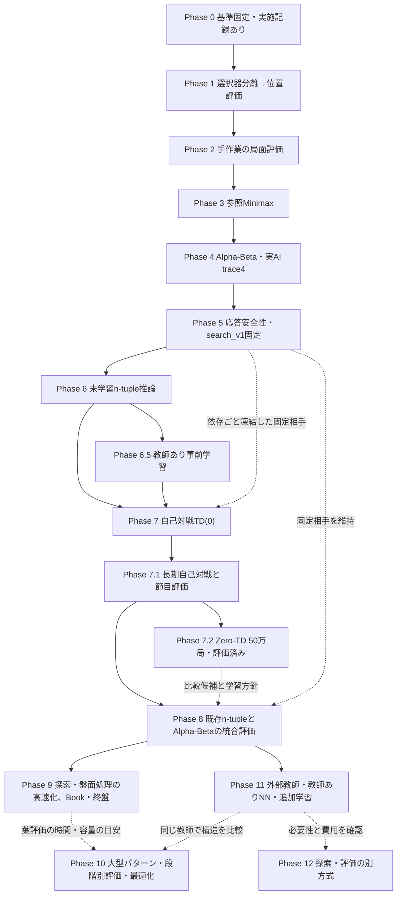

# リバーシAI 段階開発・評価設計書

- **文書ID**：REVERSI-AI-PLAN-2026-10-16
- **状態**：Phase 0〜5の基準・探索・安全応答を実装し、Phase 6〜7.2のモデルと参考評価を保存済み。次はPhase 8の既存n-tupleとAlpha-Betaの統合評価。実装状況と採用の区別は第1.5節、確定結果と後続計画は第5節を参照。
- **作成日**：2026-10-16
- **改訂日**：2026-11-25
- **対象**：`reversi_player/reversi.py` を基点とする対戦AI、既存の検証・評価ハーネス
- **目的**：大学の提出サーバーの課題制約下で、実戦棋力をできるだけ高める。Phase・学習・探索・正式評価は手段とし、正しさ・実行品質・棋力を分けて検証できるようにする。

> **実装担当への最重要指示**：この文書を根拠に全フェーズを一括実装しない。[強化方針](強化方針.md)の第一推奨を本書の詳細工程へ取り込み、採用理由・旧工程との対応を第11節に記録した。着手前に[開発計画](開発計画.md)、[現行契約](harness_contracts.md)、[現行アーキテクチャ](harness_architecture.md)、[品質進捗](QUALITY_PROGRESS.md)、[AI分離案](リバーシAI分離設計.md)と照合する。以後は **モデル図・契約の確認／更新 → 最小実装 → テスト → 対局評価 → 証拠保存 → 判定** の順で、1フェーズまたは1つの独立実験ずつ進める。優先変更の判断は第1節とAGENTSの最上位方針に従う。未実装の設計を実装済みと報告しない。

Phase 0の[実施報告](reports/20261016_phase0.md)と[manifest](../benchmark_sets/phase0/manifest.json)はPR #1のmerge commit`eb2e860`でmainへ統合済みと確認した。Phase 1Aの選択器分離、Phase 1Bの位置評価selector、事前登録比較実験は完了した。[AI分離設計第13節](リバーシAI分離設計.md#phase1a-design)と[Phase 1引き継ぎ資料](phase1_handoff.md)を現状参照先とする。固定済みrandom_v0・positional_v1・序盤集合・原証拠は変更しない。過去の品質PASSは当時のsnapshotの証拠であり、改訂後の検証を代用しない。

---

## 1. 目的・成功の定義

### 1.1 最終目的と意思決定

2026-11-10の利用者指示による唯一の最終目的は大学の提出サーバー上で課題の制約を守り、実戦でできるだけ強いAIを動かすことである。

1. 候補は提出環境での期待棋力、プロトコル・時間・メモリへの適合、開発・検証費用に対する期待改善、安定版との比較可能性、次の改善に必要な基盤価値の順に検討する。正しさ・必須品質・再現性・証拠保全は採用の前提とする。
2. Phase 6のn-tuple推論、Phase 7のTD学習、Phase 8の探索統合、Phase 9の終盤解法・高速化は有力な標準経路として残す。[R1][R2]は従来経路の採用根拠であり、学習の導入そのものを最終成功条件にはしない。
3. 深度拡張、Alpha-Beta効率化、評価改善、学習、終盤解法の独立実験や優先変更は、理由・期待効果・検証方法・既存工程への影響を記録して行える。理論上の期待と実測改善を区別し、深くすれば必ず強い、学習すれば必ず強いとは仮定しない。
4. 提出候補は可能な限り同じ相手・序盤・先後・環境・外部制限で比較する。勝率・勝ち点率と時間超過・不正手・異常終了・メモリを合わせて判断し、弱い学習モデルの採用を要求しない。安定版を維持して改善・悪化・不明を分ける。
5. 実装PASS、参考評価、正式採用PASSは次節のとおり区別する。正式資格がない結果は参考値に留め、評価基盤を拡張し続けること自体を目的にしない。固定3 baseline、held-outの非チューニング利用、品質・評価契約、既存Phaseの履歴・結果・原証拠を維持する。

### 1.2 非目的

学習経路を選ぶ場合の標準案を以下に示す。独立実験の優先順位は第1.1節で判断する。

- 方策・価値ネットワーク＋学習中MCTSは将来候補とする。まずCPUで試しやすいn-tuple/TD(0)から始め、MCTSは学習後の比較候補とする。CPU/GPU、期限、学習可能時間を確認して実験量を決める。[R2][R4]
- `web.py` の改修・strict化を今回の必須工程にしない。既存LintとGUI関連テストは維持する。
- ハーネスのschema5/trace4/validation3、正式資格や統計の定義をAIに合わせて緩めない。
- 既存の教師配布プロトコルや `Pos.__eq__` の動的比較境界を、性能向上の名目で無断変更しない。
- 外部の探索実装や新しい評価器の自己申告だけで「正解」「強い」「verified」とみなさない。

### 1.3 成功を区別する3つの判定

| 判定 | 意味 | 進行・報告での扱い |
|---|---|---|
| **実装PASS** | 仕様、ルール、品質ゲート、該当する単体・性質・統合テストに合格 | 次の実装フェーズへ進むための必須条件 |
| **参考評価完了** | 条件固定の `smoke` / `descriptive` 評価を保存し、勝敗・応答・異常を説明できる | 強弱の仮説を検討できるが、正式な優越性は主張しない |
| **正式採用PASS** | `confirmatory` または用途に合う `deployment` の契約を満たし、事前固定した採用基準に合格 | 「正式評価で優位」「実運用条件を満たす」など用途を限定して主張できる |

**重要**：実装PASS・参考評価完了は、正式採用PASSを意味しない。強さの改善が不明でも、探索基盤のような構造的な工程は、正しさと実験結果を明示して次へ進める。ただし性能改善を実証したことにはしない。

### 1.4 提出期限と探索時間

手元の授業仕様[処理時間](プログラム開発方法.md#3-処理時間)はgenmove10秒以内と定める。提出サーバー固有の規約原本・計時方式は未確認で、異なる正式仕様が確認された場合はそちらを優先する。

Phase 5の7秒は初期の全応答安全目標であり、将来候補の固定上限ではない。7秒超の目標や深度拡張は、探索以外の費用、OS遅延、実機性能、最悪局面を測り、安全余裕を確保して検討する。予算増加だけの効果と、早期到達している最大深度・探索能力の拡張を分ける。現行のdepth/time受理範囲は第2.1節のままで、必要な拡張は先行設計・契約照合・境界検証を伴う別候補とする。固定search_v1と既存提出ZIPの設定・原証拠を変更しない。

### 1.5 現在地と研究候補の状態

「実装済み」はコードと回帰の確認、「評価済み」は条件と結果の保存、「実験中」は実行記録のある未完了試行を指す。「計画確定」は着手条件と順序を決めた段階、「研究候補」は比較設計が必要な段階、「保留」は再検討条件を残して着手を見送る状態、「不採用」は特定の条件で採用を見送った判定である。参考評価済みと提出採用は第1.3節に従って区別する。

| 対象 | 状態 |
|---|---|
| Phase 0〜3 | 固定資産と実装・参考評価を保全。Phase 2の昇格は保留、Phase 3の正式採用は未達。[Phase 1](phase1_handoff.md)・[Phase 2](reports/20261030_phase2_implementation.md)・[Phase 3](reports/20261106_phase3_implementation.md) |
| Phase 4〜5 | Alpha-Betaと安全応答、固定search_v1、ローカル提出ZIPを検証済み。正式計測は確認した条件に限定。[Phase 5実装・評価記録](reports/20261108_phase5_implementation.md) |
| Phase 6〜7.1 | 推論・教師あり学習・TD(0)・長期自己対戦を実装。Phase 7.1は全6系列10万局の参考評価を完了。学習モデルの提出採用は未判定 |
| Phase 7.2 | Zero-TDの3 seedで各500,000局と全評価を完了。[50万局実行報告](reports/20261124_phase7_zero_500k_results.md) |
| Phase 8 | 計画確定。凍結済みの既存n-tupleを現行Alpha-Betaの葉評価に接続して比較する |
| Phase 9〜11 | 探索・盤面処理の計測と高速化を優先する。外部教師を監査し、教師ありNNを段階的に試す。大型n-tuple、Book、終盤完全探索と自前学習の条件は第5節を参照 |
| Phase 12 | MCTS、NNUE、KPP型、分類木・回帰木は独立した研究候補。性能と費用を確認して着手を決める |

方式、費用、採用・中止条件と[先生メモとの対応表](phase8_plus_research.md#8-先生メモとの対応)は[Phase 8以降の技術研究計画](phase8_plus_research.md)にまとめる。

---

## 2. 前提・変更禁止の契約

### 2.1 既存資産

- `Board.cell[y][x]` は8×8、値は `B` / `W` / `E`。
- 既存の `_ask()`、`_play()`、`_update()`、`_has_legal_move()`、`result()` を当初のルール実装として利用する。
- 標準入力コマンド：`name`、`ask`、`play`、`genmove`、`showboard`、`result`、`quit`。
- `genmove` は合法手があれば**盤面を更新して** `x y` を出力、なければ `NG` を出力して盤面不変。独自の `pass` コマンドを追加しない。
- GUIは `reversi_player/web.py` から起動。AI改修後も既存GUI連携を維持する。
- ハーネスはAIを独立プロセスとして扱い、独立した `harness/referee.py` により盤面を検証する。
- 現行ハーネスは evaluation/analysis/comparison schema5、trace4、validation3。正式時計照合の対応契約はWindows／直接インストールのCPython 3.13.5／QPCに限定される。
- 実AIはPhase 4でdepth1〜4、Phase 5でtime1,000,000〜6,500,000,000nsの受領とtrace4に対応した。実時計の正式資格は取得したdepth2/100msと対応環境の範囲だけに与える。fixtureの合格や入力値域への対応を、全設定の実測適合証拠とは扱わない。

### 2.2 保持すべき外部インターフェース

1. stdoutは課題プロトコルの応答だけ。探索ログ、警告、特徴量、ベンチマーク値を混入させない。
2. stderr・内部ファイルへの診断記録も、ハーネスの取得契約と性能に影響するため勝手に増やさない。
3. 全コマンドの成功時・不正入力時の既存仕様、および未定義入力に関する既存の扱いを無断変更しない。
4. `genmove` 以外のコマンドに、探索による新たな副作用を持ち込まない。
5. `web.py` に追加のCLI引数や新しいコマンドを要求しない。
6. 変更前後で合法着手・盤面反転・パス・終局のルールが一致することを独立した検証で確かめる。

### 2.3 品質ゲート・環境

- 既存の `python -m pytest -q`、`python -m pytest -q -m smoke`、`python -B tools/quality.py` を維持する。
- 品質ゲートの実行は、現行契約に合うローカルWindows + 直接インストールCPython 3.13.5で行う。異なる環境の結果を正式なPASSとして代用しない。
- 新規本番Pythonモジュールは、設計時にstrict mypyの適用対象・Lint対象・テスト対象を明示して登録する。Phase 10の新規scope自動検査は**未実装**のため自動検出を前提にしない。
- `web.py` のstrict除外は維持するが、GUIテストやLintを除外しない。
- 失敗テストをskip化、期待値の安易な修正、評価の再分類によって通過させない。

---

## 3. 目標アーキテクチャと移行方針

### 3.1 責務の分離（概念設計）

```text
外部 GUI / ハーネス
       │ stdin / stdout（既存契約を維持）
       ▼
reversi.py：コマンド受付・Board・状態更新
       │ genmove時だけ合法手と現在盤面を渡す
       ▼
着手選択（Strategy / choose_move）
       ├── 評価関数（Evaluation）
       │    ├── 位置評価
       │    ├── 角／合法手数／局面特徴
       │    ├── 学習済みn-tuple価値（Phase 6以降）
       │    └── 終局の厳密評価
       └── 探索（Search）
            ├── Minimax / Negamax
            ├── Alpha-Beta
            ├── Move Ordering / Cache
            ├── 学習後MCTS（Phase 12の独立研究候補）
            └── 終盤完全読み
       │ 合法手を1つ返す（または合法手なし）
       ▼
Board._play() による確定更新 → プロトコル応答

ハーネス（独立プロセス／独立レフェリー）
       ├── 現行の品質・対局・予算・保存・再解析
       └── 新しい「診断評価」：局面テスト・特徴量・探索効率・学習更新

学習（Phase 7以降、対戦時の推論とは別工程）
       AI側ルールによる自己対戦 → TD更新 → checkpoint＋学習ログ
                                           │ 凍結して明示資産登録
                                           ▼
                               外部ハーネスで固定相手と評価
```

上図は目標構造であり、Phase 1〜4の実装状態は[開発計画](開発計画.md)に記録する。浅いMinimaxとAlpha-Beta・depth予算の実AI探索計測は実装済みで、反復深化・学習は未実装である。自己対戦ループに毎手HTTPや外部プロセスを挟まず、AI側ルールを利用し、一部の棋譜を独立レフェリーで監査する。`harness/referee.py`をAIのルールとして共用しない。[R5]

### 3.2 移行の原則

- **Phase 1は選択器の最小分離から開始**：[AI分離案](リバーシAI分離設計.md)の`reversi_player/ai_engine.py`を第一案とし、ランダム版の合法手順序・`random.shuffle()`の呼出しと乱数消費・盤面不変を先に回帰確認する。その後、別の小Goalで位置評価へ切り替える。Board・コマンド処理を全面分離しない。[R5]
- **Phase 2で評価境界を追加**：盤面コピー／純粋な特徴量計算／評価を必要な範囲で分離する。探索は本体をimportせず、必要なら本体から渡すスナップショット遷移関数を使う。AI側からharnessをimportしない。[R5]
- 直接実行 `python reversi_player/reversi.py` と、既存テストでのimportの両方を壊さない。相対import／パッケージ構成を憶測で決めない。
- 探索中は**実盤面を変更しない**。仮局面のコピーまたは適切に戻せる更新を使用し、最初はコピー方式を推奨する。
- 各戦略は、合法手0個、複数手、パス、終局の扱いを持つ。着手確定は原則として現行の `Board._play()` から行う。
- ベースラインを依存も含め凍結する。バージョンのファイル名だけでなく、実体・明示資産・hash・seed・実行条件を保存する。
- **Phase 5で`search_v1`を独立固定してから学習へ進む**。候補側の共有engineや重み変更で固定相手まで変わらないことを確認する。広範な高速化と終盤完全読みはPhase 9へ移す。[R1][R6]



この図は改訂後の予定工程であり、現行harnessの実装依存図・正式資格の状態遷移を変更しない。Phase 4の正式計測に証拠不足が残る場合、参考研究への進行可否と正式採用を分けて記録し、未達をPASSへ置き換えない。

### 3.3 評価のための責務境界

- **ルール正当性**：独立レフェリーおよび既知局面の手計算オラクルで確認。
- **戦略正当性**：同一盤面で選択理由を診断し、想定する関数値・最適性を単体テストで確認。
- **内部探索計測**：AI実装側がノード数・深度・探索時間等を定義して発行。正式値にするには現行trace4契約による取得・照合が必要。
- **対戦性能**：実際の独立対局で評価。特徴量の改善だけでは棋力改善の代わりにならない。

---

## 4. 評価ハーネスの拡張方針：新しい軸をいつ作るか

現行ハーネスの評価・証拠・正式資格は保持する。新しい指標は**最初は独立した診断レイヤー**として追加し、正式評価に使う必要が生じた時点で契約・実証・schema適合を検討する。schema5やtrace4の原データを書き換えて後付けすることは禁止。

| 導入時期 | 新しく導入する評価軸 | 計測方法・オラクル | 位置付け |
|---|---|---|---|
| **Phase 0** | 比較基準・異常率・先後別得点・再現性 | 現行 `evaluate` / 独立レフェリー / 固定序盤 | 既存機能を活用、原則追加実装不要 |
| **Phase 1** | **着手選択の説明可能性・位置選択の正しさ** | 固定局面の合法手と位置スコアを独立計算 | 新規の局面診断テスト（正式勝率ではない） |
| **Phase 2** | **戦略特徴量**（角差・mobility差・位置評価・局面別） | 仮局面で独立再計算し、盤面不変を照合 | 新規の特徴量診断と局面分類 |
| **Phase 3** | **探索の正しさ**（参照Minimaxとの一致、パス、終局） | 小規模・浅い局面で独立オラクル | 新規の探索専用回帰テスト |
| **Phase 3後半〜4** | **探索コスト**（展開ノード、深度、枝刈り率） | 先に計数定義を文書化。内部診断→trace4実装・照合 | 正式予算・公平比較への必須基盤 |
| **Phase 4〜5** | **効率と時間余裕**（同深度ノード、全応答分布、timeout） | 同じ固定局面、同じ環境で複数回測定 | `descriptive`／`deployment`、用途別に扱う |
| **Phase 6** | **n-tuple推論・対称性・モデルI/O** | 手計算LUT、重複参照、手番・色交換、save/load | 未学習モデルの正しさを検証、強さは要求しない |
| **Phase 7** | **TD更新・学習一般化・漏洩・アブレーション** | 手計算更新・有限差分、学習／開発／最終評価分離、複数学習seed | 学習系実験の新規診断 |
| **Phase 7.1** | **長期学習の節目と再開** | 6系列100,000局、途中checkpointと評価、不完全試行の記録 | 参考成績と独立評価を分ける |
| **Phase 8** | **学習と探索の寄与** | 同じcheckpointの1手／αβと手作業評価、固定相手との比較 | 固定workと同時間の評価を分ける |
| **Phase 9** | **高速化・Book・終盤正解率** | 完全列挙、独立referee、登録内外、時間とメモリ | 必要な変更を一つずつ試す |

### 4.1 診断レイヤーの最低設計

新しい診断機構（実装パスは調査後決定。候補：`tools/ai_diagnostics.py`、`tests/test_ai_strategy.py`）には次の性質を要求する。

1. **入力**：固定局面ID、8行盤面、手番、期待特性、テスト定義版、元となる独立資料／オラクルの識別子。
2. **出力**：ケースID、対象AI hash、局面ID、合法手一覧、選択手、期待と実測、診断結果、実行環境、必要なら計数値。
3. **独立性**：期待値の作成に対象AIの選択結果を使わない。戦略上の一般則（「Xマスは必ず悪い」など）を無条件の正解にしない。
4. **非干渉**：現行ハーネスの正式データ・終了コード・資格を勝手に変更しない。診断結果からschema5のverifiedやCIを偽造しない。
5. **追跡可能性**：局面セット・評価定義・コードhash・出力を保存し、何が変化したかを見られる。
6. **局面の出所**：既知の合法棋譜から導くか、独立したルール検査で入力を検証する。意図的な不正局面は別カテゴリにする。
7. **増設制約**：現段階で利用しない分析や可視化は作らない。各Phaseの判定に必要な最小機能から実装する。

**正式な内部探索計測への昇格条件**：AIが予算設定を正しく受領し、trace4で必要なrun/session/generation/command・時計・子lifecycle・探索範囲・ノード数等の契約を実装し、原記録の再検証を通過した場合のみ。単なる診断JSON・ログ・自己申告値は参考値とする。

### 4.2 比較試験の3段階

- 段階A（機能回帰）では、該当単体テスト、全pytest、品質ゲート、2局smokeを毎フェーズ実施する。
- 段階B（開発中の参考比較）では、日常回帰を20局、調整時は固定探索版・旧採用版の各相手と50ペア（各100局）を初期案とし、実時間に応じて規模を決める。事前に固定した開発用序盤と独立Bを使い、予定した全局の結果、異常、原証拠の検証状態を保存する。異常を除外して成功扱いにしない。この比較は仮説検討用であり、有意差や正式な優越性を主張するものではない。[R7]
- 段階C（正式な採用評価）は、実AIの予算・trace4・決定性・資産・親子時計・固定有限母集合など、現行の `confirmatory` 契約に**実際に**適合した後に実行する。時間予算と実用応答は別途 `deployment` で評価し、固定得点CIと混同しない。

正式評価以前でも研究を止める必要はない。ただし、報告書に「参考」「未検証」「正式利用可能」を必ず明示する。

---

## 5. フェーズ別の設計・実行・移行条件

各フェーズの完了は、共通ゲートG0〜G5と固有条件で決める。

### 共通ゲート（全フェーズ必須）

| ID | 判定内容 | PASS条件 |
|---|---|---|
| **G0 構成・設計** | 対象差分、モデル図、責務、インターフェース、比較相手、テスト計画を確定 | 変更前に記録し、既存仕様との衝突なし／衝突なら解消記録あり |
| **G1 正しさ** | 単体・性質・独立レフェリー・プロトコル・GUI接続の該当テスト | 必須テストすべてPASS。skip/xfail・未実行をPASSに数えない |
| **G2 品質** | 現行の全pytest・smoke・統合品質ゲート | 対応環境で実行し必須検査が成功、証拠保存も成功 |
| **G3 対局健全性** | 最低2局smoke、該当する固定局面・参考対局 | 予定局で不正手、同期失敗、余計なstdout、timeout、異常終了なし。失敗を勝敗へ付け替えない |
| **G4 比較可能性** | 変更前後で固定B・序盤・seed・予算・環境・明示資産を識別 | 不一致は比較不成立とし、差の解釈を停止する |
| **G5 証拠と意思決定** | コマンド、結果、hash、未確認事項、改善／悪化／不明の判定 | 再実行可能な報告を保存し、採用／再設計／保留を明記する |

**進行の原則**：G0〜G5と各Phaseの必須機能を満たした場合に限り、その範囲の実装PASSを記録する。G4は参考比較でも条件の同一性を要求するが、内部予算unknownを同一workの証明として扱わない。実装PASSと正式資格availableは別である。正式計測の未達がある場合は未達を残し、利用範囲を参考研究へ限定したうえで、次工程の前提を満たすか個別に判断する。対局の優越が不明なら「強化成功」とは記録せず、前の安定版を保持する。品質ゲートまたはプロトコルに失敗したまま次Phaseへ進まない。[R7]

### Phase 0：基準の固定・実験条件の確立

**目的**：出発点を不変にし、何を改善したか比較できるようにする。

**手段**
1. 現行 `reversi.py` と依存・実行条件を保存し `random_v0` として固定する。
2. 開発用と最終評価用の固定序盤集合を分離して作成。対称重複・合法性・母集合hashを検証する。最終評価用は開発中の重み調整に使わない。
3. ベースライン同士のsmokeを行い、必要なら参考対局でランダムAIの性質を記録する。
4. 各結果の保存先、ゲームID、実行設定、source hash、明示資産、未検証事項を記録する。
5. ハーネスの現行仕様とAI分離案の整合を確認し、変更予定のモデル図を作成する。

**このPhaseで新たに作る評価軸**：原則なし。既存の正常完了・勝ち点率・先後別集計・応答時間を使用する。

**固有完了条件**：ランダムAIが独立起動し2局smoke成功、固定Bを再現可能に起動でき、開発・最終評価集合のhashと区別が保存されている。全品質ゲートが通っている。

**失敗時**：AI強化に進まず、現在のプロトコル・評価器・固定資産の問題を先に直す。

**実施済み範囲**：2026-10-16の[Phase 0報告](reports/20261016_phase0.md)では、`random_v0`、開発用／held-out各1000件・8 placementsの集合、2局smokeを2run、当時の品質ゲートを記録した。資産・報告はその後mainへ統合済み。smokeは初期盤面で実施し、序盤集合を用いた棋力比較は行っていない。内部予算unknown・trace4未対応という制約も保持する。本改訂を理由に資産を`random_v1`へ改名したり、過去の証拠を書き換えたりしない。[R8]

### Phase 1：位置評価だけで手を選ぶ

Phase 1Bの確定契約・実験条件・結果は[Phase 1引き継ぎ資料](phase1_handoff.md)に集約した。以下にある未確定の「位置表・同点規則」「100局程度」は、8×8固定表・完全な決定規則・100局（50先後交換pair）へ具体化済み。selector実装・全品質検証・参考比較は完了した。`positional_v1`を次工程の候補として暫定維持する。正式統計資格は未取得のまま。Phase 2の現状は次節と[実装記録](reports/20261030_phase2_implementation.md)を参照する。

**目的**：ランダム選択器の互換性を確保して分離し、位置価値に従う決定的な選択へ進む。

**Phase 1A／1Bの境界（2026-10-19確定）**：Phase 1Aは[分離設計第13節](リバーシAI分離設計.md#phase1a-design)の3引数callable、keyword-only selector、既存RNG／起動互換の確保に限定する。入力snapshot・root合法手は本体、選択だけはengine、確定着手は本体とする。実装前の図と[ハーネス境界](harness_contracts.md#phase1a-boundary)は更新済み。Phase 1Bはその後の別Goalで位置表・同点規則を導入する。Phase 1Aには勝率改善や位置評価100局を要求せず、分離前後の互換回帰・2局smoke・既存全品質ゲートを要求する。Phase 1全体の固有条件はPhase 1Bまで完了して初めて判定する。

**手段**
1. まず選択器だけを最小engineへ委譲し、固定seedでランダム版の棋譜・乱数消費順と盤面更新が変わらないことを確認する。直接起動・import・GUI接続の回帰を通してから、位置評価を別の小Goalで導入する。`_ask()`と`_play()`は維持する。[R5]
2. 8×8の重み表（角、高リスク隣接マス等）を導入。値は最初から最適だと主張しない。
3. 合法手に対して位置得点が最大の候補を選ぶ。同点時の優先順（例：行・列の昇順）を固定して記録する。
4. 選択前後で盤面を壊していないこと、選択後は通常の `_play()` だけが確定更新することをテストする。

**このPhaseで作る評価軸**：固定局面について、全合法手・位置得点・選択手を照合する**着手理由の診断**。角が合法かつ重み最大なら選ばれる、といった条件つきテストを作る。

**固有完了条件**：診断ケースでの選択値・同点処理100%一致、全合法手・盤面更新テストPASS、共通ゲートPASS。固定Bに対する100局程度の参考比較と結果解釈を保存する。参考勝ち点率が悪化した場合も、原因を記録したうえでPhase 2の評価改善を試してよいが、`positional_v1` を最強版として採用しない。

### Phase 2：盤面評価関数と戦略の分離

2026-10-21の[実装準備](phase2_design.md)で、このPhaseのコピー接続・特徴の正規化・初期重み・終局優先・同点順・テスト条件・参考比較を具体化した。2026-10-30にコピーcallback・盤面評価・1手selectorを実装した。全1041回帰・Full11工程・独立smoke成功、固定2相手への計204局とfresh再解析を完了し、実装PASS。random戦の参考対応差は+0.11だがpositional_v1直接戦は0.39のため、棋力版としての昇格は保留する。条件・限界・G0〜G5は[実装記録](reports/20261030_phase2_implementation.md)を参照する。準備の実行結果は[準備記録](reports/20261021_phase2_preparation.md)を参照する。

**目的**：着手場所ではなく、着手**後**の盤面を評価するAIにする。

**手段**
1. 実盤面を変更しない仮局面生成・コピーを実装。
2. `evaluate(state, viewpoint)` に相当する**副作用のない**評価関数を用意。
3. 角差、両者の合法手数差（mobility）、位置評価差から小さく始める。frontier（空きマスに隣接する石）差と未取得の角の隣接リスクを追加候補とし、一要素ずつ比較する。角取得後も隣接マスを一律に悪いとしない。序中盤の石数差を過大評価しない。[R6]
4. 最初は `V = wC*C + wM*M + wP*P` とし、特徴の正規化・重み・符号・評価視点を記録する。角差と位置表の角加点の重複に注意し、終局の確定勝敗は非終局評価より優先する。将来の学習価値は黒視点とし、Negamaxへ渡す際の手番による符号変換を境界で明示する。[R6][R9]
5. 各合法手で仮着手→盤面評価→最高得点を選ぶ。局面別重み変更は、この基本版の評価後に別実験として扱う。
6. 必要になった範囲で戦略・評価・ルール境界を分離する。直接スクリプト実行と既存importを回帰で確認する。

**このPhaseで作る評価軸**：**特徴量診断**。角数差、mobility、位置評価、終局評価と盤面不変を、独立計算と比較する。局面を「空き44以上／13〜43／12以下」などの暫定群に分けて観察してよいが、分類閾値も実験条件として記録し、普遍的な理論値とみなさない。

**固有完了条件**：特徴量・終局・視点反転・盤面不変の必須テスト100% PASS、全Phase 1回帰PASS、共通ゲートPASS。固定Bと `positional_v1` への参考成績・特徴量の変化を記録する。特徴量の数値改善のみで棋力改善とは判断しない。

### Phase 3：正しい浅いMinimax / Negamax探索

**目的**：相手が最善の応手を選ぶ前提で手を比較する。

**手段**
1. まず剪定なしの参照Minimax、または同値のNegamaxを実装。実装上の正負・視点が一貫するようにする。
2. 深度の定義は **実際に石を置く着手数（placement ply）** とし、パスでは深度を減らさない。双方が合法手なしなら終局。パスの連鎖で無限再帰しない。
3. 深度1→2→3→4の小規模局面からテスト。終局評価は実際の石差・勝敗を正確に扱う。
4. 小局面・浅い深度は独立の参照探索器または全列挙による結果と照合する。同点手が複数なら評価値一致と最善手集合への包含を認める。
5. 本番の盤面・標準出力への探索副作用がないことを確認する。

**このPhaseで作る評価軸**：**探索オラクルテスト**（評価値一致、合法性、パス、終局、元盤面不変）。同時に、後の探索計測用に「1ノードを何と数えるか」「leaf／passを数えるか」などの計数定義を設計する。

**固有完了条件**：すべての参照局面で評価値と合法性が一致し、深度ごとの回帰がPASS、共通ゲートPASS。固定深度で制限内に応答でき、参考成績を保存する。**この段階では内部ノード数をまだ正式値と呼ばない。**

**実施済み範囲（2026-11-06）**: 実装PASS・参考評価完了。固定深度2、独立探索104ケース・Full11工程成功。random得点率1.000、positional得点率0.800、参考昇格条件達成・正式採用未達。G0〜G5と固有条件を満たし、Phase 4へ進行可能。計数はminimax-call-v1の参考値であり、実AI trace4や正式予算の資格は未取得。[先行設計](phase3_design.md)と[実装・評価記録](reports/20261106_phase3_implementation.md)を参照。

### Phase 4：Alpha-Betaと正式探索計測基盤

**目的**：同じ正解を、より少ない探索で得る。比較に耐える探索予算・証拠を整える。

**手段**
1. Alpha-Betaを導入し、剪定なしMinimaxと**同一深度・評価関数**で照合。
2. 単純な着手順序（角・位置評価など）を導入し、枝刈り効果を比較する。
3. 探索カウンタの意味を確定（例：`negamax-node-v1` を採るなら契約・実装・計数の一致を検証）。名前だけを付けて適合扱いしない。
4. 実AIが `--a-config` / `--b-config` 相当のハーネス環境設定を受領し、予算を守り、trace4／子lifecycle／探索時刻／ノード数を正しく記録できるよう、**現行契約に沿って**実装する。元のtraceを後から加工して作らない。
5. 正式の親子時計・予算照合・原証拠再検証の成功を、fixtureでなく**実AI**に対して確認する。

**このPhaseで作る評価軸**：**探索ノード、枝刈り率、同深度での効率、予算契約適合**。trace4が検証済みになるまでは参考診断として扱う。

**固有完了条件**：参照Minimaxとの評価値一致100%、必要な盤面・pass回帰PASS、共通ゲートPASS。代表局面集合で同じ深度の探索ノード削減を測り、悪化例も記録する。中央値20%以上削減は旧版の暫定目標として扱い、論文由来の合格値や学習開始の必須条件にしない。正式計測の契約テストと実AIによる取得・保存・再解析の成否を別に記録し、未達ならPhase 4全体を完全PASSとしない。探索実装が正しくても正式評価への移行は、**実AIと相手の必要証拠が全条件を満たした場合に限る**。[R7]

**実施済み範囲（2026-11-07最終照合）**: Phase 4完了。深度0〜4・白黒・ordered有無の200比較で独立Fractionオラクルと参照Minimaxに厳密一致し、Full1391回帰・全11工程成功。代表40条件のnode削減中央値は同順序26.90%、内部順序付き40.71%。順序付けによる悪化4条件も保存した。固定相手への参考204局は完走し、変更前と棋譜・勝敗が一致した。別枠で実AI Alpha-Beta対保全Minimaxのdepth2・4局を取得し、fresh再解析で正式計測資格が成立した。これは計測適合の確認で、棋力優越の証明ではない。G0〜G5と固有条件を満たし、Phase 5へ進行可能。[設計・計数契約](phase4_design.md)と[実装・評価記録](reports/20261107_phase4_implementation.md)を参照。

### Phase 5：応答安全性の確保と探索基準の固定

**目的**：学習モデルを評価する固定探索相手`search_v1`を作り、制限時間内に安全に応答できる状態を確立する。高速化を際限なく続けて学習を先送りしない。[R1][R6]

**手段**
1. 反復深化を導入。時間不足・中断時は、最後まで完了した深度の合法手を採用。探索開始前に合法フォールバックを確保する。
2. 単純な着手順序を維持し、初期time予算は通常0.1秒/手を試す。実測に応じて1秒/手などを比較する。これらは内部探索の設計値であり、外部応答時間の保証ではない。TT・bitboard・大幅な高速化はPhase 9の必要性判断へ送る。[R6]
3. 固定nodesまたはdepthで探索品質を測り、time制限では別に実用応答を評価する。固定nodes・depthとtimeの結果を同一の公平性指標にしない。
4. 起動、モデル読込、探索、盤面更新、trace書込、全応答の測定区間を混同しない。
5. 検証済みの探索版と全依存・設定を`baselines/search_v1/`へ独立保存する。固定深度／nodes用とtime用の設定・用途をmanifestで識別し、学習中に相手を再調整しない。正式資格が不足する固定相手は参考相手として明記する。[R5]

**このPhaseで作る評価軸**：**固定相手の再現性＋時間余裕＋タイムアウト耐性**。同じ固定局面・予算・環境で深度／外部応答／内部探索／異常を測る。time評価には`deployment`を用い、正式固定得点CIと分離する。

**固有完了条件**：中断後の合法応答・盤面不変・固定相手の独立起動／候補変更後の不変性・共通ゲートPASS。genmove10秒の課題期限を守り、**測定した全応答8秒以内**を暫定安全目標とする。内部探索の8秒上限案だけで外部8秒達成とはしない。参考比較を保存し、ランダムへの勝ち点率55%以上・95%下限50%超・90%等は未採用の目標案として扱う。正式採用基準にする場合は相手の適格性・母集合・予算・件数と共に事前登録する。実装PASSで学習基盤へ進める場合も、優越性未確認は残す。[R7]

**2026-11-08実施結果**：Phase 5のローカル作業完了。反復深化・協調的中断・合法な安全応答を実装し、Full1604件・独立smoke1件、参考408局、678応答の検証を完了した。678件の応答測定は全件7秒以内で、正式計測はWindows直接CPython3.13.5のdepth2と100ms timeに限定する。

search_v1を全依存・設定・hashごと独立固定し、提出用7秒ZIPと開始時Phase 4の復旧ZIPを展開物・別cwdで検証した。

一般的な棋力向上とサーバー実機での安全性は未確認。先行runで固定Bの通常play timeout1件を観測し、原因未確定のまま別記録に保持した。全試行で異常0とは扱わない。Phase 6の別途設計へ進行可能とするが、学習・Phase 6以降・Git統合・外部提出は未実施。[Phase 5実装・評価記録](reports/20261108_phase5_implementation.md)を参照。 固定depthは0〜4の既存APIを保全し、時間対応側も最大4とした。初期100ms超過2件、25ms予約分での超過6件は失敗として保存し、現行予約分・red/green検証・再取得を[実装設計](phase5_design.md)へ記録した。nodes、TT、bitboard、学習は追加していない。

### Phase 6：n-tuple価値モデルの推論・保存・読込

**目的**：自己対戦で学習する価値モデルを用意し、まず未学習重みで推論・表現・I/Oの正しさを検証する。[R2][R9]

**手段**
1. 体系的な直線状2-tuples／3-tuplesを最初の候補とする。各LUTは`3^n`要素とし、空白／黒／白の符号化・座標順・tuple配置をmanifestに固定する。これはJaśkowski論文から得た小型配置の候補であり、TD学習での最適性の保証ではない。[R2][R3]
2. 8種類の回転・反転で重みを共有する。対称操作で同じLUT要素を重複参照する場合、推論の加算回数と勾配の参照回数を一致させる。モデル容量と1評価当たりの参照数も記録する。
3. 状態を**盤面＋手番**とし、初版は黒視点の`V(s)=tanh(f(s))`と手番別LUTを採用する。黒は最大化、白は最小化する。パスでも手番が変わること、Negamaxへの変換は手番に応じた符号変換であることを明示する。色交換で値が自動的に反転する構造とは仮定しない。[R9]
4. 未学習モデル・手計算重みfixture・save/loadを作る。推論中は重みを更新しない。8対称性、白の最小化、パス、終局の確定勝敗優先、元盤面不変をテストする。
5. `ai/ntuple.py`等の配置は着手時に決め、不要な細分化を避ける。推論には学習専用ライブラリを要求しない。モデル実体・定義・設定を明示資産に登録し、実AIのstartup load証拠を現行契約に沿って取得する。未対応のlazy/background/GPU計測をverifiedにしない。[R5]
6. GUIでは要求ごとに起動する経路を考慮し、モデル読込・初回genmove・HTTP応答・欠落／破損時を確認する。提出動作では検証済み探索版へ戻す案を設計するが、採用試験はモデル失敗・フォールバック0回を必須とする。未登録のfallback経路を正式verifiedとしない。

**このPhaseで作る評価軸**：**LUTの独立計算・対称共有・手番・重複参照・モデル資産とI/O**。色交換のテストでは盤面・手番・目標符号の対応を検証する。数値の反対称性を必須にする場合は、別にその構造制約を設計する。

**固有完了条件**：手計算LUT・対称性・手番・I/O・推論不変性の必須テストと共通ゲートPASS、独立プロセスとGUI接続で合法応答、未学習モデルと固定探索相手の参考結果を保存。**未学習モデルに強さを要求しない**。内部予算・時計・load証拠の資格は別に報告する。

### Phase 6.5：配布棋譜による教師あり学習実験

Phase 6の後に独立した実験として実施する。はじめに原データの出所・合法性・重複と偏りを監査し、同一対局やD4同値棋譜を同じデータ分割に置く。黒視点の観測最終結果を、共通の特徴量とモデル形式で学ぶ。実験条件とPhase 7への引き継ぎは[Phase 6.5学習設計](phase6_5_design.md)と[監査・実験報告](reports/20261118_phase65_supervised.md)を参照。[Phase 6の学習用契約](phase6_design.md#検証とphase-65への引き継ぎ)を参照。

### Phase 7：自己対戦TD(0)学習と学習効果の検証

**目的**：モデルが自己対戦の報酬から価値を更新し、未知の評価条件で改善するかを測る。学習は主要工程とし、線形重みのランダム探索だけで代替しない。[R1][R2]

**手段**
1. 学習中は重い探索を入れず、1手価値評価＋ε-greedyで自己対戦する。対戦時の凍結モデルによる評価では探索的ランダム着手を止め、同点規則とseedを固定する。学習用の乱数状態と評価用seedを分ける。[R4]
2. 黒視点、`γ=1`、終局報酬は黒勝ち`+1`・白勝ち`−1`・引分`0`とする。非終局では目標を更新前重みの`V(s')`、終局への遷移では確定報酬`z`とし、`δ=目標−V(s)`で`θ←θ+αδ∇θV(s)`を適用する。目標側へ勾配を流さず、手番交代ごとにTD目標を無条件に負にしない。パス遷移も状態＋手番の規則に従う。[R9]
3. 最初に1000局で速度・終局・発散・容量を調べる。5000局ごとの保存、1万→5万局を初期実験案とし、所要時間・強度は保証しない。学習率0.001を中心に0.0001／0.01、ε=0.1→累計2万局で0.02等は事前固定する候補値であり、論文の最適値として扱わない。重複参照数に応じた更新幅の正規化を定義する。[R10]
4. まず同じ学習モデルの自己対戦を使い、必要なら過去採用モデルとの混合相手・比率を別実験で導入する。一度にtuple配置・学習率など一要素を比較し、選定設定は少なくとも3学習seedで再学習する。[R10]
5. checkpointに重み・tuple配置・対称性・手番／色／報酬・局数・学習率・ε・乱数状態・コード／データhashを保存する。中断再開の条件を固定し、凍結checkpointでのみ外部評価する。推論対局中に学習しない。
6. 学習生成／開発評価／最終held-outを分け、同じ棋譜由来・対称同値局面の漏洩を検査する。Phase 0の2集合は学習データ分割そのものではない。学習開始局面・教師データ・評価用局面の出所と利用を追跡し、held-out内容を学習・選択へ使わない。偶発的な局面重複を検出した場合は理由・範囲を記録し、最終評価の独立性を未確認のまま主張しない。[R11]
7. `102400-games.pkl`は必須にしない。利用する場合は原本を変更せず、出所・合法性・パス・結果ラベル・重複を監査して対局単位で分割する。教師あり初期化と自己対戦TD更新の効果を別々に測る。[R11]

**このPhaseで作る評価軸**：**更新方向・終端ラベル・有限差分勾配・重複LUT更新・再開再現性・学習前後差・漏洩・複数学習seed**。固定`search_v1`、旧採用版、未学習n-tupleとの比較を保存する。固定checkpointのケース間の区間は、学習seed間の分散や全学習アルゴリズムの優越性を保証しない。[R7][R9]

**固有完了条件**：更新式・勾配・パス／終端・保存再開・漏洩検査・モデル資産登録・共通ゲートPASS、少なくとも3学習seedの結果と未使用条件での評価を保存。学習の実装PASSと学習による強化成功は別判定とし、正式な改善の主張には第6節の事前基準を要求する。改善しなければ原因を調べ、学習成功とせず保留または再設計する。

Phase 7実施時は1手ε-greedy、学習率0.0000625、ε=0.20、γ=1で、Zero-TDとPretrained-TDを各3 seed・10,000局まで学習し、参考対局を行った。上記の局数や学習率の候補は当初案である。[Phase 7の実装・比較報告](reports/20261120_phase7_td0.md)

### Phase 7.1：長期自己対戦と途中checkpointの評価

2026-11-20、Zero-TD・Pretrained-TDの各seed 701・702・703が累積100,000局に到達した。Phase 7の各10,000局を起点として、各90,000局、合計540,000局を追加した。方策、学習率0.0000625、ε=0.20、γ=1はPhase 7の条件を維持した。実験先は `evaluation_results/phase7-longrun-100k-rerun-20261120/`、実験IDは `003aa0b66d2d4d10a36ad27589d3c779`。[10万局の実行報告](reports/20261120_phase7_longrun_100k_results.md)・[長期学習設計](phase7_longrun_design.md)

| 累積局数 | Zero-TD 対 search_v1 | Pretrained-TD 対 search_v1 |
|---:|---:|---:|
| 10,000 | 38.9% | 48.6% |
| 20,000 | 41.0% | 46.5% |
| 50,000 | 49.3% | 58.3% |
| 100,000 | 57.6% | 42.4% |

固定 `search_v1` を深度2で実行し、固定development序盤12先後交換ペア、各seed24局の勝ち点率を3 seedで等重み平均した。Zero-TDの平均は観測した4節目で上がり、Pretrained-TDは50,000局から100,000局で下がった。10万局同士の直接対戦ではPretrained-TDが53.5%だった。対戦相手と探索の条件を変えたときの優劣や学習の収束は未確認である。

進捗表示ファイル `live.json` の置き換えでWindowsが `WinError 5` を返し、7試行が中断した。再開後に6系列の最終checkpointを確定し、予定の評価も完了した。`verify` は未評価0件、過去の未確定試行7件を検出して終了コード1だった。Zero-TDを500,000局まで延長した別実験は、次のPhase 7.2に記録する。

### Phase 7.2：Zero-TDの50万局追加学習と節目評価

2026年11月24日19:06:21（日本時間）、Phase 7.1のZero-TDの100,000局checkpointを引き継いだseed 701・702・703が各500,000局に到達した。追加学習は各400,000局、合計1,200,000局。実験IDは `80f502543ecb47b4b9e11e2428803a29`、保存先は `evaluation_results/phase7-zero-500k-20261121/`。最終状態は `COMPLETED`。確定した評価は51件で、新規は45件・1,080局。最終 `verify` は終了コード0、未評価・要確認とも0件だった。実験後のFull品質ゲートは11工程すべてPASS、pytest 1,870件、独立smoke 1件に成功した。固定条件、全モデルと原証拠の場所は[50万局実行報告](reports/20261124_phase7_zero_500k_results.md)に記録した。

決定的な1手選択を、development序盤12組の先後交換で1 seed・1相手につき24局評価した。勝ち点率は3 seedの等重み平均。100,000局の固定相手成績はPhase 7.1の確定記録を使用した。

| 累積局数 | positional_v1 | search_v1（深度2） | 同seedの100,000局モデル |
|---:|---:|---:|---:|
| 100,000 | 87.50% | 57.64% | 基準 |
| 150,000 | 86.81% | 48.61% | 45.14% |
| 200,000 | 86.81% | 53.47% | 48.61% |
| 300,000 | 90.97% | 47.92% | 55.56% |
| 400,000 | 87.50% | 53.47% | 50.69% |
| 500,000 | 90.97% | 56.25% | 38.89% |

Zero-TDは100,000局までの観測点で `search_v1` への成績が上がった。以降は同じ設定で一貫した改善が見られなかった。500,000局の固定相手2種に対する成績は100,000局と近く、同seedの旧モデルとの直接対戦では27勝43敗2分で、全3 seedが負け越した。直接対戦の成績は300,000局が最も高かった。相手ごとに成績の良いcheckpointが異なるため、局数だけで候補を選ばない。区間推定は3 seedと12序盤に依存し、節目間の比較は事後分析である。固定深度2の `search_v1` を提出用Ranger全体の代わりにせず、一般的な棋力低下、TDの収束・未収束、別設定での改善可能性は未判定とする。Alpha-Betaの葉評価としての棋力はPhase 8で測る。

追加のTD更新は72,187,055回だった。平均絶対TD誤差とtanh飽和率は更新回数で加重し、L2は区間末の重みを3 seedで平均した。

| 累積局数の区間 | 平均絶対TD誤差 | tanh飽和率 | 区間末の重みL2ノルム |
|---|---:|---:|---:|
| 100k→150k | 0.06189 | 5.43% | 0.974 |
| 150k→200k | 0.06306 | 5.38% | 1.021 |
| 200k→300k | 0.06384 | 5.31% | 1.079 |
| 300k→400k | 0.06437 | 5.14% | 1.108 |
| 400k→500k | 0.06465 | 5.13% | 1.130 |

追加学習で重みは変化を続け、飽和率は5.43%から5.13%に下がった。この集計から飽和による停滞とは判断できない。未検証の仮説と、その切り分け方は[技術研究計画の教師データとcheckpoint選択](phase8_plus_research.md#5-教師データとcheckpoint選択)に示す。

1,872重みの現行2・3-tuple、オンライン半勾配TD(0)、α=0.0000625、ε=0.20、γ=1、1手選択自己対戦を維持したまま100万局以上へ延長する案は、既定の開発計画から外す。延長を再検討する場合は、学習条件を改善する比較や対照として目的を明記し、途中checkpoint、複数seed、独立評価と費用上限を先に決める。

経過75時間46分にはWindowsのModern Standby記録61時間17分と異常停止後の待機が含まれ、一部は時間帯が重なる。学習時間は別に集計する。評価進捗の `WinError 5`、評価起動時のタイムアウト、`git rev-parse HEAD` のタイムアウトで計4回中断し、再開後に完了した。無人運転ではスリープと外部プロセスの起動、評価進捗の保存を別々に検証する。checkpoint検証と安全停止の条件は維持する。[中断・復旧の原記録への案内](reports/20261124_phase7_zero_500k_results.md#中断復旧windows運用)

### Phase 8：学習済み価値とAlpha-Betaの統合

**目的・開始条件**：既存n-tupleの価値と探索の寄与を分け、現行Rangerと同じ外部期限で比較する。Phase 5の提出版・設定、Phase 7〜7.2の凍結資産、[モデル台帳](phase8_plus_research.md#1-phase-8のモデル台帳)のモデルID・SHA-256、プロトコル、時計、安全応答を照合する。

1. 現行Alpha-Betaの葉評価に接続する最小の変更から始める。主要候補はZero-TDの100,000局とPretrained-TDの50,000局で、各701・702・703の全seedを用いる。対照にはZero-TDの300,000局（旧モデルとの直接対戦で最も高い勝ち点率）・500,000局（長期学習での変化を調べる）、Pretrained-TDの100,000局、Phase 7の両系列の初期checkpoint（まず10,000局を対照とし、必要な場合は1,000・5,000局も照合）、Phase 6.5の教師あり学習モデル、既存の手作業評価を置く。
2. 凍結モデルの1手選択、同じモデルを葉に使うAlpha-Beta、手作業評価を葉に使うAlpha-Betaを分けて評価する。同一探索深度では探索結果と評価差を、同一時間予算では勝ち点、完了深度、ノード数、葉の推論時間、起動・通常応答・genmove時間、メモリ、異常を比較する。
3. 葉の手番でモデルの重み表を選び、黒視点の値を探索の根の視点に変換する。符号、パス、終局、モデルの不変性と読み込み、破損・非有限値、期限時の合法応答を独立オラクルと回帰で確認する。開発用の固定序盤・相手・先後交換で安全性と候補間の差を調べ、費用を見て独立評価に進む候補を絞る。すべての対照に大規模評価を要求しない。
4. 最も成績が良かった単一seedや最終局数だけで採用しない。凍結候補を独立評価にかけ、提出条件への適合を確かめてから判断する。50万局モデルを提出版へ自動反映しない。TT、Book、新規NN、MCTSは、このn-tuple接続とは別Goalで扱う。

**固有完了条件**：共通ゲートと運用上の安全性を確認し、1手／Alpha-Beta、手作業／学習済みの比較と最悪応答を保存する。採用には第6節の事前基準と提出条件での強度・安全性が必要。優位が確認できなければ既存版を保ち、追加実験の必要性を評価する。

固定深度2ではZero-TD 10万局が65.28%、Pretrained-TD 5万局が58.33%だった。同じ12開発序盤を用いた同一時間・最大深度4の計144局では、3 seedの等重み平均がそれぞれ53.47%と43.75%だった。両系列が開発基準に届かなかったため、現行の手作業評価を維持し、この比較から独立評価へ進む候補は選ばなかった。接続とWindowsでの操作は[探索統合と評価計画](phase8_search_integration.md)、比較結果と保留の根拠は[実行記録](reports/20261125_phase8_search_integration.md#同一時間の追加評価)を参照する。

### Phase 9（必要時）：探索高速化、定石Bookと終盤完全読み

Phase 8の比較元を凍結し、時間の内訳を測る。小容量のTTとMove Orderingを別Goalで試し、必要に応じてbitboard、2bitライン表、差分更新、PVS、時間管理を個別に比較する。定石Bookと終盤完全探索はこのフェーズ番号を維持する。実施順では、探索・盤面処理の高速化と有望な評価の探索統合を先に扱い、Bookと終盤は個別に比較する。[技術研究計画 第2・3・6節](phase8_plus_research.md)

**固有完了・採用条件**：同条件の探索値・合法性・安全応答を維持し、固定局面で費用改善と悪化例を保存する。Bookは登録内外で比較する。厳密解と報告する局面では独立列挙との一致を要求し、未完了なら合法な確定手へ戻る。必要性と安全余裕を実測できた項目だけを候補として凍結し、同時間の対局と提出制約で採否を判断する。[R6]

### Phase 10（候補）：大型パターン、段階別評価、学習方法

Phase 8と探索高速化の計測を基に、許容できる葉の処理時間とメモリを見積もる。既存n-tupleでSGDとAdamを比較し、大型パターンと段階数は独立に変える。Phase 11の監査済み外部教師を共通に使う場合は、既存n-tuple、大型n-tuple、NNを同じラベルと条件で比較する。[技術研究計画 第4〜6節](phase8_plus_research.md)

**固有完了・採用条件**：再現・再開・推論の同値性、推論と学習の費用、開発対局での効果を保存する。独立した同時間対局と制約適合で見合う利益が確認できたものを選ぶ。予測誤差の改善だけでは採用しない。

### Phase 11（計画）：外部教師、教師ありNNと自前学習の比較

山名琢翔氏のEgaroucid公開評価値付き局面を、最初のNNの第一教師候補とする。監査可能な出典、利用条件、視点、ラベル、分割を先に確定し、約100,000局面の検証から約1,000,000局面の学習へ進む。入力128、隠れ層128ユニットを3層、出力1のMLPで、手番側の予想石差を回帰する。Phase 6.5の配布棋譜には分布の追加監査を計画し、比較対照として保全する。[技術研究計画 第4〜6節](phase8_plus_research.md)

**固有完了・採用条件**：保存・再開とCPU推論の検証、複数seedのvalidation、同じ教師で学んだn-tupleとの比較を先に行う。約1,000,000局面で予測誤差・1手選択の棋力・推論費用が有望な場合、10,000,000局面と公開データ全体を段階的に検討する。葉評価への接続は独立Goalとし、提出環境の依存関係と外部時間予算を検証する。探索統合後の性能が良い場合に、学習条件を変えて自己対戦による追加強化を比較する。

### Phase 12（保留）：探索・評価方式の比較研究

Alpha-Betaと評価の比較元が安定し、解決すべき限界と費用の上限を示せた場合に着手する。MCTS／PUCT、差分更新を使うNNUE、KPP型、分類木・回帰木を別Goalで検討する。最初の全結合NNはPhase 11で優先して検証する。[技術研究計画 第2・4・6節](phase8_plus_research.md)

**固有完了・採用条件**：候補ごとに固定したモデル・環境・制約で正しさ、費用、棋力と不確実性を記録する。判断できない場合は保留し、追加検証なしに方式一般を不採用としない。

#### Phase 8以降の着手順

1. **完了**：Phase 7.2の結果と原証拠を確定する。
2. **Phase 8**：既存n-tupleとAlpha-Betaを統合し、同じ時間予算で比較する。
3. **Phase 9**：探索と盤面処理の高速化を一項目ずつ検証する。
4. **Phase 11／NN-A準備**：Egaroucidデータの出典・条件・ラベルを監査し、取込と分割を設計する。
5. **Phase 11／NN-A〜C**：3隠れ層×128ユニットのNNを教師あり学習で段階的に試す。
6. **Phase 10と11**：大型n-tupleとNNを共通の教師・評価条件で比較する。
7. **Phase 11／NN-Dなど**：有望な評価を葉に組み込み、既存評価と同じ時間予算で試す。
8. **Phase 9の残り**：Bookと終盤完全探索を個別に強化する。
9. **Phase 11／NN-Eなど**：教師ありモデルの実績を踏まえ、条件を改善した自己対戦を検証する。
10. **Phase 12**：必要に応じてMCTS、KPP型、木モデルなどを比較する。

比較元の凍結と実験ごとの開始条件を守れば、データ監査、盤面オラクル、Bookの出典確認、Piの環境調査などは並行できる。フェーズ番号は従来のままとし、独立実験の実施順を上記で決める。

---

## 6. 実験の事前登録と採用判定

### 6.1 実験前に必ず固定する事項

- **比較命題**：例「A=Alpha-Beta版はA=Minimax版と同深度で評価値を維持し、探索ノードを減らす」。
- **比較対象**：候補A、変更前A、固定Bの用途を区別。Bの実体・依存・hashを保存する。
- **局面集合**：開発用／最終用、母集合hash、固定序盤数、placements、対称重複方針。
- **抽出条件**：games（偶数）、selection seed、master seed、先後交換の単位。
- **探索制限**：nodes／depth／timeの別、counting_definition_id、予算値。異なる制限の比較は何を主張できるか明記。
- **測定値**：正常完了率、勝ち点率、先後別成績、対応差、合法性、必要なら探索ノード・応答時間。
- **採用基準**：何を改善とみなし、何を悪化とみなすかを**データを見始める前**に決定する。
- **環境**：OS、Python、時計domain、ハーネス版、ソース・資産・設定hash。
- **学習実験**：tuple配置、LUT容量、価値視点、対称重複の規約、報酬、更新式、正規化、学習率、ε、対局数、checkpoint選択規則、学習seed、相手混合比、再開条件。
- **学習の途中評価**：大型パターン、段階別評価、Adam、教師あり事前学習、TD、長期自己対戦で共通化する。複数seedのcheckpointと評価間隔を先に固定し、開発評価で選び、独立した評価で採用を判断する。学習局数を増やせば棋力が上がるとは限らない。低下の原因を調べ、観測範囲を超えた収束判定は避ける。事前学習による初期差と同じ指標へのTD到達時間を区別する。
- **推定の範囲**：凍結した特定モデルの有限母集合上の得点か、複数学習seedでの安定性かを分ける。異なる学習seedの結果を、同じモデルの独立ケースとして1つの正式区間へ合算しない。[R7]

### 6.2 暫定的な判断ポリシー

| 場面 | 判断基準 |
|---|---|
| **単体機能の採用** | 関連オラクル／性質テスト100% PASS、全品質ゲート成功、プロトコル異常なし |
| **参考対局での候補選別** | 開発用50ペア＝100局を初期目安に使用。勝ち点率・paired差と異常数を報告し、差が小さければ「優劣不明」とする。特定の勝率だけをPASS基準にしない |
| **探索の最適化採用** | 同一深度・同一評価で結果が一致し、事前に固定した代表局面でノード数または時間改善。悪化局面も記録 |
| **正式な棋力向上の主張** | 現行 `confirmatory` の正式資格がavailable、同一固定Bへのbefore/after対応比較が適格、事前登録した主指標の対応差について、**適格な95%区間の下限が0を超える**ことを原則とする。全数評価（census）では区間の代わりに**正確な全母集合平均の対応差が0を超える**ことを判定する。推論の対象は固定有限母集合に限定 |
| **実運用への採用** | 用途に合う `deployment` で応答期限・失敗率・品質基準を満たす。固定得点CIと混同しない |

ランダム版への勝ち点率55%以上・95%下限50%超という[強化方針](強化方針.md)の数値は、相手への絶対的な成績の**初期案**である。本表のbefore/after対応差の下限0超とは異なる命題として事前登録する。trace4等に未対応の`random_v0`を正式相手とみなして区間を発行しない。実AI・相手の資格がない場合は参考値に留める。ハーネスの`decision=undetermined`を計画書の閾値で自動変更しない。[R7]

区間下限0超えは「正式に強さの改善を主張する」ための**提案基準**であり、授業やプロジェクトの合意に合わせて事前に改訂できる。現行のHoeffding–Serfling boundは保守的で、母集合・件数によっては改善があっても判定不能となり得る。**判定不能は失敗でも成功でもない。**

最終held-outは原則1回の凍結候補評価に用いる。結果を見てチューニングし直したら、その集合を新しい「未閲覧」データとは呼ばない。候補を何度も正式判定する場合は多重比較・選択バイアスを別途考慮し、単純な95%の繰り返し利用で全体の保証を主張しない。

最終規模は主要相手400局（200ケース×2leg）、固定探索版200局、ランダム版100局を初期費用見積りとする。同じ相手・ケースの結果を二重計上せず、各実験のN・母集合hash・抽出・seed・予算を識別する。これらの局数は十分な検出力を保証しない。少数局の実測から、例えば100局×約60着手×0.1秒≒600秒に起動・パス・検証費用が加わる規模を見積もる。平均1秒なら約100分となるため、現行ランダム版の速さを探索版・学習版へ外挿しない。[R7]

Phase 0の開発／held-out集合は各1000件・8 placementsとして既に保存している。集合のサイズ・生成条件を本改訂で変えず、学習用データの分割を別に設計する。held-outの用途宣言とhashだけで秘匿・未使用を保証しない。学習seedやcheckpointの選択は開発評価で済ませ、最終結果を使った選択を隠さない。[R8][R11]

### 6.3 評価ログの最小フォーマット

各フェーズの報告には最低限以下を記す。

```text
Phase / Goal ID:
変更理由と仮説:
モデル図・契約差分:
変更したファイルと依存:
対象AI・固定B・資産hash:
学習方式・価値視点・報酬・tuple定義・学習seed・checkpoint選択規則:
局面集合・抽出seed・games:
予算kind・値・counting definition:
テスト／品質ゲートの結果と証拠path:
smoke／descriptive／confirmatory／deploymentの別:
正常／異常／未検証件数:
勝ち点率・先後別・対応差（適格な場合のみ）:
探索診断の定義・実測・真正性の状態:
採用基準と観測結果:
判定（実装PASS／参考評価完了／正式採用PASS／保留／不採用）:
残る制限・次フェーズの前提:
```

---

## 7. フェーズ進行を制御する運用手順

1. **`/goal` を1フェーズまたは1つの独立実験に対して1つ設定**し、目的・対象ファイル・非対象・モデル図・完了条件を記す。優先変更は理由・期待効果・検証方法・既存工程への影響を先に記録し、大きい場合は小Goalへ分割する。
2. まず現状のGit状態、全pytest、利用可能なquality証拠を確認して基準を記録する。既存の失敗と新しい失敗を区別する。
3. モデル図、依存、状態遷移、計算と計測の責務を先に確定する。契約変更が必要なら理由と後方互換性を記す。
4. 必要なテストとオラクルを先に定義する。対象実装の出力をそのまま期待値にしない。
5. **最小のコード差分**で実装する。新規本番コードはstrict・Lintのscopeへ登録し、GUIは維持する。
6. 該当単体テスト→全pytest→独立smoke→対応環境で品質ゲートを実行。既存の失敗を隠さない。
7. 固定済み条件で参考評価、必要な場合だけ正式／deployment評価を実行。毎回新規出力先に保存する。
8. 保存済み原証跡を必要に応じて再検証し、診断値と正式資格を分けて報告する。
9. G0〜G5とPhase固有ゲートで「次フェーズへ進行」「同フェーズ再実装」「保留／不採用」を決める。
10. 次フェーズに進むときは**採用した実装**と**強さの主張が許される範囲**を明示し、安定ベースラインを凍結する。commit／pushは明示依頼がある場合だけ行う。

### 7.1 失敗・不一致への対応

- **品質ゲートNG**：性能が良くても先に進めない。原因修正→新しい証拠で再実行。
- **探索オラクル不一致**：評価関数、視点、深度、パス、終局、TT境界を切り分け。棋力評価で相殺しない。
- **対局結果が悪化／不明**：直ちに品質NGとはしない。参考評価条件、局面別傾向、構造欠陥を調べ、採用・保留を決める。
- **正式資格がunknown／unavailable**：正式CIを出さず、参考として報告。trace4実装・資産登録・時計・決定性など未充足条件を列挙。
- **原証拠欠損・保存失敗**：結果の再解析・正式資格を主張せず、別出力名で最初から取得し直す。
- **学習の発散・非改善**：更新式・視点・報酬・重複参照・学習率・データ分割を切り分ける。損失低下や自己対戦勝率だけで改善としない。未学習版／固定探索版／複数学習seedの比較から再設計する。
- **モデル欠落・破損・fallback**：提出用の応答保証とモデル採用試験を分ける。採用試験でのfallbackは失敗として記録し、探索版の成績を学習モデルの成績に置き換えない。原traceを後から修復しない。

---

## 8. 成果物とディレクトリの提案

本書は`docs/リバーシAI段階開発・評価設計書.md`を正本とし、実行報告は`docs/reports/`へ置く。Phase 0の資産は既存パスを保持する。それ以外は**提案パス**であり、既存の命名・責務・importを調査して必要になったものだけ追加する。[R5][R8]

```text
docs/
    リバーシAI段階開発・評価設計書.md  # 工程・ゲート・変更根拠の正本
    リバーシAI分離設計.md             # AI側の構造案
    reports/                         # 実験仕様・測定・採否・未検証事項

reversi_player/
    ai_engine.py                  # Phase 1の最小分離案

ai/
    ntuple.py                     # Phase 6のモデル推論案

training/
    self_play.py                  # Phase 7の学習用自己対戦案
    train_value.py                # TD更新・checkpoint管理案

baselines/
    random_v0/                    # 依存ごと固定
    positional_v1/                # Phase 1以降、採用時に固定
    search_v1/                    # Phase 5、学習中に変更しない比較相手
    ...

benchmark_sets/
    phase0/development.json       # 固定済み、反復開発用
    phase0/held_out.json          # 固定済み、最終候補用
    phase0/manifest.json          # 集合とPhase 0証拠の識別

tests/
    ...                           # 現行テストを維持
    test_ai_strategy.py           # 新設の場合の候補
    test_ai_search.py             # 新設の場合の候補
    test_ai_endgame.py            # 新設の場合の候補
    test_ntuple.py                # 推論・対称性・save/load
    test_td_learning.py           # 更新式・再開・乱数分離

tools/
    ai_diagnostics.py             # 新設の場合の候補

evaluation_results/
    ...                           # 既存の排他新規保存と原証跡を維持
```

### 必ず保持する成果物

- フェーズ前後のソース・明示資産hash、固定Bの依存を含む実体。
- モデル図／責務／データフローと対応する実装差分。
- テスト対象・入力・期待値・実測・失敗時の再現情報。
- 品質ゲートの実行コマンド・状態・evidence参照。
- 評価設定、固定序盤、seed、予算、対局結果、原trace、診断値と正式資格。
- 採用／保留／不採用の判断と残る制約。
- 学習checkpoint・更新規則・乱数状態・対局数・学習ログ・データ分割・複数学習seedの結果。Git管理外の`evaluation_results/`等も保存先を記録し、commitだけで証拠が保全されたとみなさない。

---

## 9. 改訂後の着手指示

以下の引用は2026-10-16改訂時点の着手指示として保持する。現在の作業対象は開発計画、目的と優先順位は第1.1節で判断し、既に完了したPhaseを再開する指示には読み替えない。

> 今回は設計改訂のみです。次に実装を依頼された際は、Phase 0の保存資産・報告・現在のGit状態を確認し、必要な品質検査で基準を再確認してください。過去のPASSだけで現在の完了を保証せず、Phase 0の資産・原証拠を上書きしないでください。
>
> 次の対象は**Phase 1だけ**です。`/goal`を用い、まずAI分離案のモデル・契約とランダム選択の互換回帰を確定し、最小engineへ委譲してください。その成功後、別の小Goalで位置評価と独立診断を実装してください。import・直接起動・既存GUIを確認し、共通ゲートとPhase固有条件・参考評価を保存してください。
>
> 現行仕様、ハーネスのschema・正式資格、`web.py`の方針は維持し、必要な実AI producerは現行契約に沿って後続Phaseで実装してください。Phase 6〜7の学習やPhase 8のMCTSまで一括実装しないでください。
>
> 全フェーズの一括実装、テストの形骸化、既存失敗の隠蔽、fixture成功による実AI正式評価の宣言、未検証traceからの正式CI生成、無断commit／pushは行わないでください。

---

## 10. 確定した方針と着手前に残す判断

| 項目 | 本改訂での決定／残る判断 |
|---|---|
| 最終目的 | 提出サーバーの課題制約下で実戦棋力をできるだけ高める。学習・探索・各Phaseは手段とし、特定技術を必須採用条件にしない |
| 方式 | 既存n-tupleをPhase 8の比較元とし、同じ設定での長期TD延長は既定計画から外す。外部教師を使う全結合NNを独立に検証し、大型・段階別パターンと探索高速化を個別に比較する |
| 分離 | `ai_engine.py`を第一案とする。直接起動とimportを両立するimport戦略はPhase 1の設計で確定 |
| 固定資産 | `random_v0`とPhase 0の2集合は保持。`search_v1`の全依存固定はPhase 5。モデル定義・重み・設定も明示資産とする |
| 視点・更新 | 既存n-tupleは黒視点、手番別LUT、勝敗報酬のTD(0)。新NNは手番側の石差を回帰する。用途ごとに終局優先と探索への視点変換を検証する |
| 探索 | 深度はplacement ply、パスで減らさない。producer実装位置・正確なscope／node定義・中断条件はPhase 3〜4で照合 |
| 学習規模 | 既存TDの局数は確定した観測点で評価する。新NNの初期規模は約100,000・1,000,000局面。誤差・棋力・実測費用を確認して追加規模を決める |
| 評価 | Phase 0の開発／held-outは各1000件。学習用分割・漏洩監査・checkpoint選択・最終件数・採用基準は実験前に登録 |
| MCTS | Phase 12の独立研究候補。depthやnodeをαβと無条件に共通予算とせず、scope・計数・clock対応を先に設計 |
| 互換性 | モデル読込は現行startup契約から開始。lazy/background/GPU等が必要なら先に追加設計・契約・回帰を行う |

**採用の前提と優先順位**：プロトコル・ルール・必要な品質・再現性・証拠保全を満たしたうえで、第1.1節により提出環境の棋力改善を優先する。期待棋力を理由に制約違反や失敗を成功へ読み替えない。

---

## 11. 改訂の根拠と旧工程との対応

以下は従来の改訂根拠として保持する。2026-11-10の目的明確化後は第1.1節を優先し、当時の学習主要工程・工程順序の記述を、提出版への必須採用条件と解釈しない。

### 11.1 変更点と理由

`R1`〜`R11`は本文中の判断根拠を指す。既存方針からの採用、論文による方式の裏付け、本プロジェクトで決めた実験値、実施記録を区別する。論文の勝率・実行時間・必要学習局数を本プロジェクトの達成保証として転記しない。

| ID | 旧設計→改訂 | 理由と根拠 |
|---|---|---|
| R1 | 任意の学習→主要工程としてPhase 6〜7を設定 | [強化方針](強化方針.md)§1・§4の「探索基準→n-tuple自己対戦TD→探索統合」と[開発計画](開発計画.md)の強化学習モデルという目標を一致させる。授業の義務を新たに認定したわけではない |
| R2 | 線形重みの自動最適化が先→n-tuple推論とTD(0)を分けて構築 | 強化方針§2・§4の採用。Lucas論文§3〜4 [L1]はn-tupleと自己対戦TD(0)を扱う。学習せずに推論を検査できる工程を先に置く |
| R3 | モデル表現が未指定→短い直線2／3-tuplesを初期候補に | 強化方針§4とJaśkowski [L2]の体系的配置の研究を参考にした選択。ただし同研究の主な学習実験は進化戦略であり、TDや深い探索での最適性へ外挿しない |
| R4 | 学習と探索統合が不明→軽い自己対戦後、同じ重みで1手／αβ／任意MCTS比較 | 強化方針§1・段階4、Scheiermann/Konen [L4]の対戦時探索を参考にする。Buro [L3]も学習評価と探索の組合せの参考となるが教師あり学習であり、自己対戦RLの証拠とはしない。MCTS優位や論文の到達強度は保証しない |
| R5 | 選択器分離をPhase 2へ後送り→Phase 1の先行小Goal、固定相手と学習責務を明確化 | [AI分離案](リバーシAI分離設計.md)§1、強化方針§3・§7に合わせる。AI→harness依存を作らず、独立refereeを維持する。現行[契約](harness_contracts.md)§5〜6・§8〜9のclock/load/trace/正式ANDは変更しない |
| R6 | Phase 5の広範な高速化・Phase 6完全読みが学習の前提→Phase 5は安全応答とsearch_v1固定、追加最適化はPhase 9 | 強化方針§4の段階1・段階5と、[開発計画](開発計画.md)の「最後に高速化」を反映。学習前の安全性は確保し、TT/bitboard/大きい終盤閾値への作業拡大を防ぐ。8空きは試行候補で、旧6空き案を含め採用閾値は実測する |
| R7 | 任意の数値目標を進行・採用と混同し得る→実装、正式資格、棋力採用を分離 | 強化方針§5と現行契約§3〜4・§7〜9。20/100/400局、55%/50%・20%削減は設計上の案で、必要十分な標本数・実装済みの判定ではない。αβ/MCTS間の異なるwork、timeと固定得点、学習seed間の分散を同じ区間にしない |
| R8 | 全体が実装着手前・random_v1の旧提案→既存Phase 0記録とrandom_v0を維持 | [Phase 0報告](reports/20261016_phase0.md)と[manifest](../benchmark_sets/phase0/manifest.json)を根拠にする。設計改訂時は未収録だったが、2026-10-19の照合でeb2e860によるmain統合を確認した。固定済み資産・証拠は書き換えず、Phase 1以降の実装完成は主張しない |
| R9 | 価値視点・学習更新が未指定→黒視点／手番別LUT／明示TD更新と互換回帰 | 強化方針§4段階2・3とLucas [L1]の価値・更新式を参考にした設計。手番別LUT、全遷移の扱い、重複正規化は本プロジェクトの実装規約として検証する。Negamaxの符号と黒視点TDの符号を混同しない |
| R10 | 学習費用・seed安定性が不明→小規模試行、checkpoint、3学習seedから検証 | 強化方針§4の初期実験案を採用。1000局、1万〜5万局、学習率、ε、3seedはプロジェクトの開始案であり論文の保証値ではない。選定前の実時間測定と資源確認を条件にする |
| R11 | 2つの序盤集合で学習分割も完了したと誤解し得る→学習データ／開発／最終の利用を別管理 | 強化方針§3・§5〜6、現行契約§3〜4。配布棋譜は任意の教師あり初期化候補として監査し、自己対戦学習の効果と分離する。held-outの未使用性はhashだけでは証明できない |

### 11.2 フェーズ番号の対応

強化方針の「段階」は概略、本書の「Phase」は小さな実装・検証単位であり、番号の一致を要求しない。

| 強化方針§4の段階 | 旧詳細設計 | 本改訂の実施単位 |
|---|---|---|
| 0 基準固定 | Phase 0 | Phase 0、保存済み資産と実施記録を保持 |
| 1 探索基準 | Phase 1〜5 | Phase 1〜5、ランダム互換分離→位置→局面評価→Minimax→αβ計測→安全応答・独立固定 |
| 2 価値モデル | 旧Phase 7に一部含まれる | Phase 6、未学習n-tupleの正しさとI/O |
| 3 自己対戦学習 | 旧Phase 7の任意項目 | Phase 7、TD(0)を主要工程にし学習効果は別判定 |
| 4 学習後探索 | 明確な工程なし | Phase 8で1手／αβの寄与を比較。MCTSはPhase 12の候補 |
| 5 終盤・高速化 | 旧Phase 5の最適化＋旧Phase 6 | Phase 9で必要な高速化・Book・終盤解法を個別比較 |
| 将来の学習・方式比較 | 独立した番号なし | Phase 10の評価、Phase 11のデータ、Phase 12の別方式 |

旧「Phase 3 strict化保留」等の[品質進捗](QUALITY_PROGRESS.md)のPhase番号は、mypy移行の別系列である。本書のAI開発Phaseと混同しない。過去のPhase 0報告は実施当時の判断として保持する。

### 11.3 論文の参照先と適用範囲

2026-10-16に以下の一次資料を再確認した。アルゴリズムの選択根拠として利用し、既存ハーネスの統計方式の根拠を置き換えない。

- **L1** Lucas, *Learning to Play Othello with N-Tuple Systems*（大学リポジトリ表記2008）。[本文](https://repository.essex.ac.uk/3820/1/NTupleOthello.pdf)、[書誌](https://repository.essex.ac.uk/3820/)。§3のLUT・対称サンプリング、§4のtanh価値・TD(0)・終局報酬を参照する。短い直線tupleや手番別LUTを含む本書の構成が論文と同一だとはしない。
- **L2** Jaśkowski, *Systematic N-tuple Networks for Position Evaluation: Exceeding 90% in the Othello League*（2014）。[本文](https://arxiv.org/pdf/1406.1509)。§III〜Vの体系的配置と比較実験を参照する。進化学習・1手評価の結果から本プロジェクトのTD学習・深い探索の強さを保証しない。
- **L3** Buro, *Improving Heuristic Mini-Max Search by Supervised Learning*（2002）。[著者版](https://skatgame.net/mburo/ps/logaij.pdf)、[DOI](https://doi.org/10.1016/S0004-3702(01)00093-5)。学習した評価と探索を組み合わせる研究であり、教師あり学習と自己対戦RLを区別する。ProbCutは初期工程へ入れない。
- **L4** Scheiermann and Konen, *AlphaZero-Inspired Game Learning: Faster Training by Using MCTS Only at Test Time*（2022著者版）。[本文](https://arxiv.org/pdf/2204.13307)、[DOI](https://doi.org/10.1109/TG.2022.3206733)。§II、§IV-A/E、結論のTD n-tupleと対戦時MCTSを参照する。TD(λ)・TCL等を用いる論文設定と本書の初期TD(0)を区別し、学習時間・強度を外挿しない。

### 11.4 整合性と未解決事項

- **実装と予定**：更新した第3節の図は将来のAI工程。現行`harness/`の依存・正式入口・schemaを変えないため、[現行アーキテクチャ](harness_architecture.md)の実装図と[契約](harness_contracts.md)の変更は不要。各Phase着手時は実際に追加する依存・producer・モデル読込を先行設計する。
- **比較相手**：Phase 0の`random_v0`は参考相手。Phase 5の`search_v1`は依存ごと凍結する。正式相手になるかは必要証拠を検証して決め、名前や勝率だけで昇格させない。
- **予算と推定対象**：固定workの決定的モデルの有限母集合区間、timeのdeployment、学習seedの安定性を別に報告する。MCTS用の計数・scopeが既存契約に合うかは、Phase 12の着手時に確認する。
- **学習と符号**：黒視点TDでは手番交代時に目標を反転しない。Negamax境界では手番に応じて変換する。手番別LUTは色反対称性を自動保証しないため、未保証の数値対称性をテストで要求しない。
- **運用上の未確定**：CPU/GPU・期限・学習可能時間、漏洩監査の具体的手順、fallback証拠、MCTSの正式対応、最終採用閾値は着手前に詰める。これらの未実装を既存fixtureや今回の設計改訂で解消済みとしない。

### 11.5 2026-11-20改訂の根拠

[授業メモ](先生からのメモ/20261120.md)を検討候補として扱い、[Egaroucidの公式技術解説](https://www.egaroucid.nyanyan.dev/ja/technology/explanation/)、[公開学習データ](https://www.egaroucid.nyanyan.dev/ja/technology/train-data/)、[Book詳説](https://www.egaroucid.nyanyan.dev/ja/usage/book/)と照合した。第5節にPhase 7.1の実績とPhase 8の候補を追記し、Phase 9の番号を維持して後続候補を整理した。具体的な方式、未確認事項、先生メモとの対応は[技術研究計画](phase8_plus_research.md)に記録する。既存の評価資格・固定相手・凍結データの用途は維持する。

### 11.6 2026-11-25改訂の根拠

[Phase 7.2の確定報告](reports/20261124_phase7_zero_500k_results.md)と設定、最終モデル、評価の原本を照合し、追加学習の効果と運用課題を第5節に反映した。[公開学習データの配布仕様・規約](https://www.egaroucid.nyanyan.dev/ja/technology/train-data/)、[技術解説](https://www.egaroucid.nyanyan.dev/ja/technology/explanation/)、[公式リポジトリ](https://github.com/Nyanyan/Egaroucid)を確認し、教師とモデルの比較計画を[技術研究計画](phase8_plus_research.md)にまとめた。先生の助言と過去の記録は引き継ぎ、Phase 8の主要候補、固定相手、提出条件、評価資格、凍結データの用途は維持する。
